# The VoltEdge Asset Tags Guide

*How to tag, print, and scan the plant in your network — and how the tagging
system works underneath.*

---

## How to read this guide

This guide answers two questions that usually belong to two different people, so —
like the [Substation Guide](substation-guide.md) — it braids them into one text,
chapter by chapter:

- **The ▶ operator lane** — the step-by-step, "open this tab, press that button,
  hold your phone here" path for actually using asset tags: registering a legacy
  number, printing a label, scanning it in the field, managing tags at scale from
  the admin console. If you only need to *use* tags, read just these parts.
- **The ∑ model lane** — the "why it is shaped this way" reference: the code
  scheme and its check character, the database trigger that mints a tag for every
  feature, what "resolve" really does, and the visibility rules a scan obeys. If
  you administer VoltEdge, integrate with it, or need to justify a design choice,
  these are for you.

Skip the **∑** parts freely; the **▶** parts stand alone. This guide is the
how-to companion to the internals note [`docs/asset-tagging-module.md`](asset-tagging-module.md);
where this guide says "and the trigger tidies it up," that note has the SQL.

This guide assumes you have met the core VoltEdge concepts — feature classes,
the map, the feature panel, permissions, and territory — in the
[User Handbook](user-handbook.md). Asset tags also get a shorter treatment in
Handbook Chapter 13; this is the full manual.

> **Interactive edition.** `asset-tags-guide-interactive.html` keeps everything
> below and adds nineteen working widgets — a check-character generator, a Tags
> tab running the real lifecycle rules, a label designer with a real QR code and
> Code128 barcode, a scan resolver, an offline field pack, the admin console, the
> query filter and the ten assistant tools. Pick a persona (Femi, Priya, Dana,
> Ada) and each widget gates its buttons by that person's real permissions.
>
> **Code-verified edition.** Every rule, limit and error string in this guide was
> re-checked against the code (`api/internal/assettag`, migrations 0114/0115, the
> web components, the Flutter field app). Statements that the code does not bear
> out were corrected in place; each correction is marked **Code-verified** and
> they are collected in the ledger in §9.9. One visible change: the example
> codes are now `VE-7Q3KA` and `VE-9F2P5` — the originals (`VE-7Q3K2`,
> `VE-9F2P7`) did not satisfy the check-character rule of §2.3.

### The cast

The recurring VoltEdge characters carry through, each holding a real set of
permissions the examples respect exactly:

| Who | Role | Shows up when… |
| --- | --- | --- |
| **Femi** | Field technician (`tags:read`, `wam:write`) | Scanning labels on site, offline — the main character of Chapters 5–6 |
| **Dana** | Network editor / maintenance planner (`tags:write`) | Registering legacy numbers, setting primaries, reissuing damaged labels |
| **Priya** | Read-only viewer / dispatcher (`tags:read`) | Scanning to *identify* an asset; the reminder of where the write boundary sits |
| **Ada** | System administrator (`admin`) | Running the tag estate from the Admin → Asset Tags console |
| **Tom** | Network analyst | Occasionally, finding features *by* their tag in the query engine |

### The running example

One asset threads through the whole guide: **TX-Feeder7-014**, a 315 kVA
11 kV/415 V distribution transformer on **Feeder 7** out of **Oakwood Zone** — the
same transformer the [Engineering Studies](engineering-studies.md) guide analyses.
It sits in the `DIST_XFMR` feature class, it was surveyed years ago under the
legacy asset number **OLD-4471**, and by the end of this guide it will carry a
printed VoltEdge label that Femi can scan to open it on his phone with no signal.

> **Legend used throughout:** 🔒 marks an action that needs a specific permission
> (named inline). 🗺️ marks something that also depends on your **territory
> access**. 💡 is a tip. ⚠️ is a caution.

### Chapter roadmap

1. **[The asset-tag mental model](#chapter-1--the-asset-tag-mental-model)** — what a tag is, what it is not, one-feature-many-codes-one-primary, and the three lifecycle states.
2. **Anatomy of a tag & how minting works** — the code scheme and check character, the registry trigger that mints a tag for every feature, the backfill.
3. **Working with a feature's tags** — the Tags tab: register a legacy code, set primary, void, reissue.
4. **Printing labels** — the millimetre-true label, the print sheet, bulk printing, and the print count.
5. **Scanning & resolving** — the QR deep link, the scope- and draft-aware resolve, and what a scan actually lands you on.
6. **In the field, offline** — the field pack's tag index, offline-first resolution, and the online fallback.
7. **The Admin → Asset Tags console** — browsing, searching, the KPI strip, inline lifecycle, register, and bulk print at estate scale.
8. **Finding features by tag, and the agent** — the query-engine tag filter and the ten MCP tools; permissions and territory in full.
9. **Appendix** — status/source reference, the lifecycle diagram, the permission matrix, troubleshooting, a corrections ledger, worked request/response examples, and a one-page cheat sheet.

---

## Chapter 1 — The asset-tag mental model

This chapter builds the vocabulary the rest of the guide assumes. Read it once. If
you take only three ideas away, take these: an asset tag is an **identity label
over a feature that already exists**, not a new record about it; a feature can
carry **many** codes but exactly **one is primary** (the one that gets printed);
and a code has a **lifecycle** — it can be active, retired, or replaced — that
mirrors the messy reality of labels in the field.

### 1.1 What an asset tag is ▶

An **asset tag** is a short, scannable code — something like `VE-7Q3KA` — minted
for a feature in your network, printed on a small label as a **QR code, a Code128
barcode, and human-readable text**, and physically stuck on the plant: the
transformer tank, the pole, the switch cubicle, the pillar door.

Its entire job is to close the loop between the **thing in the field** and the
**record in VoltEdge**. A field worker standing in front of TX-Feeder7-014 with a
phone points the camera at the label, and VoltEdge opens that exact transformer —
ready to read its details, attach an inspection, book a defect, or raise a fault.
No hunting on a map, no keying an ID, no ambiguity about *which* of three
transformers on the pole you meant.

That is the whole promise, and it is worth stating what makes it trustworthy:
**every feature has one**. You never have to wonder whether an asset was tagged —
the system mints a tag for a feature the instant that feature exists, by any path
it could have been created (Chapter 2). Tagging is not a project you run; it is a
property of the data.

### 1.2 What an asset tag is *not* ∑

The distinction that keeps the model clean is this: an asset tag is **not a GIS
feature** and **not an operational record**. VoltEdge has three families of thing,
and a tag is none of them — it is a thin fourth layer that *points at* the first:

- A **feature** is a row in the network model — TX-Feeder7-014 is a `DIST_XFMR`
  with a location, terminals, a rated kVA, upstream and downstream connections. It
  shows up in traces and load flow.
- An **operational record** — a *defect* on that transformer, an *outage* that
  de-energised it, a *fault* event — is a thing that *happened to* the asset.
  These earn their own database schemas (`wam`, `faults`, and OMS) because each is
  new information *about* the asset.
- An **asset tag** is the opposite of an operational record. It carries no new
  information about the transformer — no condition, no event, no measurement. It
  is purely an **index entry**: "this code means that feature." It is *keyed by*
  the asset rather than being a record *about* it.

That single design decision — tags are an identity layer, not a record — is why
they don't get their own schema and why a tag has no independent life. A tag with
no feature behind it is meaningless, so when a feature is truly purged, its tags
are cleaned up automatically (Chapter 2). A defect survives its asset for the
audit trail; a tag does not, because a code that resolves to nothing is just a
dead end.

💡 The mental shortcut: **features and records are nouns with a story; a tag is
just a name you can scan.**

### 1.3 One feature, many codes, one primary ▶

Here is the idea that surprises people first: a single feature can carry **several
tags at once**. That is not a bug — it is the model bending to fit reality.

Real plant already has numbers on it. TX-Feeder7-014 was surveyed years ago and
someone painted **OLD-4471** on the tank. When VoltEdge was rolled out it minted
its own code, **VE-7Q3KA**, for that transformer. Both are legitimate ways to name
the same asset, and a field worker might read either one. So the transformer
carries both:

```
   TX-Feeder7-014  (a DIST_XFMR)
     ├── VE-7Q3KA   generated,  PRIMARY     ← the VoltEdge-minted code, printed on the new label
     └── OLD-4471   external                ← the legacy number, registered so it still resolves
```

Every code on a feature falls into one of two **sources**:

- **`generated`** — minted by VoltEdge itself. Every feature gets exactly one of
  these at birth, and its code always begins `VE-`.
- **`external`** — a pre-existing number (a legacy asset ID, a manufacturer serial,
  a code from the system VoltEdge replaced) that someone **registered** against the
  feature so that scanning or searching it lands on the right record. VoltEdge does
  not invent these — a person types them in (Chapter 3).

Among all the codes on a feature, **exactly one is marked primary**. The primary is
"the code that gets printed" — the one that goes on the official VoltEdge label
affixed to the plant. A feature has **at most one** primary at any moment (the
database enforces this literally — §2.4), and by default it is the generated code,
because that is the one VoltEdge controls and can reissue if the label is damaged.

⚠️ You can make a registered external code the primary if your organisation would
rather print the legacy number people already know — but there is still only ever
**one** primary. Promoting a new primary automatically demotes the old one; the two
never coexist.

### 1.4 The three lifecycle states ∑

The second surprising idea: a code does not simply exist or not-exist. Labels live
in the physical world, where you cannot un-print a sticker or guarantee that the
damaged one was peeled off. So a code has a **status** that models what is true
*in the field*, and there are exactly three:

| status | Resolves on scan? | What it means |
| --- | --- | --- |
| **`active`** | ✅ yes | The code is live and correct. The normal state. |
| **`superseded`** | ✅ **yes** | The code was **replaced** by a reissue, but it *still resolves* — because an old label may still be stuck on the asset in the field, and a scan of it should still find the right feature. |
| **`void`** | ❌ **no** | The code was **retired as wrong** and deliberately does **not** resolve — scanning it returns "not found," because it should never have pointed anywhere. |

The difference between `superseded` and `void` is the crux, and it is entirely
about **what you want a scan of the old sticker to do**:

- Dana reissues TX-Feeder7-014's label because the printed QR was scratched
  illegible. The system mints a **fresh** code and marks the old one
  **`superseded`**. If a colleague later scans a surviving old label, it *still*
  opens the transformer — the old number was never *wrong*, just replaced. (Chapter
  3 covers reissue.)
- By contrast, if a code was minted against the *wrong* feature, or an external
  number was keyed in against the wrong asset, you **void** it. A voided code is a
  dead end forever — and critically, **a voided code is never reused**; the code
  space only ever moves forward, so an old label that resurfaces can never
  silently resolve to some unrelated new asset.

💡 One-line summary of the trio: **active = use it; superseded = old-but-still-valid;
void = wrong, dead, and never recycled.**

There is one guard rail that ties status back to §1.3: **you cannot void the
primary code.** The primary is by definition the one that is printed and in service,
so voiding it would leave the asset with no printable identity. If you need to
retire the primary, you *reissue* it (which supersedes it and mints a replacement
that becomes the new primary) — you never simply void it. Chapter 3 walks this.

> **Code-verified — a quirk to know.** The server's `Reissue` refuses only a
> *superseded* code (`tag "…" has already been reissued`). It does **not** refuse
> a *void* one: reissuing a void code flips it to `superseded` — so it starts
> resolving again — and mints a fresh **non-primary** generated code
> (`assettag/store.go:472`). The web console hides the reissue button on
> superseded rows only, so it offers it on void rows too. Treat it as a
> last-resort correction path, not a normal move.

### 1.5 Where tags live, and who can touch them ∑

Tags occupy a deliberately small footprint:

- **Storage.** Every code is one row in a single table, `runtime.asset_tags` — the
  `runtime` schema, alongside the cross-class feature index it depends on, **not** a
  schema of its own (Chapter 2 explains why that is the right call). A row records
  the code, which feature it points at (by class and id), its source, whether it is
  primary, its status, and how many times its label has been printed.
- **The API surface.** A small set of endpoints mounted at **`/tags`** handles
  resolving, listing, registering, and the lifecycle actions. There is deliberately
  **no** "create a generated tag" endpoint — minting is automatic and belongs to
  the database, not to a caller (Chapter 2).
- **Two permissions gate everything:**
  - **`tags:read`** 🔒 — the viewer / field-technician tier. It lets you **scan and
    resolve** a code, list a feature's tags, and print a label. Femi and Priya hold
    it.
  - **`tags:write`** 🔒 — the editor tier. It lets you **register** a legacy code,
    **set** the primary, **void**, **reissue**, and record a print. Dana holds it;
    Ada holds it through the admin role.

> **Code-verified — the grants.** Migration 0115 seeds `tags:read` to the roles
> `viewer`, `analyst`, `editor`, `admin`, `break-glass-admin` and
> `field-technician`, and `tags:write` to `editor`, `admin` and
> `break-glass-admin` only. The gate is method-aware: `GET` needs read, every
> `POST` needs write; a miss is `403` with
> `you do not have the required permission (tags:write)`. The same router is
> mounted a second time under the field-sync API with the same gate (message
> `this token's user lacks tags:write`), so a device can resolve online.

🗺️ Crucially, reading a tag is **territory- and visibility-aware**. Holding
`tags:read` does not let you resolve *any* code in the system — only codes on
features **you can already see**. If TX-Feeder7-014 is outside your assigned
territory, scanning its label returns "not found," exactly as if the transformer
did not exist for you. This is not a special rule bolted onto tags; a resolve runs
through the very same read-scope and private-draft checks that govern every other
way you might reach a feature (Chapter 5 shows how, and why "not found" — rather
than "forbidden" — is the deliberate answer).

> **Code-verified — the exemptions.** Territory scoping is skipped for users who
> hold `territories:unscoped` (the `admin` and break-glass roles) and for the whole
> system when territory enforcement is switched off; the private-draft filter is
> skipped for the same unscoped users. Geometry-less feature classes carry no
> territory and are never territory-scoped; a geometry feature with no territory
> is hidden from every scoped user (fail closed).

### 1.6 The shape of the rest of this guide

With the model in hand, the guide follows a tag through its life:

- **Chapter 2** is the one deep ∑ chapter — how a code is built and how the system
  guarantees every feature gets one. Read it if you want to trust the machinery;
  skip it if you just want to use tags.
- **Chapters 3–4** are Dana's: managing a feature's tags and printing labels.
- **Chapters 5–6** are Femi's: scanning and resolving, online and offline in the
  field.
- **Chapter 7** is Ada's: running the whole tag estate from the admin console.
- **Chapter 8** covers finding features *by* tag and doing all of this through the
  API and the assistant, with the full permission picture.
- **Chapter 9** is the reference card.

Next: **Chapter 2 — Anatomy of a tag & how minting works**, where we open up
`VE-7Q3KA` and see why it is shaped the way it is.

---

## Chapter 2 — Anatomy of a tag & how minting works

This is the one chapter written mostly in the **∑** lane. It answers a question a
careful administrator eventually asks: *can I trust that every asset really has a
tag, that no two assets share one, and that a mis-read label won't silently open
the wrong transformer?* The answer is yes, and it rests on three small pieces of
machinery — a code scheme with a built-in check character, a single database
trigger, and one partial unique index. If you only ever *use* tags you can skip
to Chapter 3; nothing here changes what you press. If you *own* the system, this
is the chapter that lets you sign off on it.

### 2.1 Opening up `VE-7Q3KA` ▶

Take the code VoltEdge minted for the running-example transformer and pull it
apart:

```
   VE-7Q3KA
   ─┬ ──┬─ ┬
    │   │  └── check character   (A)  — a guard digit computed from the body
    │   └───── body              (7Q3K) — a counter, rendered in Crockford base32
    └───────── prefix            (VE-) — "this is a VoltEdge-minted code"
```

Three parts, each with a job:

- The **`VE-` prefix** announces the code's origin. Every code the system mints
  starts this way, so a human — or a parser — can tell a VoltEdge-generated code
  from a registered legacy number (`OLD-4471`) at a glance.
- The **body** (`7Q3K`) is the actual identity: a number from a single global
  counter, written in a compact, human-friendly alphabet.
- The **check character** (`A`) is not part of the identity at all. It is
  *derived* from the body, and its only purpose is to catch a typo before it can
  do harm.

> **Code-verified — worked example.** `VE-7Q3KA` is sequence value 253,043
> (7×32³ + 23×32² + 3×32 + 19). The check character of `7Q3K` is: digit values
> 7, 23, 3, 19 (`Q` is 23, `K` is 19) weighted by position 1–4 →
> 7×1 + 23×2 + 3×3 + 19×4 = 138; 138 mod 32 = 10; digit 10 is `A`. So the code is
> `VE-7Q3KA`. (The first edition of this guide wrote `VE-7Q3K2`, which fails the
> rule.) The reissue in §3.5 draws sequence value 310,358 → body `9F2P` →
> 9 + 30 + 6 + 88 = 133 → 133 mod 32 = 5 → `VE-9F2P5`.

The rest of this section is the **∑** justification for each part.

### 2.2 Why Crockford base32 — the alphabet that avoids `1`/`I`/`0`/`O` ∑

The body is a value from the global sequence `runtime.asset_tag_seq`, rendered by
`runtime.encode_base32_crockford(bigint)`. **Base32** means each character carries
five bits, so codes stay short — a body of four characters already addresses over
a million assets, six covers a billion — while remaining all-caps alphanumeric,
which prints crisply and reads aloud cleanly over a crackly radio.

The specific alphabet matters. Crockford base32 is:

```
0123456789ABCDEFGHJKMNPQRSTVWXYZ
```

Look at what is **missing**: there is no `I`, no `L`, no `O`, and no `U`. That is
deliberate. On a scuffed label under a head-torch, `I` and `1`, `O` and `0`, `L`
and `1` are exactly the pairs a tired eye confuses; `U` is dropped to dodge
accidental profanity in generated codes. By simply never emitting those four
letters, the scheme removes the most common misreads *by construction* — you
cannot mis-key an `O` for a `0` in a code that can never contain an `O`.

💡 This is why you will never see one of those letters in a `VE-` code, and why,
if someone reads you a code containing an `L`, you know immediately they've
misread a `1` — or they're reading a legacy number, not a VoltEdge code.

> **Code-verified.** The body is **not** zero-padded: sequence value 1 is
> `VE-11`, 32 is `VE-101`. Codes therefore grow one character each time the
> counter passes a power of 32 (32⁴ = 1,048,576 for the first five-character
> body). `nextval` is not rolled back with a failed transaction, so the sequence
> can skip numbers: codes are unique and increasing, not gap-free.

### 2.3 The check character — catching a mis-read before it resolves ∑

The last character, `runtime.asset_tag_check_char(body)`, is where a lot of the
"can I trust it" answer lives. It is a **position-weighted sum** of the body's
digit values, taken **mod 32**, and mapped back through the *same* 32-character
Crockford alphabet.

What that buys you: if a field worker (or an OCR scan of a smudged label)
transposes two characters or reads a single character wrong, the check character
computed from what they *typed* will usually not match the check character that is
*printed* — so a validator that applies the rule can reject the code before a
lookup is ever made. A single mis-keyed character cannot turn one minted code into
another when the weighted change is not a multiple of 32 (exact conditions in the
box below).

Two design choices are worth calling out for anyone integrating:

- It is **not** Crockford's own mod-37 check symbol. That scheme adds five extra
  characters (`* ~ $ = U`) to the check position. Those would look ugly on a
  printed label and — more importantly — several of them must be percent-escaped
  inside the QR code's deep-link URL. By keeping the check character inside the
  clean 32-letter set, **the whole code is URL-safe and label-safe with no
  escaping**, ever.
- All three functions — the base32 encoder, the check-character function, and the
  `runtime.encode_asset_tag(bigint)` that wraps them with the `VE-` prefix — are
  declared `IMMUTABLE`. That is not a footnote: it lets them be composed inside a
  single `INSERT … SELECT`, which is exactly how the backfill (§2.7) tags a whole
  pre-existing network in one statement.

> **Code-verified — what the check character really guarantees.**
>
> - A one-character substitution at 1-based body position *i* with digit change
>   *d* escapes detection only when *d*·*i* ≡ 0 (mod 32). Every **odd** position is
>   therefore always caught; position 2 misses one substitution in 31 (*d* = 16),
>   position 4 misses three (*d* = 8, 16, 24), position 8 seven. So the miss rate
>   is not a flat "1 in 32" — it is 0 at odd positions and grows with the
>   position's power-of-two factor. Averaged over a four-character body about 97%
>   of single-character slips are caught.
> - Swapping two **adjacent** different characters changes the sum by exactly
>   their difference, so adjacent transpositions are **always** caught.
>   Non-adjacent swaps can escape when (difference × distance) ≡ 0 (mod 32).
> - A slip in the check character itself is always caught.
> - **Nothing on the server verifies the check character today.** `Resolve` and
>   `LookupByCode` do an exact primary-key lookup (`assettag/resolve.go:33`,
>   `store.go:48`), and neither the web `/t/:code` page nor the Flutter app
>   validates it. A mis-keyed code is simply "not found" — unless it happens to be
>   another real code. What the scheme gives you today is a *design guarantee*
>   about minted codes (two distinct same-length codes never differ in exactly one
>   character at an odd position) and a rule that an integrator or a future client
>   can apply to give a friendlier message before calling the API.

⚠️ The check character validates *shape*, not *authority*. It proves a code was
typed without a single-character slip; it does **not** prove the code exists or
that you're allowed to see the feature behind it. Those are the resolver's job
(Chapter 5), and they are enforced separately.

### 2.4 The store: one table, `runtime.asset_tags` ∑

Every code — generated or registered, active, superseded, or void — is exactly
one row in one table, `runtime.asset_tags` (migration 0114). There is no
per-class tag table and no tag *schema*; §2.8 explains why. The columns you'll
meet again throughout this guide:

| column | what it holds |
| --- | --- |
| `tag_code` **(primary key)** | the code itself — globally unique across **every feature and every status**, so a voided code can never be reissued to anything |
| `feature_class_code` | the `gis.<class>` the feature lives in (e.g. `DIST_XFMR`) |
| `feature_id` | the gis row's UUID — **no foreign key** (§2.9) |
| `source` | `generated` or `external` (§1.3) |
| `is_primary` | whether this is *the* printed code — **at most one per feature** (§2.5) |
| `status` | `active` / `superseded` / `void` (§1.4) |
| `print_count` | how many times a label for this code has been rendered (Chapter 4) |
| `created_by` | the user who registered or reissued it; **`NULL`** for a trigger-minted code, because no user minted it |
| `created_at` / `updated_at` | timestamps |

> **Code-verified — column details.** `tag_code` is a plain `text` primary key,
> so lookups and uniqueness are **case-sensitive** (`old-4471` and `OLD-4471` are
> different codes). `source` is constrained to `generated`/`external` (default
> `generated`), `status` to `active`/`superseded`/`void` (default `active`),
> `print_count` is an integer defaulting to 0, `created_at`/`updated_at` default to
> `now()`. A `DELETE` on the registry removes the feature's tags; nothing else ever
> deletes a row.

Two ordinary indexes back the two hot read paths — `(feature_class_code,
feature_id)` and `(feature_id)` — for "list this feature's tags" and "resolve
this code." The third index is not ordinary, and it is the whole integrity story.

### 2.5 One primary, enforced by the database ∑

Section 1.3 promised that a feature has *at most one* primary code. That is not a
convention the application politely upholds — it is a **partial unique index**
the database refuses to violate:

```sql
CREATE UNIQUE INDEX asset_tags_one_primary
  ON runtime.asset_tags (feature_id)
  WHERE is_primary;
```

Read it as: "`feature_id` must be unique **among the rows where `is_primary` is
true**." Because the `WHERE is_primary` clause makes it *partial*, the constraint
only counts flagged rows. So a feature is allowed to have:

- one primary and any number of non-primary codes — the normal case; **and**
- a *voided former primary* sitting alongside a *new* primary — because the old
  one is no longer flagged `is_primary`, it simply isn't counted.

This is why `SetPrimary` (Chapter 3) must clear the old flag and set the new one
**inside a single transaction**: for one instant both could be flagged, and the
index would reject the write unless the clear and the set land together. The
application does exactly that. The upshot for you: it is *structurally
impossible* for a feature to end up with two primaries, no matter what sequence
of clicks, API calls, or concurrent edits gets thrown at it.

> **Code-verified.** The index guarantees *at most* one primary, never *at least*
> one. Through the API a feature always keeps one (void refuses the primary,
> reissue moves the flag), but direct data edits can leave a feature with none —
> which is why the bulk printer (§4.3) falls back to the newest active tag.

### 2.6 How every feature gets a tag — the registry trigger ∑

Here is the mechanism behind the boldest claim in Chapter 1: **every feature has
a tag, by every path a feature can be created.** It works because tags don't
watch the features directly — they watch the *feature registry*.

`runtime.feature_registry` (migration 0108, see
[the feature-registry note](feature-registry.md)) is a cross-class index that the
metadata compiler wires to *every* `gis.<class>` table with an
`AFTER INSERT/UPDATE/DELETE` trigger. So the registry sees a new feature the
instant it is written — whether it came from the REST API, an MCP tool, a
field-sync replay, or a **raw SQL seed** that `INSERT`s straight into `gis.*` and
never touches the Go code at all. That total coverage is precisely what "mint a
tag for *every* feature" needs.

So tags hang a **single** trigger, `feature_registry_tag_sync`, on the registry —
not one per class — running `runtime.sync_asset_tag()`:

- On **`INSERT`** (a feature just entered the registry): mint one tag —
  `source = generated`, `is_primary = true`, `status = active`. Two guards make it
  safe to fire on anything: an `EXISTS` check means a feature id that reappears
  never mints a second generated tag, and `ON CONFLICT (tag_code) DO NOTHING`
  absorbs any code collision harmlessly.
- On **`DELETE`** (a feature was **hard**-deleted — a purge removes its registry
  row): delete the now-dangling tags, so a resolve of the old label cleanly finds
  nothing.

The subtle, important part is what the trigger is **not** attached to:

- A **soft delete** is an `UPDATE`, not a `DELETE` — the registry row survives.
  The trigger ignores `UPDATE`, so a soft-deleted asset **keeps** its tags. That
  is correct: the physical label is still stuck on the plant in the field, and a
  scan should still identify what's there, even if the record is retired from the
  live network.
- A registry **re-sync** (a bulk recompute) is also an `UPDATE`, so it **never
  re-mints**. Recompiling a class or rebuilding the registry does not spray a
  network with duplicate tags.

💡 Put plainly: **inserts mint, purges clean up, and nothing else touches your
tags.** Everyday edits, soft-deletes, and re-syncs leave them exactly as they
were.

> **Code-verified.** The trigger is declared `AFTER INSERT OR DELETE` on
> `runtime.feature_registry` — it is simply not attached to `UPDATE`. A soft-deleted
> feature keeps its tags *and still resolves*: the feature read used by the resolver
> has no soft-delete filter, so the envelope comes back with `deleted_at` set (the
> console lists such tags too; the query filter of Chapter 8 and the field pack
> exclude soft-deleted features).
>
> **Code-verified — a hazard.** `Register` accepts *any* text as an external code,
> including text that looks like a future generated code. If an external code equal
> to the **next** generated code already exists, the trigger's
> `ON CONFLICT (tag_code) DO NOTHING` swallows the collision — the sequence value
> is already spent — and the new feature is born with **no tag at all**. Never
> register codes beginning `VE-` by hand. The "features with no live tag" probe of
> §8.2 is how you would find such a feature; repair means inserting a generated
> primary for it with the same expression the backfill uses.

### 2.7 The backfill — the day the migration landed ∑

A "trigger on new features" would only tag features created *after* it was
installed. So migration 0114 ends with a backfill: a single `INSERT … SELECT`
over the *entire* existing registry — `WHERE NOT EXISTS` a tag already — that
mints a primary generated tag for every feature that was already in the network.
(This is where the `IMMUTABLE` functions of §2.3 pay off: the whole encode
pipeline runs inside that one `SELECT`.) The practical consequence: from the
moment the module went live, **there was never a window of untagged plant**.
TX-Feeder7-014, surveyed years earlier, got its `VE-` code in that sweep.

> **Code-verified.** The backfill is a one-off statement at the end of migration
> 0114. It is not re-run, and no endpoint exposes it.

### 2.8 Why tags ride `runtime`, not a schema of their own ∑

Faults, outages, and defects each earn a *dedicated* schema (`faults`, OMS, `wam`)
because each is a **new record about** an asset — new information with its own
lifecycle and audit trail. Chapter 1 argued a tag is the opposite: a thin index
**keyed by** the asset, carrying no new information. Two facts make the `runtime`
placement the natural one:

- The table it depends on — `feature_registry` — already lives in `runtime`, and
  the mint trigger hangs off it. Putting the tags beside their trigger keeps the
  machinery in one schema.
- A tag **resolve** is "turn this id back into a class, an id, and a scope" — which
  is exactly what the registry already does for the whole application. Roughly
  four-fifths of the resolution path was built before tags existed; the tag layer
  just adds "code → id" in front of it.

So tags are a small, dependent layer in a shared schema, not a subsystem with a
schema of its own — a shape that matches what they *are*.

### 2.9 No foreign key, on purpose ∑

`feature_id` points at a row that could be in any one of dozens of `gis.<class>`
tables, and PostgreSQL has no way to declare a foreign key that spans many
possible tables. So — exactly like `feature_registry` and the connectivity
tables — the tag store keeps a **polymorphic reference**: a `(class, id)` pair
with no database-level FK. Integrity is instead maintained by the trigger (it
deletes tags when the registry row is purged) and by the resolver, which *joins
through the registry* — so a tag whose feature has vanished simply resolves to
nothing rather than to a stale ghost. You never get a dangling code that opens an
empty panel; you get a clean "not found."

### 2.10 What you can rely on

Pulling the ∑ threads together, here is the trust contract this chapter
establishes — the things you can state as facts about your tag estate:

1. **Every feature has exactly one generated primary tag**, created the moment the
   feature existed, by any creation path — and by backfill for everything that
   pre-dated the module.
2. **No code is ever ambiguous.** Codes are globally unique across all features
   and statuses; a voided code is never reused.
3. **No feature can have two primaries** — the partial unique index forbids it
   structurally.
4. **A single mis-read character at an odd body position, or any adjacent swap,
   cannot turn one minted code into another** — the check character guarantees it
   by construction (§2.3; the server does not additionally re-verify it on lookup).
5. **Retiring a record doesn't blind a field scan** (soft delete keeps tags), but
   **purging a record cleans up after itself** (hard delete removes them).

> **Code-verified exceptions.** Item 1 fails for a feature whose mint collided with
> a hand-registered external code (§2.6). Item 3 is "at most one", not "at least
> one" (§2.5).

With the machinery trusted, the rest of the guide is about *using* it. Next:
**Chapter 3 — Working with a feature's tags**, where Dana opens the Tags tab and
registers TX-Feeder7-014's legacy number, sets a primary, voids a mistake, and
reissues a damaged label.

---

## Chapter 3 — Working with a feature's tags

Every operation an ordinary user performs on tags happens in one place: the
**Tags tab** on a feature's panel. Open TX-Feeder7-014 on the map, click through
to its panel, and the tab is there beside Attributes, Terminals, Relationships,
and the rest. This chapter walks Dana — a network technician preparing the
Oakwood transformer for a field re-label — through every button on that tab, and
drops into the **∑** lane at each step to show exactly what the server does and
why it can't go wrong.

The four verbs, in the order you'll usually need them, are **register**,
**set primary**, **void**, and **reissue**. Each maps to one endpoint under the
`/tags` mount, which is gated `RequirePermission(tags:read, tags:write)`:
*reading* the tab needs `tags:read`; every button that *changes* a tag needs
`tags:write`. 🔒 If Dana has read but not write, she sees the whole list — the
codes, which one is primary, print counts — but the action buttons are inert.

### 3.1 What the tab shows ▶

When Dana opens the tab, the panel calls `GET
/tags?feature_class_code=DIST_XFMR&feature_id=<uuid>`, which runs
`ListForFeature`. She sees every tag on the transformer, **primary first, then
newest** (`ORDER BY is_primary DESC, created_at DESC`). For TX-Feeder7-014 that's
a short list:

| code | source | primary | status | prints |
| --- | --- | --- | --- | --- |
| `VE-7Q3KA` | generated | ★ | active | 3 |

One row: the code the mint trigger created (Chapter 2), still primary, still
active, printed three times. Everything Dana is about to do adds rows to, or
changes the flags on, this little table.

∑ There is deliberately **no scope check inside `ListForFeature`.** That looks
like a gap until you see the path: to have this panel open at all, Dana already
resolved the transformer by `(class, id)` through a *scoped* feature read. If her
territory grants didn't cover Oakwood, she'd never have reached the panel. Listing
the tags of a feature she's already allowed to see leaks nothing further, so the
list query stays a plain two-column filter. (The org-wide console in Chapter 7 is
the opposite case — there the scope check is essential, because that view starts
from the *tags*, not from an already-authorised feature.)

> **Code-verified — what the tab looks like.** Each row shows the code (with a copy
> button), "Generated" or "Legacy", "printed N×" once the count is above zero, a
> **Primary** badge and a status badge. The header has a **Legacy code** button
> (shown only to `tags:write` holders) that opens the register form; the panel's
> submit button is **Register**. The **Print / Set primary / Reissue / Void**
> buttons are rendered **only on active rows** — a superseded or void row is
> display-only on the tab (the console of Chapter 7 offers more). Set primary and
> Void are hidden on the current primary.
>
> **Code-verified — the API is not scope-checked here.** The territory check lives
> in the UI path (you reached the panel through a scoped feature read), not in the
> store. `GET /tags?feature_class_code=&feature_id=` lists the tags of any
> `(class, id)` pair a `tags:read` caller supplies; and the write verbs below are
> gated by `tags:write` alone — `Register` only checks that the feature exists in
> the registry, and `SetPrimary`/`Void`/`Reissue`/`MarkPrinted` look a tag up by code
> without consulting territory. *Resolving* a code (Chapter 5) is scoped; *managing*
> one is not. Grant `tags:write` accordingly.

### 3.2 Registering a legacy number ▶

The transformer carries an old enamel plate reading **`OLD-4471`** — the number
Oakwood's asset register used for years, stencilled on the tank, referenced in a
filing cabinet of paper maintenance cards. Dana wants a scan or a search of
`OLD-4471` to land on this feature, so she clicks **Register code**, types
`OLD-4471`, and — because the crew will keep reading the old plate until the new
`VE-` label is fitted — ticks **Make primary**.

That posts to `POST /tags`:

```json
{ "feature_class_code": "DIST_XFMR",
  "feature_id": "…",
  "tag_code": "OLD-4471",
  "make_primary": true }
```

which runs `Register`. Walk the **∑** through it, because several safety rails
fire here:

1. **Normalisation.** `normalizeCode` trims the code, rejects empty, caps it at
   64 **bytes** (Go `len()` — multi-byte characters count double), and refuses control characters — but it **preserves case**. A
   legacy barcode may be a case-sensitive string; upper-casing `OLD-4471` could
   stop a later scan matching it byte-for-byte. 💡 This is also why a registered
   code *may* contain letters a generated code never would (`OLD-4471` is fine;
   so would be one with an `I` or an `O`) — the Crockford restriction (§2.2) is a
   property of *minting*, not of *storage*.
2. **The whole thing runs in one transaction.** `Register` opens
   `db.RunInTx`, and everything below happens inside it.
3. **The feature must exist.** `featureExists` checks the *registry* — so a
   *soft-deleted* transformer still counts (its registry row survives), because
   you may well need to tag an asset that's retired in the model but still bolted
   to a pole. A hard-purged one returns `no feature … in class …`.
4. **The code must be free.** A pre-existing `tag_code` — anywhere, any status —
   is rejected with `tag_code "OLD-4471" is already in use`. Codes are globally
   unique; you cannot register a legacy number that collides with anything.
5. **The primary flip, if asked.** Because Dana ticked *make primary*, `Register`
   first calls `clearPrimary` to demote `VE-7Q3KA`, then inserts `OLD-4471` with
   `is_primary = true`. Both happen inside the one transaction, so the
   `asset_tags_one_primary` index (§2.5) never sees two primaries at once.

The row is written with `source = 'external'`, `status = 'active'`, and
`created_by` = Dana's user id (unlike the trigger-minted `VE-7Q3KA`, whose
`created_by` is `NULL` — no human minted it). The tab now shows:

| code | source | primary | status | prints |
| --- | --- | --- | --- | --- |
| `OLD-4471` | external | ★ | active | 0 |
| `VE-7Q3KA` | generated | | active | 3 |

Two codes, one feature, one primary — exactly the model from Chapter 1.

> **Code-verified — request, response and errors.** The full exchange for step 1
> (`201 Created`; the body is the new row — `created_by` is Dana's user id,
> `print_count` 0):
>
> ```
> POST /tags
> { "feature_class_code": "DIST_XFMR",
>   "feature_id": "7d1f3a52-9c04-4b7e-a8d1-2f6c0b9e4a14",
>   "tag_code": "OLD-4471", "make_primary": true }
>
> 201 Created
> { "tag_code": "OLD-4471", "feature_class_code": "DIST_XFMR",
>   "feature_id": "7d1f3a52-9c04-4b7e-a8d1-2f6c0b9e4a14",
>   "source": "external", "is_primary": true, "status": "active",
>   "created_by": "<dana's user id>", "print_count": 0,
>   "created_at": "…", "updated_at": "…" }
> ```
>
> Every refusal is `400` with `{"error": "<message>"}` (the UI shows it as a red
> toast), checked in this order:
>
> | message | cause |
> | --- | --- |
> | `feature_class_code and feature_id are required` | a blank class or id (console dialog: pick a class, paste the UUID) |
> | `tag_code is required` | empty or whitespace-only |
> | `tag_code is too long (max 64 characters)` | more than 64 **bytes** after trimming |
> | `tag_code contains a control character` | a tab, newline, NUL … or DEL inside the code |
> | `no feature <id> in class <class>` | purged, mistyped id, or the wrong class for a real id |
> | `tag_code "…" is already in use` | exact, case-sensitive match on any existing code of any status |
> | `invalid JSON body: …` | malformed request body |
>
> A missing permission is `403`, not `400`. Registering `old-4471` when `OLD-4471`
> exists **succeeds** — uniqueness is case-sensitive.

### 3.3 Setting the primary ▶

A week later the new `VE-` label is fitted in the field and the old plate is
painted over. Dana wants the *system* primary to match what's now physically on
the tank, so she opens the tab, finds the `VE-7Q3KA` row, and clicks **Set as
primary**. That's `POST /tags/VE-7Q3KA/primary` → `SetPrimary`.

∑ `SetPrimary` is careful in three ways:

- **It refuses a non-active tag.** `if t.Status != "active"` → `only an active
  tag can be the primary`. You print the primary; a voided or superseded code
  must never be the one printed, so it can't hold the flag. ⚠️
- **It's idempotent.** If the tag is *already* primary, it just re-reads and
  returns — clicking twice is harmless.
- **It flips atomically.** `clearPrimary` on the feature, then `is_primary =
  true` on `VE-7Q3KA`, both inside `db.RunInTx`. Same one-transaction discipline
  as register.

> **Code-verified.** The refusal text includes the real status:
> `tag "VE-7Q3KA" is superseded; only an active tag can be the primary` (or `is void;`).
> An unknown code is `404 no tag "…"`. Success is `200` with the updated row; no
> actor is recorded for this verb.

Now `VE-7Q3KA` is primary and `OLD-4471` is a plain active tag — still
resolvable (a stray scan of the old plate still finds the transformer), just no
longer the printed one.

### 3.4 Voiding a wrong tag ▶

Suppose Dana had fat-fingered the legacy code as `OLD-4471X`. It's wrong; she
wants it gone. She clicks **Void** on that row → `POST /tags/OLD-4471X/void` →
`Void`.

∑ Two rules define voiding:

- **You can't void the primary.** `if t.IsPrimary` → `set another tag as primary
  before voiding it`. This is the guardrail that guarantees a feature is *never*
  left with no printable code. If the bad code were somehow the primary, Dana
  must promote a good one first. (This mirrors the database's own refusal in
  Chapter 1 — the app enforces it early with a clear message rather than letting
  the write reach the index.)
- **A voided code is kept forever, never reused.** The row stays; only `status`
  becomes `void`. So a stale scan of a label that was already voided resolves to
  a clean *"retired"*, not to some unrelated feature that might otherwise have
  inherited a recycled code. 💡 "Delete" is the wrong mental model for a tag —
  the physical label may still be stuck to plant somewhere, and the system's job
  is to keep telling the truth about it.

Void is also idempotent: voiding an already-void tag just returns it.

> **Code-verified.** Voiding is `200` with the updated row; an unknown code is
> `404 no tag "…"`. A superseded, non-primary code *can* be voided (the console
> offers it); only the primary is protected. The assistant tool's description says
> voiding the primary "leaves the feature with no primary until another is
> promoted" — that sentence is stale; the store refuses (`store.go:439`). No actor
> is recorded for void.

### 3.5 Reissuing a damaged label ▶

The most interesting verb. Months on, TX-Feeder7-014's `VE-7Q3KA` label has been
scorched by a fault and the QR won't scan. The asset is fine; only the *label* is
damaged. Dana clicks **Reissue** on the `VE-7Q3KA` row → `POST
/tags/VE-7Q3KA/reissue` → `Reissue`.

∑ Reissue is a supersede-and-mint in one transaction:

1. It draws a **fresh generated code** straight from the same machinery the mint
   trigger uses: `SELECT runtime.encode_asset_tag(nextval('runtime.asset_tag_seq'))`.
   The new code — say `VE-9F2P5` — is therefore *indistinguishable* from a
   natively minted one; nothing downstream can tell it was made by reissue.
2. It marks the old code **`superseded`** (not void) and clears its primary flag.
3. It inserts the new code `active`, carrying the **primary** flag over if the old
   one held it. (Because step 2 already cleared the old primary, there's no
   moment where two rows are flagged — the unique index stays satisfied.)

Why superseded rather than void? Because between the moment Dana reissues and the
moment a crew actually fits the new label, the *old scorched label is still on
the tank*. A scan of `VE-7Q3KA` in that window must still resolve to the
transformer — superseded codes resolve; void codes don't (Chapter 5). So reissue
keeps the old code alive-but-retired precisely long enough to bridge the
re-labelling. Reissuing an already-superseded code is refused (`has already been
reissued`) so the chain doesn't fork.

> **Code-verified.** Reissue is `201 Created` and the body is the **new** tag. The
> replacement is always `source = generated`; it is primary only if the old code was.
> Reissuing a *non-primary* or *external* code therefore gives you a fresh `VE-`
> code and supersedes the old one (the legacy plate keeps resolving). Reissuing a
> **void** code is accepted too (see the §1.4 quirk). `created_by` of the new row
> is the acting user.

The tab now reads:

| code | source | primary | status | prints |
| --- | --- | --- | --- | --- |
| `VE-9F2P5` | generated | ★ | active | 0 |
| `VE-7Q3KA` | generated | | superseded | 3 |
| `OLD-4471` | external | | active | 0 |

The new primary is ready to print (Chapter 4); the scorched one is retired but
still resolves; the legacy plate still points home.

### 3.6 The full REST surface ∑

Everything above is the `/tags` router (`assettag/http.go`). The complete verb
list, for anyone scripting against it:

| method + path | does | perm |
| --- | --- | --- |
| `GET /tags/{code}` | resolve a scanned code (Chapter 5) | read |
| `GET /tags?code=<c>` | resolve by query — for codes with URL-reserved characters or manual entry | read |
| `GET /tags?feature_class_code=&feature_id=` | list one feature's tags (this tab) | read |
| `GET /tags?feature_class_code=&feature_ids=a,b,c` | the one printable tag per feature (bulk print, Chapter 4) | read |
| `GET /tags?view=list` / `view=stats` | the org-wide console (Chapter 7) | read |
| `POST /tags` | register a legacy/external code | write |
| `POST /tags/{code}/primary` | promote to primary | write |
| `POST /tags/{code}/void` | retire | write |
| `POST /tags/{code}/reissue` | supersede + mint fresh | write |
| `POST /tags/{code}/printed` / `POST /tags/printed` | bump print count, single / batch (Chapter 4) | write |

Note what is **absent**: there is no "mint" or "create generated tag" endpoint.
Generated codes are born *only* from the registry trigger (Chapter 2); the API
can register an external code, promote, retire, reissue, and print — but it never
mints on demand. That single omission is what keeps "every feature has exactly
one generated primary" true no matter how the API is driven.

The acting user on every write comes from `auth.ActorID(r.Context())` and lands
in `created_by`, so the console and history always know *who* registered or
reissued a code.

> **Code-verified.** Success codes: `201` for register and reissue, `200` for
> everything else; errors are `{"error": "…"}` — `400` for invalid input, `404` for
> unknown/hidden/retired, `403` for a missing permission, `500` otherwise. The actor
> lands in `created_by` for **register and reissue only**; set-primary, void and
> print record none. The same router is also mounted under the field-sync API
> (`this token's user lacks tags:write` for a read-only token).

Next: **Chapter 4 — Printing labels**, where the primary code becomes a physical
QR-plus-barcode sticker, one at a time and by the sheet, and we see why printing
is treated as a *read*.

---

## Chapter 4 — Printing labels

A tag that lives only in the database is half a tag. The other half is the
physical sticker on the tank — the thing a field worker actually scans. This
chapter follows the code out of the screen and onto the plant: what a label looks
like and why, how Dana prints one from the Tags tab, how a planner prints a whole
substation's worth from the features browser, and the small book-keeping the
system keeps so you know which labels have been produced.

### 4.1 Anatomy of a label ▶

Every label carries the **same code three ways**, so whatever a reader has to
hand can resolve it. The `TagLabel` component
(`web/src/components/map/tag-label.tsx`) renders a fixed **54 × 30 mm** sticker —
sized in real millimetres so it prints true-to-size and stays scannable — laid
out like this:

```
┌──────────────────────────────────────┐
│  ▛▚▞▌   VE-9F2P5                      │   ← QR (top-left)  +  code in mono (top-right)
│  ▚▞▟▘   DIST_XFMR · Feeder 7          │   ← subtitle: class + anything short
│         Scan to open in VoltEdge      │
│  ║▍║▍║▎║▍║▎║▍║▎║▍║▎║▍║▎║▍║▎║▍║▎║▍║   │   ← Code128 barcode (full width, bottom)
└──────────────────────────────────────┘
```

- **The QR** encodes not the bare code but the **web deep-link**
  `<origin>/t/<code>` (`tagDeepLink`). So *any* phone camera — no special app —
  scans it, the browser opens `/t/VE-9F2P5`, and VoltEdge resolves the code and
  jumps to the feature (Chapter 5). Error-correction level **M** keeps it
  readable through a little dirt and scuffing.
- **The Code128 barcode** encodes the **raw code** (`VE-9F2P5`), for a
  warehouse-style scanner gun that speaks barcodes, not URLs.
- **The human text** — the code in bold monospace plus a subtitle (the class, a
  circuit, a name) — is the eyeball-and-manual-keying fallback for when both
  scanners fail. This is exactly why the code scheme is shaped the way it is
  (Chapter 2): a human reading `VE-9F2P5` aloud over the radio can't confuse it,
  and a human keying it into the search box can't slip a character past the check
  digit.

∑ Rendering is entirely **client-side** — `qrcode` draws the QR as inline SVG,
`jsbarcode` draws the Code128 — so there's *no server round-trip to make a
label*. That's a deliberate architectural choice: the note in the internals doc
records that a server-side RustFS PDF worker was **deferred** (build slice S3);
the browser's own print-to-PDF does the job today. If `jsbarcode` ever meets a
code it can't encode, it swallows the error and leaves the QR and text intact
rather than crashing the label — belt and braces.

> **Code-verified — label details.** `tagDeepLink` strips trailing slashes from the
> origin and `encodeURIComponent`-escapes the code, so a legacy code with a space or
> a `/` is escaped inside the QR. The QR is drawn 16 mm square with no margin of
> its own (the label's 2 mm padding is its quiet zone) at error-correction level M
> (about 15% damage recoverable); the code is bold monospace at 3 mm; the subtitle
> is clamped to two lines at 2.3 mm; the barcode is 7 mm tall, stretched to the
> label width, and `jsbarcode` draws it as Code128 with no human-readable text of
> its own. The interactive edition's label designer renders exactly this layout
> with real QR (byte mode, level M) and Code128 encoders.

### 4.2 Printing one, from the Tags tab ▶

Back on TX-Feeder7-014. Dana has just reissued to `VE-9F2P5` (§3.5) and needs the
new label for the crew. On that row's **Print** button, the panel opens the
`TagPrintSheet` overlay with a single `TagLabel`. The overlay is a full-screen
surface with a small toolbar; she clicks **Print**, and the browser's own print
dialog opens onto a clean sheet — just the label, no app chrome.

∑ The "no app chrome" trick is CSS, not code: the toolbar is `print:hidden`, the
labels sit in a `.print-sheet` container, and the global `@media print` rules in
`index.css` hide everything *except* that container. So print-to-PDF (or print to
an actual label printer) yields a bare sheet of stickers. Pressing **Print** also
fires `onPrinted`, which the caller uses to bump the count (§4.4). ⚠️ The bump is
**best-effort** — the browser never tells JavaScript whether the user actually
completed or cancelled the print dialog, so the count means "a label was *sent*
to print," not "a label definitely came out." Treat it as a strong hint, not an
audit fact.

> **Code-verified.** The Tags tab's subtitle is `<class> · <first 8 characters of
> the feature id>`; the features-browser's is `<feature name> · <class>`; the
> console's is the class name. Escape or **Close** dismisses the overlay. The count
> bump is fired only for `tags:write` holders; a `tags:read` user prints the label
> and nothing is recorded.

### 4.3 Printing a sheet, from the features browser ▶

Now the bigger job. Tom is commissioning the whole **Oakwood primary
substation** and needs labels for every distribution transformer on it. He opens
the **Features** browser, filters to `DIST_XFMR` in the Oakwood zone, selects the
rows — or all of them — and chooses **Print asset tags**.

∑ The browser asks the server for *one printable code per feature* with a single
GET:

```
GET /tags?feature_class_code=DIST_XFMR&feature_ids=<id1>,<id2>,<id3>,…
```

which runs `PrimaryForFeatures`. That query is worth understanding, because it
encodes a sensible "print *something* for everything" rule:

- It returns **one row per feature** (`DISTINCT ON (feature_id)`).
- The one it keeps is the **primary if there is one**, else the feature's
  **newest active tag** (`ORDER BY feature_id, is_primary DESC, created_at DESC`).
  So a transformer whose primary was voided still prints *a* label rather than
  none.
- Only **active** tags are eligible — you don't print a retired code.
- A feature with **no active tag at all** simply isn't in the result. So
  `len(result)` can be **less than** the number of features Tom selected.

The browser prints what came back and, from the shortfall, shows the `note` line
in the sheet toolbar — e.g. *"3 selected features had no tag and were skipped."* (singular: *"1 selected feature had no tag and was skipped."*)
Tom prints the sheet; the labels tile across the page (`flex flex-wrap`, one
`TagLabel` each) and the print dialog gives him a PDF or a run of stickers.

> **Code-verified.** The button reads **Print tags (N)**, beside **Select all**, and
> only `tags:read` holders see the selection bar. Ids are trimmed and de-duplicated;
> a blank `feature_class_code` with `feature_ids` is `400 feature_class_code is
> required with feature_ids`; the client sends 120 ids per request. The lookup is
> class-scoped but not territory-scoped in the store (the browser only lists
> features Tom can read) and does not filter soft-deleted features, so a retired
> transformer still prints. A feature with no *primary* but an active tag prints its
> newest active tag; a feature whose tags are all void is skipped — a state the API
> cannot create (the primary can't be voided), so it takes a direct data edit.

💡 In practice the shortfall is almost always zero, because *every* feature is
auto-tagged at birth (Chapter 2). You'd only see a skip for a feature whose only
tags had all been voided — a genuinely unusual state worth noticing, which is
why the note surfaces it rather than hiding it.

### 4.4 Counting prints ∑

Two endpoints keep the `print_count` column honest:

- **`POST /tags/{code}/printed`** (`MarkPrinted`) bumps one code — the single-label
  path from the Tags tab.
- **`POST /tags/printed`** with `{ "codes": [...] }` (`MarkManyPrinted`) bumps a
  whole sheet in one statement — the bulk path. It's tolerant: unknown codes are
  skipped and it reports how many rows it actually bumped (`{"updated": n}`).

Both accept **any status** — a superseded code can legitimately be re-printed
while a crew is mid-way through re-labelling. And both are **writes** (`tags:write`),
because they change a row.

Here's the subtlety the chapter title promised: **producing the label is a
read, recording that you produced it is a write.** The bulk primary *lookup*
(`GET /tags?...feature_ids=`) is a GET — it sits on the read side of the mount's
method-aware gate, needs only `tags:read`, and fits the id list in a query string
(the client chunks very large selections). The *count bump* is the POST. So a
user with read-only tag access **can still print labels** — they just don't move
the print counter. That's the right split: printing a sticker doesn't change the
network, so gating it behind write permission would be needless friction; the
book-keeping that does change a row is what's gated.

> **Code-verified.** `POST /tags/{code}/printed` on an unknown or blank code is
> `404 no tag "…"`; the batch form silently drops blanks, duplicates and unknown
> codes and answers `{"updated": n}` with the number of rows actually bumped. The
> Tags tab only *offers* Print on active rows, so reprinting a superseded label is an
> API/console action; the console prints any row you tick.

∑ Why is print a counter and not a boolean? Because a label is produced many
times over an asset's life — reissued after damage, re-run after a smudged batch,
re-fitted after a pole change. The count, paired with the console's **"unprinted"**
KPI (Chapter 7, `status = 'active' AND print_count = 0`), lets a coordinator see
at a glance which freshly-minted labels a crew still needs to physically produce.

Next: **Chapter 5 — Scanning & resolving**, where a phone camera turns
`VE-9F2P5` back into the transformer — and we see exactly which codes resolve,
which are refused, and how territory and draft visibility ride along.

---

## Chapter 5 — Scanning & resolving

This is the moment the whole module exists for: someone standing at the asset
points a camera at the sticker and the system says *"this is TX-Feeder7-014, the
315 kVA transformer on Feeder 7, and here's everything about it."* Resolution is
the read path — turning a code back into a feature — and it is where the tag
layer meets the platform's access control. This chapter is a braid: **▶** the
three ways a code gets scanned, **∑** the single `Resolve` function they all
funnel through, and the access rules it enforces.

### 5.1 Three ways in ▶

A code reaches the resolver by three doors, all landing on the same logic:

1. **The QR deep-link.** Priya, a field engineer at the pole, opens her phone
   camera — no app — and points it at the label's QR. It encodes
   `<origin>/t/VE-9F2P5`, so the phone offers to open that URL; the browser loads
   VoltEdge's `/t/:code` route, which resolves the code and jumps straight to the
   feature on the map. 🗺️ This is the everyday field path, and it needs nothing
   installed but a camera and a login.
2. **A scanner gun / manual entry.** A warehouse reader or a person typing into
   the search box submits the raw code. Because a raw code can contain characters
   that are awkward in a URL path, there's a query form, `GET /tags?code=<c>`,
   beside the path form.
3. **The path resolve.** `GET /tags/{code}` — the direct API call the deep-link
   route and any integration use.

∑ Doors 1–3 all call the same handler, and it calls one function: `Resolve`.
Everything about *which* codes resolve and *who* may resolve them lives there, so
there's exactly one place to reason about — no door has its own rules.

> **Code-verified.** The API does **not** parse URLs: only the web `/t/:code` route
> and the Flutter `extractTagCode` peel the code out of a deep link, so pasting the
> whole URL into `?code=` is simply an unknown code. Lookup trims surrounding
> whitespace and is **case-sensitive**: `ve-7q3ka` is not `VE-7Q3KA`. The web route
> (and the bare `/t` manual-entry page, placeholder "e.g. VE-XXXXXXX") are gated
> `tags:read`; on a hit the page selects the feature with focus and replaces itself
> with the map so Back does not bounce through the resolver.

### 5.2 What a resolve returns ∑

A successful `Resolve` hands back a `Resolution`:

```go
type Resolution struct {
    Tag     *Tag             // the exact code that was scanned
    Feature map[string]any   // the full feature read-envelope
    Tags    []Tag            // every tag on that feature
}
```

Three parts, each earning its place:

- **`Tag`** is the *scanned* code specifically — so the field view can say "you
  scanned `VE-7Q3KA`" even if that's a superseded code.
- **`Feature`** is the **identical envelope** a normal `GET
  /features/{class}/{id}` returns — same attributes, geometry, everything. A scan
  is just *another way to open a feature*; downstream code treats the result like
  any feature read.
- **`Tags`** is the whole tag list for that feature, so the view can add "…the
  current primary is `VE-9F2P5`" — invaluable when Priya scanned a scorched old
  label and needs to know the live one.

### 5.3 Which codes resolve, and which are refused ∑

`Resolve` runs a short, deliberate gauntlet. In order:

1. **Unknown code → not found.** `LookupByCode` misses → `no asset tag
   "…"`. (404.)
2. **Voided code → refused, with a distinct message.** A retired or wrong label
   answers `asset tag "…" has been retired` (still a 404-class refusal, but the
   wording tells an authenticated user *why*). ⚠️ This is the payoff of "never
   reuse a voided code" (Chapter 2/3): a stale label that was voided resolves to a
   clear "retired," never to some unrelated asset.
3. **Superseded code → resolves.** A superseded label (say `VE-7Q3KA` after
   reissue) *does* resolve to its feature — because that scorched label is still
   physically on the tank while the field is being re-labelled, and a scan of it
   must still find the transformer. The returned `Tags` list then shows the crew
   the live primary to fit.
4. **Class gone → not found.** If the tag's feature class was uncompiled or
   removed, `metadata.Load` misses and it's treated as not-found, not a 500 — the
   asset it named is simply no longer resolvable.
5. **The feature read gate.** The big one — §5.4.

So the rule of thumb: **active and superseded codes resolve; unknown and voided
codes don't** — and even a resolvable code is subject to the same access gate any
feature read faces.

> **Code-verified.** A **soft-deleted** feature still resolves: the feature read has
> no soft-delete filter and the envelope carries `deleted_at`. A purged feature (or
> an uncompiled class) is not found. `Tags` in the response is ordered primary first
> then newest and includes void rows. A blank code can never match.

### 5.4 The scan obeys territory and draft visibility ∑ 🔒

Step 5 is why the tag layer didn't have to invent any access control of its own.
`Resolve` loads the feature through **`crud.GetFeatureScoped`** — the *same* gated
read a normal feature GET uses. That single call brings three platform
protections along for free:

- **Territory scope** ([Phase 58](phase-58-spatial-access-control.md)): if Priya's
  grants don't cover Oakwood, the read fails.
- **Private-draft visibility** ([Phase 61](phase-61-private-drafts.md)): a private
  draft she isn't the author or manager of stays invisible.
- **The pending-edit overlay** (Phase 61 B): she sees the version of the feature
  she's entitled to see.

And here's the crucial detail: when that gated read denies access,
`GetFeatureScoped` returns a **not-found**, and `Resolve` faithfully passes it
through as `no asset tag "…"` — *the same message as a genuinely unknown code.*

💡 Read that again, because it's the security property that matters: **a scan can
never reveal the existence of an asset the scanner has no rights to.** If Priya
scans a label for a transformer in a territory she can't see, she gets the exact
same "no such tag" answer she'd get for a code that was never minted. The label on
the plant doesn't leak the asset behind a wall she isn't cleared for. The tag
layer gets this for nothing precisely because it *reuses* the feature read gate
instead of rolling its own — the design argued for in Chapter 2 pays its dividend
here.

> **Code-verified.** Three details: (1) users holding `territories:unscoped` (admin,
> break-glass) are not territory- or draft-scoped, and neither is anyone when
> enforcement is off — they resolve everything; (2) the pending-edit overlay can hide
> a row from *its own author* (a private delete staged by Dana makes the feature
> "not found" to Dana alone); (3) the web `/t` page cannot tell the 404 flavours
> apart — it shows one message, "Tag not found — `<code>` doesn't match any asset
> you can view. It may be an unknown code, a retired label, or an asset outside your
> area." — and offers the manual-entry box again. Only API callers see the
> "has been retired" wording. Any non-404 error is shown with the server's message.

### 5.5 From resolve to the map ▶ 🗺️

Put the pieces together as Priya experiences them. She scans the QR on
TX-Feeder7-014; the browser opens `/t/VE-9F2P5`; `Resolve` runs the gauntlet,
`GetFeatureScoped` confirms Oakwood is in her territory, and the app lands her on
the transformer on the map with its panel open — attributes, terminals, faults,
works, and the Tags tab all one tap away. Had she scanned the *old* scorched
`VE-7Q3KA`, she'd land on the very same transformer (superseded resolves), and the
Tags tab would show her `VE-9F2P5` is now the primary to fit. Had the label been
one she'd voided by mistake last week, she'd see "this asset tag has been
retired" and know the sticker itself is the problem, not the asset.

Every one of those outcomes came from the one `Resolve` function — no per-door
special-casing, no bypass of the access gate, no way to turn a label into a
peek at plant you're not cleared to see.

Next: **Chapter 6 — In the field, offline**, where the same scan-to-resolve works
with no signal at all, out of a downloaded field pack, and syncs back when the
phone finds a bar of coverage.

---

## Chapter 6 — In the field, offline

The whole point of a physical label is that it's read where the asset stands —
often a substation basement or a rural feeder with no signal. So scan-to-resolve
(Chapter 5) has to work with the phone in airplane mode. It does, out of the
**field pack** the VoltEdge Flutter app downloads before a crew heads out. This
chapter follows Tom into a dead-signal switch room and shows how the same code
resolves off a local snapshot, then how the app quietly upgrades to the online
resolver the moment it can.

### 6.1 The pack carries a tag index ▶

When Tom builds a field pack for the Oakwood round, the server bundles the
features, their geometry, works, faults — and, if he's entitled to them, an
**`asset_tags` index** (pack schema **v10+**). Two facts govern what's inside it:

- 🔒 The table **ships only when the pack requester holds `tags:read`**
  (`PackScope.IncludeTags`). A crew without tag permission gets a pack with no
  `asset_tags` table at all — the same permission that gates the online tag reads
  gates the offline snapshot.
- It carries **only resolvable codes** — active and superseded — on packed
  features. **Void codes are omitted server-side** (`builder.go`'s
  `loadPackAssetTags`), mirroring the online resolver exactly (Chapter 5: void →
  not found). So a code that wouldn't resolve online won't be found offline
  either; the two behave identically.

∑ Notice what the pack does **not** carry: a scope or draft gate of its own. It
doesn't need one. The pack was built from *Tom's own authorised snapshot* — every
feature and every code in it is already something he was cleared to see at build
time. The Phase 58 / Phase 61 gates did their work when the pack was cut; the
offline index inherits that authority and just serves it back.

> **Code-verified.** The pack's `asset_tags` table has five columns — `tag_code`
> (primary key), `feature_class`, `feature_id`, `is_primary`, `status` — and
> `loadPackAssetTags` selects `status IN ('active','superseded')` on features that are
> in the pack (soft-deleted features are not packed). `IncludeTags` is resolved from
> the requester's `tags:read` when the pack is *queued* and frozen into the scope, so
> granting the permission later needs a rebuilt pack. **Staleness:** the snapshot is
> frozen, and the app consults it *first even when online* — a code voided or
> reissued on the server after the cut keeps resolving from the pack until it is
> rebuilt.

### 6.2 Scanning with no signal ▶ 🗺️

In the switch room, Tom taps the **scan** button on the pack map. The app opens
`ScanTagScreen` — a full-screen camera that reads **QR and Code128** (the two
symbologies the label prints), with a torch toggle for the dark cabinet and a
**manual-entry** fallback for a label too scorched to scan. On the first readable
code it pops back with the code extracted.

∑ Extraction is `extractTagCode`, and it's the offline mirror of the deep-link
logic from Chapter 4. A QR reads as `<origin>/t/VE-9F2P5`; a scanner-gun barcode
reads as the raw `VE-9F2P5`. `extractTagCode` normalises both: if the value
contains `/t/`, it takes everything after the **last** `/t/`, cuts at the first `?`, `#` or `/`, percent-decodes it, and trims; otherwise it uses the value verbatim. So
whether Tom's camera caught the QR or the barcode, the app ends up with the same
bare code.

> **Code-verified correction.** The original text claimed a stray non-tag barcode
> "yields `null` and is ignored". It does not: `extractTagCode` returns `null` only
> for an empty or whitespace-only value. Any other string — a product barcode, a
> random QR sticker, a URL on another site that happens to contain `/t/` — is taken
> to be a tag code, the scanner screen closes on it, and the app tries to resolve it
> (miss in the pack, then `404` → "No asset found for tag …"). The origin of a deep
> link is never checked. The manual-entry box capitalises as you type
> (`textCapitalization.characters`), and the hint text is "e.g. VE-7F3K2Q".

### 6.3 Offline first, online fallback ∑

Here's the resolution flow (`_resolveScannedTag`), and the order is the whole
design:

1. **Try the pack first.** `db.resolveTag(code)` looks the code up by its
   `tag_code` primary key in the local `asset_tags` table. A hit gives back the
   `(class, id)`; the app finds that feature in the pack (`featureById`) and
   selects it on the map — **the entire loop closed with no signal.** If the
   scanned code was a superseded label, the app even notes *"Resolved VE-7Q3KA —
   superseded label,"* so Tom knows the sticker he scanned is the retired one.
2. **Fall back online.** If the pack has no such code — an older pre-v10 pack, a
   pack built for a user without `tags:read`, or simply a code on a feature that
   wasn't packed — the app calls the server's `resolveTag` (the same `GET
   /tags?code=` from Chapter 5). A **404** becomes *"No asset found for tag …"*;
   any other error is surfaced plainly.

∑ The offline read is deliberately forgiving about a *missing table*: if the pack
predates v10 or was built without the perm, the `asset_tags` table simply isn't
there, and the SQLite "no such table" exception is swallowed to a clean `null` —
exactly as the pack's WAM and faults reads degrade. A `packsAssetTags` flag lets
the app tell the two "misses" apart: **no table** means "this pack can't answer —
go straight online," whereas **table present but code absent** is an authoritative
"not in this pack." Either way the fallback is the online resolver, so Tom always
gets an answer when he has signal and a fast local one when he doesn't.

> **Code-verified — what Tom actually sees.** After a pack hit on a packed feature:
> "Resolved `<code>`." (or "Resolved `<code>` — superseded label."). After a miss and
> a server answer: a `404` is "No asset found for tag `<code>`."; any other server
> error is "Could not resolve `<code>`: `<message>`"; if the request cannot be made
> at all (no signal) it is "Could not resolve `<code>` (are you online?)."; if the
> server resolves it but the feature is not in the pack, a dialog says it "is
> outside the downloaded pack, so it can't be shown on this map. Build a pack
> covering it to work with it offline." Two consequences: (1) the `packsAssetTags`
> flag exists on the pack database, but the scan flow does **not** read it — every
> offline miss goes to the server; and (2) with no signal a void, unknown or unpacked
> code does not give a crisp "not found" but the "are you online?" message — only
> online does the user learn that a label is retired.

💡 The practical upshot for a crew: a pack built by a tag-entitled user turns
every phone into an offline asset-lookup terminal. Point it at a sticker in a
concrete basement with zero bars and it still tells you what you're standing in
front of.

### 6.4 The detail view knows the code of record ▶

One more offline nicety. When Tom opens a feature he reached some other way — say
he tapped it on the map rather than scanning — the detail view can still show its
**primary tag** via `primaryTagFor(featureId)`: the pack returns the feature's
`is_primary`-first code, so the code-of-record sits right beside the asset even
offline. Scan *or* browse, the tag is always in reach.

> **Code-verified.** The query is `ORDER BY is_primary DESC, tag_code LIMIT 1` — ties
> are broken alphabetically, not by age — and returns nothing for a feature with no
> packed tag.

### 6.5 Where writes fit ∑

Scanning and resolving are **reads**, and that's almost all a field crew does with
tags — the everyday job is "what is this thing?", answered locally. The lifecycle
*writes* from Chapter 3 (register a legacy number, set primary, void, reissue)
are management actions that run against the live system when connected; they're
not part of the offline scan loop. So the offline story is clean and bounded:
**resolve anywhere, always; change tags when you're back on the network.** That
keeps the pack a read-only snapshot and sidesteps any question of merging
conflicting tag edits made by two crews on two phones — there are none to merge.

> **Code-verified.** The field-sync API mounts the same `/tags` router (method-aware:
> `GET` → `tags:read`, `POST` → `tags:write`), so a connected device whose user holds
> `tags:write` *could* call the lifecycle verbs; the shipped Flutter app only uses the
> resolve call, and the pack has no queue for tag edits.

Next: **Chapter 7 — The Admin → Asset Tags console**, where Ada leaves the
single-feature view behind and manages the *whole* tag estate at once — search,
filter, the KPI strip, and bulk print — all still bounded by what she's allowed
to see.

---

## Chapter 7 — The Admin → Asset Tags console

Chapters 3–6 all started from *one feature*. But a tag coordinator's questions are
about the *population*: how many labels are still waiting to be printed? Which
legacy numbers did we register last month? Show me every voided tag on the
Oakwood feeders. Those need a view that starts from the **tags** and works
outward — and that's the **Admin → Asset Tags** console. Ada, a data
administrator, lives here. This chapter walks her console top to bottom, and — because
this is the one view that *starts* from tags rather than an already-open feature —
pays close attention to how it stays inside her access rights.

### 7.1 The KPI strip ▶

At the top of the page sit seven counters (`GET /tags?view=stats` → `Stats`),
each a single number over Ada's whole visible population:

| chip | meaning (∑ the exact predicate) |
| --- | --- |
| **Active** | `status = 'active'` — live labels |
| **Unprinted** | `status = 'active' AND print_count = 0` — minted but never sent to a printer |
| **Void** | `status = 'void'` — retired |
| **Superseded** | `status = 'superseded'` — replaced by a reissue |
| **External** | `source = 'external'` — registered legacy numbers |
| **System-minted** | `source = 'generated'` |
| **Total** | everything |

💡 **Unprinted** is the chip a coordinator watches. It's the work queue: freshly
minted labels that exist in the database but haven't yet been produced as
stickers (Chapter 4). When Ada bulk-registers a new subdivision or a backfill
lands, Unprinted spikes; her job is to print those labels and drive it back to
zero.

∑ All seven come from **one grouped scan** using `count(*) FILTER (WHERE …)`
aggregates — a single round-trip, not seven queries — over the same scoped base
as the table (§7.4).

> **Code-verified.** The chips overlap by design (Active and Unprinted; Void or
> Superseded and System-minted), so they do not sum to Total.

### 7.2 Browsing and filtering ▶

Below the strip is a filter bar feeding a paged table (`GET /tags?view=list` →
`List`, 50 rows a page). Ada can narrow by:

- **Search code** — a case-insensitive substring on the tag code. It's
  **debounced 300 ms**, so the list isn't refetched on every keystroke. ∑ On the
  server, `escapeLike` neutralises `%` and `_` in her term, so searching a legacy
  code that literally contains `%` matches it literally rather than as a wildcard.
- **Status** — active / void / superseded.
- **Source** — system-minted / external.
- **Feature class** — e.g. only `DIST_XFMR`.
- **Primary only** — just the printed code per feature.

Changing any filter **resets to the first page** (paging an old offset into a
smaller result would land on an empty page). The pager shows *"Showing 1–50 of
812"* from the unpaged `total` the server returns beside the rows, so Ada always
knows the size of what she's filtered to. ∑ **Code-verified correction:** `List` does *not* clamp `limit` to `[1, 200]` — it
resets an out-of-range value to the default: `if limit <= 0 || limit > 200 { limit
= 50 }` (`store.go:197`), so `limit=500` returns **50** rows, not 200. `offset` is
floored at 0. Either way a hand-edited query string can't ask for an unbounded
page. The query engine's paging (`/query`, `find_features_by_tag`) has the same
shape with 500 as the ceiling.

Each row shows the code (with a ★ if it's the primary), the class *name* (not the
bare code — the server `LEFT JOIN`s `metadata.feature_classes` so Ada reads "MV
Conductor," not `MV_CONDUCTOR`), the feature id, source, a coloured status badge,
and the print count.

### 7.3 Per-row lifecycle, and self-gating ▶ 🔒

Every row carries the Chapter 3 verbs as icon buttons — but which appear depends
on **both** the tag's state and Ada's permission. `canWrite = usePermission()
("tags:write")` drives it:

- **Print** — always shown (printing is a read, Chapter 4).
- **Set primary** (★) — only when `canWrite && !is_primary && status ===
  "active"`. You can't promote a retired code, and there's no point promoting the
  one that's already primary.
- **Reissue** (↻) — only when `canWrite && status !== "superseded"` (an
  already-superseded code has been reissued once; the chain doesn't fork).
- **Void** (🗑) — only when `canWrite && status !== "void" && !is_primary`. The
  primary can't be voided directly — exactly the Chapter 3 rule, enforced here in
  the UI *and* by the server.

∑ This "self-gating" matters: a `tags:read`-only Ada sees the whole console —
every KPI, every row, the print button — but **none** of the mutating buttons
render. She can audit and print; she can't change lifecycle. And even if she
forged the POST by hand, the mount's method-aware gate (`tags:write` on mutating
verbs) would refuse it. The UI hiding a button is a courtesy; the server is the
wall.

The register-legacy-number button (top-right) opens the same `Register` flow from
§3.2, but here she supplies the feature class and id explicitly rather than
starting from an open feature — the console's one "reach into any feature" action.

> **Code-verified.** The dialog is titled **Register existing asset number**: a class
> dropdown, a feature-id (UUID) box, the legacy code and a "Make this the primary
> (printed) code" checkbox; **Register** stays disabled until class, id and code are
> all non-blank, and a server refusal shows as a red toast with the server's
> message. The Reissue button is hidden only on *superseded* rows, so it also
> appears on *void* rows (the §1.4 quirk); Set primary needs an active non-primary
> row; Void needs a non-void non-primary row.

### 7.4 Bulk print, and the scope that binds it all ▶ 🔒

Ada can tick rows (or a whole page) and **Print selected** — the console tiles
them through the same `TagPrintSheet` as everywhere else, and on print fires
`MarkManyPrinted` (batch count bump) if she can write. It's the fastest way to
print, say, "every unprinted `DIST_XFMR` label in Oakwood": filter to that, select
the page, print.

Now the property that makes this console safe. It **starts from tags**, so unlike
the feature-panel Tags tab (§3.1) it can't lean on an already-authorised feature
read. Instead, both `List` and `Stats` build their query through
`tagConsoleBase`, which:

1. **INNER JOINs the feature registry** — a tag whose feature was purged simply
   drops out (no orphan codes clutter a management view); and
2. runs **`featureregistry.ApplyScope`** on that join, AND-ing on the *same*
   territory + private-draft predicates a feature read applies.

∑ The scope comes from `featureregistry.ResolveScope(ctx, db)` — the caller's
territory grants and draft visibility, resolved fresh per request. So the console
can **never** list a tag, or count one in a KPI, whose feature Ada couldn't open
one-at-a-time through the resolver (Chapter 5). The page header says it plainly:
*"Scoped to your territories — you see only tags whose feature you could open."*
Her totals, her table, her search, and her bulk print are all bounded by exactly
the same wall as everything else in VoltEdge. A coordinator for the Northern
region manages the Northern region's tags; she doesn't even get a count of the
South's.

💡 That's the same scope story as Chapter 5, arrived at from the other end: the
resolver reuses the *feature read* gate; the console reuses the *registry scope*.
Neither reinvents access control, so neither can get it subtly wrong.

> **Code-verified.** "Ada" here is a system administrator, and the `admin` role holds
> `territories:unscoped` — so her console is *unscoped* and lists every territory. The
> territory story describes a scoped user (an editor with a regional grant, say).
> Geometry-less classes are never territory-scoped, tags of soft-deleted features
> still appear (the join is to the registry, which keeps their rows), and the console
> does **not** apply the pending-edit overlay that a resolve applies — a feature
> someone has staged a private delete on can be listed here yet "not found" to a scan
> by that person.

Next: **Chapter 8 — Finding features by tag, and the agent**, where a tag becomes
a *query filter* — "show me every feature that has a legacy number" — and where the
AI assistant gets the same tag powers a person has, tool for tool.

---

## Chapter 8 — Finding features by tag, and the agent

So far a code has been something you *resolve* — one code in, one feature out. This
chapter turns it around and makes the tag a **search dimension**: not "what is
`VE-7Q3KA`?" but "which transformers still carry a legacy number?", "find the
feature whose code *starts* `VE-9F2`", "is there anything with no tag at all?"
That's the query engine's **asset-tag filter**. Then we close the loop the whole
platform is built around: the AI assistant gets the *same* tag abilities a person
has, one MCP tool per action.

### 8.1 The tag filter in the query panel ▶

Open the **Feature query** panel, pick a class — say `DIST_XFMR` — and among the
field conditions there's an **Asset tag** control. It doesn't filter on an
attribute of the transformer; it asks whether a *tag* exists that matches. Ada
can set:

- a **code**, matched **exactly** or as a **prefix** (for a partial scan or a
  typed fragment);
- a **source** — restrict to `generated` or `external`;
- **present / absent** — "has such a tag" vs "has *no* such tag."

So "every `DIST_XFMR` that still carries a registered legacy number" is: class
`DIST_XFMR`, source `external`, present. Run it and the matching transformers come
back — each row carrying its **`primary_tag_code`**, so Ada immediately sees which
code a scan of each would land on.

> **Code-verified.** The control appears in **Filter** mode only (the aggregate mode
> has no tag predicate); a checkbox arms it, and off means no `tag` predicate is
> sent. Presence reads "Has a matching tag" / "Has no matching tag"; source is "any /
> generated / external"; the code box says "Tag code (optional)" with an exact /
> prefix selector. The result table gets a **Tag** column only when a row carries
> `primary_tag_code`.

### 8.2 What the filter compiles to ∑

The control posts a tag predicate on the normal query body (`POST
/{feature_class}/query`), and `buildTagFilter` turns it into a **correlated
`EXISTS`** subquery against `runtime.asset_tags`:

```sql
EXISTS (
  SELECT 1 FROM runtime.asset_tags _at
  WHERE _at.feature_class_code = ?          -- this class
    AND _at.feature_id = <table>.id         -- correlated to the outer feature row
    AND _at.status <> 'void'                -- retired codes never match
    [ AND _at.source = ? ]                  -- optional
    [ AND _at.tag_code = ?  |  ILIKE ?||'%' ] -- optional: exact | prefix
)
```

Several deliberate details:

- **Void tags never match.** `status <> 'void'` mirrors the resolver exactly
  (Chapter 5): a code that wouldn't resolve can't satisfy a search either. Active
  *and* superseded both count.
- **Present = false flips it to `NOT EXISTS`.** That's the "find features with no
  such tag" case. 💡 Ask for features with *no tag at all* and — because every
  feature is auto-tagged at birth (Chapter 2) — you should get essentially
  *nothing*. That query is a genuinely useful **integrity probe**: a non-empty
  result means something slipped past the mint trigger, which shouldn't be
  possible. An empty result is the system telling you the invariant holds.
- **Everything is a bind parameter.** The only things spliced into the SQL text
  are the fixed `EXISTS`/`NOT EXISTS` and operator tokens and the
  compiler-stamped physical table name — nothing a client can steer. Prefix match
  uses `ILIKE …||'%'` (case-insensitive), same convention as the engine's
  `starts_with`.
- **It's a normal query.** The tag filter shares `queryFeatures`, so it inherits
  the **same read scoping, private-draft visibility, and soft-delete exclusion**
  as every other query. A tag search can't surface a feature a plain query
  couldn't — the Chapter 5/7 scope story, one more time.

∑ After the rows come back, `enrichPrimaryTags` does one batched lookup to stamp
each with its active primary code. (It's written inline in `crud` rather than
calling the `assettag` package, because `assettag` imports `crud` — calling back
would be an import cycle. A small, honest concession to Go's package graph.)

> **Code-verified — the fine print.**
>
> - Prefix is `tag_code ILIKE <code>||'%'`; the code is **not** LIKE-escaped here
>   (unlike the console search), so `%` and `_` typed into a prefix act as
>   wildcards. Exact is a plain `=`, hence case-sensitive; prefix is not.
> - Validation errors are `400`: `tag source must be "generated" or "external", got
>   "…"` and `tag match must be "exact" or "prefix", got "…"`. A blank code means "any
>   tag"; `present` defaults to true when omitted; source and match are trimmed (match
>   is case-insensitive).
> - Because void tags never match, a feature whose tags are **all** void also shows up
>   in the "no tag at all" probe — the same state that makes the bulk printer skip
>   it — so a hit means "no live tag", with a mint failure (§2.6) as one of two causes.
> - `primary_tag_code` is the active, primary tag only; a feature with no active
>   primary simply lacks the key.
> - Soft-deleted and out-of-scope features are excluded here (unlike a resolve or the
>   console).

### 8.3 Two granularities of "find" ∑

It's worth being clear about the difference between the chapter's two tools,
because they answer different questions:

| | `resolve_asset_tag` (Chapter 5) | `find_features_by_tag` (this chapter) |
| --- | --- | --- |
| input | one full code | a class + a code fragment / source / present |
| matches | that one code, exactly | every feature in the class whose tag matches |
| use | a scan | a search across a class |

Resolve is the scanner; find is the flashlight sweeping a class. `FindFeaturesByTag`
is just the query engine's tag filter with **no field conditions** — a tag-only
query over one class, returning the feature envelopes (each with
`primary_tag_code`), with a `limit` of 1–500 — anything outside that range (including 0) falls back to the engine default of 50; it does not clamp.

> **Code-verified.** `find_features_by_tag` requires **both** `features:read` and
> `tags:read` (the tool registers `features:read` as its primary permission and
> `tags:read` as an extra); the other four read tools need `tags:read` only.

### 8.4 The agent has the same hands ▶

VoltEdge's standing rule is that **every activity a person can do in the UI, the
AI assistant can do through an MCP tool** (see
[the MCP-parity note](mcp-frontend-parity.md)). Asset tags are fully wired in —
**ten** tools, split exactly along the read/write line the REST mount uses:

**Reads** (`tags:read`):

- `resolve_asset_tag` — a scanned code → its feature (Chapter 5).
- `list_feature_tags` — every tag on one feature (the Tags tab, §3.1).
- `find_features_by_tag` — the class-wide tag search (this chapter).
- `list_asset_tags` — the org-wide console browse/search (Chapter 7).
- `primary_asset_tags` — the one printable code per feature, for bulk print
  (Chapter 4).

**Writes** (`tags:write`):

- `register_asset_tag` — record a legacy number (§3.2).
- `set_primary_asset_tag` — promote (§3.3).
- `void_asset_tag` — retire (§3.4).
- `reissue_asset_tag` — supersede + mint fresh (§3.5).
- `mark_asset_tag_printed` — bump the print count (§4.4).

💡 The one thing **no** tool does is *mint a generated code* — because, as
Chapter 2 established, nothing mints on demand; the registry trigger is the only
minter. The agent has every hand a person has and not one more: it can register,
promote, retire, reissue, print, resolve, and search, all under the caller's own
permissions and territory scope, because the tools run the very same store and
query functions this guide has been describing. Ask the assistant *"which Oakwood
transformers still have their old asset numbers, and print fresh labels for the
ones whose primary is still the legacy code"* and it can genuinely do it —
`find_features_by_tag`, then `primary_asset_tags`, then a print — bounded by
exactly what you'd be allowed to do yourself.

> **Code-verified.** The tools answer in JSON: `list_feature_tags` and
> `primary_asset_tags` return `{tags, count}`; `find_features_by_tag` returns
> `{feature_class, features, count}`; `list_asset_tags` returns
> `{rows, total, limit, offset}`; the writes return the affected tag (`reissue` the
> *new* one). A caller lacking a permission gets an in-band
> `permission denied: missing tags:write`. Argument errors read `code is required`,
> `feature_class_code and feature_id are required`,
> `feature_class_code and feature_ids are required`, `feature_class is required`,
> or `no such feature class "…"`. `resolve_asset_tag` expects the **bare code** (its
> description mentions the QR deep link, but the handler passes the string straight
> to `Resolve`). The write tools declare `readOnlyHint: false` so a client confirms
> with a human first; `void` is flagged destructive and idempotent, `set_primary`
> idempotent, while `reissue`, `register` and `mark_printed` are not idempotent.

Next: **Chapter 9 — Appendix**, the quick-reference: the code scheme at a glance,
the lifecycle state machine, the full endpoint and tool tables, the permissions,
and a troubleshooting list for the questions that come up in practice.

---

## Chapter 9 — Appendix

The reference chapter — everything the previous eight established, boiled down to
tables you can scan while working. Nothing new here except where marked
**Code-verified** and in §9.9–9.10; otherwise it's the cheat sheet.

### 9.1 The code at a glance

```
   VE-7Q3KA
   ─┬ ──┬─ ┬
    │   │  └── check character  — position-weighted sum of the body, mod 32, same alphabet
    │   └───── body             — a value from runtime.asset_tag_seq, Crockford base32
    └───────── prefix           — "VoltEdge-minted"
```

- **Alphabet** (Crockford base32): `0123456789ABCDEFGHJKMNPQRSTVWXYZ` — no `I`,
  `L`, `O`, or `U`, so the common misreads can't occur and generated codes stay
  clean.
- **Check character**: sum of (digit value × 1-based position) mod 32. Always catches a one-character slip at an odd body position and any adjacent swap; at even positions a slip with *d·i* ≡ 0 (mod 32) escapes (§2.3). The server does not verify it on lookup. Kept inside the 32-letter set so the whole code is
  URL- and label-safe with no escaping.
- **Functions** (all `IMMUTABLE`): `runtime.encode_base32_crockford(bigint)`,
  `runtime.asset_tag_check_char(text)`, `runtime.encode_asset_tag(bigint)` (adds
  the `VE-` prefix). A registered *legacy* code (`OLD-4471`) follows none of this —
  it's stored verbatim, case preserved.

### 9.2 Source & status reference

| field | value | meaning |
| --- | --- | --- |
| **source** | `generated` | minted by the system (registry trigger or reissue) |
| | `external` | a legacy/existing number registered against the feature |
| **status** | `active` | live; resolves; eligible to be primary and to print |
| | `superseded` | replaced by a reissue; **still resolves** (label may still be on the plant); not primary |
| | `void` | retired/wrong; **does not resolve** (404 "retired"); kept forever, never reused |

### 9.3 The lifecycle state machine

```mermaid
stateDiagram-v2
    [*] --> active: mint (trigger) / register / reissue-new
    active --> active: set primary / print
    active --> void: void  (only if NOT primary)
    active --> superseded: reissue (a fresh active code is minted alongside)
    superseded --> [*]: (kept; resolves; terminal)
    void --> [*]: (kept; refused; terminal)
    note right of active
        At most ONE active tag per feature is primary
        (asset_tags_one_primary partial unique index).
        You cannot void the primary — promote another first.
    end note
```



- **Mint** happens *only* from the `feature_registry` trigger (on feature insert)
  or the backfill — never over the API.
- **Reissue** supersedes the old code and mints a fresh active one, carrying
  primary over.
- **Void** and **superseded** are terminal; codes are never deleted (except when
  the feature is hard-purged) and never reused.

- **Code-verified:** the diagram above omits one transition the server permits:
  `void --> superseded` via **reissue** of a void code (§1.4 quirk), which also mints
  a fresh non-primary active code. `set primary` accepts only `active`; `void` is
  idempotent; `reissue` refuses only `superseded`.

### 9.4 REST endpoints (mount: `/tags`, gate `RequirePermission(tags:read, tags:write)`)

| method + path | action | perm |
| --- | --- | --- |
| `GET /tags/{code}` | resolve a code | read |
| `GET /tags?code=<c>` | resolve by query | read |
| `GET /tags?feature_class_code=&feature_id=` | list a feature's tags | read |
| `GET /tags?feature_class_code=&feature_ids=a,b,c` | primary tag per feature (bulk print) | read |
| `GET /tags?view=list` | console browse/search (paged) | read |
| `GET /tags?view=stats` | console KPI strip | read |
| `POST /tags` | register a legacy/external code | write |
| `POST /tags/{code}/primary` | set primary | write |
| `POST /tags/{code}/void` | void | write |
| `POST /tags/{code}/reissue` | reissue | write |
| `POST /tags/{code}/printed` | bump print count | write |
| `POST /tags/printed` | bump a batch of codes | write |

Also: the query-engine tag filter rides `POST /{feature_class}/query` with a tag
predicate; the public scan interstitial is the web route `/t/:code`.

Code-verified: success is `201` for `POST /tags` and `POST /tags/{code}/reissue`
and `200` for everything else; every error body is `{"error": "…"}` (`400` invalid,
`404` not found/hidden/retired, `403` missing permission, `500` other); the batch
print answers `{"updated": n}`; the same router is also mounted under the field-sync
API.

### 9.5 MCP / assistant tools (ten)

| tool | perm | mirror of |
| --- | --- | --- |
| `resolve_asset_tag` | read | `GET /tags/{code}` |
| `list_feature_tags` | read | a feature's Tags tab |
| `find_features_by_tag` | read | the query tag filter |
| `list_asset_tags` | read | the console (`view=list`) |
| `primary_asset_tags` | read | bulk primary lookup |
| `register_asset_tag` | write | `POST /tags` |
| `set_primary_asset_tag` | write | `POST /tags/{code}/primary` |
| `void_asset_tag` | write | `POST /tags/{code}/void` |
| `reissue_asset_tag` | write | `POST /tags/{code}/reissue` |
| `mark_asset_tag_printed` | write | `POST /tags/{code}/printed` |

No tool (and no endpoint) mints a generated code on demand — the registry trigger
is the sole minter.

### 9.6 Permissions

| permission | grants |
| --- | --- |
| `tags:read` | resolve, list a feature's tags, search by tag, the console (browse + KPIs), the field-pack tag index, printing labels |
| `tags:write` | register, set primary, void, reissue, and print-count book-keeping |

Every read is **additionally** bounded by the caller's **territory scope** (Phase
58) and **private-draft visibility** (Phase 61): you can only resolve, list, or
count a tag whose feature you could open. This is enforced by *reusing* the
feature read gate (resolve) and the registry scope (console/query), not by any
tag-specific access code.

> **Code-verified.** Seeds (migration 0115): `tags:read` → `viewer`, `analyst`,
> `editor`, `admin`, `break-glass-admin`, `field-technician`; `tags:write` → `editor`,
> `admin`, `break-glass-admin`. `find_features_by_tag` additionally needs
> `features:read`. Users holding `territories:unscoped` (admin, break-glass) skip the
> territory and draft scope. The per-feature list, the bulk primary lookup and all
> write verbs are gated by the tag permission alone (no territory test in the store).

### 9.7 Where it lives

| piece | location |
| --- | --- |
| store table + mint trigger + backfill | migration `0114`; functions/index in `runtime` |
| permissions seed | migration `0115` |
| Go package | `api/internal/assettag` (`models`, `store`, `resolve`, `http`, `errors`) |
| query filter | `api/internal/crud/query.go` (`buildTagFilter`, `enrichPrimaryTags`, `FindFeaturesByTag`) |
| MCP tools | `api/internal/agenttools/tools_assettag.go` |
| web label + print | `web/src/components/map/tag-label.tsx`, `tag-print-sheet.tsx` |
| web Tags tab | `web/src/components/map/feature-tags-tab.tsx` |
| web console | `web/src/routes/admin-asset-tags.tsx` |
| web scan route | `/t/:code` and bare `/t` → `web/src/routes/tag-resolve.tsx` |
| web client hooks | `web/src/hooks/use-asset-tags.ts` |
| features-browser bulk print | `web/src/routes/features.tsx` (`printSelected`, 120 ids per request) |
| pack tag index | `api/internal/fieldpack/builder.go` (`loadPackAssetTags`), `mobile/lib/src/pack/pack_database.dart` (`resolveTag`, `primaryTagFor`) |
| field app | `mobile/lib/src/ui/scan_tag_screen.dart`, `pack_map_page.dart`; pack index `asset_tags` (pack schema **v10+**) |
| internals deep-dive | [asset-tagging-module.md](asset-tagging-module.md) |

### 9.8 Troubleshooting

| symptom | cause & fix |
| --- | --- |
| **"Asset tag has been retired"** on scan | the code is **void** — the label was retired. Scan the current label, or find the feature another way and check its Tags tab for the live primary. |
| **"No asset tag …"** on a code you know exists | either the code is genuinely unknown, **or** the feature is outside your territory / a private draft you can't see — the two are deliberately indistinguishable (§5.4). If you should have access, check your territory grants. |
| **Can't void a tag** — button missing or refused | it's the **primary**. Set another active tag as primary first, then void it (§3.4). |
| **Can't set a tag as primary** | it isn't **active** — a void/superseded code can't be primary. Reissue or register a live code instead. |
| **A feature shows two codes but only one prints** | working as intended — a feature has many codes but exactly **one primary**, and only the primary prints. Promote the one you want on the Tags tab. |
| **Registered a legacy number and it was refused** | the code is already in use somewhere (codes are globally unique), or the feature was hard-purged. Check for an existing tag with that code. |
| **Bulk print skipped some features** | those features had **no active tag** (e.g. all voided). The print sheet's note line reports the count; check those features individually. |
| **Offline scan finds nothing but online works** | your field pack predates **v10** or was built without `tags:read`, so it has no tag index — the app falls back online automatically. Rebuild the pack as a `tags:read` user to resolve offline. |
\1| **Registering `old-4471` worked although `OLD-4471` exists** | by design: codes are stored verbatim and compared case-sensitively. |
| **A lower-case code won't scan** | lookup is case-sensitive and minted codes are upper-case; check auto-correct. The field app's manual-entry box capitalises for you. |
| **Offline: "Could not resolve … (are you online?)"** | the pack had no row (void, unknown, or unpacked code) **and** there is no signal, so the server fallback failed. Get coverage for the definitive answer ("No asset found for tag …" or the feature). |
| **A code voided on the server still resolves in the field** | the pack is a frozen snapshot consulted first, even online. Rebuild the pack. |
| **The scanner closed on a random barcode** | `extractTagCode` ignores only empty values; anything else is treated as a tag code (§6.2). |
| **Console `limit=500` returned 50 rows** | an out-of-range limit resets to the default 50; it does not clamp (§7.2). |
| **A feature was created with no tag at all** | a hand-registered external code equalled the next generated code, and the trigger's `ON CONFLICT DO NOTHING` swallowed the collision (§2.6). Insert a generated primary for it; never register `VE-` codes by hand. |
| **403 `you do not have the required permission (tags:write)`** | a `tags:read`-only user sent a mutating request (the UI hides those buttons). |
| **Print count didn't move** | only `tags:write` holders bump it; and it counts "sent to print" (§4.2). |

### 9.9 Corrections ledger — where this edition departs from the original

Everything below was checked against the code; the first column is what the original
manual (or a comment in the code) said, the last is where to look.

| original claim | what the code does | source |
| --- | --- | --- |
| Example codes `VE-7Q3K2` / `VE-9F2P7` | The real check characters are `A` and `5`: `VE-7Q3KA` / `VE-9F2P5`. | migration 0114 `asset_tag_check_char` |
| The check character rejects a mis-read "before it ever touches a feature"; 1 in 32 slips through | Nothing validates it on lookup. As a property of minted codes: odd body positions and adjacent swaps are always caught; even positions miss the deltas where *d·i* ≡ 0 (mod 32). | `resolve.go:33`, `store.go:48`; web and mobile never check |
| A stray non-tag barcode yields `null` and is ignored | `null` only for empty/whitespace; anything else is resolved as a code. | `scan_tag_screen.dart` `extractTagCode` |
| `extractTagCode` drops any query or fragment | It also cuts at a following `/`. | `scan_tag_screen.dart` |
| `packsAssetTags` lets the app tell the two misses apart | The flag exists but the scan flow never reads it; every miss goes online. | `pack_database.dart:1030`, `pack_map_page.dart:2351` |
| `List` clamps `limit` to [1, 200] | Out of range resets to 50 (not 200); the query engine likewise (500 → 50). | `store.go:197`, `crud/query.go:436` |
| Sheet note: "3 features had no active tag and were skipped" | "3 selected features had no tag and were skipped." | `features.tsx:326` |
| Button labels "Print asset tags", "Register code" | "Print tags (N)"; Tags tab "Legacy code" + "Register"; console "Register number". | `features.tsx`, `feature-tags-tab.tsx`, `admin-asset-tags.tsx` |
| A superseded code can be re-printed (§4.4) | True for the API and the console; the Tags tab only renders buttons on active rows. | `feature-tags-tab.tsx` (`isActive`) |
| Reissue is offered when status isn't superseded, so void is excluded | The server accepts reissue of a void code (→ superseded + a fresh non-primary code). | `store.go:472` |
| Ada, a coordinator, sees only her region | Admin/break-glass hold `territories:unscoped`; enforcement can be off; a *scoped* coordinator is the territory case. | `featureregistry/http.go` `resolveTerritoryScope` |
| (silent) the per-feature list and lifecycle writes are scoped | They are not: `tags:read` / `tags:write` alone, by class+id or code. | `store.go` `Register`, `SetPrimary`, `Void`, `Reissue` |
| "Every feature has a tag" | True unless an external code equals the next minted code (`ON CONFLICT DO NOTHING`). | migration 0114 `sync_asset_tag` |
| `tag_code` capped at 64 "characters" | Bytes (`len()`); multi-byte text counts double. | `store.go:33` |
| `void_asset_tag` tool text: voiding the primary "leaves no primary" | The store refuses to void a primary. | `tools_assettag.go` vs `store.go:439` |
| `resolve_asset_tag` tool text: the code "may be … the QR deep link" | The handler passes the string to `Resolve` as-is; pass the bare code. | `tools_assettag.go` `toolResolveAssetTag` |
| (silent) `find_features_by_tag` needs only `tags:read` | It needs `features:read` **and** `tags:read`. | `tools_assettag.go` (`ExtraPerms`) |
| "No tag at all" probe means a mint failure | Also lists features whose tags are all void (void never matches). | `crud/query.go` `buildTagFilter` |

### 9.10 Worked request / response examples

All with the running example (TX-Feeder7-014, id `7d1f3a52-9c04-4b7e-a8d1-2f6c0b9e4a14`)
after the Chapter 3 story. Timestamps elided.

**Resolve a superseded label** — `GET /tags?code=VE-7Q3KA` → `200`

```json
{ "tag":  { "tag_code": "VE-7Q3KA", "feature_class_code": "DIST_XFMR",
            "feature_id": "7d1f3a52-9c04-4b7e-a8d1-2f6c0b9e4a14",
            "source": "generated", "is_primary": false, "status": "superseded",
            "created_by": null, "print_count": 3, "created_at": "…", "updated_at": "…" },
  "feature": { "id": "7d1f3a52-…", "name": "TX-Feeder7-014", "...": "full feature envelope" },
  "tags": [ { "tag_code": "VE-9F2P5", "is_primary": true,  "status": "active",     "source": "generated" },
            { "tag_code": "VE-7Q3KA", "is_primary": false, "status": "superseded", "source": "generated" },
            { "tag_code": "OLD-4471", "is_primary": false, "status": "active",     "source": "external"  } ] }
```

**The three refusals** — all `404`, body `{"error": "…"}`:

```
GET /tags?code=VE-ZZZZ0      → no asset tag "VE-ZZZZ0"              (never minted)
GET /tags?code=OLD-4471X     → asset tag "OLD-4471X" has been retired   (void)
GET /tags?code=<out of your territory>
                             → no asset tag "<code>"                (identical to the first)
```

**Void the primary** — `POST /tags/VE-9F2P5/void` → `400`

```json
{ "error": "tag \"VE-9F2P5\" is the primary; set another tag as primary before voiding it" }
```

**Set primary, then reissue** — `POST /tags/OLD-4471/primary` → `200` (the updated row);
`POST /tags/VE-9F2P5/reissue` → `201` (the **new** row: `source: "generated"`,
`is_primary` carried over, `created_by` = the caller).

**A read-only user tries to write** — `POST /tags/OLD-4471/void` as Femi → `403`

```json
{ "error": "you do not have the required permission (tags:write)" }
```

**Bulk print lookup and count** —

```
GET /tags?feature_class_code=DIST_XFMR&feature_ids=<id1>,<id2>,<id3>
→ 200 { "tags": [ <one row per feature that has an active tag> ] }       (may be fewer than 3)
POST /tags/printed   { "codes": ["VE-9F2P5", "SN-88213-B", "NOPE"] }
→ 200 { "updated": 2 }                                                   (unknown codes skipped)
```

**Console** — `GET /tags?view=list&status=active&source=external&limit=2` → `200`

```json
{ "rows": [ { "tag_code": "OLD-4471", "feature_class_code": "DIST_XFMR",
              "class_name": "Distribution Transformer", "feature_id": "7d1f3a52-…",
              "source": "external", "is_primary": false, "status": "active",
              "print_count": 0, "created_by": "<user id>", "created_at": "…", "updated_at": "…" },
            { "...": "second row" } ],
  "total": 12, "limit": 2, "offset": 0 }
```

`GET /tags?view=stats` → `{"total":107,"active":96,"void":6,"superseded":5,"unprinted":29,"external":26,"generated":81}`
(illustrative numbers); `view=list&limit=500` returns `"limit": 50`.

**Query engine tag filter** — `POST /DIST_XFMR/query`

```json
{ "tag": { "source": "external", "present": true } }
```

returns the matching feature envelopes, each with `"primary_tag_code": "VE-9F2P5"`;
`{"tag": {"source": "bogus"}}` → `400 tag source must be "generated" or "external", got "bogus"`.

**Assistant tool call** — `find_features_by_tag`

```json
{ "feature_class": "DIST_XFMR", "code": "VE-9F", "match": "prefix", "limit": 10 }
```

→ `{ "feature_class": "DIST_XFMR", "features": [ … ], "count": 1 }`; without
`tags:write`, `void_asset_tag` answers `permission denied: missing tags:write`.

---

*End of the VoltEdge Asset Tags guide. For the design-level internals — every
function signature, the trigger body, the build slices — see
[asset-tagging-module.md](asset-tagging-module.md). For where this manual sits
among the others, see the [documentation index](README.md).*
