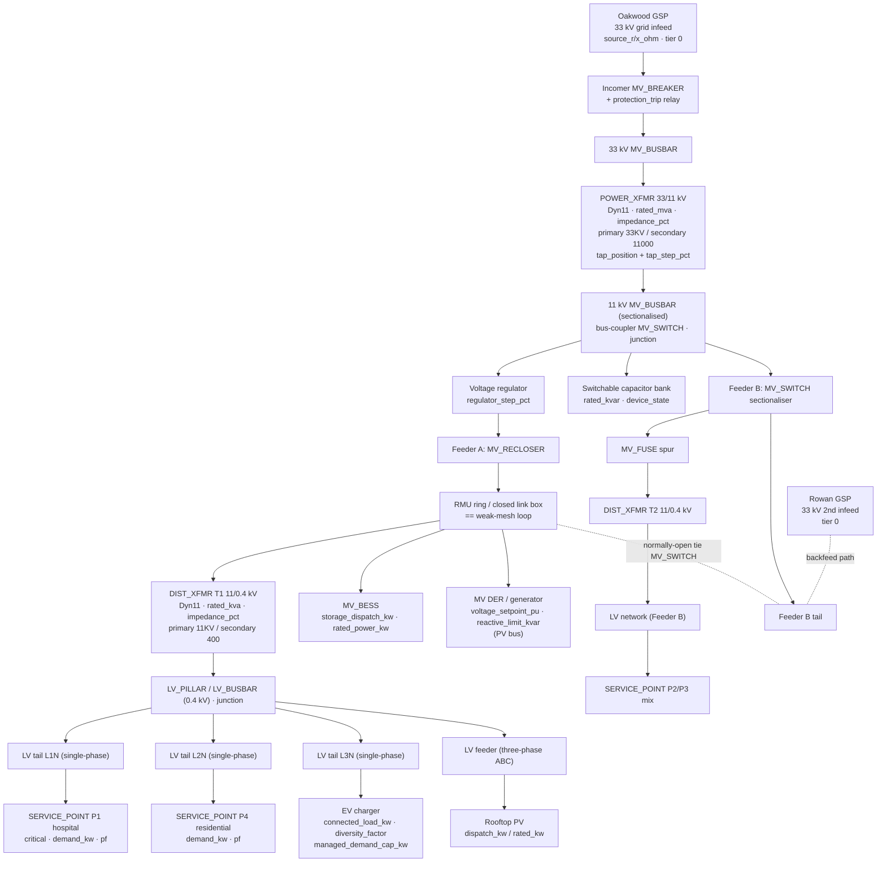
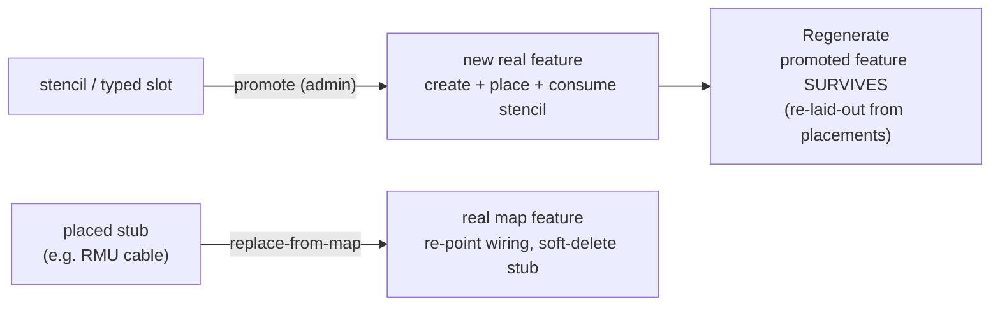
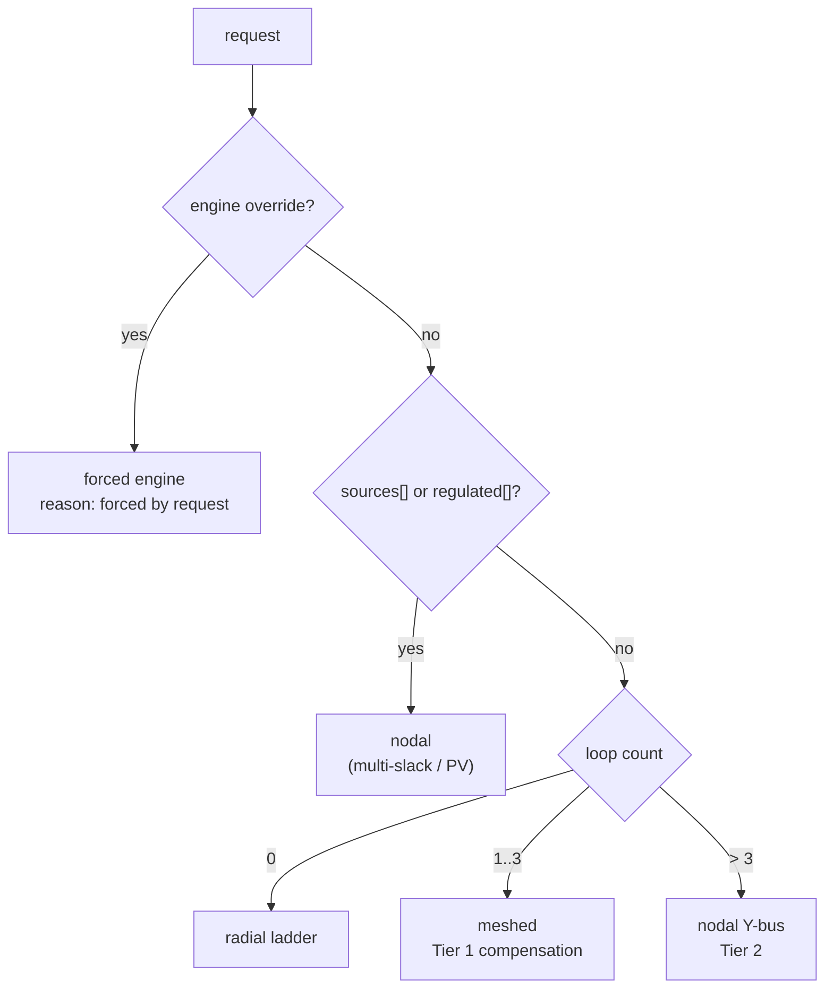

# Book of Tests

A hands-on validation manual for VoltEdge — one chapter to set up, one to build
the reference network, and one per analysis family to test it. Every test uses a
fixed template so nothing is left uncovered, and the chapters run in the order
you actually work: **set up → build → analyse.**

Tests are numbered **by chapter** — Test 3.2 is the second test in Chapter 3, and
the number always tells you where it lives. One test (4.1) is a dated **worked
exercise** with real screenshots and a diagnosis; the rest are reproducible
template cases.

## Contents

1. **How to run a test** — conventions, request grammar, universal pass gates.
2. **The reference test network ("Oakwood 33/11 kV")** — the system every test
   runs against, with schematics and a build sheet.
3. **Building & maintaining the network** — the authoring workflows (create a
   station, draw a feeder, edit a feature, wire connectivity + relationships,
   diagrams, territories, tags, import/export, external systems). Following this
   chapter *builds* Oakwood.
4. **Load-flow analysis** — basic, meshed, nodal, auto, unbalanced, voltage
   profile.
5. **Traces & OMS** — standard, feeder, section, service, supply-path, isolate,
   energization.
6. **Fault & protection** — fault current, SLG, arc flash, coordination,
   ampacity, N-1 contingency (with the back-feed capacity margin), the
   feeder-wide miscoordination sweep, the fuse-saving scheme check, and the
   protection-settings register.
7. **DER & optimization** — hosting capacity, EV hosting, storage dispatch,
   volt-var, tap optimization, VVO, load-growth forecast.
8. **Beyond correctness — the production-readiness tests** — the four things
   Chapters 3–7 do *not* prove: that the numbers are **accurate** (validated
   against a reference, not just "it ran"), that it holds at **scale**, that
   **access control** is enforced, and that it survives **concurrent editing**.
   These are what separate "impressive demo" from "a utility can trust it."
9. **Operational subsystems** — safety (tags/grounds/clearances), FLISR
   restoration, the device-operations log, the land/spatial domain, the
   standalone planned-switching builder, and the abnormal-configuration report.
10. **Asset management & data quality** — asset lifecycle & aging (+ its network
    gate), the asset register / BoQ, the fault-mode catalog, attribute QA, and
    fault location.
11. **Composite units & structures** — the nested packed station, and attaching a
    street light to a pole.
12. **Platform, integration & governance** — edit/view mode, the edit-session
    audit, external-reference integration, and webhooks (inbound + outbound).

- **Appendix A — coverage matrix.**

The spine: **picture it** (Chapter 2) → **build it** (Chapter 3) → **analyse it**
(Chapters 4–7). Run against a seeded dev database or a scratch territory with a
known feeder. Where a test says "MV busbar upstream of the transformer", use a
feature you can point to on the map so the reading is reproducible.

---

# Chapter 1 — How to run a test

Every analysis is an HTTP `POST` under `/analysis`; every trace is a `POST`
under `/trace` (plus the OMS `GET`). Chapter 3's authoring tests are UI gestures
instead. All the read analyses are read-only and never mutate the network —
**except** OMS switching, which is out of scope here. You can drive the analyses
three ways:

1. **From the map UI** — the Analysis / Trace menus build the request for you.
   This is the primary path; screenshots go in the worked exercises.
2. **Raw HTTP** — `POST http://localhost:<port>/analysis/<route>` with a bearer
   token, for exact-input reproducibility and error-string checks.
3. **MCP tools** — only the traces have them (see each test's "MCP" line). **No
   load-flow, fault, or optimization analysis has an MCP tool** — those are
   HTTP-only. This asymmetry is itself worth a regression check.

## Shared request grammar

- **`featureRef`** = `{ "feature_class": "<CODE>", "feature_id": "<uuid>" }`.
  Used for `start`, `source`, `device`, `node`, `tie`, and the `sources[]` /
  `regulated[]` arrays.
- **`nominal_voltage_v`** — required, must be `> 0`, on every analysis. It is the
  voltage held at the start/source, on whatever basis (line-to-line vs
  phase-to-neutral) you consistently choose. Getting it wrong is the #1 cause of
  a nonsense result (see Test 4.1).
- Invalid JSON → `400 "request body is not valid JSON: ..."`. Unknown class →
  `404 "feature class %q does not exist"`. Missing feature → `404`. Soft-deleted
  feature → `400 "... is deleted"`.

## Universal pass gates (apply to every test)

- **P0 — it runs.** A valid request returns `200` with the documented response
  shape, not a `500`.
- **P0 — bad input is rejected with the exact string**, not a panic or a silent
  empty result. Each test lists the strings to provoke.
- **P0 — graceful degradation, not failure.** A missing optional attribute must
  fall to its documented default and set the relevant `*_resolved` / `*_complete`
  flag to `false`, never abort the run. Each test names the flags.

---

# Chapter 2 — The reference test network ("Oakwood 33/11 kV")

Build this **once** and every test in Chapters 3–7 has something to run against.
It is deliberately a complete distribution system — grid infeed → primary
substation → two MV feeders → distribution transformers → LV networks → metered
services — with a ring, a normally-open tie, DER, a capacitor, a regulator, and
a mix of single- and three-phase tails, so that every engine and trace has the
topology it needs. Where a test needs a special feature (a PV bus, a fuse spur),
it is called out in the build sheet and in the coverage map at the end.

Use the existing seed feeder if it already matches; otherwise build Oakwood on a
scratch territory (Chapter 3 walks you through it) so the numbers are stable and
reproducible.

## One-line schematic (rendered)



## One-line schematic (ASCII fallback)

```
  Oakwood GSP (33 kV, tier 0, source_r/x_ohm)
        |
   [MV_BREAKER + protection relay]  <-- coordination top device
        |
   === 33 kV MV_BUSBAR ===
        |
   (POWER_XFMR 33/11 kV, Dyn11, %Z, rated_mva, tap)   <-- SLG vector group, taps
        |
   === 11 kV MV_BUSBAR (sectionalised, bus-coupler switch) ===  [junction]
        |                         |                      |
   [Voltage regulator]      [Switchable cap bank]   (start point for most studies)
        |
   FEEDER A                                  FEEDER B
   [MV_RECLOSER]                             [MV_SWITCH sectionaliser]
        |                                         |
   MV_CONDUCTOR                              [MV_FUSE] spur  <-- coordination pair
        |                                         |
   +--[ RMU ring / closed link box ]--+      (DIST_XFMR T2)
   |    == WEAK-MESH LOOP ==          |           |
   | MV_BESS   MV DER (PV bus)        |       LV network B
   |                                  |       SERVICE_POINT P2/P3
  (DIST_XFMR T1 11/0.4 kV, Dyn11)     |           |
        |                             +...normally-open tie...+
   === LV_PILLAR / LV_BUSBAR 0.4 kV ===  [junction]        :
    |      |      |          |                             :
  L1N    L2N    L3N     three-phase ABC          Rowan GSP (2nd 33 kV infeed)
   |      |      |          |                     ...backfeed path for N-1
 SP P1  SP P4  EV chgr   Rooftop PV
(hosp,  (res)  (managed) (dispatch_kw)
critical)
```

## Build sheet — layer by layer

Set the attributes named; leave the rest to defaults. Coded fields
(`primary_voltage`, `phase`) take domain codes, not free text.

| Layer | Feature(s) | Key attributes to set |
|---|---|---|
| **Infeed** (tier 0) | `GRID_SUPPLY_POINT` × 2 (Oakwood main, Rowan standby) | `source_r_ohm`, `source_x_ohm` (Oakwood non-zero so it sags; Rowan for N-1) |
| **Primary sub 33 kV** | `MV_BUSBAR`, incomer `MV_BREAKER` + its `protection_trip` relay | breaker's relay curve/pickup (coordination) |
| **Primary transformer** | `POWER_XFMR` 33/11 kV | `primary_voltage=33KV`, `secondary_voltage=11000`, `rated_mva`, `impedance_pct`, `x_r_ratio`, `vector_group=Dyn11`, `tap_position`, `tap_step_pct` |
| **11 kV bus** | `MV_BUSBAR` (sectionalised) + bus-coupler `MV_SWITCH` | `network_role=junction`; coupler `device_state` |
| **Voltage control** | voltage regulator on the bus | `regulator_step_pct`, `regulator_tap_position`, `device_state=CLOSED` |
| **Reactive** | switchable `capacitor` bank | `rated_kvar`, `device_state` (leave OPEN so volt-var has a close to evaluate) |
| **Feeder A** | `MV_RECLOSER`, `MV_CONDUCTOR` sections (with material spec), RMU **closed** ring / link box | conductor material (per-km R/X, ampacity), real geometry length; ring closed = weak mesh |
| **Feeder B** | `MV_SWITCH` sectionaliser, `MV_FUSE` spur, `MV_CONDUCTOR` | fuse rating (coordination) |
| **Tie** | `MV_SWITCH` between Feeder A tail and Feeder B tail | `device_state=OPEN` (normally-open — contingency + closable loop) |
| **MV DER** | `MV_BESS`, one DER/generator | BESS `storage_dispatch_kw` + `rated_power_kw`; generator `voltage_setpoint_pu` + `reactive_limit_kvar` (PV bus) |
| **Distribution xfmrs** | `DIST_XFMR` T1 (Feeder A), T2 (Feeder B) | `primary_voltage=11KV`, `secondary_voltage=400`, `rated_kva`, `impedance_pct`, `x_r_ratio`, `vector_group=Dyn11` |
| **LV networks** | `LV_PILLAR`/`LV_BUSBAR` (junction), `LV_CONDUCTOR` tails | conductor `phase` codes: L1N / L2N / L3N single-phase tails + one three-phase (ABC or L1L2L3N); material spec (Tier-2 needs line geometry PosAX…) |
| **Services** | `SERVICE_POINT` × several | `demand_kw`, `power_factor`, `load_priority` P1 (hospital, critical) / P2 / P3 / P4 (residential) |
| **LV DER / load** | EV charger node, rooftop PV | EV: `connected_load_kw`, `diversity_factor`, `managed_demand_cap_kw`; PV: `dispatch_kw` or `rated_kw` |

**Trace-tier sanity:** after seeding, the classes should already carry
`trace_tier` (0 GSP · 200 POWER_XFMR · 300 MV · 400 DIST_XFMR · 500 LV · 600
service/meter), so DOWNSTREAM/UPSTREAM traces respect the source-to-load
hierarchy. Structural/off-path devices (relays, CT/VT) stay untiered/transparent.

## Which region drives which test

| Region of Oakwood | Enables tests |
|---|---|
| GSP → POWER_XFMR → 11 kV bus → Feeder A → T1 → LV → services (radial) | 4.1, 4.2, 4.7 (load flow, voltage profile), 5.1–5.4 (traces), 6.1–6.5 (fault/coordination/ampacity), 7.7 (load-growth forecast) |
| RMU **closed** ring on Feeder A | 4.3 (meshed), and 4.4/4.5 when you make it dense |
| Two GSPs + normally-open tie | 4.4 (multi-slack nodal), 6.6 (N-1 contingency), 4.5 (auto → nodal) |
| Phase-coded LV tails (L1N/L2N/L3N + 3-ph) | 4.6 (unbalanced Tier 1; Tier 2 once LV geometry is filled) |
| MV_FUSE spur under the MV_RECLOSER, under the incomer breaker | 6.4 (coordination — three graded devices in series) |
| Switchable capacitor (OPEN), regulator, MV_BESS, DER PV bus | 7.1–7.6 (hosting, EV, storage, volt-var, tap-opt, VVO) |
| POWER_XFMR/DIST_XFMR `vector_group=Dyn11` + earthing | 6.2 (SLG) |
| MV switchgear panel | 6.3 (arc flash) |
| Any OMS incident opened on Feeder A | 5.7 (energization), 5.5/5.6 (supply-path, isolate) |

**Minimum viable build** if you only want the load-flow family working first:
GSP → POWER_XFMR → 11 kV bus → one MV feeder → one DIST_XFMR (with both voltage
fields) → LV pillar → a few phase-coded tails → services with `demand_kw`. That
alone runs Tests 4.1–4.2, 4.6–4.7, and 5.1–5.4. Add the ring for 4.3, the second
GSP + tie for 4.4/6.6, and the DER for Chapter 7.

> **On the image:** the Mermaid block above renders as a real diagram in the
> in-app documentation viewer; the ASCII fallback is there for plain-text/diff
> contexts. If you want a polished single-line for a report, build Oakwood, then
> use the diagram **Print** engine (Test 3.11) to export the auto-generated
> single-line to PDF.

---

# Chapter 3 — Building & maintaining the network

Chapters 4–7 need Oakwood to exist. This chapter **builds it, in order**, and
each step doubles as a test of an authoring workflow. Follow the tests
top-to-bottom on a scratch territory and you finish with the reference network
drawn, wired, diagrammed, and tagged — ready to analyse. The last test (3.16,
bulk wipe) is the teardown, so the whole build is repeatable.

Template here is gesture-first: **Purpose → Preconditions → Steps (the gesture)
→ Expected / pass criteria → Failure modes.** These are UI-driven, so "run" means
the on-map or admin gesture, not an HTTP body. Permissions matter — each test
names the permission the gesture needs.

## Test 3.1 — Create the Oakwood territory

**Purpose:** Stand up the scratch territory everything else is built in; exercise
territory create / edit / reparent. Permission: `territories:write`.

```
  Region
   +-- Oakwood  (new, top-level)        rename + reparent inline
        +-- per-class feature counts appear in the Territory Explorer tree
  inspect-lock (i): boundary overlay still draws, click no longer opens the panel
```

**Steps**
1. Create a top-level territory "Oakwood" (Territories admin or the map
   Territories panel).
2. Rename it inline from the map territory panel (attribute edit, not boundary
   edit) and reparent it under a region.
3. Toggle the boundary **inspect-lock** (the trailing `i` on the Layers-panel
   Territories row) and confirm a click no longer opens the read-only panel while
   the overlay still draws.

**Expected / pass criteria**
- The territory appears in the Territory Explorer tree (`GET /territories/mine`)
  with per-class counts (zero for now).
- Inline rename + reparent persist; **level is not editable anywhere** (by
  design — the PATCH has no level field).
- Inspect-lock mutes the click-panel but keeps the boundary overlay + labels.

**Failure modes**
- Editing without `territories:write` → the edit form is hidden / rejected.
- Reparent choices should only offer one-rank-above candidates.

## Test 3.2 — Create a single feature

**Purpose:** The atomic authoring gesture — draw one feature on the map and prove
required-attribute enforcement. Build the **Oakwood GSP** here. Permission:
`features:write`.

**Preconditions:** the class carries subtype rules that mark some fields required
(the asterisks come from **subtype rules, not DB-nullable** — a class with no
subtype rule shows no asterisks).

```
  New feature -> pick class (GRID_SUPPLY_POINT) -> draw geometry -> create form
     required fields (from SUBTYPE RULES) show *  ->  blank * BLOCKS save
     date/timestamp field set to the future     ->  REJECTED (max + onChange)
     valid save -> feature drawn + selectable, attributes round-trip
```

**Steps**
1. New feature → pick the class (e.g. `GRID_SUPPLY_POINT`) → draw its geometry.
2. Fill the create form; leave a required field blank and try to save.
3. Set a date/timestamp field to a **future** date.
4. Save with everything valid; set `source_r_ohm` / `source_x_ohm`.

**Expected / pass criteria**
- Blank required field blocks save with the asterisked field flagged.
- Future date is rejected inline (the app-wide future-date guard on date/timestamp
  inputs — `max` + onChange).
- On save the feature is drawn and selectable; attributes round-trip.

**Failure modes**
- A subtype whose `subtypes.code` was seeded as text instead of `(int, slug)`
  silently skips its rules → no asterisks + a DB not-null error on save. If you
  see that, the subtype seed is malformed (known class of bug).

## Test 3.3 — Create the primary substation from a template

**Purpose:** Build the 33/11 kV primary sub from a built-in **substation
single-line template** with typed slots; exercise template apply. Permission:
`metadata:write` for admin templates / `features:write` to place.

```
   33 kV incomers ==[ MV_BUSBAR ]==
        |                       |
   (POWER_XFMR bay 1)     (POWER_XFMR bay 2)     typed slots (slot_class):
        |                       |                  MV_BUSBAR / POWER_XFMR /
   ==[ 11 kV BUSBAR ]==[coupler]==[ 11 kV BUSBAR ]==   MV_SWITCHGEAR_PANEL
        |    |                     |    |
      feeders                    feeders          SUBSTATION x ONE_LINE allowlist
                                                  UNCONSTRAINED -> no slot skipped
```

**Steps**
1. Apply the "33/11 kV substation" template (or "Switching station (33 kV)") to a
   `SUBSTATION` container.
2. Fill the **typed slots** (`slot_class` MV_BUSBAR / POWER_XFMR /
   MV_SWITCHGEAR_PANEL) by binding existing features or **promoting** a slot into
   a new feature (Test 3.10).
3. Set the POWER_XFMR fields: `primary_voltage=33KV`, `secondary_voltage=11000`,
   `rated_mva`, `impedance_pct`, `vector_group=Dyn11`, taps.

**Expected / pass criteria**
- Template lays out incomers → transformer bays → sectionalised 11 kV bus +
  coupler + feeders.
- The SUBSTATION × ONE_LINE allowlist is **unconstrained** for these slot classes
  — no silent slot-skip.

**Failure modes**
- A slot class outside the allowlist would silently skip — confirm every slot
  binds.

## Test 3.4 — Create an assembly with fan-out (RMU) + auto single-line

**Purpose:** Build the Feeder-A RMU ring from the **fan-out assembly** engine and
confirm it auto-generates a fully-placed single-line on create. Permission:
`features:write`.

```
        ┌─ way1 ─[switch]─┐
  cable ─┤    busbar      ├─ way2 ─[switch]─ ...      bus = one-way sink
        └─ way3 ─[switch]─┘
  ring CLOSED -> weak-mesh loop (Test 4.3); each cable side gets a
  geometry-less MV_CONDUCTOR (T1); auto single-line placed on create
```

**Steps**
1. New feature → Assemblies → RMU (WAYS_n) → place.
2. Confirm the fan-out creates the ways, busbar, switches, **and** a
   geometry-less MV_CONDUCTOR on each cable side (T1).
3. Open the auto-generated diagram; hit **Regenerate** and confirm it rebuilds
   from the source template + current placements.
4. Build the LV pillar assembly (LV_PILLAR + LV_FUSE, WAYS_n) for the LV side.

**Expected / pass criteria**
- Assembly appears wired, with a placed single-line, **zero manual binding**.
- Regenerate is idempotent (same layout from the source template).
- The RMU ring left **closed** gives the weak-mesh loop Test 4.3 needs.

**Failure modes**
- If MV_CONDUCTOR isn't `geometry_optional` + compiled, the cable fan-out step
  fails — that class must be compiled first.

## Test 3.5 — Draw the MV/LV network (conductors + snapping)

**Purpose:** Draw the feeders connecting substation → RMU → transformers → LV,
and prove snapping + the edit-lock guard. Permission: `features:write`.

```
  bus O----snap----> draw MV_CONDUCTOR   (start snaps to the busbar vertex)
      save -> IMMEDIATELY draw a 2nd conductor snapping to the 1st (no pan!)
              snap source rebuilds on tileloadend, not only on moveend
  while EDITING a geometry: New / Assemblies / Annotate menus are DISABLED
              (no two OpenLayers interactions fighting over the same click)
```

**Steps**
1. Draw an `MV_CONDUCTOR` from the 11 kV bus; snap its start to the busbar.
2. Save it, then **immediately** draw a second conductor snapping to the *just-
   drawn* first one — without panning.
3. While mid-edit of an existing feature's geometry, try to arm a **new** draw
   from the New-feature / Assemblies / Annotate menus.

**Expected / pass criteria**
- Snap to the just-saved feature works immediately (the snap source rebuilds on
  `tileloadend`, not only on pan) — this is the fixed snap-to-just-drawn bug.
- The three draw menus are **disabled while editing** (draw-blocked-while-editing
  fix) — you can't have two OpenLayers interactions fighting over clicks.

**Failure modes**
- If a fresh draw arms mid-edit, the guard regressed.
- If you must pan before snapping to a new feature, the tileloadend rebuild
  regressed.

## Test 3.6 — Edit a feature

**Purpose:** Change attributes and geometry on an existing feature; set the loads
that make the analyses non-trivial. Permission: `features:write`.

```
  SERVICE_POINT:  demand_kw=? , power_factor=? , load_priority=P1..P4
        inline edit round-trips -> shows in the Service rollup as kW / kVA
  conductor: drag a vertex -> length changes -> impedance + ampacity update
        (this is the prerequisite that makes Test 4.1/4.2 non-flat)
```

**Steps**
1. Inline-edit a `SERVICE_POINT`: set `demand_kw`, `power_factor`,
   `load_priority` (P1 hospital … P4 residential).
2. Edit a conductor's geometry (move a vertex) and save.
3. Confirm the Service trace (Test 5.4) reflects the new `demand_kw`.

**Expected / pass criteria**
- Attribute edits round-trip; the load shows up in the Service rollup as kW/kVA.
- Geometry edit persists; conductor length (hence impedance/ampacity) updates.

**Failure modes**
- Editing service loads is the prerequisite for Test 4.1/4.2 — a flat load flow
  means this step wasn't done.

## Test 3.7 — Establish connectivity (terminals)

**Purpose:** Wire two features together through their terminals and prove the
connectivity engine matches by terminal **code**. Permission: `features:write`.

```
  A class can hold >1 terminal row for the SAME code:
    code "T1":  row a  subtype = NULL  (generic)   <- a rule may pin THIS uuid
                row b  subtype = 17    (override)   <- resolved at runtime
  Engine matches by CODE "T1" (not uuid) -> the rule still applies to row b
  (subtypes still id-matched). A uuid mismatch here = "no network rule permits..."
```

**Steps**
1. Use the connect tool from a feature panel to connect an `LV_CONDUCTOR` (T1) to
   a `SERVICE_POINT` terminal.
2. Connect an MV feature whose class holds **more than one terminal row per code**
   (a generic subtype-null terminal plus subtype overrides).
3. From the feature panel Terminals list, click a row (locates the counterpart
   with the emerald peek halo) and use the `i` button to open its panel.

**Expected / pass criteria**
- A valid connection permitted by a network rule succeeds.
- The multi-terminal-row case connects — the fix matches terminals **by code**
  via `TerminalByID` (subtypes still id-matched), so authored-uuid ≠ resolved-uuid
  no longer breaks it.
- Terminals-list row click **locates** (peek halo), `i` **opens** — they're
  distinct gestures.

**Failure modes**
- A connection that *should* be legal failing with **"no network rule permits
  this connection"** despite a visibly-correct rule is the terminal-code-match
  regression (`connectivity/rules.go` + `sql.go`).

## Test 3.8 — Establish relationships

**Purpose:** Create the non-connectivity relationships — accounting and composite
part-of. Permission: `features:write`.

```
  NETWORK_METER --[metering_accounting]--> DIST_XFMR / MV_BUSBAR / MV_CONDUCTOR
        off-path: no terminals, network_role=none -> never a conductive trace node
  TAP_CHANGER  --[part-of]--> POWER_XFMR
        asset/device only; the LIVE electrical tap stays on the POWER_XFMR
        (CIM export renders it as a RatioTapChanger 'asset')
```

**Steps**
1. Create a `NETWORK_METER` and relate it to a metered element (DIST_XFMR /
   MV_BUSBAR / MV_CONDUCTOR …) via the **metering_accounting** relationship kind.
2. Add a `TAP_CHANGER` as a composite **part-of** a POWER_XFMR (the live
   electrical tap stays on the POWER_XFMR — the tap changer is the asset/device).

**Expected / pass criteria**
- The metering_accounting relationship is permitted by its 3-place allowlist;
  the meter is off-path (no terminals, `network_role=none`) so it never appears
  in a trace as a conductive node.
- The part-of relationship holds; CIM export later renders the tap changer as a
  RatioTapChanger 'asset'.

**Failure modes**
- A relationship kind not in the allowlist is rejected — confirm the error names
  origin/dest/kind.

## Test 3.9 — Validate against rules & clean duplicates

**Purpose:** Prove the three rule families gate authoring, and the admin
duplicate-remover. Permission: `features:write` to author; `metadata:write` for
the Rules admin.

```
  three rule families gate authoring:
     Network       can A-terminal connect to B-terminal?     illegal -> rejected
     Relationship  can A relate to B by kind?                order-independent key
     Snapping      can A snap to B?
  admin Rules page: "Remove N duplicates" per section
     (a bidirectional net rule authored twice / reversed = ONE duplicate)
```

**Steps**
1. Attempt an illegal connection (no network rule) → confirm rejection.
2. Attempt an illegal relationship / a snap that violates a snapping rule.
3. In the admin feature-class **Rules** page, seed a duplicate rule in each
   section (Network / Relationship / Snapping) and use **"Remove N duplicates"**.

**Expected / pass criteria**
- Illegal connection → **"... no network rule permits this connection"**.
- The duplicate detector flags dups in **all three** sections (Network is order-
  independent on eps+phase+valid; Relationship on origin|dest|kind|cardinality;
  Snapping on the full tuple) and the button removes them via the per-row DELETE.

**Failure modes**
- A bidirectional network rule authored twice (reverse orientation) must be seen
  as a duplicate, not two rules.

## Test 3.10 — Build the single-line diagram

**Purpose:** Turn map features into a diagram and exercise the stencil workflows.
Permission: `metadata:write` for promote/replace (admin-gated), `features:write`
to place.



```
  ASCII fallback:  stencil/slot --promote(admin)--> real feature (create+place+consume)
                   placed stub  --replace-------> real map feature (re-point, del stub)
                   Regenerate -> promoted feature survives
```

**Steps**
1. Place Oakwood features on a new ONE_LINE diagram.
2. **Promote** a typed slot / decorative stencil into a real permanent feature
   (create-only, no auto-wiring) via the SlotBindPanel "Create new" action.
3. **Replace from map**: overwrite a placed stub (e.g. an RMU cable) with a real
   map feature (same-class re-point of placements/connectivity/relationships,
   then soft-delete the stub).
4. **Regenerate** the assembly diagram and confirm the promoted feature survives.

**Expected / pass criteria**
- Promote is atomic (create → place → consume stencil) and **admin-only** to
  invoke; the new feature persists across reload and regenerate.
- Replace re-points wiring by feature_id and drops the stub without orphaning
  connections.

**Failure modes**
- A non-`metadata:write` user must not see "Create new" / double-click-promote;
  a direct promote call returns 403.

## Test 3.11 — Diagram presentation (tree/table + print)

**Purpose:** Read a diagram/result as a tree and export a drawing sheet.
Permission: read.

```
  result panel:  [ Table | Tree ]     tree built CLIENT-SIDE from parent_feature_*
      root
       +-- node
       |    +-- child          orphans reparent under root; cycles guarded
       +-- node
  Printer -> vector PDF (clone of live SVG, mm sheet + title block, no drift)
```

**Steps**
1. On a trace or load-flow result panel, toggle **Table | Tree**; expand/collapse.
2. On a placed single-line, use the toolbar **Printer** → export a vector PDF.

**Expected / pass criteria**
- Tree view builds client-side from `parent_feature_*`; orphans reparent under
  root, cycles are guarded.
- Print produces a light-palette mm-sheet PDF with title block + footer (a clone
  of the live SVG — no server round-trip, no drift).

**Failure modes**
- KMZ can't reproject (WGS84-locked) — not a print issue but the same "some
  formats are constrained" caveat applies (Test 3.14).

## Test 3.12 — Asset tags lifecycle

**Purpose:** Attach and transition an asset tag through its lifecycle.
Permission: `asset-tags:write` (or as configured).


```
  ASCII fallback:  Draft --assign--> Active (OLD-4471 -> VE-7Q3K2) --> Retired
  filter/search features by tag; a non-terminal tag still resolves on the panel
```

**Steps**
1. Apply an asset tag to a feature (e.g. migrate an old code OLD-4471 → VE-7Q3K2).
2. Move it through its lifecycle states.
3. Filter/search features by tag.

**Expected / pass criteria**
- Tag attaches, transitions, and is queryable; see `docs/asset-tags-guide.md` for
  the lifecycle diagram and the MCP tools.

**Failure modes**
- A tag left in a non-terminal state should still resolve on the feature panel.

## Test 3.13 — Import with reprojection

**Purpose:** Bring features in from a file in a non-native CRS and confirm
reprojection. Permission: import.

```
  file (source CRS, e.g. a national-grid EPSG)
      --> ST_Transform on ingest --> storage CRS --> overlays correctly on basemap
  wrong source SRID picked -> features land OFFSET (confirm the CRS matched file)
```

**Steps**
1. Import a Shapefile/DXF/CIM in a projected CRS (e.g. a national grid EPSG).
2. Confirm geometry lands in the right place (PostGIS `ST_Transform` on ingest).

**Expected / pass criteria**
- Imported features overlay correctly on the basemap — the import reprojection
  engine transformed source CRS → storage CRS.

**Failure modes**
- Wrong source SRID → features land offset; confirm the CRS picker matched the
  file.

## Test 3.14 — Export jobs & CIM/DXF with target CRS

**Purpose:** Export the network, background/reopen the job, and reproject on the
way out. Permission: export.

```
  scope --> export JOB (async ops.export_jobs) --> DXF / Shapefile / CIM
      target CRS (catalog SRID) applied via ST_Transform, ONE CRS per job
      CIM: crsUrn=...EPSG::N    Shapefile: .prj    KMZ: WGS84-LOCKED (no target)
  close panel -> job keeps running -> reopen (toolbar) re-fetches per-user history
```

**Steps**
1. Export a scope as DXF / Shapefile / CIM with a **target CRS** picked from the
   CRS groups.
2. Close the Export Jobs panel, then **reopen** it from the map-toolbar
   ListChecks button; confirm the job kept running (async `ops.export_jobs`) and
   history re-fetches.
3. Inspect the output: CIM carries `crsUrn=urn:ogc:def:crs:EPSG::N`; Shapefile has
   a `.prj`.

**Expected / pass criteria**
- Reprojection applies to DXF / Shapefile / CIM (via `ST_Transform`); one CRS per
  job, catalog SRIDs only.
- Reopening the panel shows the server-owned per-user job history + active badge.

**Failure modes**
- **KMZ is WGS84-locked** — it must not offer a target CRS. A non-reprojectable
  format + a target SRID should be rejected at enqueue (`reprojectableFormats`
  gate).

## Test 3.15 — External systems (feature data links)

**Purpose:** Catalogue an **external system** and attach a **live-data link** to a
feature; confirm the feature panel's **External systems** tab fetches and renders it,
and that the SSRF proxy + auth behave. Permissions: **`metadata:write`** (catalog),
**`features:write`** (add a link), **`features:read`** (view).

**Preconditions:** a mock HTTP endpoint returning JSON at a **public** URL (the proxy
refuses loopback/private — tunnel a local mock); `EXTERNAL_SYSTEMS_ENCRYPTION_KEY` set
**only** if you use an authenticated system.

```
  admin: catalogue system {base_url/, auth, format}   (metadata:write)
  feature: add API link -> system + resource_path       (features:write)
  panel "External systems" tab -> server-side fetch base_url+path -> read-only data card
  base_url on localhost/private -> REFUSED (SSRF) ;  non-2xx upstream -> error on the card
```

**Steps**
1. **Catalogue** (Admin → External systems, or `POST /external-systems`): create a
   system — `code`, `name`, `base_url` **with a trailing slash**, `auth_type=none`,
   `response_format=json`.
2. **Link** on a feature's **External systems** tab (or `POST /feature-links`): add a
   `kind=api` link → the system's `system_id` + a `resource_path` (e.g. `customer/42`).
   Also add a plain **hyperlink** link and confirm it opens in a new tab.
3. **View:** open the feature → **External systems** tab → the API link renders as a
   **data card** carrying the mock's fields.
4. **Provoke:** point `base_url` at `localhost`/a private IP and re-view → the card
   must show a "not a public address" / unreachable **error**, not a crash.

**Expected / pass criteria**
- The API link **fetches server-side** and shows the external record read-only;
  nothing is written into VoltEdge or the external system. The hyperlink opens a new
  tab (no fetch).
- A credential, if set, is **write-only** — the catalog returns only `has_credential`,
  never the secret.
- A `localhost`/private `base_url` is **refused by the SSRF proxy**; a non-2xx or
  unreachable upstream surfaces as an error on the card.

**Failure modes**
- `metadata:write` absent → cannot catalogue; `features:write` absent → cannot add a
  link.
- `base_url` **without** a trailing slash drops the last path segment (RFC join) — the
  usual "wrong URL" surprise.
- Storing a credential with `EXTERNAL_SYSTEMS_ENCRYPTION_KEY` unset is refused.

---

## Test 3.16 — Bulk wipe (nuke) — teardown

**Purpose:** Clear a class (or the whole scratch build) so the exercise is
repeatable. Permission: **`features:wipe`** (admin-only), territory-scoped.

```
  class wipe (nuke):   step 1 SOFT-DELETE  -->  step 2 PURGE
      scoped to (territory x class); after purge, analyses/traces return
      EMPTY (not errors); no features:wipe -> cannot invoke; never crosses scope
```

**Steps**
1. In the Features browser, pick a class and run the class **wipe ("nuke")**.
2. Confirm the two-step: soft-delete first, then purge.

**Expected / pass criteria**
- Wipe is scoped to the selected territory and class; soft-then-purge is a
  deliberate two-step.
- After purge, the analyses/traces on that class return empty, not errors.

**Failure modes**
- A user without `features:wipe` cannot invoke it; the wipe must not cross
  territory scope.

---

# Chapter 4 — Load-flow analysis

Six engines share one demand model and (mostly) one graph walk. Read Test 4.1
first — it is the worked example for the whole chapter and explains the
transformer voltage-base gotcha every one of these inherits.

**Shared demand attributes** (read off any node by
`api/internal/powerflow/resolve.go`, field-driven — no class hardcoding):

| Attribute | Meaning | Default when absent |
|---|---|---|
| `demand_kw` | real-power load (kW) | 0 → node contributes nothing |
| `power_factor` | load/gen pf → `Q = P·tan(acos(pf))` | **1.0** (unity, Q=0) |
| `connected_load_kw` + `diversity_factor` + `managed_demand_cap_kw` | EV managed charging; effective = `min(cap, connected·diversity)`, wins over `demand_kw` | diversity **1.0**, no cap |
| `dispatch_kw` else `rated_kw` | generation, netted as **negative** demand | 0 |
| `rated_kvar` | capacitor kVAR (switched needs `device_state=CLOSED`) | fixed bank always on |
| `storage_dispatch_kw` | BESS **signed** injection (+discharge/−charge) | 0 (idle) |
| `regulator_step_pct` (+ `regulator_tap_position`, `device_state`) | series regulator ratio `1 + pos·step/100` | off if absent |
| `primary_voltage` (coded VOLTAGE_CLASS) + `secondary_voltage` (volts) | transformer turns ratio `secondary/primary` | pass-through if either missing |
| `impedance_pct` + `x_r_ratio` | transformer %Z, X/R | X/R **2.0**; no through-drop if no %Z |
| `rated_kva` / `rated_mva` | transformer rating (for loading %) | no loading % if absent |
| `tap_position` + `tap_step_pct` | LV-side tap `1 + pos·step/100` | **1** (nominal) |
| `source_r_ohm` + `source_x_ohm` | source impedance (meaningful only on start) | 0 (ideal stiff source) |
| conductor material (via domain-linked spec field) | per-km R/X × `ST_Length(geom::geography)` | `material_resolved=false`, zero drop |

**Shared start-point gotcha (all six):** if the start node **is** a transformer,
the `n == start` branch takes `nominal_voltage_v` as-is and **does not apply the
step-down ratio** — you must then pass the LV secondary as `nominal_voltage_v`.
Start **upstream** of the transformer to have the ratio applied automatically.

**Shared barriers:** open devices from the `trace_barrier_rules`
(DIST_SWITCH / SERVICE_CUTOUT / LV_LINK_BOX on `device_state = OPEN`) stop the
walk and appear in `barriers[]`. If those rules are unseeded, the walk proceeds
optimistically with no barriers.

## Test 4.1 — LV service load flow through a distribution transformer (worked exercise)

**Date:** 2026-09-30
**Feature under test:** Service Point `eb9f6b0f…` on a single-phase L2N LV tail
(overhead ABC_95) fed from a Distribution Transformer `3afee5e0…` via three
LV Conductor segments.
**Goal:** Confirm that, once a service point carries a real load, a load flow
reports realistic LV voltages and conductor loading end-to-end through the
transformer.

### Setup

1. Set the load on the service point (the load-flow engine reads these off a
   `SERVICE_POINT` — see `api/internal/powerflow/resolve.go`):
   - `demand_kw` — real-power load, kW. Zero/absent → the node contributes
     nothing (a load flow comes back flat).
   - `power_factor` — optional; missing or out of `(0,1]` defaults to **1.0**
     (unity, no reactive draw). Reactive power `Q = P·tan(acos(pf))`.
   - Test value used: `demand_kw = 40`, which registered as **40 kW · 42 kVA**
     in the Service trace, one customer, tier **P4**.
   - NOTE: 40 kW for a single P4 residential is unrealistically high (typical is
     2–5 kW after diversity). Fine as a stress value; revisit before judging any
     overload as real.

2. Run the load flow.

### First run (INCORRECT setup) — the 11 kV symptom

Started the load flow **at the Distribution Transformer** with
`nominal_voltage_v = 11000`.

Result — every node reported at 11 kV:

| Feature | Voltage | Current | Loading |
|---|---|---|---|
| Distribution Transformer (Start) | 11,000.0 V | — | — |
| LV Conductor (3) | 11,000.0 V | 3.8 A | 1.6% |
| LV Conductor (2) | 10,999.9 V | 3.8 A | 1.6% |
| LV Conductor (1) | 10,999.9 V | 3.8 A | 1.6% |
| Service Point | 10,999.9 V | — | — |

**Diagnosis — study-setup issue, not data.** When the start node **is** the
transformer, the engine deliberately does *not* apply the step-down ratio; it
takes the supplied `nominal_voltage_v` as the LV sending-end voltage as-is
(`api/internal/powerflow/sweep.go`, the `n == start` branch). So the entire LV
feeder was solved at 11 kV. The tell: 40 kW at 11 kV, pf 0.95 → `I ≈ 40000 /
(11000 × 0.95) ≈ 3.8 A` — exactly what was shown, hence the fictional 1.6%
loading. At true LV (230 V single-phase) the same 40 kW draws ~180 A.

```
  WRONG — start AT the transformer:        RIGHT — start UPSTREAM (Option B):

  [DIST_XFMR]  start, nom=11000            MV bus   start, nom=11000  (11 kV)
       |  (ratio NOT applied)                 |
  LV cond .... 11,000 V                    [DIST_XFMR]  ratio 400/11000 APPLIED
       |       (11 kV everywhere)              |  (steps down)
  Service Pt . 11,000 V   << wrong         LV cond .... ~400 V base
                                              |
                                           Service Pt . ~230 V (L2N)  << right
```

### Correct setup (Option B) — start upstream, let the transformer step down

Model the step-down physically by starting on the MV side so the sweep crosses
the transformer mid-tree (`sweep.go`, the `st.xfmr.ok` branch applies
`ratio = secondaryV / primaryV` and hands the secondary base down).

**Prerequisite — the DIST_XFMR must carry both voltage fields**
(`resolve.go`, `resolveTransformerModel`); if either is missing the sweep falls
to pass-through and the 11 kV symptom returns:
- `primary_voltage` — coded `VOLTAGE_CLASS` string, e.g. `11KV`.
- `secondary_voltage` — plain volts, e.g. `400` (line-to-line for a 400/230 LV
  system; the 230 V L2N phase-to-neutral rides on that base).

**Steps**
1. Confirm/set the two transformer fields above (`secondary_voltage = 400` is
   the most likely gap).
2. Select the **MV busbar or MV conductor immediately upstream** of the
   transformer as the start (the HV side, not the transformer itself).
3. Run the load flow with `nominal_voltage_v = 11000`.

**Expected (pass criteria)**
- Transformer node + MV side: ~11 kV.
- LV conductors + service point: **~400 V base** (NOT 11 kV).
- LV conductor current: **~170–180 A** on the single-phase tail; loading well up
  from 1.6%.
- Service-point voltage: read in pu; flag anything below ~0.94 pu on the L2N
  spur (single-phase LV tails are the usual voltage-drop offenders).

**Status:** Option B run pending — record the service-point pu voltage and the
ABC_95 loading here when run, and judge the L2N tail (healthy vs. needs a bigger
conductor / shorter spur / phase rebalance). Re-check with a realistic
`demand_kw` before calling any overload real.

### Takeaways

- A load flow needs `demand_kw` on the service points or it is a no-op.
- Start point choice sets the voltage base: starting **at** a transformer skips
  its ratio (you must then supply the LV secondary as `nominal_voltage_v`);
  starting **upstream** of it applies the ratio and steps down automatically.
- The step-down depends on the transformer carrying both `primary_voltage`
  (coded) and `secondary_voltage` (volts). Missing either → silent pass-through.

## Test 4.2 — Basic radial load flow

**Purpose:** Kersting forward-backward sweep on a radial feeder — per-node
voltage and per-branch loading. `runLoadFlow` / `sweep.go`.
**Endpoint:** `POST /analysis/load-flow`. **MCP:** none.

```
  source --c1-- (T) --c2-- c3-- SP     radial "ladder": one path to every node
  (start)       xfmr                   V steps down each branch + across (T)
  backward sweep sums load upward; forward sweep drops V downward; repeat x3
```

**Preconditions**
- A radial feeder from a source down to loaded service points (Test 4.1 topology).
- `demand_kw` set on at least one downstream node (else the run is flat).
- If the study is to cross a transformer, the transformer carries
  `primary_voltage` + `secondary_voltage` (Test 4.1 prerequisite).

**Run (inputs):** `{ start, nominal_voltage_v }`. Start **upstream** of any
transformer; choose `nominal_voltage_v` to match the start's real base.

**Expected / pass criteria**
- `200` with `iterations = 3`, `nodes[]`, `barriers[]`, `overloaded[]`.
- Voltages step **down** with distance and across each transformer to its
  secondary base; each node's `voltage_drop_pct` is against its **own**
  `nominal_base_v`, so an LV node reads a small drop, not ~95%.
- Edge nodes carry `current_amps` + `ampacity_amps` + `loading_pct`; rated
  junctions (transformers) carry `rated_kva` + `loading_pct`. A node is never
  both.
- Any node over 100% loading also appears in `overloaded[]`.
- `material_resolved=false` on conductors whose material/length/spec didn't
  resolve — those branches show zero drop but the run still completes.

**Failure modes to check**
- **Not radial:** introduce a second path to a visited node → `400 "the network
  downstream of the start feature is not radial (loop/mesh detected ...) -- load
  flow requires a tree, run LOOP_CHECK_TRACE first ..."`. A *false* mesh (one
  adjacency on two connectivity rows, a busbar wired via two terminals, an edge
  kept both orientations) must **not** trip this — buildTree's `seenNeighbor`
  dedupe + skip-reverse-edge + tier guard collapse the artifact.
- **11 kV-everywhere:** wrong `nominal_voltage_v`, or start-at-transformer, mis-
  bases the whole tree (Test 4.1).
- **Missing-attribute degradation:** pf→1.0, X/R→2.0, tap→1, no %Z → ideal ratio
  no through-drop, no rating → no loading %. None of these should error.

## Test 4.3 — Meshed load flow (weak-mesh compensation)

**Purpose:** Solve a radial spanning tree, then close each ring/link-box loop by
circulating-power compensation. `runMeshLoadFlow` / `mesh.go`.
**Endpoint:** `POST /analysis/meshed-load-flow`. **MCP:** none.

```
        +-- c2 (tree path) --+
  src --+                    +-- load
        +-- c3 (loop closer)-+
  buildTree keeps ONE path radial; the other edge is the "closer",
  reconciled by circulating power until endpoint mismatch < 1e-4 V
```

**Preconditions**
- A weakly-meshed feeder: a normally-**closed** ring or a closed link box giving
  1–3 loops. (A normally-open tie stays open — see below.)

**Run (inputs):** `{ start, nominal_voltage_v, max_iterations? }`. `max_iterations`
overrides the compensation-pass cap (default `meshCompIterations = 25`).

**Expected / pass criteria**
- `200` with `compensation_passes`, `loop_count`, `loops[]` (each: `closer`,
  `existing`, `loop_resistance_ohm`, `loop_reactance_ohm`,
  `residual_mismatch_v`, `impedance_resolved`, `compensated`, `note`), plus the
  standard `nodes[]`/`barriers[]`/`overloaded[]`.
- On a genuinely meshed net: `loop_count > 0`, and each compensated loop's
  `residual_mismatch_v` converges below `1e-4` V.
- On a **radial** net: degrades cleanly to `loop_count = 0`,
  `compensation_passes = 0`, numerics identical to Test 4.2.

**Failure modes to check**
- **Loop through an open device:** must be **left open, not compensated** —
  `note = "loop meets at an open device -- left open, not compensated"`,
  `compensated=false`. It must never silently energize a normally-open tie.
- **Ideal-wire loop** (zero impedance): flagged, not compensated —
  `note = "loop impedance is zero (ideal wire loop) -- endpoints tied, no
  circulating flow"`.
- **`impedance_resolved=false` on a loop:** a conductor on the loop lacked
  material; compensation rests on incomplete impedance — result is indicative,
  flag it.

## Test 4.4 — Nodal load flow (Y-bus)

**Purpose:** Full nodal Y-bus power flow over the general (densely meshed) graph;
the only engine supporting **multiple slack sources** and **PV/grid-forming**
buses. `runNodalLoadFlow` / `nodal.go`.
**Endpoint:** `POST /analysis/nodal-load-flow`. **MCP:** none.

```
  slack (start) --+        +-- slack2   (sources[])
                  bus ==== bus
                   |        |
              PV bus (voltage_setpoint_pu holds |V|, Q within reactive_limit)
  Y-bus solves the WHOLE mesh at once (Gauss-Seidel / Newton), multi-slack OK
```

**Preconditions**
- A meshed network (or any network — nodal solves radial too). For the multi-
  slack / PV extensions, a second infeed and/or a generator with a voltage
  setpoint.

**Run (inputs):** `{ start, nominal_voltage_v, sources?[], regulated?[], solver? }`.
- `start` = the single primary slack. `sources[]` = extra slack infeeds.
- `regulated[]` = `{ feature, voltage_pu, q_min_kvar, q_max_kvar }` forced PV buses.
- `solver` = `"gauss-seidel"` (default) or `"newton"`; anything else falls back
  to gauss-seidel.
- PV buses also arise from a generator carrying `voltage_setpoint_pu` (+ optional
  `reactive_limit_kvar`, symmetric ± bound).

**Expected / pass criteria**
- `200` with `solver`, `converged`, `iterations`, `max_mismatch_pu`,
  `bus_count`, `branch_count`, `slack_count`, and `nodes[]` each with a `role`
  (`bus`/`slack`/`pv`/`conductor`/`transformer`), `through_kw`/`through_kvar` on
  branches, `supplied_kw`/`reactive_kvar` on slack/PV.
- `converged=true` with `max_mismatch_pu` below tolerance
  (`gsTolerancePU`/`newtonTolerancePU = 1e-9`).
- A PV bus whose reactive output hits `reactive_limit_kvar` reverts PV→PQ at the
  clamped Q (check `reactive_kvar` sits exactly on the bound).
- Two parallel conductors between the same bus pair split current by inverse
  impedance (the case Test 4.2/4.3 can't do).

**Failure modes to check**
- Unreachable `sources[]` → `400 "source %s/%s is not reachable from start (a
  different network, or behind an open device)"`.
- Unreachable `regulated[]` → `400 "regulated generator %s/%s is not reachable
  from start"`.
- Start/source resolving to no bus → `400 "start feature resolved to no
  electrical bus"` / `"source feature resolved to no electrical bus"`.
- **Non-convergence is returned flagged** (`converged=false`), not silently
  trusted — provoke with a very stiff/ill-conditioned case and confirm the flag.
- Off-nominal transformer taps are **not** modelled here (deferred) — don't
  expect tap effects; at-nominal transformer is a 1:1 per-unit branch.

## Test 4.5 — Auto load flow (dispatch router)

**Purpose:** Classify topology once, auto-select radial / meshed / nodal, run it
unchanged, and report which ran and why. `runDispatchLoadFlow` / `dispatch.go`.
**Endpoint:** `POST /analysis/load-flow-auto`. **MCP:** none.

**Run (inputs):** `{ start, nominal_voltage_v, engine?, sources?[], regulated?[],
max_iterations? }`. `engine` = `""`/`"auto"` (classify) or `"radial"`/`"meshed"`/
`"nodal"` (force).



```
  ASCII fallback:  override? -> yes: forced
                             -> no:  sources/regulated? -> yes: nodal
                                                        -> no:  loops 0        -> radial
                                                                loops 1..3     -> meshed
                                                                loops >3       -> nodal
```

**Expected / pass criteria (the selection is the test)**
- `200` with `engine`, `engine_reason` (one-line justification), `loop_count`,
  and exactly **one** populated sub-response (`radial` / `meshed` / `nodal`),
  byte-for-byte identical to the dedicated endpoint.
- Selection order:
  1. Explicit `engine` override wins — reason like `"engine forced to radial
     ladder by request"`.
  2. Else `sources[]` or `regulated[]` present → **nodal**.
  3. Else by loop count from a barrier-aware classify walk:
     - `0` loops → **radial** (`"network is radial (no loops) -- fast forward-
       backward ladder"`).
     - `1..3` (`routerMaxWeakLoops`) → **meshed** (`"... weakly meshed (%d loop(s)
       <= %d) -- Tier 1 mesh compensation"`).
     - `> 3` → **nodal** (`"... densely meshed (%d loops > %d) -- Tier 2 nodal
       Y-bus (Gauss-Seidel)"`).

**Failure modes to check**
- Bad `engine` → `400 "engine must be one of \"\"/\"auto\", \"radial\",
  \"meshed\", \"nodal\""`.
- Under an override, `loop_count` reports **0** (classification skipped) even on
  a meshed net — expected, not a bug.
- `engine=radial` forced on a genuinely meshed net throws the same not-radial
  `400` as Test 4.2.

## Test 4.6 — Unbalanced (three-phase) load flow

**Purpose:** Per-node Va/Vb/Vc, NEMA voltage unbalance, neutral current. Tier 1 =
three decoupled per-phase ladders; Tier 2 (`coupled:true`) = complex sweep over
each conductor's Carson 3×3. `runUnbalancedLoadFlow` / `unbalanced*.go`.
**Endpoint:** `POST /analysis/unbalanced-load-flow`. **MCP:** none.

**Preconditions**
- Conductors carry a coded `phase` field (LV: L1/L2/L3/N + combos; MV: A/B/C/ABC).
- Single-phase tails present, so unbalance is non-trivial.
- For Tier 2: conductor spec line geometry (`PosAX/AY/BX/BY/CX/CY` all required,
  `gmr_phase_mm` or `diameter_mm`, optional neutral geometry) — migration 0117.

**Run (inputs):** `{ start, nominal_voltage_v, coupled?, frequency_hz?,
earth_resistivity_ohm_m? }`. `coupled=false` default (decoupled); `frequency_hz`
default **50**; `earth_resistivity_ohm_m` default **100** (both ignored on a
decoupled run).

```
  3-phase feeder splits to single-phase tails:
     L1 --- SP   (all load on L1)     Tier 1: 3 DECOUPLED per-phase ladders
     L2 --- SP                        Tier 2 (coupled): Carson 3x3 ->
     L3 --- SP   (nothing on L3)               neutral current + phase mutual
  uneven tails -> voltage_unbalance_pct (>2.0% flagged) + neutral_current_amps
```

**Expected / pass criteria**
- `200` with `coupling_model` (`"decoupled"`/`"carson"`), `nodes[]` (each node's
  `phases[]` lists only energized phases; `neutral_current_amps` +
  `voltage_unbalance_pct` only when all three phases present), and
  `unbalanced[]` (nodes over `unbalanceLimitPct = 2.0`%).
- Demand splits correctly: single-phase load lands on its one phase; three-phase
  splits evenly; a phaseless SERVICE_POINT inherits its feeder's phases.
- Tier 2: a conductor with full geometry shows `mutual_modeled=true`; one lacking
  geometry silently falls back to its decoupled diagonal (`mutual_modeled=false`)
  — not an error.

**Failure modes to check**
- `frequency_hz < 0` → `400 "frequency_hz must not be negative"`.
- `earth_resistivity_ohm_m < 0` → `400 "earth_resistivity_ohm_m must not be
  negative"`.
- Tier 1 neutral/unbalance is an **estimate** (assumes nominal 0/−120/+120 phase
  angles) — don't treat it as measured; use Tier 2 for the real coupling.
- Non-radial input still rejected (same string as Test 4.2).

## Test 4.7 — Voltage profile

**Purpose:** Same radial sweep as Test 4.2, reported as a per-unit voltage
profile vs an ANSI C84.1 band, plus an I²R loss summary. `runVoltageProfile` /
`profile.go`.
**Endpoint:** `POST /analysis/voltage-profile`. **MCP:** none.

**Run (inputs):** `{ start, nominal_voltage_v, min_voltage_pu?, max_voltage_pu? }`.
Band defaults **0.95 / 1.05** (Range A). Pointers, so unset ≠ 0.

```
  V(pu) 1.05 |= = = = = = = = = = = = = =   upper band
        1.00 |*--.__
             |       *--.___              each node in pu of ITS OWN base
        0.95 |= = = = = = *--.__ = = = =   lower band  (tail nodes below = violations[])
             +--------------------------> distance from source
       source           feeder end        summary: total_loss_kw = SUM branch I2R
```

**Expected / pass criteria**
- `200` with `nodes[]` (each `voltage_pu = voltage_v / nominal_base_v`, so an LV
  node reads ~1.0 pu of its own base — **not** ~0.004 pu of MV), `within_limits`
  per node, `violations[]`, `summary`, `barriers[]`.
- `summary`: `total_load_kw/kvar`, `total_loss_kw` (Σ branch I²R), `loss_pct`,
  `min_voltage_pu` (worst pu), `worst_node`, `violation_count`,
  `losses_complete`.
- Set a tight band (e.g. min 0.98) and confirm the under-voltage tail nodes land
  in `violations[]`.

**Failure modes to check**
- `min_voltage_pu` or `max_voltage_pu ≤ 0` → `400 "min_voltage_pu and
  max_voltage_pu must be positive"`.
- `min > max` → `400 "min_voltage_pu must not exceed max_voltage_pu"`.
- A never-reached node (base 0) is **not** flagged as under-voltage (no false
  positive) — verify.
- `losses_complete=false` means unresolved conductor material → `total_loss_kw`
  is a lower bound, not a failure.

---

# Chapter 5 — Traces & OMS

Routes under `/trace` (permission `trace:run`) and `/oms`. Traces walk the
connectivity graph; they honour junction pass-through and the `trace_tier`
cross-layer guard (both **DOWNSTREAM/UPSTREAM only**; CONNECTED / SHORTEST_PATH
pay nothing). Untiered classes are transparent.

**Shared: `trace_configuration`** carries `direction` and options; `start` is a
`featureRef` (except Isolate, which uses `device`).

## Test 5.1 — Standard trace

**Purpose:** General connectivity walk in a chosen direction. `run_trace`.
**Endpoint:** `POST /trace`. **MCP:** `run_trace`.

```
                UPSTREAM ^  (toward source; tier guard blocks stepping HIGHER)
                         |
   ...-- device ---- (o) start ---- device --...
                         |
              DOWNSTREAM v  (toward loads; STOPS at transformer unless
                            cross_transformers; blocks stepping to LOWER tier)
   CONNECTED = both ways, no tier guard      SHORTEST_PATH needs a target
```

**Run (inputs):** `{ trace_configuration: { direction, cross_transformers? },
start, target? }`.
- `direction` ∈ `DOWNSTREAM` / `UPSTREAM` / `CONNECTED` / `SHORTEST_PATH`.
- `target` **required** for `SHORTEST_PATH` (the other endpoint).
- `cross_transformers` (DOWNSTREAM) crosses a `functional_role=transformer`
  boundary into LV; default stops at it.

**Expected / pass criteria**
- Reached features returned with `parent_feature_*` (spanning tree),
  `on_map`/`diagrams` placement flags, and per-feature detail.
- **DOWNSTREAM stops at transformers** by default; with `cross_transformers` it
  continues and the LV side appears.
- **Tier guard:** DOWNSTREAM never climbs to a strictly-lower `trace_tier`;
  UPSTREAM never steps to a strictly-higher one (judged on the original
  direction so junction-bus undirected expansion can't leak the wrong way).
- **Junction pass-through:** a trace crossing an RMU/substation busbar reaches
  the sibling ways and their downstream (doesn't dead-end at the one-way-sink
  bus).

**Failure modes to check**
- `SHORTEST_PATH` without `target` → validation error.
- CONNECTED/SHORTEST_PATH must **not** apply the tier guard (they load no tiers).

## Test 5.2 — Feeder trace

**Purpose:** Whole feeder from a source, downstream. `run_feeder_trace`.
**Endpoint:** `POST /trace/feeder`. **MCP:** `run_feeder_trace`.

**Run:** `{ trace_configuration: { direction: "DOWNSTREAM" }, start }` — must be
DOWNSTREAM. Flows **through** transformers (feeder energization is not stopped by
the transformer boundary).

```
  source --> MV feeder --> (DIST_XFMR) --> LV network --> services
                            flows THROUGH transformers
                            (unlike a standard DOWNSTREAM trace, which stops)
```

**Expected:** the full downstream feeder incl. the LV networks past every
distribution transformer.
**Failure modes:** a non-DOWNSTREAM direction is rejected.

## Test 5.3 — Section trace

**Purpose:** The switchable section around a feature, bounded by isolating
devices. `run_section_trace`.
**Endpoint:** `POST /trace/section`. **MCP:** `run_section_trace`.

**Run:** `{ start, boundary_class? }`. `boundary_class` defaults to `MV_SWITCH`;
the walk expands outward and stops at the first boundary-class device on each leg.

```
  --[MV_SWITCH]---- ... feature ... ----[MV_SWITCH]--
     boundary          the SECTION          boundary     (default = MV_SWITCH)
```

**Expected:** everything between the bounding switches, boundary devices listed.
**Failure modes:** an unknown `boundary_class` → class-not-found `404`.

## Test 5.4 — Service trace

**Purpose:** Load/consumption rollup downstream of a point — customers, kW/kVA,
critical count, by-tier. `run_service_trace`.
**Endpoint:** `POST /trace/service`. **MCP:** `run_service_trace`.

**Run:** `{ start }` — DOWNSTREAM, load-only response.

```
  start --> (downstream services rolled up)
     customers | total kW / kVA | critical count | by_tier (P1 P2 P3 P4)
     critical = load_priority rank <= P2   (supersedes legacy is_critical)
```

**Expected / pass criteria (ServiceRollup):**
- `customers`, total `kW`/`kVA`, `critical` count, `by_tier` breakdown.
- `SERVICE_POINT.load_priority` graded **P1–P4**; **critical = rank ≤ P2**
  (supersedes the legacy `is_critical`).
- This is the same rollup embedded in trace/isolation tables and the OMS console
  — cross-check the number matches there.

**Setup note:** this is the trace that reported "1 customer, 40 kW · 42 kVA, P4"
in Test 4.1 — use it to confirm a `demand_kw` edit before running a load flow.

## Test 5.5 — Supply-path trace

**Purpose:** Barrier-free walk **upstream** to the source, listing milestones
(the path back to grid infeed). No barriers stop it.
**Endpoint:** `POST /trace/supply-path`. **MCP:** **none** (parity gap — worth a
follow-up tool).

**Run:** `{ start }` — start only, no direction/target.

```
  start --> ... --> DIST_XFMR --> MV feeder --> POWER_XFMR --> GSP (source)
     BARRIER-FREE upstream: open devices do NOT stop it -> lists milestones
```

**Expected:** ordered upstream milestones from `start` to the source; open
devices do **not** stop it (unlike a normal upstream trace).
**Regression note:** because there's no MCP tool, this analysis is only reachable
from the UI/HTTP — flag if an agent is asked to run it.

## Test 5.6 — Isolation trace

**Purpose:** The minimal set of devices to open to de-energize a target, and
what goes dark. `run_isolation_trace`.
**Endpoint:** `POST /trace/isolate`. **MCP:** `run_isolation_trace`.

**Run:** `{ device, trace_configuration: { direction: "DOWNSTREAM" } }` — note
the field is **`device`**, not `start`.

```
   --[SW]------ (o) device (o) ------[SW]--
      ^ OPEN these two (minimal isolating set)      ^
             everything BETWEEN them = de-energized (ServiceRollup of lost load)
```

**Expected:** the isolating devices to operate + the affected (de-energized) set,
with a ServiceRollup of the customers lost.
**Failure modes:** passing `start` instead of `device` → validation error.

## Test 5.7 — OMS incident energization

**Purpose:** Live energization state of the network around an outage incident —
who is de-energized, who is backfed. `oms_incident_energization`.
**Endpoint:** `GET /oms/incidents/{id}/energization`. **MCP:**
`oms_incident_energization`.

**Preconditions:** an OMS incident exists with switching applied (device states
flipped). This is the **read** side; the switching that mutates `device_state`
is separate and out of scope here.

```
  source ===[CB open]---X---( de-energized cone )---o SERVICE_POINTs (dark)
                         |
     tie [NO->NC] ~~~~~~~+~~~~ backfed branch (re-energized from the other feeder)
        report: de-energized cone + affected ServiceRollup (critical chip)
```

**Expected:** the de-energized cone + affected ServiceRollup (critical chip),
consistent with a fresh trace from the same devices.
**Failure modes:** unknown incident id → `404`.

---

# Chapter 6 — Fault & protection

All HTTP-only (**no MCP** — the `faults_*` agent tools are OMS incident records,
not analyses). All graceful-degrade with documented defaults rather than failing.

## Test 6.1 — Fault current (three-phase)

**Purpose:** Symmetrical three-phase fault current at a point.
**Endpoint:** `POST /analysis/fault-current`. **MCP:** none.

**Run:** `{ start, nominal_voltage_v, fault_type: "three_phase",
fault_impedance_ohm? }`.

```
  GSP(Zsource) --[POWER_XFMR %Z]-- line R+jX -- ... -- [ FAULT @ start ]
     Ifault = V / SUM(Z along the path)      x_r_ratio -> 2.0 if a xfmr lacks it
     bolted 3-phase unless fault_impedance_ohm is given
```

**Expected:** fault MVA / kA at `start`, contributions along the path, using
source + transformer + conductor impedances. `x_r_ratio` defaults to
`defaultTransformerXR = 2.0` where a transformer lacks it.
**Failure modes:** missing/`≤0` `nominal_voltage_v` → the standard positive-
number error; a transformer with no %Z contributes an ideal (drop-free) element.

## Test 6.2 — Single-line-to-ground fault (SLG)

**Purpose:** Earth-fault current via symmetrical components. Same endpoint,
`fault_type=slg`.
**Endpoint:** `POST /analysis/fault-current` with `fault_type: "slg"`. **MCP:** none.

**Run:** adds zero-sequence inputs: `source_r0_ohm`/`source_x0_ohm`, `z0_pct`,
`vector_group` (default **Dyn**), earthing shunt `z0_ohm` /
`neutral_resistance_ohm`.

```
  symmetrical components:   I_slg = 3 * V / (Z1 + Z2 + Z0)
     Z0 path depends on transformer vector_group (Dyn default) + earthing shunt
     zeroSeqLineFactor = 3.0 applied where a line Z0 isn't specified
```

**Expected:** SLG current reflecting the earthing arrangement; `zeroSeqLineFactor
= 3.0` applied where a line zero-sequence isn't specified.
**Failure modes:** unspecified zero-sequence data falls to the defaults (Dyn,
factor 3.0) — result is indicative, confirm the vector group matches the real
transformer before trusting magnitude.

## Test 6.3 — Arc flash

**Purpose:** Incident energy and PPE category (IEEE 1584-2002).
**Endpoint:** `POST /analysis/arc-flash`. **MCP:** none.

**Run:** `{ start, nominal_voltage_v, arc_electrode_configuration, ... }`.

```
  fault current  +  clearing time  +  electrode config  (IEEE 1584-2002)
        |                 |                  |
        +--------- incident energy (cal/cm²) --------+
                          |
        arc-flash boundary (mm) + ppe_category 0..4   (ppe_category = -1 -> DANGEROUS)
```

**Expected:** incident energy (cal/cm²), arc-flash boundary, `ppe_category`.
**Failure modes:** an out-of-range / undetermined case returns `ppe_category = -1`
("dangerous / beyond category") — treat as a flag, not a crash.

## Test 6.4 — Protection coordination

**Purpose:** Time-current coordination between upstream/downstream protective
devices for a fault.
**Endpoint:** `POST /analysis/coordination`. **MCP:** none.

**Run:** `{ start, nominal_voltage_v, fault..., cti_seconds? }`. `cti_seconds`
(coordination time interval) defaults **0.3 s**.

```
  [Incomer BREAKER+relay] --CTI--> [RECLOSER] --CTI--> [FUSE] --> fault
   slowest (backup)                                     fastest (primary)
  the DOWNSTREAM device must clear first; each pair's margin >= cti_seconds (0.3 s)
```

**Expected:** operating times per device and the margin between each pair;
mis-coordinated pairs flagged where margin `< cti_seconds`. Devices modelled:
`MV_BREAKER` (via its `protection_trip` relay), `MV_FUSE`, `MV_RECLOSER`.
**Failure modes:** a device with no protection element in the path is skipped,
not fatal.

## Test 6.5 — Conductor ampacity (IEEE 738)

**Purpose:** Thermal current rating of a conductor under ambient conditions.
**Endpoint:** `POST /analysis/ampacity`. **MCP:** none.

**Run:** the conductor `featureRef` (**must be `network_role=edge`**) +
`ambient_temp_c` (**required, a pointer** — absent is an error, not a default) +
IEEE 738 material-spec fields.

```
  IEEE 738 steady-state heat balance:   I^2 * R  =  q_convection + q_radiation - q_solar
        solve for I at the given ambient_temp_c (REQUIRED pointer)
        conductor must be an edge (network_role = edge)
```

**Expected:** steady-state ampacity at the given ambient, from the conductor's
material spec.
**Failure modes:** a non-edge feature → rejected; a missing `ambient_temp_c` →
validation error (unlike most optionals, this one is not defaulted).

## Test 6.6 — N-1 contingency

**Purpose:** Loss-of-element study — can the network be backfed after an outage.
**Endpoint:** `POST /analysis/contingency`. **MCP:** none.

**Run:** `{ source, tie?, ... }` — note the field is **`source`**, not `start`;
`tie` (the normally-open tie to close) optional.

```
  src1 --X--(lost)     feeder A            feeder B      src2
    |                                                     |
   load ............ [tie OPEN] ........................ load
   close the tie -> load backfed from src2 (feasible=true if within limits)
```

**Expected:** per-contingency a `feasible` flag and the backfeed path; with a
`tie` supplied, whether closing it restores the lost load within limits. Each
option now also carries the **back-feed capacity margin**: `worst_loading_pct`
(the most-loaded element on the post-transfer donor), `limiting_element` +
`limiting_kind` (`ampacity` | `transformer`), and `limiting_headroom_kva` (spare
apparent power before 100 %, **negative** when the transfer pushes it over); the
response carries `base_worst_loading_pct` (the donor's pre-transfer loading).
**Failure modes:** passing `start` instead of `source` → validation error; no
viable backfeed → `feasible=false` (not an error); a tie whose transfer overloads
the donor → `feasible=false` with `worst_loading_pct > 100` and the limiting
element named (not an error).

## Test 6.7 — Miscoordination sweep (feeder-wide)

**Purpose:** Grade **every** series protective pair on the feeder below a source
in one run — the feeder-wide version of 6.4.
**Endpoint:** `POST /analysis/coordination-sweep`. **MCP:** none.

**Run:** `{ start, nominal_voltage_v, cti_seconds? }` — **no `fault`** (the engine
postulates one at each protective device itself). The map panel exposes it as the
**Sweep feeder** button beside *Run* on the coordination panel.

```
  build the radial tree ONCE from `start`; fault at each protective device below it
  (MV_BREAKER/MV_FUSE/MV_SWITCH/LV_SWITCH/MV_RECLOSER); re-grade each pair;
  keep each pair's WORST (smallest) margin; list miscoordinated-first. Cap 40 devices.
```

**Expected:** `pair_count`, `miscoordinated_count`, `ungraded_count`, `pairs[]`
(each a downstream→upstream pair with its worst `margin_s` and `coordinated`,
ordered miscoordinated-first), and `truncated` (set when > 40 protective devices).
**Failure modes:** a feeder with no gradeable pairs → empty `pairs` (not an
error); `truncated=true` means the report is **not** exhaustive — read it as a
sample, not a clean bill.

## Test 6.8 — Fuse-saving scheme check

**Purpose:** Check each lateral fuse against its upstream recloser's two-curve
reclose scheme — what §7.9 of the Switching & Protection guide used to call a
hand calc.
**Endpoint:** `POST /analysis/fuse-saving`. **MCP:** none.

**Run:** `{ start, nominal_voltage_v }` on a feeder with a recloser above one or
more lateral fuses. The map panel exposes it as the **Fuse-saving** button on the
coordination panel.

```
  for each lateral fuse, find its nearest upstream MV_RECLOSER:
    fuse_saved  = t_recloser_fast(I) < t_fuse_minmelt(I)      (transient: fuse not blown)
    fuse_clears = t_fuse_totalclear(I) < t_recloser_slow(I)   (permanent: fuse clears before lockout)
    max_save_current_amps = crossover where fast == min-melt (upper fuse-saving bound)
```

**Expected:** `pairs[]` (recloser→fuse), each with `fuse_saved`, `fuse_clears`,
the four operate times, and `max_save_current_amps`; `fuse_saved_count`,
`fuse_clears_count`, `issue_count` (either verdict failed), `truncated` (cap 60
pairs). Issues first.
**Failure modes:** a fuse with no upstream recloser is skipped (not an issue); a
recloser missing its `fast_curve_ref`/`slow_curve_ref` or a fuse missing its
bands leaves that pair ungraded with a note (not fatal).

## Test 6.9 — Protection settings register

**Purpose:** Prove the per-device as-built relay/overcurrent settings register and
its device-class guard.
**Endpoint:** `GET/PUT/DELETE /protection/settings/{class}/{id}`,
`GET /protection/resolve?feature_id=`. **MCP:** none.
**Permission:** `features:read` to view, `features:write` to edit.

**Run:** `PUT` a settings body (`relay_model`, `ct_ratio`,
`phase_pickup_a`/`phase_time_dial`/`phase_curve`/`phase_instantaneous_a`,
`ground_*`, `reclose_operations`/`reclose_intervals`, `notes`) for a protective
device; it upserts one row per device. The register page `/protection-settings`
finds the device by a name search **scoped to protective/switching classes**, or
by pasting a feature id (GUID) resolved through `/protection/resolve`.

```
  ProtectionDeviceClasses = MV_BREAKER, MV_RECLOSER, MV_FUSE, MV_SWITCH,
                            MV_ISOLATOR, MV_SECTIONALIZER, LV_SWITCH, PROTECTIVE_RELAY
  Upsert REFUSES any class outside that set (even via the raw API)
  resolve?feature_id=  →  the device's class + name, or REFUSED for a non-protection id
```

**Expected:** a settings row keyed on `(feature_class_code, feature_id)`, with a
`source` of `manual` for a UI/API edit; the resolver returns the device's class
for a protective id.
**Failure modes:** a `PUT` to a non-protection class (e.g. a `DIST_XFMR`) →
**refused** with the allowed-classes list; `resolve` on a transformer/line GUID →
**refused** (*"no protective/switching device has id …"*). The register itself
feeds nothing automatically yet — coordination still reads the relay feature's own
`curve_type`/`pickup_current_a` (a documented gap, not a test failure).

---

# Chapter 7 — DER & optimization

All HTTP-only (**no MCP**). Shared: a `featureRef` grammar; `nominal_voltage_v`
required `> 0` (same positive-number error string); voltage band defaults
**0.95 / 1.05**; candidate resolution is field-driven off DER attributes.

## Test 7.1 — Hosting capacity (generation headroom)

**Purpose:** Maximum DER injection at a node before a voltage/thermal limit binds.
**Endpoint:** `POST /analysis/hosting-capacity`. **MCP:** none.

**Run:** `{ source, node, nominal_voltage_v, max_voltage_pu?, ... }` — a source
(slack) and the node under test.

```
  |V| at node
  1.05 |- - - - - - - - X   limit binds -> binding_constraint = overvoltage
       |            .../     headroom = injected kW at the crossing
  1.00 |.........../         (ramp up until a limit trips, then bisect to the edge)
       +------------------> injected kW at node
```

**Expected:** headroom in kW via ramp-then-bisect, plus `binding_constraint` ∈
`overvoltage` / `thermal` / `none` / `pre_existing`.
**Failure modes:** `pre_existing` means the node is already at a limit at zero
injection (headroom 0) — a valid answer, not an error.

## Test 7.2 — EV hosting capacity (load headroom)

**Purpose:** The undervoltage mirror of Test 7.1 — how much EV charging load a
node absorbs before undervoltage/thermal binds.
**Endpoint:** `POST /analysis/ev-hosting`. **MCP:** none.

**Run:** like hosting capacity but **no `max_voltage_pu`** (it's an undervoltage
study); reads `connected_load_kw`/`diversity_factor`/`managed_demand_cap_kw`.

```
  V(pu) 1.00 |----.___
             |         \___          ramp EV load up until V hits 0.95 (or thermal)
        0.95 |-------------\----     managed_demand_cap_kw clamps the usable headroom
             +------------------->  added EV load (kW)
                     ^ load headroom
```

**Expected:** load headroom in kW; binding constraint undervoltage or thermal.
**Failure modes:** managed-charging fields interact — confirm the cap clamps the
headroom.

## Test 7.3 — Storage dispatch

**Purpose:** Optimal battery dispatch over steps against a lexicographic
objective, respecting the SoC window and PCS rating.
**Endpoint:** `POST /analysis/storage-dispatch`. **MCP:** none.

**Preconditions:** BESS with `rated_power_kw` (candidate bound) and an SoC window.

**Run:** `{ source, nominal_voltage_v, dispatch_steps, ... }`.

```
  SoC  100% |***----.          discharge = +kW (support)   charge = -kW (absorb)
            |    \    \___      each step bounded by +/- rated_power_kw
        0%  |______\______\__   SoC stays inside [min,max] window
            step1  step2  step3 ...  (objective improves lexicographically)
```

**Expected:** per-step signed dispatch honouring `rated_power_kw` and the SoC
window; objective improves lexicographically.
**Failure modes:** a battery with no `rated_power_kw` isn't a candidate.

## Test 7.4 — Volt-VAR (capacitor)

**Purpose:** Single-step evaluation of closing a switchable capacitor bank.
**Endpoint:** `POST /analysis/volt-var`. **MCP:** none.

**Run:** `{ source, nominal_voltage_v, ... }`. Switchable caps currently
**out-of-circuit** are evaluated for a single close.

```
  cap OPEN  --evaluate CLOSE-->  +kVAR injected  -->  V rises, I2R losses drop
        recommend the close only if it helps within band
        a FIXED (always-in) cap is not a candidate
```

**Expected:** the voltage/loss effect of the candidate close, recommend or not.
**Failure modes:** a fixed (always-on) cap isn't a candidate; an already-closed
switchable cap isn't re-evaluated.

## Test 7.5 — Tap optimization

**Purpose:** Best regulator/transformer tap within travel limits.
**Endpoint:** `POST /analysis/tap-optimization`. **MCP:** none.

**Run:** `{ source, nominal_voltage_v, ... }`; reads `regulator_step_pct`, bounded
by `± max_tap_steps`.

```
  taps:  -N ... -2  -1   0  +1  +2 ... +N     each step = regulator_step_pct
                          ^                    search only within +/- max_tap_steps
             lower V <----+----> raise V       pick the tap that centres the profile
```

**Expected:** the recommended tap and the resulting voltage profile, within the
step limit.
**Failure modes:** a device with no `regulator_step_pct` isn't optimizable.

## Test 7.6 — Volt-VAR optimization (VVO, combined)

**Purpose:** Co-optimize **all** actors — capacitors, regulators, batteries — by
coordinate descent. `vvo.go`.
**Endpoint:** `POST /analysis/vvo`. **MCP:** none.

**Run:** `{ source, nominal_voltage_v, max_rounds?, ... }`. `max_rounds` default
**8**.

```
  coordinate descent, repeat until converged (<= max_rounds = 8):
     round: [ caps ] -> [ regulators ] -> [ batteries ] -> re-solve -> improved?
     stop when a full round yields no gain -> converged = true
   should beat any single-actor study (7.2 caps / 7.5 taps / 7.3 storage alone)
```

**Expected:** a coordinated setpoint per actor, a `converged` flag, and the
combined loss/voltage improvement. Cross-check: VVO's recommendation should not
be worse than the best single-actor study (Tests 7.3–7.5) in isolation.
**Failure modes:** non-convergence within `max_rounds` is returned **flagged**
(`converged=false`), not silently trusted.

## Test 7.7 — Load-growth forecast

**Purpose:** Scenario projection of the feeder over a horizon — which assets
overload (and in which year) and which nodes drop under-voltage as load grows, plus
DER headroom over time. A planning *what-if*, not a prediction.
**Endpoint:** `POST /analysis/load-growth`. **MCP:** none.

**Run:** `{ start, nominal_voltage_v, horizon_years, base_growth_pct,
min_voltage_pu?, include_planned?, der_headroom?, per_feeder?, per_class?,
block_loads?, ... }` — note the field is **`start`** (like load flow), not `source`.

```
  loading% 120 |                         ___X  overload -> first_violation_year
           100 |- - - - - - - - - -___---      (demand scaled (1+g)^year, re-swept each year)
            80 |............___---             assets >= 80% are reported; voltage_violations[]
               +-------------------------->    catch an under-voltage sag before any overload
                 0    2    4    6    8  year
```

**Expected:** `assets[]` (each with `first_violation_year` + year-by-year
`trajectory`), `voltage_violations[]` (nodes below `min_voltage_pu`, with the first
year), `reinforcement_order` (soonest + most severe first), `der_headroom[]` when
requested, the echoed `assumptions`, and `validation: "derived"`.
**Failure modes:** a meshed feeder → validation error (radial only, like plain load
flow); `horizon_years` outside 1–60 → error; a `block_loads`/`der_nodes` attach not
on the swept feeder → error; with `include_planned` off, `operational_state=PLANNED`
assets contribute **zero** demand (the base is in-service only — no double-count).

---

# Chapter 8 — Beyond correctness: the production-readiness tests

Chapters 3–7 prove the system **does the right thing** on a small, clean
reference network. They do **not** prove the four things a utility actually buys
on: that the numbers are **right** (not just well-shaped), that it holds at
**real scale**, that **access control** is enforced, and that it survives
**many editors at once**. This chapter is those tests. Treat a failure here as
more serious than a Chapter 4–7 failure — a wrong-but-plausible number or a
scope leak is worse than a `500`.

Template: **Purpose → Setup → Measure/Provoke → Pass gate → Why it matters.**

## Test 8.1 — Numerical accuracy vs a reference (the credibility test)

**Purpose:** Prove each solver's *number* is correct, not merely that it ran and
degraded gracefully. Chapters 4–6 gate on response *shape* and behaviour; this
gates on **magnitude within a tolerance of a known-good source**. This is the
single most important test in the book — an analysis you can't defend is worse
than no analysis.

**Setup — build two things you can check by hand or against a reference tool:**
1. **A 2-bus hand-calc fixture.** Source (`source_r_ohm`+`source_x_ohm`) → one
   conductor of known R+jX and length → one load of known `demand_kw`/`pf`.
   Everything is computable with a calculator: `I = S/(√3·V)`, `Vdrop = I·Z`,
   `Ifault = V/Z`. Record the expected V, I, drop%, and 3-phase fault current.
2. **A published reference feeder** — the **IEEE 13-bus** (or 34-bus) test feeder
   is the industry standard with published node voltages. Build it in Oakwood's
   shape and compare node-by-node.
3. **A commercial cross-check** (if you have CYME / Synergi / ETAP / DIgSILENT):
   build the same feeder there and diff the results.

**Measure** — per solver, tabulate VoltEdge's output against the reference:

| Study | Fixture | Metric | Tolerance to pass |
|---|---|---|---|
| 4.2 radial LF | 2-bus + IEEE 13 | node voltage (pu) | ≤ 1% vs hand-calc; ≤ 2–3% vs IEEE 13 published |
| 4.3 meshed LF | 2-source ring | circulating current, loop residual | residual < 1e-4 V; current within 2% of nodal |
| 4.4 nodal LF | IEEE 13/34 | every bus |V|, angle | ≤ 1% vs the dedicated radial on a radial net (must agree with itself) |
| 4.6 unbalanced | IEEE 13 (it's unbalanced) | per-phase Va/Vb/Vc | ≤ 2–3% vs published; neutral current sane |
| 6.1 fault (3ph) | 2-bus hand-calc | kA at the fault | ≤ 2% vs `V/Z` by hand |
| 6.2 SLG | known vector group + earthing | I_slg | ≤ 5% vs `3V/(Z1+Z2+Z0)` hand-calc |
| 6.3 arc flash | an IEEE 1584 worked example | incident energy cal/cm² | matches the 1584 worked example |
| 6.5 ampacity | an IEEE 738 worked example | ampacity A | matches the 738 worked example |

**Pass gate**
- Every solver is within tolerance of its reference on at least one fixture, and
  the **cross-engine self-consistency** holds: radial, meshed, nodal, and auto
  **must return the same answer on a radial network** (they already claim this —
  prove it numerically, byte-compare where the book says "byte-for-byte").
- Where a number is off, you can **explain why** (a modelling assumption, a
  missing attribute) — an unexplained discrepancy is a fail.

**Why it matters:** this is the gap between "VoltEdge has twelve analyses" and
"VoltEdge has twelve analyses an engineer will sign their name to." Until this
table is filled with real numbers, the breadth is unproven.

## Test 8.2 — Scale & performance (the "does it survive a real network" test)

**Purpose:** Oakwood is ~dozens of features. A real distribution utility is
**hundreds of thousands to millions**. Prove the system doesn't fall over — and
find where it does.

**Setup:** generate a synthetic network at three sizes — **10k, 100k, 1M**
features (scripted inserts into the `gis.*` tables + `runtime.feature_connectivity`,
or a scaled import). Keep one long radial feeder of 2–5k series elements for
walk-depth, plus breadth.

**Measure (record wall-clock + resource):**

| Operation | What to time | Red flag |
|---|---|---|
| Map pan/zoom over a dense area | tile fetch + render latency | tiles > ~500 ms; Martin `cache-size 0` means every tile is a live PostGIS query (deliberate — see compose) — confirm it's acceptable or turn caching on |
| A DOWNSTREAM/feeder trace on the 2–5k-element feeder | trace latency | super-linear growth; timeout |
| A radial load flow on a long feeder | solve time, iterations | non-convergence or minutes |
| `assign circuit` / `mark ownership downstream` on a big feeder | bulk-stamp time | table-scan behaviour |
| Features browser list / query-aggregate over 1M rows | query latency | missing index → seq scan |
| Concurrent map sessions (10–50 simulated) | p95 tile/API latency under load | contention, connection-pool exhaustion |

**Pass gate**
- Interactive operations (pan, select, single trace) stay **sub-second to a few
  seconds** at 100k; 1M is where you learn what needs an index or a cache.
- No operation is **O(whole table)** when it should be scoped (traces, assigns,
  territory-filtered reads). Catch a seq-scan with `EXPLAIN` on the slow ones.
- The system **degrades, not dies** — a huge trace returns or times out
  cleanly, never OOMs the API.

**Why it matters:** this is the make-or-break for a utility and the biggest
untested risk in the whole system. Everything else is moot if it can't hold a
real network.

## Test 8.3 — Access control & tenancy (the "can't see/do what you shouldn't" test)

**Purpose:** Chapters 3–7 *name* the permission each gesture needs but never test
the **boundary**. Prove the API itself refuses — not just that the UI hides a
button.

**Provoke (hit the HTTP API directly, bypassing the UI):**
- **No token / bad token** → `401`, on every non-public route.
- **Valid token, missing permission** → `403` (e.g. `features:read` user hits a
  `features:write` / `metadata:write` / `features:wipe` route). The UI hiding the
  control is **not** the test — the server must reject.
- **Territory scope isolation** → a user scoped to Territory A **cannot read or
  edit** a feature in Territory B. Try a direct `GET`/`PATCH` by id across the
  boundary; expect empty/403, never a leak. (Phase 58 spatial access is
  fail-closed — prove it.)
- **CSRF / Sec-Fetch** → a cross-site-shaped write is rejected on the browser
  path.
- **Break-glass** → the break-glass account overrides permissions **and every use
  is audited** (`iam.auth_events`). Confirm the audit row is written.
- **⚠️ Known gap to probe:** memory notes WAM has **no territory enforcement**
  and the break-glass `Has()` short-circuit gap — test these explicitly and
  record the actual behaviour, don't assume.

**Pass gate:** every unauthorized attempt is refused by the **server** with the
right status, no data crosses a territory boundary, and privileged actions are
audited. A single scope leak is a release-blocker.

**Why it matters:** a utility GIS holds the whole grid. "The button was hidden"
is not security; the API boundary is.

## Test 8.4 — Concurrency & data integrity (the "many editors" test)

**Purpose:** Real utilities have dozens of editors on one network. Prove
simultaneous edits don't corrupt it.

**Provoke:**
- **Optimistic concurrency (OCC)** — two sessions load the same feature; both
  edit; the second save gets a **`409`** (Phase 40), not a silent overwrite.
- **Private drafts** — one user's unpublished edit is invisible to others until
  applied; apply-with-stale-base conflicts are surfaced (Phase 61).
- **Field sync conflict** — two offline devices edit the same feature; on sync
  the inbox **quarantines/conflicts** the second rather than last-write-wins
  (Phase 23 detect_conflicts).
- **Bulk-op integrity** — after a class wipe/purge, run the orphan checks: no
  `runtime.feature_connectivity` row referencing a purged feature, no dangling
  `circuit_id`/relationship/terminal pointing at a gone row.
- **Connectivity consistency at volume** — after heavy authoring, no duplicate
  connectivity rows the trace dedupe has to paper over, no self-loops, no
  terminal referenced by a connection but absent on the class.

**Pass gate:** concurrent edits are serialized or rejected (never silently
lost); bulk ops leave **referential integrity intact**; the data model has no
orphans or dangling pointers after the churn.

**Why it matters:** correctness on a static network means nothing if two editors
can corrupt it.

## Test 8.5 — The subsystems the analysis tests skip (operational, field, exchange)

Chapters 3–7 are GIS + analysis. These whole subsystems need their own passes
before "comprehensive" is honest:

- **OMS lifecycle** — open an incident, apply switching (mutates `device_state`),
  confirm the energization read (5.7) tracks it, restore. The *write* side, not
  just the read.
- **WAM** — defect → work order → inspection checklist, the closed loop; and the
  field-offline variants.
- **Faults** — the fault-event record between OMS (outage) and WAM (defect).
- **Field app (Flutter) & offline sync** — pack build, offline create/edit, GPS
  walk, reconnect + sync, conflict resolution (8.4), rule enforcement offline.
- **CIM interop depth** — not just "it exported with a CRS" (3.14) but: does the
  CIM/XML **validate against the profile**, and can a CIM export **round-trip**
  back through import? That's the real interop bar.

**Pass gate:** each subsystem has at least one end-to-end workflow test with a
documented expected outcome.

## Test 8.6 — Automate it (turn this book into a regression suite)

**Purpose:** Chapters 4–7 are a **manual runbook**. "Test heavily" means
**repeatable** — so these should run unattended and *assert* expected values, not
just be eyeballed.

**Do:**
- Script the HTTP analyses/traces (Chapters 4–7) as a fixture-driven suite: seed
  Oakwood deterministically, `POST` each request, **assert** the numeric
  expectations from Test 8.1 (not just `200`).
- Wire it into CI so every change re-runs the whole book against the reference
  numbers — the thing that catches a solver regression the day it lands.
- Add the negative cases (the "Failure modes" blocks) as explicit assertions on
  the exact error strings.

**Pass gate:** a single command rebuilds Oakwood and runs every analysis/trace
with pass/fail on asserted values; it runs green in CI.

**Why it matters:** a one-maintainer system with no automated regression net is
exactly where a silent numerical regression hides. This is the cheapest insurance
against the "writing checks the validation can't cash" risk.

---

# Chapter 9 — Operational subsystems

The analysis chapters prove the *engines*. This chapter proves the day-to-day
**operational** layers that sit on top of the model: safety, restoration,
operation logging, and the spatial/land domain. All run against Oakwood.

## Test 9.1 — Operational safety (tags, grounds, clearances)

**Purpose:** Prove the safety layer bars a device operation and that a clearance
auto-applies its tags/grounds. Permission: `safety:read` / `safety:write`.

```
  blocking tag on a switch  ->  an OMS open/close STEP on it is REFUSED
  issue clearance from an order -> auto-tags + grounds every device in scope
```

**Steps**
1. Place a **blocking tag** on a switch (`POST /safety/...`, `safety:write`).
2. Run an OMS switching order whose step opens/closes that switch (`applyStepDeviceState`).
3. Issue a clearance from a switching order: `POST /oms/switching-orders/{id}/clearance` (needs `safety:write` escalation).
4. Open the feature's **Safety** tab; confirm the tags/grounds/clearances list.
5. Drive the 13 safety MCP tools (see `docs/safety-guide.md`).

**Expected / pass criteria**
- The blocking tag **refuses** the open/close step with a clear error; non-blocking tags don't.
- The clearance **auto-tags and grounds** every device in its order's scope (`IssueClearanceFromOrder`).
- The Safety tab reflects state; MCP tools mirror the REST surface.

**Failure modes**
- A blocked device that still operates = the gate in `oms.applyStepDeviceState` regressed.
- Clearance that leaves devices untagged = `oms/clearance.go` scope bug.

## Test 9.2 — FLISR back-feed restoration

**Purpose:** Suggest a restoration tie for a dead section and generate a close-tie
order. Permission: `oms:read` / `oms:write`.

**Steps**
1. Open an incident with a de-energised cone (from Test 5.7).
2. Request restoration suggestions: the engine finds a `NORMALLY_OPEN` tie to an energised alternate source, ranked, with a capacity verdict.
3. Confirm the verdict uses a **real load-flow** capacity check (`verdict_basis: load_flow` supersedes nameplate — `powerflow/restore_export.go`).
4. Generate the order: `POST /incidents/{id}/restoration-orders` (MCP `oms_generate_restoration_order`) — close-tie RESTORE steps land in `switching_orders`.

**Expected / pass criteria**
- Only ties reaching an **energised** alternate source within capacity are suggested, ranked.
- `verdict_basis` = `load_flow` when the flow check ran; the order's steps are RESTORE close-tie steps.

**Failure modes**
- A suggested tie to a dead source, or one that overloads the alternate feeder, = `SuggestRestoration` logic bug.

## Test 9.3 — Device-operations log

**Purpose:** Prove the append-only operation log captures trips/opens/closes from
every source. Permission: `operations:read` / `operations:write`.

**Steps**
1. Execute a switching step (open/close) and confirm an `ops.operations` row auto-emits.
2. Create/update a fault → a `trip` operation auto-emits (idempotent — no duplicate on re-update).
3. Push an operation via the webhook `operation` adapter with an external device ref (correlated by `external_ref`).
4. Open the `/operations` board + the per-device Operations tab + the device-inventory report. Drive the 5 operation MCP tools.

**Expected / pass criteria**
- Every open/close/trip lands exactly once (idempotent); fed from crew, switching, faults, SCADA, and agents.
- The board, per-device tab, and report all read the same log.

**Failure modes**
- A duplicate trip on fault re-update = the idempotency key regressed.

## Test 9.4 — Land & spatial (vegetation, easements)

**Purpose:** Exercise the geometry-derived spatial engine and the vegetation /
easement workflows. Permission: `features:read` (+ `wam:write` to raise a trim).

**Steps**
1. `GET /spatial/related` for a feature (4 modes: intersects / contains / contained_by / within) over the `gis.*` land classes (LAND_PARCEL/EASEMENT/UTILITY_CORRIDOR/VEGETATION_ZONE).
2. `GET /spatial/vegetation-encroachments` — scan a conductor (and the circuit-wide toggle) for zones breaching its **per-voltage clearance**.
3. Raise a trim order: `POST .../work-order` onto a WAM board (MCP `raise_vegetation_trim_order`).
4. `GET /spatial/easements/expiring` + `/vegetation/trim-due`; confirm the per-feature **LandDueBadge** and slide "today" forward.

**Expected / pass criteria**
- Overlap/proximity results match the geometry; clearance breaches are per-voltage, not a flat distance.
- A trim order lands on WAM; expiry/trim-due badges flip with the clock.

**Failure modes**
- A breach computed with a flat (non-voltage) clearance, or spatial results not matching the polygons.

## Test 9.5 — Standalone planned switching builder

**Purpose:** Author and execute a switching **program** that is *not* tied to an
incident — planned work. Permission: `oms:read` to view, `oms:write` to build.
Reached via **Operations → Switching** (`/switching`); it reuses the
`oms.switching_orders`/`_steps` tables (migration 0186 made `incident_id`
nullable).

**Steps**
1. `POST /oms/planned-switching` with a `reference` only → an empty draft program; and again with a `target_device` → the standard **open → verify → earth → close** steps seeded for that device.
2. `POST /oms/switching-orders/{id}/steps` to add a step; `PATCH /oms/switching-steps/{id}` to edit one; `DELETE` one (the rest renumber); `POST /oms/switching-orders/{id}/reorder` with the full id list to move steps.
3. `PATCH /oms/switching-orders/{id}` `{status:"issued"}` to issue the draft.
4. `POST /oms/switching-steps/{id}/execute` on an **open**/**close** step → the device's live `device_state` flips and an `ops.operations` row logs it (source `switching_order`); un-tick restores the opposite.
5. `GET /oms/planned-switching` → the program lists (newest first) with its ordered steps.

**Expected / pass criteria**
- A standalone program has `incident_id = null`; its step edits are rejected once it is `completed`/`cancelled`, and an executed step can't be edited/deleted until reverted.
- Executing an open/close step moves the network (traces, power flow, the outage map read the new position) and lands exactly one operation-log row — the same machinery an incident switching order uses.
- A `reorder` list that isn't exactly the order's step set is rejected; an `open`/`close` step with no device is rejected.

**Failure modes**
- Editing an incident-backed order through the planned-switching routes is refused (it belongs to its incident).
- A reorder that drops or duplicates a step, or a `UNIQUE(order, step_no)` collision, = a bug (the two-pass renumber must dodge it).

## Test 9.6 — Abnormal-configuration report

**Purpose:** Surface every device whose live position contradicts its declared
normal state — "what's off normal". Permission: `operations:read` /
`telemetry:read` (the Operations page). No migration.

**Steps**
1. Open **Operations → Abnormal** (a view toggle on the Operations page).
2. Confirm it lists only devices where `device_state` contradicts `normal_state`: `NORMALLY_OPEN` + `CLOSED` (a tie carrying load), or `NORMALLY_CLOSED` + `OPEN` (a switch left open).
3. Flip a tie closed (`device_state = CLOSED` on a `NORMALLY_OPEN` device) → it appears; return it to `OPEN` → it clears.

**Expected / pass criteria**
- The report selects exactly the contradictions, across every class carrying **both** `device_state` and `normal_state` (deviceops discovers them from metadata); each row shows the device, its normal vs current state, and its last operation.
- It is a **report**, not an alarm or a notification — nothing is pushed; the operator reads the tab.

**Failure modes**
- A device in its normal position appearing in the list, or a class without a `normal_state` being judged, = a bug.

# Chapter 10 — Asset management & data quality

The record-keeping layer: where each asset is in its life, what it's worth, how a
fault on it is described, whether its data is clean, and where a fault sits on a
feeder.

## Test 10.1 — Asset lifecycle & aging (and the network gate)

**Purpose:** Prove the lifecycle axis, its trace/power-flow gate, and the aging
report. Permission: `features:write` (lifecycle) / `features:read` (report) /
`metadata:write` (catalog).

```
  lifecycle_status in {PLANNED, UNDER_CONSTRUCTION, IN_SERVICE, DERATED, RETIRED, REMOVED}
  OPERATIONAL = IN_SERVICE | DERATED  ->  only these CONDUCT
```

**Steps**
1. `PATCH /features/{code}/{id}/lifecycle` to move a mid-feeder feature to `RETIRED`; confirm `retired_at` auto-stamps.
2. Run a downstream trace and a load flow from above it → the retired feature and everything beyond it **drops out** (both endpoints must be operational).
3. Move it back to `IN_SERVICE` (auto-stamps `commissioned_at`) → it conducts again.
4. Seed an expected-life catalog entry (`/asset-life/catalog`, `metadata:write`); run `GET /asset-life/report` and confirm overdue/due-soon/ok buckets + remaining-life.
5. Drive MCP `set_feature_lifecycle` + `asset_life_report`.

**Expected / pass criteria**
- A non-operational feature conducts in neither trace nor power flow (the `feature_registry.lifecycle_status` gate).
- Aging report buckets in-service assets only; planned/retired excluded. Dates auto-stamp on the matching transition.

**Failure modes**
- A retired feature still traced/solved = a conduction query missed the operational predicate.

## Test 10.2 — Asset register & Bill of Quantities

**Purpose:** Generate a per-feature asset register (async XLSX via RustFS) and a
priced BoQ. Permission: `features:read`.

**Steps**
1. `POST /boq/asset-register.xlsx` with a scope (map / selection / territory / circuit) → enqueues a job (shared `ops.export_jobs`, `kind` discriminator).
2. Poll `GET /boq/asset-register/jobs/{id}` → presigned **RustFS** download; open the XLSX (one sheet per class, full attribute columns; lines show From/To endpoints).
3. Run the priced BoQ (`/boq`) with the catalog; confirm per-feature overrides apply.
4. Drive MCP `run_asset_register`.

**Expected / pass criteria**
- The job runs detached, the requester is reconstructed (`auth.LoadSessionUser`), and the file lands in RustFS.
- Quantities/pricing match the scope; valuation is off by default on the register.

**Failure modes**
- A line feature showing a centroid instead of From/To, or the job failing to reconstruct the requester's scope.

## Test 10.3 — Fault-mode catalog (FMEA picker)

**Purpose:** Prove the class-aware failure-mode picker on the fault form.
Permission: `faults:write` (log) / `metadata:write` (catalog).

**Steps**
1. Open the fault form on a given class → the **cause** picker lists only that class's modes (`GET /faults/modes`), distinct from the electrical `fault_type`.
2. Log a fault with a `fault_mode`; confirm it stores.
3. Edit the catalog (`POST/PATCH/DELETE /faults/modes`, `metadata:write` escalation).
4. Spot-check a few of the ~400 seeded modes across classes against `docs/fault-modes-guide.md`.

**Expected / pass criteria**
- Each class offers its own FMEA modes (dimension / typical cause / effect / severity); the picker is class-scoped.

**Failure modes**
- A class showing another class's modes, or `fault_mode` conflated with `fault_type`.

## Test 10.4 — Attribute QA / data-quality rules

**Purpose:** Prove the attribute audit (drift + completeness rules) feeds the same
validation-issue queue as connectivity. Permission: `connectivity:read` (view) /
`metadata:write` (rules) / `connectivity:commit` (triage).

**Steps**
1. Create a data-quality completeness rule (`POST /connectivity/rules`, `metadata:write`) — a field expected on a class/subtype.
2. Run the audit (`GET /connectivity/audit` → `AuditAll` merges connectivity + attribute findings in **one** report).
3. In the Network-audit **Issue queue**, filter by **Kind → Data quality**; confirm `attr_required_missing` / `attr_out_of_domain` / `attr_out_of_range` / `attr_completeness` rows.
4. Fix a flagged field → the issue **auto-resolves** on the next reconcile. Triage one (ack/resolve/suppress) — note triage now works in **view mode** (Test 12.1).
5. Drive MCP `validation_issues`.

**Expected / pass criteria**
- Drift (value valid-when-written, now out of domain/range) is caught against **current** metadata; completeness rules fire per rule.
- One merged report; fingerprint `attr_*:feature:field` auto-resolves on fix.

**Failure modes**
- Reconciling connectivity and attribute findings separately (would wrongly auto-resolve the other family).

## Test 10.5 — Fault location (distance-to-fault)

**Purpose:** Prove the inverse-of-fault-current distance estimate. Permission:
`analysis:run`.

**Steps**
1. `POST /analysis/fault-location` with a measured current and a faulted 3-phase feature → target `|Z|` → bracket the conductor span whose source-to-span impedance window contains it → distance + oriented map point, multiple candidates per lateral.
2. From a logged fault, use the **Locate** button (pre-fills `fault_current_a`).
3. Confirm red candidate pins on the map; drive MCP `locate_fault`.

**Expected / pass criteria**
- Candidate spans + interpolated distances are returned (3-phase, faulted voltage level); mesh start is rejected with the neutral LOOP_CHECK_TRACE message.

**Failure modes**
- A candidate outside the bracketed impedance window, or a silent empty result on a mesh.

# Chapter 11 — Composite units & structures

## Test 11.1 — Packed-station assembly (nested)

**Purpose:** Place a nested packed station and prove its internal hierarchy +
connectivity + auto single-line. Permission: `features:write` +
`relationships:commit` + `connectivity:commit`.

```
  PACKAGED_SUBSTATION (point)
   |- RMU (- bus - 2 ring + 1 tee switch)   |- DIST_XFMR   |- LV_PILLAR (- bus - 4 fuses)
   fixed/mobile = enclosure subtype; one point moves the whole unit
```

**Steps**
1. Assemblies → Packaged Substation → **Packed station — RMU + transformer + pillar (fixed/mobile)** → place.
2. Confirm the fan-out creates the RMU (containing its bus + 3 switches), the transformer, and the pillar (containing its bus + 4 fuses), all geometry-less.
3. Trace from the ring: current flows bus → tee switch → transformer → LV bus → fuses.
4. Open the auto single-line; confirm the typed slots bound (RMU internals, transformer, pillar internals) with **zero manual binding**.
5. Place the **transformer + pillar** (no-RMU) config.

**Expected / pass criteria**
- Two-level containment (station → RMU/pillar → their internals) via `support_parent_position`; the tee switch feeds the transformer (MV_SWITCH T1 → DIST_XFMR T1).
- Single-line auto-builds; the fused tee lands above the transformer slot.

**Failure modes**
- A flat (non-nested) structure, or the tee wired from T2 (bus side) instead of T1.

## Test 11.2 — Attach a street light to a pole

**Purpose:** Attach a geometry-less pole-mounted lamp and auto-wire it to the
pole's LV. Permission: `features:write` + `relationships:commit`
(+ `connectivity:commit` to wire).

**Steps**
1. Open a pole (editing on) → **⋯ More → Attach street light** → pick phase / luminaire type / condition → **Attach** (`POST /street-lights`).
2. Confirm the lamp is created **geometry-less** (subtype `pole_mounted`), linked **POLE supports STREET_LIGHT**, and — when exactly one LV conductor is within ~10 m, phase-compatible — **auto-wired**.
3. Try a pole with zero / several LV runs → attached-only with the explanatory `wire_note`.
4. Drive MCP `attach_street_light`.

**Expected / pass criteria**
- Create + relate are atomic; the auto-wire is best-effort (never undoes the attach), exactly-one-else-attach-only, never guesses the wrong line.
- Without `connectivity:commit`, the lamp attaches unwired with a note.

**Failure modes**
- A wire to the wrong LV line when several are in range, or the attach rolling back on a wire failure.

# Chapter 12 — Platform, integration & governance

## Test 12.1 — Edit / view mode

**Purpose:** Prove the app is read-only until Edit is on, and that destructive
writes stay gated. Permission: `features:write` (to see the toggle).

**Steps**
1. Land in **View** (default each session). Confirm: create menus hidden, feature panel read-only, no map draw/connect armed, diagram canvas read-only.
2. Flip **Edit** on (amber toggle + map ring + "Edit mode" badge). Confirm every create/edit/connect/delete/import/promote affordance appears across map **and** diagram.
3. In the Audit panel: confirm **triage** (ack/resolve/suppress) works in view mode, but **Reconcile** + **Clean up** need edit mode.
4. Flip Edit off mid-gesture → the gesture cancels; confirm a read-only user never sees the toggle.

**Expected / pass criteria**
- View mode arms no edit interaction; the server still enforces every permission (UX-only gate).
- Queue-curation (triage) is view-mode; destructive/data writes are edit-mode.

**Failure modes**
- Any write affordance reachable in view mode (a leak), or a gesture left live after leaving edit mode.

## Test 12.2 — Edit-session audit (tiered visibility)

**Purpose:** Prove edits group into sessions and the visibility tiers.
Permission: `admin:users` (all) / supervisor (own + reports).

**Steps**
1. In edit mode, make several feature changes → each `feature_history` row carries the client's `X-Edit-Session` uuid.
2. `GET /features/edit-sessions` → one row per session (who / start / end / change-count / classes). Sessions with **no** changes never appear.
3. As an **admin / break-glass** → see everyone. As a **non-admin supervisor** → see self + subordinates. As a **leaf editor** (no reports) → 403.
4. Confirm the Admin → **Edit sessions** page gates on the derived `edit-sessions:view` capability (`is_supervisor` on `/auth/me`).

**Expected / pass criteria**
- Start/end = first/last stamped change; the scope filter restricts rows server-side (not just the UI).

**Failure modes**
- A supervisor seeing a non-subordinate's sessions, or an empty session appearing.

## Test 12.3 — External reference integration (SCADA/AMI/CIS)

**Purpose:** Prove the `external_ref` system column + its reverse index.
Permission: `features:write` / `metadata:write`.

**Steps**
1. Stamp a feature's external ids (`external_ref` jsonb `{system_code: id}`) via the panel / MCP set tool.
2. Confirm the per-class trigger mirrors it into `runtime.external_feature_refs` (reverse lookup).
3. Push an inbound webhook carrying an external ref → it **adopts + stamps** the matching feature.
4. Fetch live external data via a system path template (admin `path_template`). Drive the get/set MCP tools.

**Expected / pass criteria**
- The reverse index stays in step (pull + push); inbound correlation finds the feature by its external id.

**Failure modes**
- A stale reverse index after an `external_ref` edit (trigger regressed).

## Test 12.4 — Webhooks (inbound ingestion + outbound emit)

**Purpose:** Prove both directions of the integration bus. Permission: webhook
mount (HMAC) / `metadata:read` (admin).

**Steps**
1. **Inbound:** POST a signed delivery to `/webhooks` → HMAC + replay check, SSRF-hardened, service-user-scoped **atomic apply**; confirm a poison delivery is reaped (attempts cap), not retried forever.
2. **Target coverage:** drive one delivery per adapter — `feature`, `reading`, `work`, `fault`, `operation`, `outage`, the read-only mirrors `incident`/`workorder`, and the new **`protection`** target.
3. **Protection ingestion:** target `protection` with `config.system_code` set; push a change naming the device by `device_external_id` (resolved via `runtime.external_feature_refs`) or directly (`device_class`+`device_id`), carrying settings fields → the protection register upserts that device's row stamped `source = <system_code>`; `op:"delete"` removes it. A ref that resolves to a non-protection class is **refused**.
4. **Outbound:** make a change on a wired write path (faults/wam/oms) → a transactional-outbox row emits on the same tx; confirm the delivery worker fans it out.
5. Confirm no secret leaks in logs/errors.

**Expected / pass criteria**
- Inbound: valid signed deliveries apply atomically; malformed/replayed are rejected; a worker panic recovers (no poison-loop).
- `protection` ingestion upserts/deletes the register keyed on the device, stamps `source` (so an ingested setting is distinguishable from a `manual` one), and refuses a non-protection device ref — the same guard the register UI enforces.
- Outbound: an event is emitted exactly once per committed change.

**Failure modes**
- A delivery applied without a valid HMAC, or an outbound event emitted for a rolled-back change.
- A `protection` change attaching settings to a transformer/line (the class guard failed), or an ingested row left with a `null`/`manual` source (provenance lost).

# Appendix A — coverage matrix

## Chapter 3 — Building & maintaining the network

| # | Workflow | Area | Key permission |
|---|---|---|---|
| 3.1 | Create territory (edit/reparent/inspect-lock) | Territories | `territories:write` |
| 3.2 | Create a single feature (required attrs, date guard) | Core modelling | `features:write` |
| 3.3 | Primary substation from template (typed slots) | Core / diagrams | `metadata:write` |
| 3.4 | RMU / LV-pillar assembly fan-out + auto single-line | Core modelling | `features:write` |
| 3.5 | Draw network (conductors, snapping, edit-lock) | Core modelling | `features:write` |
| 3.6 | Edit a feature (attributes + geometry + loads) | Core modelling | `features:write` |
| 3.7 | Establish connectivity (terminals, code-match) | Core modelling | `features:write` |
| 3.8 | Establish relationships (accounting, part-of) | Core modelling | `features:write` |
| 3.9 | Validate against rules + duplicate remover | Rules | `features:write` / `metadata:write` |
| 3.10 | Build single-line diagram (promote / replace / regenerate) | Diagrams | `metadata:write` |
| 3.11 | Diagram presentation (tree/table + print) | Diagrams | read |
| 3.12 | Asset tags lifecycle | Tags | `asset-tags:write` |
| 3.13 | Import with reprojection | Bulk / exchange | import |
| 3.14 | Export jobs & CIM/DXF with target CRS | Exchange | export |
| 3.15 | External systems (feature data links) | Exchange | `metadata:write` + `features:write` |
| 3.16 | Bulk wipe (nuke) — teardown | Bulk | `features:wipe` |

## Chapters 4–7 — analyses & traces

| # | Analysis / trace | Endpoint | MCP tool |
|---|---|---|---|
| 4.1 | LF worked exercise | `/analysis/load-flow` | — |
| 4.2 | Basic load flow | `/analysis/load-flow` | — |
| 4.3 | Meshed load flow | `/analysis/meshed-load-flow` | — |
| 4.4 | Nodal load flow | `/analysis/nodal-load-flow` | — |
| 4.5 | Auto load flow | `/analysis/load-flow-auto` | — |
| 4.6 | Unbalanced load flow | `/analysis/unbalanced-load-flow` | — |
| 4.7 | Voltage profile | `/analysis/voltage-profile` | — |
| 5.1 | Standard trace | `/trace` | `run_trace` |
| 5.2 | Feeder trace | `/trace/feeder` | `run_feeder_trace` |
| 5.3 | Section trace | `/trace/section` | `run_section_trace` |
| 5.4 | Service trace | `/trace/service` | `run_service_trace` |
| 5.5 | Supply-path trace | `/trace/supply-path` | **none** |
| 5.6 | Isolation trace | `/trace/isolate` | `run_isolation_trace` |
| 5.7 | OMS energization | `/oms/incidents/{id}/energization` | `oms_incident_energization` |
| 6.1 | Fault current (3ph) | `/analysis/fault-current` | — |
| 6.2 | SLG fault | `/analysis/fault-current` (slg) | — |
| 6.3 | Arc flash | `/analysis/arc-flash` | — |
| 6.4 | Coordination | `/analysis/coordination` | — |
| 6.5 | Ampacity | `/analysis/ampacity` | — |
| 6.6 | N-1 contingency (+ back-feed capacity margin) | `/analysis/contingency` | — |
| 6.7 | Miscoordination sweep (feeder-wide) | `/analysis/coordination-sweep` | — |
| 6.8 | Fuse-saving scheme check | `/analysis/fuse-saving` | — |
| 6.9 | Protection-settings register | `/protection/settings/{class}/{id}` · `/protection/resolve` | — |
| 7.1 | Hosting capacity | `/analysis/hosting-capacity` | — |
| 7.2 | EV hosting | `/analysis/ev-hosting` | — |
| 7.3 | Storage dispatch | `/analysis/storage-dispatch` | — |
| 7.4 | Volt-VAR | `/analysis/volt-var` | — |
| 7.5 | Tap optimization | `/analysis/tap-optimization` | — |
| 7.6 | VVO (combined) | `/analysis/vvo` | — |

**MCP parity gaps (candidates for follow-up tools):** every load-flow-family
analysis (4.1–4.7), the supply-path trace (5.5), and every fault/protection and
DER/optimization analysis (6.1–7.6) are HTTP-only. Only the six traces + OMS
energization have agent tools.

## Chapter 8 — production-readiness

| # | Test family | What it proves | Status |
|---|---|---|---|
| 8.1 | Numerical accuracy vs reference | solver numbers are *correct* (hand-calc / IEEE 13-34 / CYME), not just well-shaped | **the critical gap** |
| 8.2 | Scale & performance | holds at 10k/100k/1M features; no O(table) ops; degrades not dies | **largest untested risk** |
| 8.3 | Access control & tenancy | server enforces 401/403; territory isolation; CSRF; break-glass audited | blocker-class |
| 8.4 | Concurrency & integrity | OCC 409; draft/sync conflicts; no orphans after bulk ops | blocker-class |
| 8.5 | Operational / field / interop | OMS write, WAM loop, Faults, field offline sync, CIM round-trip | subsystem coverage |
| 8.6 | Automation / regression | the book runs unattended in CI, asserting 8.1's numbers | the insurance |

> **Priority order for heavy testing:** **8.1 (accuracy) and 8.2 (scale) first** —
> they decide whether anything else matters. Then 8.3/8.4 (a scope leak or a
> corrupting concurrent edit is a release-blocker). 8.6 makes all of it
> repeatable; do it early so 8.1's numbers can't silently regress.

## Chapters 9–12 — operational, asset, structures, platform

| # | Test | Area | Key surface |
|---|---|---|---|
| 9.1 | Safety (tags/grounds/clearances + operation gate) | Operational | `/safety`, `safety:write` |
| 9.2 | FLISR back-feed restoration | Operational | `POST /incidents/{id}/restoration-orders` · `oms_generate_restoration_order` |
| 9.3 | Device-operations log | Operational | `/operations`, `operations:write` |
| 9.4 | Land & spatial (vegetation, easements) | Spatial | `/spatial/*`, `raise_vegetation_trim_order` |
| 9.5 | Standalone planned switching builder | Operational | `/oms/planned-switching` · `/oms/switching-orders/{id}` · `oms:write` |
| 9.6 | Abnormal-configuration report | Operational | Operations → Abnormal · `operations:read` |
| 10.1 | Asset lifecycle & aging + network gate | Asset mgmt | `PATCH .../lifecycle` · `/asset-life/*` · `set_feature_lifecycle` / `asset_life_report` |
| 10.2 | Asset register & BoQ | Asset mgmt | `POST /boq/asset-register.xlsx` · `run_asset_register` |
| 10.3 | Fault-mode catalog (FMEA picker) | Data quality | `/faults/modes`, `metadata:write` |
| 10.4 | Attribute QA / data-quality rules | Data quality | `/connectivity/rules`, `/connectivity/audit` · `validation_issues` |
| 10.5 | Fault location (distance-to-fault) | Fault | `POST /analysis/fault-location` · `locate_fault` |
| 11.1 | Packed-station assembly (nested) | Structures | `POST /assemblies` (PACKED_*) |
| 11.2 | Attach street light to a pole | Structures | `POST /street-lights` · `attach_street_light` |
| 12.1 | Edit / view mode | Governance | client toggle; server still enforces perms |
| 12.2 | Edit-session audit (tiered visibility) | Governance | `GET /features/edit-sessions`, `admin:users` / supervisor |
| 12.3 | External reference integration | Integration | `external_ref` + `runtime.external_feature_refs` |
| 12.4 | Webhooks (inbound + outbound) | Integration | `/webhooks` (HMAC) · transactional outbox |

**New MCP tools since the Ch 4–7 parity note:** `set_feature_lifecycle`,
`asset_life_report`, `validation_issues`, `locate_fault`, `run_asset_register`,
`attach_street_light`, plus the safety (13) / spatial / operations / restoration
tools — so the agent surface now reaches well beyond the six traces.
