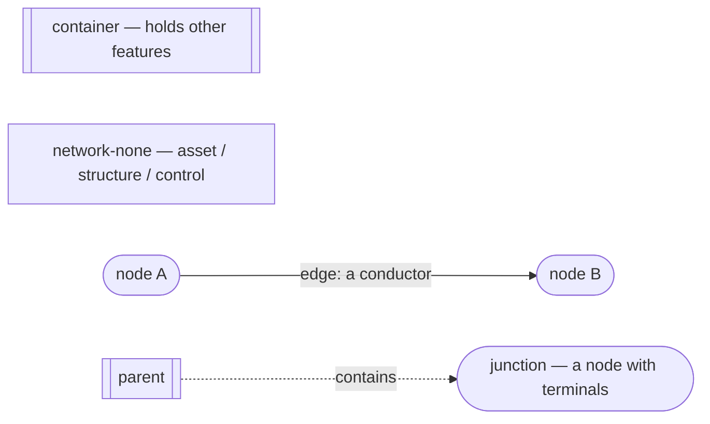
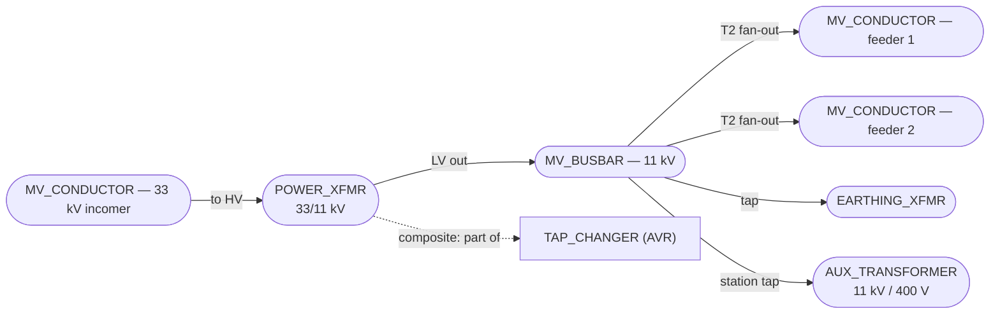
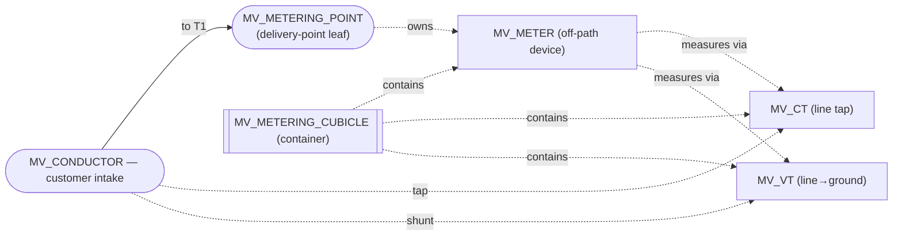
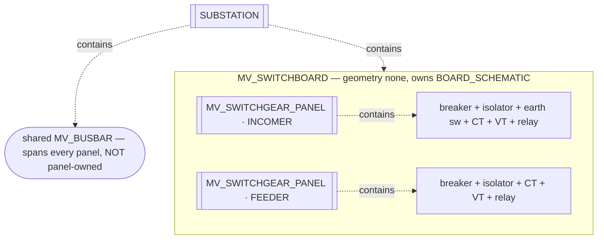
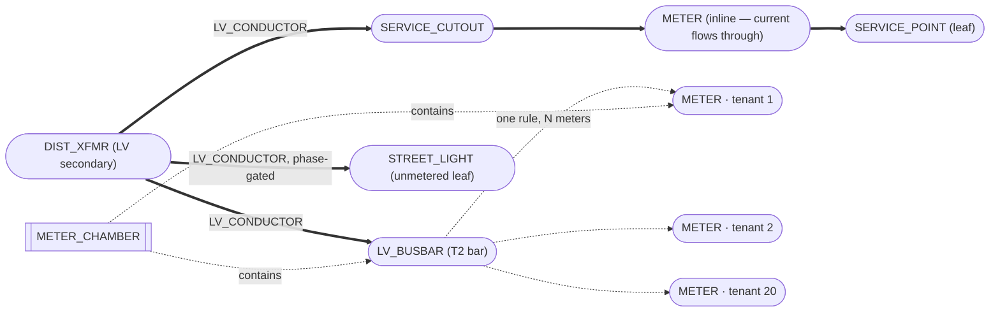
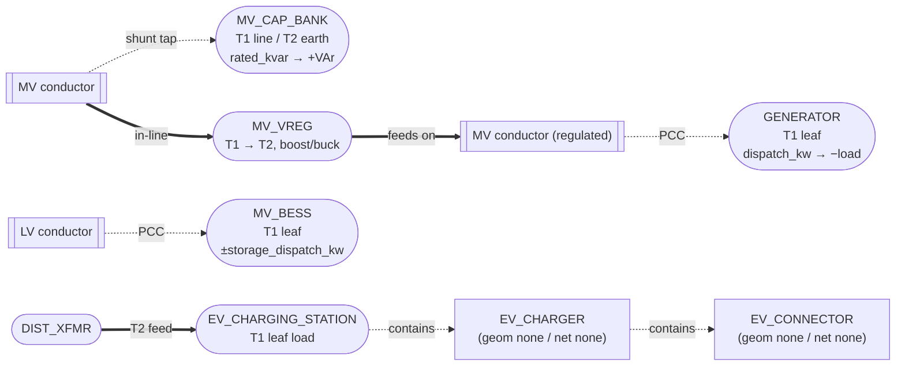
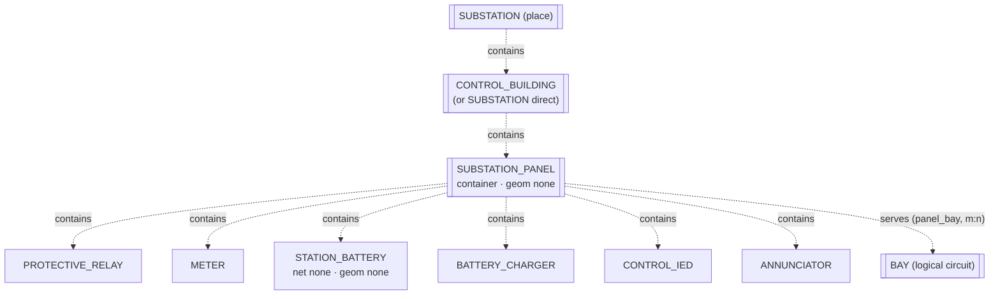
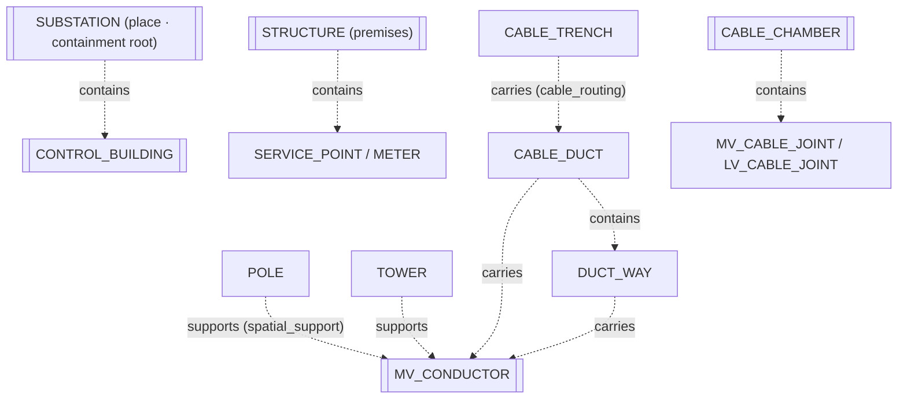

# The VoltEdge Feature Catalog

*A reference to every feature class in the VoltEdge data model — what each one is,
what it does, how it is specified, its network role and terminals, how it relates to
other features, and where it is drawn (on the geographic map, on a schematic diagram,
or both).*

---

## How to read this catalog

VoltEdge is **metadata-driven**: the network is not a fixed set of hard-coded tables
but a catalog of **feature classes** defined in data (`metadata.feature_classes` and
its companions, seeded under `/seed`). This document is the human-readable companion
to that catalog — one entry per class, all written to the same template so you can
scan any class and find the same facts in the same places.

This is a **reference**, not a tutorial. If you want the *narrative* of how a
substation is built end to end, read the [Substation Guide](substation-guide.md); if
you want the analysis engine, read [Engineering Studies](engineering-studies.md). This
catalog is the thing you keep open on a second monitor while you model.

### The per-class entry template

Every class below is described under the same seven headings — the facets you need to
actually use it:

1. **What it is** — a one-paragraph description of the real-world thing.
2. **What it does** — its role in the network and which analyses or workflows read it.
3. **How it's specified** — its subtypes and its fields (with the domains that
   constrain coded fields), and which fields are required.
4. **Network role** — `junction`, `edge`, `container`, or `none` (defined below), and
   what that means for whether the trace and load flow walk it.
5. **Terminals** — its connection points (if any), by code and role.
6. **Relates to** — the other classes it connects to (connectivity), is part of or
   contains (containment/composite), and any special interactions.
7. **Where it's drawn** — its geometry (point / line / polygon / none), whether it
   appears on the geographic map, on a schematic diagram, or both, and its symbology.

### The shared model — five ideas every entry leans on

Before the entries, the five cross-cutting concepts they all reference. If you have
read the Substation Guide these will be familiar; they are restated here because the
catalog stands alone.

#### 1. Geometry type — where a feature can live

| `geometry_type` | Shape | Example | On the map? |
| --- | --- | --- | --- |
| `point` | A single location | `POWER_XFMR`, `METER` | Yes — a marker |
| `line` | A polyline | `MV_CONDUCTOR` | Yes — a run |
| `polygon` | An area | `SUBSTATION`, `STRUCTURE` | Yes — a footprint |
| `none` | No map geometry at all | `PROTECTIVE_RELAY`, `TAP_CHANGER` | No — diagram/attribute only |

A `geometry_type 'none'` class has **no location on the map**. Its only visual form is
a placement on a schematic **diagram**, or it is purely an attribute record hung off
another feature. Half the control room is like this.

#### 2. Network role — whether the network "sees" a feature

This is the single most important axis in the catalog. `network_role` decides whether a
feature is part of the **connectivity graph** that the trace, load flow, fault study
and outage engine walk.

| `network_role` | It is… | Has terminals? | Walked by analyses? |
| --- | --- | --- | --- |
| `junction` | a **node** — a device the current flows *into and out of* | Yes | Yes — a stop on the walk |
| `edge` | a **conductor** — the wire *between* two nodes | No | Yes — the span the walk crosses |
| `container` | a **grouping** — a box that holds other features | No | No — organizational only |
| `none` | **not on the network** — an asset, structure or control device | No | No |

The graph strictly **alternates node → edge → node**: a `junction` connects to an
`edge` which connects to another `junction`. An `edge` is *never* the endpoint a walk
starts or ends on. A `container` and a `none` class carry no power path at all — they
are organizational (containers) or attached-but-passive (structures, relays, the DC
layer).

#### 3. Terminals — a junction's connection points

Only `junction` classes have **terminals**: named ports (`T1`, `T2`, …) with a
**role** (`primary`, `secondary`, `source`, `load`, …) that say *where* a wire may
land. A two-terminal series device (a switch, a regulator) has `T1`/`T2`; a transformer
has one terminal per winding; a busbar has an incoming `T1` and a fan-out `T2` that
many feeders share. Terminals are how `network_rules` (below) know *which side* of a
device a connection is allowed on.

**How a connection is matched.** Establishing a connection looks up the `network_rules` for the
two feature classes (`api/internal/connectivity/rules.go`, `matchRule`): a rule's subtype and
terminal pins are *wildcards when null* and exact matches when set; among the applicable valid
rules the most specific wins; a rule that matches but has `is_valid = false` is reported as
"exists but is disabled"; no rule at all is the zero-trust default "absence of a rule means the
connection is invalid". A rule matches in **either** direction — one `T2 → bus` rule authorizes
the leg whichever end the caller names first. The `phase_rule` column is enforced **only** when
it is exactly `phases_intersect` (both features must carry a `phase` and share an L1/L2/L3
line); any other text — including the `from.voltage_class = to.primary_voltage` that several
rules carry, which this catalog calls "voltage-matched" — is **descriptive and enforces
nothing** (`api/internal/connectivity/phase.go`, lines 9-18).

#### 4. Connectivity vs. containment — two independent graphs

A feature participates in **two graphs that never touch each other**:

- **Connectivity** — "what feeds what." Built from terminals + `network_rules`
  (directed allow-list of which class-terminal may connect to which), stored in
  `runtime.feature_connectivity`, walked by every electrical analysis.
- **Containment / composite** — "what is inside / part of what." Built from
  `relationship_classes` (nine kinds: the structural `containment`, `composite`,
  `spatial_support`, `panel_bay`, and the association kinds `protection_trip`,
  `protection_sensing`, `metering_sensing`, `metering_accounting`, `cable_routing` — widened
  one migration at a time, 0075 / 0080 / 0082 / 0083 / 0121), stored in
  `runtime.feature_relationships`, read almost exclusively by **CIM export** for nesting and
  by the relationship UI. Single-parent for containment since Phase 47.

A transformer is *connected* to a busbar (connectivity) and *contained by* a substation
(containment). The two facts are stored, edited and traversed independently. Each entry's
**Relates to** heading separates them.

#### 5. Render context — map symbology vs. diagram symbology

A class can carry a `map` symbology rule (how it draws on the geographic map) and/or a
`diagram` symbology rule (how it draws on a schematic). The diagram renderer tries
`diagram` first, then falls back to `map`. A `geometry_type 'none'` class has **no map
rule to fall back to**, so it *must* carry a `diagram` rule or it renders as nothing.
Some classes also set a `diagram_geometry_type` that differs from their map geometry —
the busbar is a **point** on the map but draws as a **bar** (`line`) on the one-line.

A diagram can also carry a **placement allow-list** (`metadata.diagram_placement_rules`,
migration 0068): a container class + diagram type pair (e.g. `MV_METERING_CUBICLE` +
`METERING_SCHEMATIC`) that has *any* rows accepts **only** the listed classes; a pairing
with *no* rows is open to every `is_diagram_placeable` class. This "opt-in-by-absence" rule
is what Chapters 4, 5 and 6 refer to. A rule can restrict but never widen — a class must
still be `is_diagram_placeable` to be placed at all.

### The diagram legend

This catalog uses two kinds of picture. **Mermaid** (fenced ```` ```mermaid ````
blocks — they render live in VSCode's markdown preview and on GitHub) for connectivity
and containment graphs, and small **ASCII** sketches for terminal layouts.

Mermaid node-shape convention used throughout:



- **Stadium** `([ ])` = a `junction` (a node).
- A **solid arrow** `-->` labelled with a conductor class = an **edge** (connectivity).
- **Subroutine** `[[ ]]` = a `container`.
- A **dashed arrow** `-.->` = a **containment / composite** relationship.
- **Plain rectangle** `[ ]` = a `network_role 'none'` class.

ASCII terminal-sketch convention:

```
        T1                     T2
  ───────●──[  POWER_XFMR  ]──●───────
     (primary / HV)      (secondary / LV)
```

A filled `●` is a terminal; the label under it is the terminal's role.

---

## The master index

Every class in the catalog, with its geometry, network role, and the chapter that
covers it. This is the spine — jump from here.

| Class | Name | Geometry | Network role | Chapter |
| --- | --- | --- | --- | --- |
| `POWER_XFMR` | Power Transformer | point | junction | 2 |
| `DIST_XFMR` | Distribution Transformer | point | junction | 2 |
| `AUX_TRANSFORMER` | Station Auxiliary Transformer | point | junction | 2 |
| `EARTHING_XFMR` | Earthing Transformer | point | junction | 2 |
| `MV_BUSBAR` | MV Busbar | point (bar) | junction | 2 |
| `TAP_CHANGER` | Transformer Tap Changer | none | none | 2 |
| `MV_BREAKER` | MV Breaker | point | junction | 3 |
| `MV_ISOLATOR` | MV Isolator | point | junction | 3 |
| `MV_SECTIONALIZER` | MV Sectionalizer | point | junction | 3 |
| `MV_RECLOSER` | MV Recloser | point | junction | 3 |
| `MV_SWITCH` | MV Switch | point | junction | 3 |
| `DIST_SWITCH` | Distribution Switch | point | junction | 3 |
| `MV_FUSE` | MV Fuse | point | junction | 3 |
| `MV_ARRESTER` | MV Surge Arrester | point | junction | 3 |
| `MV_EARTH_SWITCH` | MV Earth Switch | point | none | 3 |
| `PROTECTIVE_RELAY` | Protective Relay | none | none | 3 |
| `MV_CT` | MV Current Transformer | point | junction | 4 |
| `MV_VT` | MV Voltage Transformer | point | junction | 4 |
| `MV_METERING_POINT` | MV Metering Point | point | junction | 4 |
| `MV_METER` | MV Meter | point | none | 4 |
| `MV_METERING_CUBICLE` | MV Metering Cubicle | point | container | 4 |
| `NETWORK_METER` | Network Meter | point | none | 4 |
| `MV_SWITCHBOARD` | MV Switchboard | none | container | 5 |
| `MV_SWITCHGEAR_PANEL` | MV Switchgear Panel | none | container | 5 |
| `BAY` | Bay | none | container | 5 |
| `RMU` | Ring Main Unit | point | container | 5 |
| `PACKAGED_SUBSTATION` | Packaged Substation | point | container | 5 |
| `LV_BUSBAR` | LV Busbar | point | junction | 6 |
| `LV_SWITCH` | LV Switch | point | junction | 6 |
| `SERVICE_CUTOUT` | Service Cutout | point | junction | 6 |
| `LV_LINK_BOX` | LV Link Box | point | junction | 6 |
| `LVAC_BOARD` | Station LVAC Board | point | junction | 6 |
| `STREET_LIGHT` | Street Light | point | junction | 6 |
| `SERVICE_POINT` | Service Point | point | junction | 6 |
| `METER` | Meter | point | junction | 6 |
| `METER_CHAMBER` | Meter Chamber | point | container | 6 |
| `LV_PILLAR` | LV Feeder Pillar | point | container | 6 |
| `LV_FUSE` | LV Fuse Way | none | junction | 6 |
| `MV_CONDUCTOR` | MV Conductor | line | edge | 7 |
| `LV_CONDUCTOR` | LV Conductor | line | edge | 7 |
| `MV_CABLE_JOINT` | MV Cable Joint | point | junction | 7 |
| `LV_CABLE_JOINT` | LV Cable Joint | point | junction | 7 |
| `GENERATOR` | Generator | point | junction | 8 |
| `MV_BESS` | MV Battery Storage | point | junction | 8 |
| `MV_CAP_BANK` | MV Capacitor Bank | point | junction | 8 |
| `MV_VREG` | MV Voltage Regulator | point | junction | 8 |
| `EV_CHARGING_STATION` | EV Charging Station | point | junction | 8 |
| `EV_CHARGER` | EV Charger | none | none | 8 |
| `EV_CONNECTOR` | EV Connector | none | none | 8 |
| `SUBSTATION_PANEL` | Substation Panel | none | container | 9 |
| `STATION_BATTERY` | Station Battery | none | none | 9 |
| `BATTERY_CHARGER` | Battery Charger | none | none | 9 |
| `CONTROL_IED` | Control IED | none | none | 9 |
| `ANNUNCIATOR` | Annunciator | none | none | 9 |
| `SUBSTATION` | Substation | polygon | none (container root) | 10 |
| `CONTROL_BUILDING` | Control Building | polygon | container | 10 |
| `STRUCTURE` | Structure | polygon | none | 10 |
| `POLE` | Pole | point | none | 10 |
| `TOWER` | Tower | point | none | 10 |
| `CABLE_TRENCH` | Cable Trench | line | none | 10 |
| `CABLE_DUCT` | Cable Duct | line | none | 10 |
| `CABLE_CHAMBER` | Cable Chamber | polygon | none | 10 |
| `DUCT_WAY` | Duct Way | none | none | 10 |

**63 classes.** A freshly seeded database (`task seed-all`, the metadata phase) holds **62**
feature classes; the 63rd is the legacy `DIST_SWITCH`, which is catalogued here because it
still appears in older data and in `seed/switching_device_example.sql` but is not loaded by
`seed-all`. (Earlier editions of this catalog listed 60 — `LV_FUSE`, `LV_PILLAR` and
`NETWORK_METER` were missing; see [Appendix A](#appendix-a--corrections).)

### What this catalog covers

- **Chapter 1 — the shared model** (this chapter): how to read the catalog; the five
  cross-cutting ideas; the diagram legend; the master index.
- **Chapter 2 — the MV yard: transformers & buses** — `POWER_XFMR`, `DIST_XFMR`,
  `AUX_TRANSFORMER`, `EARTHING_XFMR`, `MV_BUSBAR`, `TAP_CHANGER`.
- **Chapter 3 — MV switching & protection** — the breakers, isolators, reclosers,
  switches, fuses, arrester, earth switch and the relay.
- **Chapter 4 — MV measurement & metering** — instrument transformers, metering point,
  meter, metering cubicle, and the accounting-only network meter.
- **Chapter 5 — MV assemblies & switchgear containers** — switchboard, switchgear
  panel, bay, RMU, packaged substation.
- **Chapter 6 — LV distribution & service** — LV busbar and switching, cutout, link
  box, feeder pillar and its fuse ways, LVAC board, street light, service point, meter,
  meter chamber.
- **Chapter 7 — conductors, joints & the edge model** — the two conductor classes and
  the cable joints, and how edges work.
- **Chapter 8 — DER, storage & EV** — generator, BESS, capacitor bank, voltage
  regulator, EV charging.
- **Chapter 9 — the control room & DC auxiliary** — panel, battery, charger, IED,
  annunciator.
- **Chapter 10 — civil, structures & cable containment** — substation, control
  building, structure, pole, tower, trench, duct, chamber, duct way.
- **Appendices** — A: corrections to earlier editions; B: which class do I use?; C:
  fields the entries do not cover; D: the complete connectivity-rule table; E: the
  complete relationship-class table; F: classification axes, cross-cutting fields and
  system columns.

Say **next** for Chapter 2 — the MV yard.

---

## Chapter 2 — The MV yard: transformers & buses

The yard is the electrical heart of a substation: the bulk transformer that steps
transmission or sub-transmission voltage down to a distribution voltage, the busbars
that collect and redistribute it, the little station-service transformer that powers
the site itself, the earthing transformer that gives an ungrounded system a ground
reference, and the tap changer that trims the voltage. Six classes.

They divide cleanly by network role. Five are **junctions** — real nodes the load flow
and the trace walk through. One, `TAP_CHANGER`, is a `network_role 'none'` control
device that sits *inside* the transformer and never touches the connectivity graph.

Here is how they wire together in a single 33/11 kV primary — the Adenta Primary
running example from the [Substation Guide](substation-guide.md):



The solid arrows are connectivity (edges the trace crosses); the dashed arrow is the
composite relationship binding the tap changer to its transformer. Note `TAP_CHANGER`
hangs off the transformer by a *dashed* line — it is not on the power path at all.

---

### `POWER_XFMR` — Power Transformer

> Seed: [`seed/power_transformer_example.sql`](../seed/power_transformer_example.sql)

**What it is.** The bulk transformer at a primary or bulk-supply substation — a
33/11 kV, 132/33 kV or 161/34.5 kV unit, two-winding or three-winding. Distinct from
the pole-or-pad `DIST_XFMR` that steps MV down to LV service: `POWER_XFMR` is quoted in
**MVA**, can carry a **tertiary** winding, and its winding count changes its terminals
— structural differences a subtype of `DIST_XFMR` could not express, which is exactly
why it is its own class.

**What it does.** It is the substation's step-down node. The field-name-driven load
flow (`api/internal/powerflow`, `resolveTransformerModel`) sees a junction carrying
**both** `primary_voltage` and `secondary_voltage` and models it as a real
voltage-transforming, impedance-dropping node with a loading percentage — no class
gate, purely on the field names. It is also the substation's **fault sink**: its
`impedance_pct` sets the fault level on the LV bus. A downstream trace walks *through*
it (HV in → LV out).

**How it's specified.** Two subtypes on the winding-count axis:

| Subtype (`code`) | Name | Terminals |
| --- | --- | --- |
| `1` | `two_winding` | HV, LV, N |
| `2` | `three_winding` | HV, LV, TV, N |

Fields (group · required?) — every model field *except* `primary_voltage` and
`condition_rating` is DB-nullable (those two are `NOT NULL` columns as well as required by
subtype rule), so an un-surveyed unit degrades gracefully:

| Field | Type | Domain | Req | Role |
| --- | --- | --- | --- | --- |
| `primary_voltage` | text | `VOLTAGE_CLASS` | ✓ | HV nominal (e.g. `132KV`) |
| `secondary_voltage` | numeric | — | | LV nominal volts (e.g. `33000`) — **presence makes it a transformer** |
| `impedance_pct` | numeric | — | | nameplate %Z, HV–LV; sets the series drop **and the LV fault level** |
| `x_r_ratio` | numeric | — | | X/R of that impedance |
| `rated_mva` | numeric | — | | nameplate MVA (engine ×1000 → kVA for loading %) |
| `tertiary_voltage` / `z_hv_tv_pct` / `z_lv_tv_pct` | numeric | — | | tertiary data (recorded; sweep ignores today) |
| `tap_position` / `tap_step_pct` | numeric | — | | **live tap** — shifts LV ratio via `tapFactor` = 1 + pos·step/100 |
| `tap_min` / `tap_max` | numeric | — | | tap bounds (validation only) |
| `vector_group` | text | `VECTOR_GROUP` | | Dyn11 etc. — record-only until a meshed study exists |
| `condition_rating` | text | `CONDITION_RATING` | ✓ | maintenance state |

Both subtypes require the same two fields at form level: `primary_voltage` +
`condition_rating`. The three-winding-specific fields stay optional even on
`three_winding` (a survey without tertiary nameplate data must not be un-enterable).

**Network role.** `junction`. Geometry `point`, `geometry_optional` — it may be placed
on the map, on a one-line diagram, or both.

**Terminals.** Subtype-scoped (the first class in the model to scope terminals to a
subtype — `metadata.terminals.subtype_id`, most-specific-wins):

```
        HV                    LV                    TV (three_winding only)
  ───────●──[   POWER_XFMR   ]──●───────           ──●──
     (primary)            (secondary)              (tertiary)
                    ●  N (ground)
```

**Relates to.**
- *Connectivity:* `MV_CONDUCTOR → POWER_XFMR HV` (feeder into the HV
  winding; the `phase_rule` text names a voltage match but is not enforced); `POWER_XFMR LV → MV_CONDUCTOR` and `POWER_XFMR TV → MV_CONDUCTOR` (windings
  out — transformer as the *from* side, so a downstream trace descends through it). The
  TV rule generates rows only for `three_winding` (the join finds no TV terminal on
  `two_winding`).
- *Containment:* **not seeded** — no `relationship_classes` row ties `POWER_XFMR` to
  `SUBSTATION` (or to a `BAY`); the seeded `SUBSTATION` containment set is `BAY`,
  `CONTROL_BUILDING`, `SUBSTATION_PANEL`, `MV_BUSBAR`, `MV_SWITCHBOARD`, `AUX_TRANSFORMER`
  and `LVAC_BOARD`. A power transformer's place in the station is its **connectivity** and
  its map position; add a containment row in `metadata.relationship_classes` if CIM export
  should nest it. (Earlier editions stated `SUBSTATION contains POWER_XFMR`.)
- *Metering:* `NETWORK_METER meters POWER_XFMR` (`metering_accounting`, many-to-many).
- *Composite:* `POWER_XFMR has TAP_CHANGER` (one-to-one) — see `TAP_CHANGER` below.

**Where it's drawn.** A **teal square** on the map (`#0f766e`, distinct from
`DIST_XFMR`'s blue and `EARTHING_XFMR`'s amber). On a diagram it uses the default node
until a dedicated ANSI two-/three-winding stencil is seeded (a noted follow-up).

---

### `DIST_XFMR` — Distribution Transformer

> Seed: [`seed/connectivity_example.sql`](../seed/connectivity_example.sql) (base) +
> [`seed/load_flow_fields.sql`](../seed/load_flow_fields.sql) +
> [`seed/transformer_model_fields.sql`](../seed/transformer_model_fields.sql)

**What it is.** The distribution transformer that steps MV (11 kV / 33 kV) down to LV
service (400 V) — the pole-mounted or pad-mounted unit at the end of an MV feeder,
quoted in **kVA**. The original transformer class in the model; `POWER_XFMR` was later
carved off for the bulk-transformer differences.

**What it does.** The same step-down node behaviour as `POWER_XFMR`, driven by the same
field names — `resolveTransformerModel` reads `primary_voltage` / `secondary_voltage` /
`impedance_pct` off it identically. This is the payoff of the field-name-driven engine:
one solver handles every transformer class because they all speak the same field
vocabulary.

**How it's specified.** Three subtypes distinguish the mounting construction —
`1` `pole_mounted`, `2` `pad_mounted`, `3` `underground_vault` (the `PAD_MOUNT_URD` and
`POLE_MOUNT_STD` assembly kits anchor on `pad_mounted` / `pole_mounted`). Core
fields: `primary_voltage` (coded `VOLTAGE_CLASS`, required), `condition_rating`
(required); plus the load-flow trio added by seed as **nullable** fields —
`secondary_voltage`, `impedance_pct`, `x_r_ratio` — and `rated_kva` (from
`load_flow_fields.sql`). Nullable so the engine degrades gracefully: no
`secondary_voltage` → pass-through; ratio but no `impedance_pct` → ideal transformer;
`impedance_pct` but no `x_r_ratio` → a documented default X/R.

**Network role.** `junction`. Geometry `point`.

**Terminals.** `T1` (primary), `T2` (secondary), `T3` (ground). Not subtype-scoped —
`T3` inbound rule is retired (`is_valid false`), leaving the ground terminal recorded
but not walked.

**Relates to.** *Connectivity:* `MV_CONDUCTOR → DIST_XFMR T1` (the rule's `phase_rule` text names a voltage match, which is descriptive and not enforced — see Chapter 1), and —
added by the switching, fuse and kit seeds — `MV_SWITCH T2 → DIST_XFMR T1`,
`MV_FUSE T2 → DIST_XFMR T1` and `DIST_XFMR T1 → MV_ARRESTER T1`. The secondary (`T2`)
wires on to `LV_CONDUCTOR`, `LV_BUSBAR`, `LV_LINK_BOX`, and the source/load leaves
`GENERATOR`, `MV_BESS`, `EV_CHARGING_STATION` (Chapters 6 and 8); `DIST_XFMR T2 →
MV_CONDUCTOR` is the older "this instance is really a substation transformer feeding a feeder
onward" rule (`seed/service_point_example.sql:121-131`, from before `POWER_XFMR`). The older `DIST_XFMR T2 → SERVICE_POINT` rule is
retired (`is_valid false`) in favour of the metered path. *Containment:* contained by
its structure/pole and, in URD kits, by a pad assembly (`PACKAGED_SUBSTATION contains
DIST_XFMR`; `POLE supports DIST_XFMR`). *Metering:* `NETWORK_METER meters DIST_XFMR`.

**Where it's drawn.** A **blue square** on the map.

---

### `AUX_TRANSFORMER` — Station Auxiliary Transformer

> Seed: [`seed/lvac_auxiliary_example.sql`](../seed/lvac_auxiliary_example.sql)

**What it is.** The station-service transformer — the small unit that taps the MV bus
and produces the 400 V LV supply that powers the substation *itself*: the battery
chargers, cooling fans, tap-changer motors, lighting and small power. Part of the
station AC-auxiliary (LVAC) layer added to close the substation-service gap.

**What it does.** It is modelled as a **real traceable step-down junction**, not an
inventory row — deliberately (the user chose Option B: a traceable AC subsystem). Its
field *names* match `POWER_XFMR`/`DIST_XFMR` exactly, so the field-name-driven sweep
picks it up as a genuine step-down node with **zero engine change**. The trace reaches
it, steps through it, and continues into the LVAC board.

**How it's specified.** Single `standard` subtype (the variety is in the fields, not
the terminals). Fields: `primary_voltage` (coded `VOLTAGE_CLASS`, required),
`secondary_voltage` (numeric), `impedance_pct` (numeric), `rated_kva` (numeric),
`condition_rating` (required). Same nullable-degrades-gracefully discipline.

**Network role.** `junction`. Geometry `point`, `geometry_optional`.

**Terminals.** `T1` (primary / MV in), `T2` (secondary / LV out).

**Relates to.** *Connectivity:* `MV_BUSBAR T2 → AUX_TRANSFORMER T1` (the station-service
tap, `phase_rule` NULL) and `MV_CONDUCTOR → AUX_TRANSFORMER T1` (voltage match in the rule text only — not enforced);
`AUX_TRANSFORMER T2 → LVAC_BOARD T1` on the LV side (Chapter 6). *Containment:*
`SUBSTATION contains AUX_TRANSFORMER`.

**Where it's drawn.** An **amber square** on the map (`#b45309`). → CIM
`PowerTransformer`.

---

### `EARTHING_XFMR` — Earthing Transformer

> Seed: [`seed/earthing_transformer_example.sql`](../seed/earthing_transformer_example.sql)

**What it is.** An earthing (grounding) transformer — a zig-zag or grounded-wye-delta
unit that gives an otherwise ungrounded (delta) MV system a neutral/ground reference,
so a ground fault has a path to earth. It transforms no voltage between networks and
carries no through-load in balanced operation: it is a **shunt** that only conducts
during a ground fault.

**What it does.** Two things, both by the generic-field-name approach:
1. In the balanced load flow it carries `primary_voltage` but **no** `secondary_voltage`,
   so `resolveTransformerModel` resolves it as a plain **pass-through leaf** — exactly
   right for a dead-end shunt with no downstream network and no through-power.
2. In the single-line-to-ground fault model (`groundfault.go`) its `z0_ohm` is read as
   the zero-sequence shunt to earth (folding in 3× any `neutral_resistance_ohm`). The
   engine identifies it **by the presence of a positive `z0_ohm`, not by class** — so
   an earthing transformer turns an ungrounded bus grounded and bounds the SLG current
   on that bus and its downstream cone.

**How it's specified.** **No subtypes** — the two constructions (zig-zag /
wye-delta) present the same connection points, so the construction is a coded field, not
a subtype axis ("a subtype is for differences the network can see"). Required fields are
enforced by `nullable = false` directly:

| Field | Type | Domain | Req |
| --- | --- | --- | --- |
| `primary_voltage` | text | `VOLTAGE_CLASS` | ✓ |
| `connection_type` | text | `GROUNDING_TYPE` (zig-zag / wye-delta) | ✓ |
| `z0_ohm` | numeric | — | | zero-sequence impedance — **drives the SLG model** |
| `rated_neutral_current_a` / `rated_time_s` | numeric | — | | thermal withstand (record-only) |
| `neutral_resistance_ohm` | numeric | — | | integral NER, folded 3× into z0 |
| `condition_rating` | text | `CONDITION_RATING` | ✓ |

Note there is **deliberately no `secondary_voltage`** — its absence is what keeps the
engine treating this as a shunt rather than a voltage-transforming node.

**Network role.** `junction`. Geometry `point`, `geometry_optional`.

**Terminals.** `LINE` (primary, three-phase onto the system) + `N` (ground, not
phase-capable). The `N` connects to the earth grid, not a traceable element.

**Relates to.** *Connectivity:* exactly **one** rule, inbound only —
`MV_CONDUCTOR → EARTHING_XFMR LINE` (voltage match in the rule text only — not enforced). With no outbound rule it is a
**dead-end shunt**: a trace or load flow reaching it descends into it as a leaf that
contributes nothing, which is its true electrical behaviour. *Containment:* **none
seeded** — there is no `SUBSTATION contains EARTHING_XFMR` relationship class (earlier
editions said it was contained by `SUBSTATION`).

**Where it's drawn.** An **amber square** on the map (`#b45309`).

---

### `MV_BUSBAR` — MV Busbar

> Seed: [`seed/mv_busbar_example.sql`](../seed/mv_busbar_example.sql)

**What it is.** The substation bus — the equipotential bar that collects the incoming
supply and redistributes it to every bay. Modelled as a solid bar, **not** a set of
switchable ways (the bay switches themselves are the switching devices), so it needs no
per-way terminal schema.

**What it does.** It is the collection-and-fan-out node. Its `T2` is an equipotential
tap that **many** bays hang off — each a distinct `feature_connectivity` row — exactly
the `LV_BUSBAR` shape scaled up to MV. Four wiring-rule shapes make a whole yard
expressible: incomer → bus, bus → feeder, bus → bay-switch, bay-switch → bus (the last
two together also express bus couplers and bus-section switches with no new rule shape).

**How it's specified.** **No subtypes** — a bus is classified by voltage, not by
switchgear construction (leaving it subtype-less also lets an RMU create a bare internal
bus). Both fields are **nullable**: `voltage_class` (coded `VOLTAGE_CLASS`) and
`condition_rating` (coded `CONDITION_RATING`) — a substation bus is expected to carry
them, but a bare internal RMU bus is created without them.

**Network role.** `junction`. Geometry `point` on the map — but `diagram_geometry_type
= 'line'` (migration 0053), so on a one-line/schematic it draws as a **spanning bar**
while the map keeps it a point. This is the model's clearest example of a class whose
map geometry and diagram geometry differ.

**Terminals.** `T1` (primary, incoming) + `T2` (`other`, the equipotential fan-out —
one terminal, N feeders).

```
   T1 ───────────────●═══════════════════●─────────── T2  (equipotential bar)
   (incoming)         │   │   │   │   │   │   (many bays tap the one T2)
```

**Relates to.** *Connectivity (the four shapes):* `MV_CONDUCTOR → MV_BUSBAR T1`;
`MV_BUSBAR T2 → MV_CONDUCTOR`; `MV_BUSBAR T2 → {MV_BREAKER|MV_ISOLATOR|MV_SECTIONALIZER}
T1`; `{switch} T2 → MV_BUSBAR T1`. *Containment:* `SUBSTATION contains MV_BUSBAR`
(station-level plant, shared across bays, so it hangs off the yard directly rather than
under a bay).

**Where it's drawn.** Map: a point (voltage-coloured symbology). Diagram: a **bar**.

---

### `TAP_CHANGER` — Transformer Tap Changer

> Seed: [`seed/oltc_tap_changer_example.sql`](../seed/oltc_tap_changer_example.sql)

**What it is.** The transformer's tap-changing mechanism together with its automatic
voltage regulator (AVR): an on-load tap changer (OLTC) or off-circuit tap changer
(DETC). It carries the **control intent** (target voltage, deadband, time delay,
line-drop compensation, auto/manual mode) and the **asset identity** (operation counter,
condition) that a tap changer has as separately-maintained plant — contacts, oil,
diverter, motor drive — none of which belongs on the transformer nameplate.

**What it does.** *Nothing electrical in the sweep* — and that is the point. The **live
electrical tap stays on `POWER_XFMR`** (`tap_position` / `tap_step_pct`), where the load
flow already reads it and applies `tapFactor`. `TAP_CHANGER` is the **controller and the
asset record** that drives that tap; duplicating the live tap onto it would demand an
engine change and create two writers for one value. So this class needs **zero engine
change**. Modelling it as a series junction (as `MV_VREG`, a genuine standalone line
regulator, legitimately is) would **double-count** the ratio the transformer already
applies — so it deliberately is *not* a junction.

**How it's specified.** Single `standard` subtype (OLTC vs DETC is a *field*, not a
subtype — it changes no terminals). All fields DB-nullable; requiredness via
`subtype_field_rules`:

| Field | Type | Domain | Req |
| --- | --- | --- | --- |
| `tap_changer_type` | text | `TAP_CHANGER_TYPE` (on_load / off_circuit) | ✓ |
| `control_mode` | text | `TAP_CONTROL_MODE` (auto / manual / off) | ✓ |
| `target_voltage_kv` | numeric | — | | AVR setpoint |
| `bandwidth_pct` | numeric | — | | deadband before it taps |
| `time_delay_s` | numeric | — | | delay before an out-of-band excursion taps |
| `ldc_r_ohm` / `ldc_x_ohm` | numeric | — | | line-drop compensation (regulate a remote point) |
| `operation_count` | integer | — | | lifetime tap operations (a wear driver) |
| `condition_rating` | text | `CONDITION_RATING` | ✓ |

**Network role.** `none`. Geometry `none`, SRID NULL — an OLTC lives *inside* the tank,
has no independent map location, and is not on the connectivity graph. This is the same
stance the P&C-DC control devices take (Chapter 9).

**Terminals.** None (network role `none` carries no power path).

**Relates to.** *Composite:* `POWER_XFMR has TAP_CHANGER` (one-to-one) — a tap changer
is **part of** its transformer, distinct from `SUBSTATION`'s `containment`. The AVR
"senses the bus VT and commands the tap" link is control wiring (annotation), the
deferred *Dual line semantics* open item shared with the relay/DC layer.

**Where it's drawn.** Diagram only — a **purple circle** (`#7e22ce`). Because it is
geometry `none` it has **no map rule to fall back to**, so it *must* carry an explicit
`diagram` symbology rule or it would render as nothing (the general rule from Chapter 1).
→ CIM `RatioTapChanger`, `cim_kind 'asset'` (attached equipment, nested on its
`PowerTransformer`).

---

**Chapter 2 recap.** Five junctions and one contained controller. The recurring lesson:
transformer behaviour is driven by **field names, not class identity** — `POWER_XFMR`,
`DIST_XFMR` and `AUX_TRANSFORMER` all become step-down nodes because they carry
`primary_voltage` + `secondary_voltage`; `EARTHING_XFMR` stays a shunt because it
carries only the primary; and `TAP_CHANGER` stays off the graph entirely because the
tap it controls already lives on the transformer. The busbar — `MV_BUSBAR`, and `LV_BUSBAR` since the LV pillar seed — is the class whose map
shape (point) and diagram shape (bar) differ.

Say **next** for Chapter 3 — MV switching & protection.

---

## Chapter 3 — MV switching & protection

If Chapter 2 was the plant, this is the plant's nervous system: the devices that
**open and close** the network and the devices that **protect** it. Ten classes,
and — unusually for this catalog — most of them share one skeleton. Understanding that
skeleton once means nine of the ten entries reduce to "the series-switch pattern, plus
what makes this one different."

### The series-switch pattern (read this once)

A **series switching device** is an inline junction that current flows *through*: line
in on one side, load out on the other. In VoltEdge every one of them is built from the
identical parts, first laid down by the legacy `DIST_SWITCH` and copied since:

- **Network role** `junction`, geometry `point`, `geometry_optional` +
  `is_diagram_placeable` (place it on the map, on a one-line, or both).
- **Terminals** `T1` (role `primary`, the line side) and `T2` (role `secondary`, the
  load side). The role names are nominal — their real job is just to distinguish the
  two sides.
- **Field** `device_state` (coded `DEVICE_STATE` = `CLOSED` / `OPEN`, required) plus
  `condition_rating` (required).
- **Three network rules**: `MV_CONDUCTOR → device T1`, `MV_CONDUCTOR → device T2`, and
  `device T2 → MV_CONDUCTOR`. That last rule (device as the *from* side) is what lets a
  **downstream trace walk through** the device. All three carry `phase_rule` NULL — a
  device hop, not a phase-matched splice.
- **A barrier rule**: when `device_state = OPEN`, the device **halts** every
  barrier-respecting trace (`trace_barrier_rules`, keyed on `stop_at_open_devices =
  true` so it covers every such config without naming them). This is the single
  mechanism behind isolation, fault-cone and outage traces stopping at open points.

```
        T1                          T2
  ───────●──[  device_state ?  ]────●───────
     (line side)              (load side)
                 CLOSED → current passes
                 OPEN   → trace barrier (walk halts here)
```

So the entries below spend their words on what is *different* per class. Seven follow
this pattern (breaker, isolator, sectionalizer, switch, recloser, fuse, and legacy
dist-switch); the arrester breaks it (a shunt); the earth switch is recorded-only; the
relay is a diagram control record.

---

### `MV_BREAKER` — MV Breaker

> Seed: [`seed/mv_switching_example.sql`](../seed/mv_switching_example.sql)

**What it is / does.** The substation or feeder circuit breaker — the workhorse
protective switch that **interrupts fault current**. `OPEN` = a barrier.
**Differences from the pattern:** subtypes name the interrupting medium —
`vacuum_breaker` / `sf6_breaker` (recorded; no engine action yet). Everything else is
the series-switch pattern exactly.

---

### `MV_ISOLATOR` — MV Isolator

> Seed: [`seed/mv_switching_example.sql`](../seed/mv_switching_example.sql)

**What it is / does.** An off-load disconnector — opened only when de-energised, to
provide a **visible isolating gap** for safe working. It interrupts no fault current;
electrically and topologically it is the series-switch pattern. **Differences:**
subtypes name the break arrangement — `single_break` / `double_break`.

---

### `MV_SECTIONALIZER` — MV Sectionalizer

> Seed: [`seed/mv_switching_example.sql`](../seed/mv_switching_example.sql)

**What it is / does.** An auto-sectionalizer: it **counts fault-current passages** while
an upstream recloser or breaker is clearing, then opens during a dead interval to
isolate the faulted section (it never interrupts fault current itself). The series-switch
pattern. **Differences:** subtypes name the counting mechanism — `hydraulic` /
`electronic`.

---

### `MV_SWITCH` — MV Switch

> Seed: [`seed/mv_lv_switch_example.sql`](../seed/mv_lv_switch_example.sql)

**What it is / does.** The generic MV switch — a load-break or disconnect switch with no
active protection scheme beyond, optionally, a single fuse. One of the two successor
classes the legacy `DIST_SWITCH` migrates into. The series-switch pattern.
**Differences:** single `standard` subtype (the fused/non-fused distinction is a
**flag**, not a subtype — the design decision to keep it a field). Extra optional
protection fields: `is_fused` (boolean), `fuse_rating_a` (numeric), `curve_ref` (text →
a `protection_curves` code). Only `device_state` + `condition_rating` are required.

---

### `MV_RECLOSER` — MV Recloser

> Seed: [`seed/mv_recloser_example.sql`](../seed/mv_recloser_example.sql)

**What it is / does.** A self-contained MV auto-recloser — an *active, multi-shot*
protective device: it trips on a fault, auto-recloses a programmed number of times over
set dead-times, and **locks out** (goes `OPEN`) if the fault persists, following a
fast/slow curve sequence (fuse-saving). Promoted from what used to be `DIST_SWITCH`'s
attribute-less `automatic_recloser` subtype into a first-class class with real recloser
attributes; the other successor of the `DIST_SWITCH` migration. Topologically the
series-switch pattern (T1/T2, `OPEN` = barrier). **Differences — the protection field
set, and it participates in the coordination engine:**

| Field | Type | Role |
| --- | --- | --- |
| `reclose_attempts` | integer | operations to lockout (e.g. 4) |
| `fast_curve_ref` | text | `protection_curves.code` — fast/instantaneous curve |
| `slow_curve_ref` | text | `protection_curves.code` — delayed/coordinating curve |
| `reclose_interval_s` | numeric | dead time between shots, seconds |
| `reset_time_s` | numeric | time to reset the operation counter, seconds |

It **grades in the coordination engine** off its *slow* curve
(`api/internal/powerflow/coordination.go`, `evalRecloser`) — the one class in this
chapter the protection-coordination study reasons about as an active device. Reuses the
`ansi-load-break` diagram glyph and the CIM `Recloser` class inherited from the old
subtype. A single `standard` subtype (code `1`); `device_state` and `condition_rating` are
required (the series-switch pattern), and the five protection fields above are optional.

---

### `MV_FUSE` — MV Fuse

> Seed: [`seed/mv_protection_example.sql`](../seed/mv_protection_example.sql)

**What it is / does.** An inline MV fuse or drop-out cutout. A blown or pulled fuse is
`device_state = OPEN` and acts as a **trace barrier**, exactly like an open breaker —
so an isolation trace stops at it. The series-switch pattern. **Differences:** subtypes
name the interrupting technology — `expulsion_fuse` / `current_limiting_fuse`. (Filed
under "protection," but structurally it is a series switch — a nice illustration that
the *pattern* is topological, not categorical.)

---

### `DIST_SWITCH` — Distribution Switch *(legacy — being retired)*

> Seed: [`seed/switching_device_example.sql`](../seed/switching_device_example.sql);
> retirement: [`seed/migrate_dist_switch_to_mv_switch.sql`](../seed/migrate_dist_switch_to_mv_switch.sql)

**What it is.** The **original** inline switching class — the one that first defined the
series-switch pattern every device above copies. Two subtypes: `manual_switch` and
`automatic_recloser` (the latter was an attribute-less placeholder).

**Status — important.** `DIST_SWITCH` is **superseded**. A destructive, one-way
migration (`migrate_dist_switch_to_mv_switch.sql`) splits every live feature **by
subtype** — `manual_switch` → `MV_SWITCH`, `automatic_recloser` → `MV_RECLOSER` —
preserving each feature's id, geometry, attributes, connectivity, relationships and
history, then **drops the class and its `gis.dist_switch` table**. New models should use
`MV_SWITCH` / `MV_RECLOSER`. It is catalogued here because you will meet it in older
data and in the base seed, and because it is the ancestor of the whole pattern.

**Everything else** (junction, T1/T2, `device_state`, three rules, `OPEN` barrier) is
the pattern — it *is* the pattern's definition.

---

### `MV_ARRESTER` — MV Surge Arrester

> Seed: [`seed/mv_protection_example.sql`](../seed/mv_protection_example.sql)

**What it is.** A surge / lightning arrester — a **shunt** device that clamps
overvoltages to earth. This is the class that *breaks* the series pattern, so it is worth
its own full read.

**What it does.** It taps the line and drains surges to ground. It is **always
in-circuit** — it does not switch — so it has **no `device_state` and is never a trace
barrier**.

**How it's specified.** Subtypes name the technology — `gapless_mov` (metal-oxide) /
`gapped_sic` (older silicon-carbide). Only field is `condition_rating` (required); an
arrester carries no switch state, and a rating/MCOV field was deliberately *not* seeded
speculatively (no domain for it yet).

**Network role.** `junction` — but a **shunt** junction, not a series one.

**Terminals.** `T1` (primary, taps the line) + `T2` (**ground**, `phase_capable =
false`) — the same shape as a transformer's ground terminal.

```
   ───────●───  T1 (taps the line)
          │
        [arrester]
          │
          ▽  T2 (ground — no feature to connect to, a documented dead-end)
```

**Relates to.** *Connectivity:* the class seed ships **one rule** — `MV_CONDUCTOR →
MV_ARRESTER T1`. The pole-mount and kit seeds add six more *onto device terminals* so a
kit can hang an arrester off a device: `MV_RECLOSER T1 → T1`, `MV_RECLOSER T2 → T1`,
`MV_SWITCH T2 → T1`, `DIST_XFMR T1 → T1`, `MV_VREG T1 → T1` and `MV_VREG T2 → T1` — seven
rules in a fully seeded database. `T2` (ground) has no feature class to connect to (there
is no "earth" class), so it carries no rule: it is a shunt dead-end, not a hop a trace
continues through. A trace reaching an arrester descends into it as a contributing-nothing
leaf. *Containment:* `BAY` / `MV_SWITCHGEAR_PANEL contains MV_ARRESTER`; `POLE supports
MV_ARRESTER` (kits).

**Where it's drawn.** Map point; diagram via its stencil.

---

### `MV_EARTH_SWITCH` — MV Earth Switch

> Seed: [`seed/mv_switchgear_panel_example.sql`](../seed/mv_switchgear_panel_example.sql)

**What it is.** An earthing switch — the maintenance-earthing device that grounds an
isolated busbar or feeder section so a crew can work on it safely.

**What it does.** In this slice it is **recorded and drawn, but not on the connectivity
graph**: `network_role = 'none'`. It carries `device_state` and `condition_rating` like
a real switch, but has **no terminals and no network rules**, so no trace walks through
or stops at it — it is a documented safety device, not (yet) a modelled connectivity
element. (Its earthing action is to a bus the model doesn't represent as a node.)

**How it's specified.** `network = 'MV'`. Subtypes name the earthing arrangement —
`manual` / `fault_making`. Fields: `device_state` (required), `condition_rating`
(required).

**Network role.** `none` (geometry `point`, `is_diagram_placeable`). Contrast with the
otherwise similar `MV_ISOLATOR`, which *is* a junction — the difference is that an earth
switch grounds to earth rather than passing load between two sides, so there is nothing
for a trace to continue *to*.

**Relates to.** *Containment:* legal pairings under the switchgear panel /
switchboard (Chapter 5). No connectivity. **Barrier note:** because `MV_EARTH_SWITCH`
carries a `device_state` field with an `OPEN` value, `seed/trace_barrier_resync.sql`
(lines 42-55 — every class with such a field gets an OPEN barrier on every
barrier-respecting trace configuration) registers a barrier row for it; with no terminals
and `network_role none` a trace never visits it, so the row is inert.

**Where it's drawn.** Map point and one-line diagram; no barrier behaviour.

---

### `PROTECTIVE_RELAY` — Protective Relay

> Seed: [`seed/protective_relay_example.sql`](../seed/protective_relay_example.sql)

**What it is.** The protection relay — the intelligent device that measures the network
(through CTs/VTs) and commands a breaker to trip. Historically significant as the
**first `geometry_type = 'none'` class in the whole model**: a feature whose only visual
form is ever a *diagram placement*, never a marker on the map.

**What it does.** It records the protection *intent* — which ANSI function this relay
primarily performs — as a data record hung off the switchgear. It does **not** model
trip/control wiring: a relay-trips-breaker link is schematic annotation, not real
`feature_connectivity` (the deferred *Dual line semantics* open item). A modern
numerical relay is multi-function; the single `device_number` captures its **primary**
ANSI function (one row per relay).

**How it's specified.** Deliberately minimal — one `standard` subtype (the ANSI device
number already captures the functional variant a subtype would model). Fields:

| Field | Type | Domain | Req |
| --- | --- | --- | --- |
| `device_number` | text | `ANSI_DEVICE_NUMBER` (27, 59, 50/51, 87, 79, 81, …) | ✓ |
| `manufacturer` | text | — | |

**Network role.** `none`. Geometry `none`, SRID NULL — no map presence, no terminals,
no network rules.

**Relates to.** *Containment/composite:* placed under a switchgear panel / bay; the
`PROTECTIVE_RELAY-trips-MV_SWITCH` relationship class exists (used by the recloser/switch
parity), but the live trip is not a connectivity edge.

**Where it's drawn.** **Diagram only** — an **orange circle** (`#ea580c`). Being
geometry `none` it has **no map rule to fall back to**, so it carries its own explicit
`diagram` symbology rule (the first one ever authored in the project — the pattern every
later `none`-geometry class, including `TAP_CHANGER`, follows).

---

**Chapter 3 recap.** One pattern, three exceptions. The **series-switch pattern**
(junction · T1/T2 · `device_state` · three rules · `OPEN` barrier) covers the breaker,
isolator, sectionalizer, switch, recloser, fuse and the legacy dist-switch — the whole
"open a point and the network downstream goes dark" behaviour is that one barrier rule.
The `MV_ARRESTER` breaks it by being a **shunt** (line + ground, no state, no barrier);
the `MV_EARTH_SWITCH` breaks it by being **recorded-only** (`network_role none`, no
terminals); and the `PROTECTIVE_RELAY` breaks it by being a **diagram control record**
(`geometry none`, no map form). Only the recloser is reasoned about by the protection
*coordination* engine — the rest simply pass or block the walk.

Say **next** for Chapter 4 — MV measurement & metering.

---

## Chapter 4 — MV measurement & metering

Measurement is where the model draws its sharpest line between **the power path** and
**everything hung off it**. The governing physics: at MV the primary current never
flows *through* a meter — the meter reads the **secondaries** of instrument
transformers (a CT's 5 A, a VT's 110 V). So none of the measurement plant should inflate
the connectivity graph with pass-through nodes the current never actually stops at. Five
classes (plus a sixth, `NETWORK_METER`, the accounting meter at the end of the chapter),
and each one is a study in *how* to attach something to the network without
putting it *on* the network.

Three shapes recur:
1. **The line tap** — a single-terminal junction that attaches to the conductor and
   goes no further (`MV_CT`).
2. **The shunt** — a two-terminal junction, line + ground, that drains to earth
   (`MV_VT`, the exact `MV_ARRESTER` shape from Chapter 3).
3. **The off-path device** — `network_role 'none'`, no terminals, joined to the network
   by *relationship* instead of connectivity (`MV_METER`).

Plus one true network leaf (`MV_METERING_POINT`, the commercial boundary a trace *ends*
at) and one container (`MV_METERING_CUBICLE`, the box that holds it all). Here is how a
customer's MV intake fits together:



Solid arrow = the one connectivity edge (into the metering-point leaf). Every dashed
arrow is either a tap/shunt or a relationship — none of them is a walked path.

---

### `MV_CT` — MV Current Transformer

> Seed: [`seed/mv_measuring_example.sql`](../seed/mv_measuring_example.sql)

**What it is.** A current transformer — standalone yard/bay plant that measures line
current (a metering-accuracy or a protection-class core on a feeder). It earns its own
class because at MV a CT is real, located, condition-tracked plant with its own ratio;
contrast LV, where service-metering CT/VT are folded into a `ct_ratio` *attribute* on
`METER` (a different device at a different level).

**What it does.** It measures — conceptually in series but **non-interrupting** — so it
is modelled as a **single-terminal tap** on the line, an annotation the trace attaches
to but does **not walk through**. Modelling it as an inline `T1`/`T2` node would inflate
the graph with a pass-through the current never stops at.

**How it's specified.** Subtypes name the core class — `metering_ct` / `protection_ct`.
Fields: `ct_ratio` (coded `CT_RATIO` = 100/5, 200/5, … — reused from the LV CT slice,
required), `condition_rating` (required).

**Network role.** `junction` (a *tap*, not a series node). Geometry `point`.

**Terminals.** `T1` only (role `primary`) — the single tap onto the line.

**Relates to.** *Connectivity:* one rule — `MV_CONDUCTOR → MV_CT T1`. No outgoing rule,
so a trace attaches and dead-ends. *Containment/relationship:* contained by
`MV_METERING_CUBICLE`; a meter reads it via the `metering_sensing` relationship (below).

**Where it's drawn.** Map point; on a metering schematic.

---

### `MV_VT` — MV Voltage Transformer

> Seed: [`seed/mv_measuring_example.sql`](../seed/mv_measuring_example.sql)

**What it is.** A voltage / potential transformer — measures line voltage line-to-ground.

**What it does.** A **shunt**, topologically identical to `MV_ARRESTER`: it taps the
line and references earth. Measuring only — no barrier, never walked through.

**How it's specified.** Subtypes name the construction — `inductive_vt` /
`capacitive_vt` (CVT). Fields: `vt_ratio` (coded `VT_RATIO` = 11 kV/110 V, 33 kV/110 V —
new this slice, required), `condition_rating` (required).

**Network role.** `junction` (shunt).

**Terminals.** `T1` (primary, taps the line) + `T2` (**ground**, `phase_capable =
false`).

```
   ───────●───  T1 (taps the line)
          │
         [VT]
          │
          ▽  T2 (ground — no earth feature, a dead-end)
```

**Relates to.** *Connectivity:* one rule — `MV_CONDUCTOR → MV_VT T1` (the `T2` ground has
no feature to connect to, so no rule). *Containment/relationship:* contained by the
cubicle; read by a meter via `metering_sensing`.

**Where it's drawn.** Map point; on a metering schematic.

---

### `MV_METERING_POINT` — MV Metering Point

> Seed: [`seed/mv_metering_example.sql`](../seed/mv_metering_example.sql)

**What it is.** The **delivery-point leaf** — the commercial boundary where the network
operator's system hands off to a customer taking supply at MV (an industrial site, a
building complex, a bulk-supply customer). It is the MV analogue of the LV
`SERVICE_POINT`: the model's answer to "where does a *trace to the customer* end?"

**What it does.** It is the network **leaf** a supply trace terminates on — never inline
on a run. It carries the *commercial* terms of the supply, and it **owns** the meter(s)
that measure it (the point is the connection; the meter is the device).

**How it's specified.** Subtypes are the customer class (like `SERVICE_POINT`'s), not a
physical variant — `industrial` / `commercial_complex` / `bulk_supply`. Fields:

| Field | Type | Domain | Req |
| --- | --- | --- | --- |
| `supply_voltage` | text | `MV_SUPPLY_VOLTAGE` (11 kV / 33 kV) | ✓ |
| `contracted_demand_kva` | numeric | — | ✓ |
| `tariff_ref` / `account_ref` | text | — | | CIS/MDM join keys (a point can exist before it is billed) |

**Network role.** `junction`. Geometry `point`.

**Terminals.** `T1` only (the customer boundary a trace lands on).

**Relates to.** *Connectivity:* fed at MV — `MV_CONDUCTOR → MV_METERING_POINT T1` or
`MV_SWITCH T2 → MV_METERING_POINT T1` (from a switch/RMU way or intake breaker). Leaf, so
no onward rule. *Composite:* `MV_METERING_POINT owns MV_METER` (one-to-many — a main +
check meter, or none yet) — the exact analogue of `SERVICE_POINT owns METER`.

**Where it's drawn.** Map point; the leaf on a one-line.

---

### `MV_METER` — MV Meter

> Seed: [`seed/mv_metering_example.sql`](../seed/mv_metering_example.sql)

**What it is.** The meter **device** — the revenue/measurement instrument at an MV
intake. Kept deliberately distinct from the `MV_METERING_POINT` (the connection) and from
the LV `METER` (a different, inline device at a different level).

**What it does.** It measures the supply by reading the CT/VT **secondaries** — so it is
**off the primary path**: `network_role = 'none'`, **no terminals**, exactly the shape of
a protective relay. Reusing the inline LV `METER` class here would misrepresent the
physics (at LV the service current really does flow through the meter; at MV it does
not). It does not carry `ct_ratio`/`vt_ratio` — those are **read from the linked real
`MV_CT`/`MV_VT`** so there is one source of truth per ratio.

**How it's specified.** Subtypes — `main_meter` / `check_meter`. Fields:

| Field | Type | Domain | Req |
| --- | --- | --- | --- |
| `meter_serial` | text | — | ✓ | device identity |
| `metering_class` | text | `METERING_CLASS` (0.2S / 0.5S / 1.0) | ✓ | IEC 62053 accuracy |
| `demand_kva` | numeric | — | | recorded max demand |
| `account_ref` | text | — | | billing key |

**Network role.** `none`. Geometry `point` (locatable, and `is_diagram_placeable` for a
metering schematic), but **not a traced node** — like `POLE`/`TOWER`.

**Terminals.** None (`network_role 'none'`).

**Relates to.** *Composite:* owned by `MV_METERING_POINT`. *`metering_sensing`
(many-to-many):* `MV_METER measures via MV_CT` and `measures via MV_VT` — the metering
twin of `protection_sensing`. Many-to-many is deliberate: a meter reads several CTs (one
per phase) **and** a CT/VT can feed a main + check meter sharing a metering core, so
one-to-many would wrongly cap either side. This is the chapter's cleanest example of
**joining to the network by relationship, not connectivity**.

**Where it's drawn.** Map point; the device on a metering schematic. (No map power-path
symbology — it isn't on the path.)

---

### `MV_METERING_CUBICLE` — MV Metering Cubicle

> Seed: [`seed/mv_metering_cubicle_example.sql`](../seed/mv_metering_cubicle_example.sql)

**What it is.** The physical enclosure at a customer's MV intake that houses the metering
plant — the meter and its instrument transformers. The MV analogue of the LV
`METER_CHAMBER`, reusing that machinery byte-for-byte.

**What it does.** It **groups** its plant. `network_role = 'container'` — not a traced
node, no terminals; it holds its meter + CTs + VT by the `containment` relationship, and
it **owns a diagram** (a metering schematic — the meter wired to its CT/VT). Note the
deliberate boundary: the cubicle is the **box**, the `MV_METERING_POINT` is the
**connection**; the cubicle does **not** contain the point (just as `METER_CHAMBER` does
not contain `SERVICE_POINT`).

**How it's specified.** `is_diagram_container = true`. Subtypes — `indoor` /
`outdoor_kiosk`. Fields: `cubicle_ref` (asset tag, nullable), `condition_rating`
(required) — mirrors `METER_CHAMBER`.

**Network role.** `container`. Geometry `point` — it has a real location you click to
open its schematic (unlike the geometry-less `MV_SWITCHBOARD`, which must be placed on a
parent one-line first — Chapter 5).

**Terminals.** None (`container`).

**Relates to.** *Containment:* `MV_METERING_CUBICLE contains {MV_METER, MV_CT, MV_VT}`
(one-to-many each). *Diagram:* owns a `METERING_SCHEMATIC` (its own `DIAGRAM_TYPE` value),
with a **placement allow-list** (migration 0068) restricting that diagram to exactly
`{MV_METER, MV_CT, MV_VT}` — because the pairing has allow-list rows, the diagram engine
rejects any other class on it, even a globally `is_diagram_placeable` one. (The
"opt-in-by-absence" allow-list rule from Chapter 1 in action: a pairing with rows is
restricted; one with no rows is open.)

**Where it's drawn.** A map point; its interior is the metering schematic.

---

### `NETWORK_METER` — Network Meter

> Seed: [`seed/network_meter_example.sql`](../seed/network_meter_example.sql)

**What it is.** A network energy meter placed for **energy accounting**, not customer
service — the non-commercial sibling of the `MV_METERING_POINT` + `MV_METER` pair. Where
that pair is bound to a customer's delivery point (tariff, account), a `NETWORK_METER`
meters a point of the **network itself**: a substation incomer, a feeder head, the output
of a distribution transformer, a bus section, an interchange tie between territories.

**What it does.** It is an **asset registry entry only** — VoltEdge stores the meter's
identity, accuracy class and instrument-transformer ratios, **never readings**. Energy and
demand values live in an external MDM / head-end and are fetched temporarily at view time,
keyed by `external_ref`. It is off the power path (`network_role 'none'`, no terminals,
no rules, no barrier): "what is downstream of this meter?" is answered by tracing the
element it meters, not by walking through the meter.

**How it's specified.** Seven subtypes name the **point of the network** being metered:

| Subtype (`code`) | Name |
| --- | --- |
| `1` | `substation_incomer` |
| `2` | `feeder_head` |
| `3` | `transformer_metering` |
| `4` | `bus_section` |
| `5` | `boundary_exchange` |
| `6` | `interchange_tie` |
| `7` | `generation_export` |

| Field | Type | Domain | Req | Role |
| --- | --- | --- | --- | --- |
| `meter_serial` | text | — | ✓ (every subtype) | device identity |
| `metering_class` | text | `METERING_CLASS` (0.2S / 0.5S / 1.0) | ✓ (every subtype) | IEC 62053 accuracy class |
| `external_ref` | text | — | | MDM / head-end key for the temporary reading fetch |
| `ct_ratio` | text | `CT_RATIO` (100_5 … 1600_5) | | CT ratio of the metering transformers |
| `vt_ratio` | text | `VT_RATIO` (11KV_110 / 33KV_110) | | VT ratio |

**Voltage is deliberately not stored** — it is read from the element the meter is attached
to, so there is no second source of truth (the same reason `MV_METER` reads ratios from
its linked `MV_CT` / `MV_VT`).

**Network role.** `none`. Geometry `point`, `geometry_optional`, `is_diagram_placeable`;
map display from zoom 13.

**Terminals.** None.

**Relates to.** *Accounting (`metering_accounting`, many-to-many):* `NETWORK_METER meters
{POWER_XFMR, DIST_XFMR, MV_CONDUCTOR, LV_CONDUCTOR, MV_BUSBAR}`. Many-to-many on purpose: an
element can carry a main and a check meter, and a boundary meter accounts across a tie.
The relationship is neither containment nor composite — the element is not "owned" by its
meter.

**Where it's drawn.** A map point (or diagram-only, since geometry is optional). No
symbology rule is seeded for it — assign one in the symbology editor.

---

**Chapter 4 recap.** The chapter's one idea: **measurement attaches to the network
without joining it.** The CT is a single-terminal *tap*; the VT is a *shunt* to ground;
neither is walked through and neither is a barrier. The meter goes further — it is fully
**off-path** (`network_role none`, no terminals) and reaches the network only through the
`metering_sensing` relationship to its real CT/VT, so each ratio lives in exactly one
place. The metering *point* is the sole true connectivity leaf (the commercial boundary a
trace ends at), and the cubicle is a `container` that owns a restricted schematic. Point
vs. device, box vs. connection — the same LV `SERVICE_POINT`/`METER`/`METER_CHAMBER`
split, lifted to MV where the physics forced the meter off the path. `NETWORK_METER` is the
fifth variation on the theme: off-path by relationship (`metering_accounting`), but pointed
at the *network* rather than at a customer.

Say **next** for Chapter 5 — MV assemblies & switchgear containers.

---

## Chapter 5 — MV assemblies & switchgear containers

Every class so far has been a *thing on the network* — a junction, an edge, a leaf, or a
device hung off the side. This chapter is about the **boxes that hold them**. A
switchboard, a bay, a ring main unit, a packaged substation: each is a `container`, and
the single most important thing to understand about all of them is that **the container
carries no topology.** A trace never walks *through* an RMU; it walks the `MV_SWITCH`
ways *inside* the RMU. The powerflow never sees a switchboard; it sees the busbar and
breakers inside it. The container is scaffolding — it groups, it owns a diagram, it maps
to a CIM `EquipmentContainer` — but the live network is always the primitives within.

That single rule is what makes isolation come out right. Model an RMU as one lumped
switch and opening it kills the whole ring; model it honestly as *N* independently-switched
ways sharing an internal bus, and opening one tee way isolates only its transformer while
the ring keeps feeding through the bus. **The correctness lives in the decomposition, not
the container.**

Two things vary across the five classes:

| | Geometry | Built how | Internal shape |
| --- | --- | --- | --- |
| `BAY` | `none` (inside the yard) | by hand | logical grouping, no internal wiring |
| `MV_SWITCHBOARD` | `none` (inside the yard) | by hand | panels on a shared bus |
| `MV_SWITCHGEAR_PANEL` | `none` (on the board) | by hand | one circuit's device stack |
| `RMU` | `point` (outdoor footprint) | **fan-out template** | **star** — ways round one bus |
| `PACKAGED_SUBSTATION` | `point` (movable footprint) | **fan-out template** | **chain** — switch→xfmr→board |

The `none`-geometry containers *live inside* a substation and are reached by placing them
on a diagram; the `point`-geometry ones are standalone outdoor units you place and move on
the map. And two of them — the RMU and the packaged substation — aren't built by hand at
all: a one-action **fan-out** creates the internal kit and wires it, driven by a
configuration field (`rmu_config`, `package_config`) that selects a template.



---

### `BAY` — Substation Bay

> Seed: [`seed/bay_example.sql`](../seed/bay_example.sql) · containment
> [`seed/bay_containment_example.sql`](../seed/bay_containment_example.sql)

**What it is.** The intermediate grouping between a `SUBSTATION` and its per-circuit
plant — the control-building panel for one circuit (an incomer, a feeder, a bus coupler,
a transformer bay). It introduced two-level containment to the model: before `BAY`,
containment was flat (`yard → device`); now it is `yard → bay → device`.

**What it does.** It groups a circuit's devices so an operator can talk about "the Adenta
incomer bay" as one thing. It is **not** a network node — no terminals, no rules, never
traced. It is a purely *logical* grouping with no map footprint.

**How it's specified.** One `standard` subtype — the functional variant is the
**`bay_role` field** (`BAY_ROLE` domain: INCOMER / FEEDER / BUS_COUPLER / BUS_SECTION /
TRANSFORMER), not a subtype, exactly the call `PROTECTIVE_RELAY` made with
`device_number`. Fields: `bay_role` (req), `voltage_class` (`VOLTAGE_CLASS`, req),
`bay_ref` (asset tag, nullable), `condition_rating` (nullable — a logical grouping doesn't
always carry its own condition).

**Network role.** `container`. Geometry `none`.

**Terminals.** None.

**Relates to.** *Containment:* `SUBSTATION contains BAY`, and `BAY contains {MV_BREAKER,
MV_ISOLATOR, MV_SECTIONALIZER, MV_FUSE, MV_ARRESTER, MV_CT, MV_VT, PROTECTIVE_RELAY}`
(one-to-many each). The Slice-2 wiring **retires** the old flat `yard → device` rows that
the bay now owns — but the shared `MV_BUSBAR` deliberately stays *yard*-contained, because
the bus spans every bay and is owned by no single circuit. A device class having two legal
containment parents (`BAY` **and** `MV_SWITCHGEAR_PANEL`) is fine: a given device
*instance* has exactly one parent at runtime.

**Where it's drawn.** No map footprint — it appears only as a labelled grouping on a
diagram (its role can key a role-specific glyph off `bay_role`).

---

### `MV_SWITCHBOARD` — MV Switchboard

> Seed: [`seed/mv_switchgear_panel_example.sql`](../seed/mv_switchgear_panel_example.sql)

**What it is.** The indoor metal-clad (or gas-insulated) switchgear **lineup** — a row of
cubicles on a shared busbar, the board an operator opens to see every feeder hanging off
the bus. It is defined by being *inside* a substation, so — unlike the outdoor RMU — it
has no independent map footprint.

**What it does.** It groups its panels and **owns the board single-line mimic** (a new
`BOARD_SCHEMATIC` diagram type). It carries no topology; the panels' devices and the
shared bus do.

**How it's specified.** Subtypes name the switchgear technology — `metal_clad` /
`gas_insulated`. Fields: `voltage_class` (`VOLTAGE_CLASS`, req), `board_ref` (asset tag,
nullable), `room` (free-text location so two boards in separate switch rooms are told
apart without inventing a room class, nullable), `condition_rating` (nullable).

**Network role.** `container`. Geometry `none`.

**Terminals.** None.

**The two diagram flags — the subtle bit.** `MV_SWITCHBOARD` sets **both**
`is_diagram_container = true` (it *owns* the `BOARD_SCHEMATIC`) **and**
`is_diagram_placeable = true` (it is *also* a node on its parent's yard `ONE_LINE`). That
second flag is what makes the board reachable at all: because it is geometry-less, there
is no map point to click — so the only way to select it and open its board mimic is to
place it on the yard one-line first. A class being container **and** placeable at once is
legal; the two flags answer different questions ("who may *own* a diagram" vs. "who may be
*placed* on one"). Contrast the `MV_METERING_CUBICLE` of Chapter 4, which is a real map
point you click directly.

**Relates to.** *Containment:* `SUBSTATION contains MV_SWITCHBOARD` (the same slot BAY
occupies), `MV_SWITCHBOARD contains MV_SWITCHGEAR_PANEL`. *Diagram:* owns
`BOARD_SCHEMATIC`, with a **placement allow-list** restricting it to exactly
`{MV_BUSBAR, MV_SWITCHGEAR_PANEL, MV_BREAKER, MV_ISOLATOR, MV_SECTIONALIZER, MV_FUSE,
MV_ARRESTER, MV_EARTH_SWITCH, MV_CT, MV_VT, PROTECTIVE_RELAY}`.

**Where it's drawn.** As a node on the yard one-line (placeable); its interior is the
board single-line mimic (container). The shared `MV_BUSBAR` is placed straight on the
mimic, not owned by any one panel column.

---

### `MV_SWITCHGEAR_PANEL` — MV Switchgear Panel

> Seed: [`seed/mv_switchgear_panel_example.sql`](../seed/mv_switchgear_panel_example.sql)

**What it is.** One cubicle — a single switching position on the board's shared bus. Each
panel is a column on the board mimic carrying a stack of the devices from Chapters 3–4
(breaker + disconnectors + earth switch + CT + VT + relay).

**What it does.** It groups one circuit's devices. Like the board, no topology of its own.

**How it's specified.** One `standard` subtype — the functional variant is the
**`panel_role` field** on the *reused* `BAY_ROLE` domain (INCOMER / FEEDER / BUS_COUPLER /
BUS_SECTION / TRANSFORMER; a 1:1 fit with bays, so no duplicate domain). Fields:
`panel_role` (req), `voltage_class` (req), `panel_ref` (cubicle tag, nullable),
`condition_rating` (nullable).

**Network role.** `container`. Geometry `none`. `is_diagram_placeable = true` — a labelled
column on the board mimic.

**Terminals.** None.

**Relates to.** *Containment:* contained by `MV_SWITCHBOARD`; contains the same per-circuit
device set `BAY` does plus the new `MV_EARTH_SWITCH`. The panel is the indoor twin of the
bay — same idea, different housing.

**Where it's drawn.** A column on the `BOARD_SCHEMATIC`.

---

### `RMU` — Ring Main Unit

> Seed: [`seed/rmu_example.sql`](../seed/rmu_example.sql) · templates
> [`seed/rmu_templates.sql`](../seed/rmu_templates.sql)

**What it is.** An outdoor, pad-mounted switching **assembly** — several independently
switched *ways* sharing one internal bus, the workhorse of the MV distribution ring. This
is the chapter's cleanest illustration of "correctness lives in the decomposition."

**What it does.** It **owns** its ways and internal bus (like a switchboard owns its
panels) but — unlike the switchboard — it has a **real map footprint**, so `geometry_type
'point'` + srid, not `'none'`. It carries no topology itself; the ways do.

**The decomposition (why it's modelled this way).** The RMU deliberately has **no
dedicated way or bus classes** — those were collapsed away:
- Each **switched way is a plain `MV_SWITCH`** (collapse 2026-09-07 retired the old
  `RMU_WAY` class). A way *is* a switch: junction, `device_state`, `T1` cable side / `T2`
  bus side, OPEN = trace barrier. The ring-vs-transformer distinction folds onto
  `MV_SWITCH`'s **`is_fused` flag** (a fused tee way protecting a distribution transformer
  = `is_fused true`; a plain ring way = `false`).
- The **internal bus is a plain `MV_BUSBAR`** (collapse 2026-09-06 retired `RMU_BUSBAR`) —
  a busbar's real classifier is voltage, so a bare one serves. Every way's bus side wires
  *terminal-less* onto this one node, which is exactly what makes the ring a ring.

```
                    ┌── MV_SWITCH way 1 (ring) ──●T1── external cable
   internal bus     │
   (MV_BUSBAR) ●────┼── MV_SWITCH way 2 (ring) ──●T1── external cable
                    │
                    └── MV_SWITCH way 3 (tee, is_fused) ──●T1── to DIST_XFMR
       open way 3 → only its transformer isolates; the ring keeps feeding through the bus
```

**How it's specified.** One `standard` subtype. Field: `rmu_config` (`RMU_CONFIG` domain:
`2W_1T` = 2 ring + 1 transformer, `2W_2T` = 2 ring + 2 transformer; required). The coded
value selects the **fan-out template** (`metadata.rmu_templates`) — the one action that
creates each way as an `MV_SWITCH`, stamps its `is_fused`, and wires it to the internal
bus. Built by fan-out, not by hand.

**Network role.** `container`. Geometry `point` (`is_diagram_container = true`,
`is_diagram_placeable = false` — it has its own footprint, so it need not sit on a parent
diagram the way the geometry-less switchboard must).

**Terminals.** None (the *ways* carry the terminals).

**Relates to.** *Containment:* `RMU contains MV_BUSBAR` and `RMU contains MV_SWITCH`.
*Diagram:* owns a `ONE_LINE` with a placement allow-list of exactly `{MV_CONDUCTOR,
MV_SWITCH, MV_FUSE, MV_BUSBAR}` (the cable side, the ways, the tee fuse and the bus).
*Connectivity (added by this seed):* the one internal leg `MV_SWITCH T2 → MV_BUSBAR`; each
way's external `MV_CONDUCTOR ↔ T1` leg and its OPEN barrier already ship with `MV_SWITCH`.
A downstream trace walks *cable → way → bus → other ways → their cables*, and an OPEN way
halts it at exactly one way.

**Where it's drawn.** A map point; its interior a star of ways round the bus.

---

### `PACKAGED_SUBSTATION` — Packaged Substation

> Seed: [`seed/packaged_substation_example.sql`](../seed/packaged_substation_example.sql)
> · templates [`seed/packaged_substation_templates.sql`](../seed/packaged_substation_templates.sql)

**What it is.** A factory-built, movable secondary substation — an enclosure that bundles,
pre-wired, an MV switch + a distribution transformer + an LV board, placed and moved as
one physical unit (a compact unit substation, or a trailer/skid-mounted relocatable).

**What it does.** Shaped exactly like the RMU — `container`, real `point` footprint,
`is_diagram_container = true` — but its internal kit is a **series chain**, not a star:
`MV_SWITCH → DIST_XFMR → LV_BUSBAR`. It is a NEW class (not a `SUBSTATION` subtype) because
it *moves as one point-placed live object*, whereas `SUBSTATION` is a drawn polygon site
boundary with `network_role 'none'`.

**How it's specified.** Subtypes carry the permanent-vs-temporary axis — `permanent`
(fixed compact unit) / `mobile` (relocatable). Fields: `package_config`
(`PACKAGED_SUB_CONFIG` domain, currently `COMPACT` = switch + transformer + LV board;
required — the fan-out can't build a unit without it), plus nullable nameplate fields
`primary_voltage` / `secondary_voltage` (`VOLTAGE_CLASS`) and `condition_rating`.
Lifecycle (installed / isolated / retired) stays on the shared `operational_state` field,
not a subtype. Built by a **chain-capable fan-out** (migration 0092 template tables).

**Network role.** `container`. Geometry `point`.

**Terminals.** None (the contained switch/transformer/board carry them).

**Relates to.** *Containment:* `PACKAGED_SUBSTATION contains {MV_SWITCH, DIST_XFMR,
LV_BUSBAR}`. *Connectivity (two internal legs added by this seed):* `MV_SWITCH T2 →
DIST_XFMR T1` (leg 1) and `DIST_XFMR T2 → LV_BUSBAR T1` (leg 2); the external
`MV_CONDUCTOR → MV_SWITCH T1` and `LV_BUSBAR T2 → LV feeders` legs, and the OPEN barrier,
already ship with the component classes. *CIM:* it **is** a self-contained mini-substation,
so it maps to CIM `Substation` (`cim_kind 'container'`) exactly like the drawn
`SUBSTATION` — its contained kit then references it via `Equipment.EquipmentContainer`
automatically.

**Where it's drawn.** A map point; its interior the switch→transformer→board chain.

---

**Chapter 5 recap.** Containers are **scaffolding, not network** — no terminals, never
traced; the live topology is always the primitives inside. Two axes organise the five:
*geometry* (the `none` grouping units `BAY` / `MV_SWITCHBOARD` / `MV_SWITCHGEAR_PANEL` that
live inside a yard and are reached via a diagram, vs. the `point` outdoor units `RMU` /
`PACKAGED_SUBSTATION` you place and move) and *construction* (built by hand vs. built by a
**fan-out template** keyed on a config field). The RMU is the model's thesis in one class:
by refusing to lump — every way a real `MV_SWITCH`, the bus a real `MV_BUSBAR` — isolation
traces come out correct for free, because the container was never on the graph to begin
with. `MV_SWITCHBOARD`'s dual diagram flags (container **and** placeable) are the trick
that makes a geometry-less board reachable at all.

Say **next** for Chapter 6 — LV distribution & service.

---

## Chapter 6 — LV distribution & service

This is the last mile — everything below the distribution transformer's LV terminal, out
to the customer. It is where **the network ends at the meter**, and it introduces two
ideas the MV layers never needed:

1. **Phase actually matters here.** MV rules almost all carry `phase_rule NULL` — a device
   hop authorized structurally. At LV, single-phase loads hang off three-phase mains, so
   rules can be **phase-gated**: a street light wired to L1 must be fed by a conductor
   carrying L1 (`phase_rule 'phases_intersect'`), and the `phase` field becomes required on
   almost every LV class.
2. **The meter is *inline* here.** This is the sharpest contrast with Chapter 4. The MV
   `MV_METER` was `network_role 'none'`, off-path, reading CT/VT secondaries. The LV
   `METER` is a **two-terminal junction the current flows straight through** — a real
   traced node — because at whole-current LV metering the service current genuinely passes
   through the meter. Same word, opposite topology, and the physics is why.

The LV last mile, single dwelling and apartment block side by side:



Solid `==>` = a traced power path; dashed = a fan-out tap (still one connectivity row
each) or containment. Note the meter sits *on* the solid path — unlike its MV cousin.

---

### `SERVICE_CUTOUT` — Service Cutout

> Seed: [`seed/lv_devices_example.sql`](../seed/lv_devices_example.sql)

**What it is.** The intake service fuse — the protective cutout spliced into the LV run
just ahead of a service point (or an apartment building's main).

**What it does.** A two-terminal inline junction, the LV twin of the MV series-switch
pattern (Chapter 3): current enters `T1` (line), leaves `T2` (load). OPEN = trace barrier.
A blown fuse is modelled as the device going OPEN — no separate "operated" state.

**How it's specified.** Subtypes name the physical kind — `fuse_carrier` (a plain fuse
carrier) / `switch_fuse` (a fused switch, operable as a disconnector). Fields:
`device_state` (`DEVICE_STATE`, req), `condition_rating` (req).

**Network role.** `junction`. Geometry `point`.

**Terminals.** `T1` (primary/line) + `T2` (secondary/load).

**Relates to.** *Connectivity:* `LV_CONDUCTOR → SERVICE_CUTOUT T1`; from `T2` onward to more
`LV_CONDUCTOR`, or straight to a `SERVICE_POINT T1`, `METER T1`, or `LV_BUSBAR T1`. *Barrier:*
OPEN halts the two barrier-respecting configs.

**Where it's drawn.** Map point.

---

### `LV_SWITCH` — LV Switch

> Seed: [`seed/mv_lv_switch_example.sql`](../seed/mv_lv_switch_example.sql)

**What it is.** The generic LV switch — the LV sibling of `MV_SWITCH` (Chapter 3),
byte-for-byte the same shape but connecting only to `LV_CONDUCTOR`.

**What it does.** Two-terminal inline junction with the three-rule series pattern (feeder →
T1, feeder → T2, T2 → feeder so a downstream trace walks through). Carries the same
`is_fused` flag: when true it holds a fuse curve (`curve_ref`) and the coordination engine
grades it as a protective device (`evalFusedSwitch`). OPEN = barrier.

**How it's specified.** One `standard` subtype (fused-vs-not is the flag, not a subtype).
Fields: `device_state` (req), `condition_rating` (req), plus optional protection fields
`is_fused` / `fuse_rating_a` / `curve_ref` (meaningful only when fused).
`geometry_optional` + `is_diagram_placeable` — map, diagram, or both.

**Network role.** `junction`. Geometry `point` (optional).

**Terminals.** `T1` (line) + `T2` (load).

**Relates to.** *Connectivity:* the three `LV_CONDUCTOR ↔ T1/T2` rules. *Barrier:* OPEN on
every `stop_at_open_devices` config.

**Where it's drawn.** Map point and/or a diagram.

---

### `LV_LINK_BOX` — LV Link Box

> Seed: [`seed/lv_devices_example.sql`](../seed/lv_devices_example.sql)

**What it is.** The feeder pillar / LV sectionalising cabinet — a multi-way node that fans
an LV main out to several streets, or whose normally-open way ties two feeders (the classic
LV meshed-network normally-open point).

**What it does.** A **four-terminal** junction: `T1` the incoming way, `T2`/`T3`/`T4` the
switchable outgoing ways. Any outgoing way can feed onward `LV_CONDUCTOR`.

**How it's specified.** Subtypes name the kind — `feeder_pillar` / `link_box`. Fields:
`device_state` (req), `condition_rating` (req).

**Network role.** `junction`. Geometry `point`.

**Terminals.** `T1` (primary/incoming) + `T2`/`T3`/`T4` (role `other` — no line/load
asymmetry among peers).

**The honest limitation — worth knowing.** The OPEN barrier is **feature-level, not
per-way**: a `trace_barrier_rules` row halts on the *feature's* `device_state`, so "way T3
is open" cannot be expressed as a per-terminal barrier. A normally-open way is instead
modelled by the **absence of a seeded connection on that way** — an open way simply isn't
wired — and whole-device isolation by the feature-level `device_state = OPEN`. Per-way NOP
state needs a per-terminal state model the schema doesn't have yet; this is on the record,
not silent.

**Relates to.** *Connectivity:* `LV_CONDUCTOR → LV_LINK_BOX T1`; each of `T2`/`T3`/`T4 →
LV_CONDUCTOR`. *Barrier:* whole-device OPEN.

**Where it's drawn.** Map point.

---

### `LV_BUSBAR` — LV Busbar

> Seed: [`seed/lv_metering_example.sql`](../seed/lv_metering_example.sql)

**What it is.** The distribution board inside a meter chamber (or a busbar riser in an
apartment block) — one incoming way and a single equipotential bar that fans out to every
tenant meter. It is the class that made the multi-occupancy apartment case — "20 meters on
one board" — expressible.

**What it does.** `T1` incoming, `T2` **the bar** — a solid equipotential tap side, *not* a
set of switchable ways (that is `LV_LINK_BOX`, which is why it has discrete `T1..T4`). The
crux: many meters hang off the one `T2` tap, each a distinct `feature_connectivity` row, so
**one rule `LV_BUSBAR T2 → METER T1` scales to any N** with no 20-terminal schema. Same
T1-in / T2-equipotential-fan-out shape as the MV `MV_BUSBAR` and the `LVAC_BOARD` below.

**How it's specified.** Subtypes — `lv_distribution_board` / `busbar_riser`. Field: `phase`
(`PHASE`, req). `is_diagram_placeable = true` — a node on the chamber schematic.

**Network role.** `junction`. Geometry `point`.

**Terminals.** `T1` (primary/incoming) + `T2` (role `other` — the bar).

**Relates to.** *Connectivity:* fed by `SERVICE_CUTOUT T2 → T1` or `LV_CONDUCTOR → T1`; the
bar fans out `T2 → METER T1` (one rule, any number of meters). *Containment:* contained by
`METER_CHAMBER`.

**Where it's drawn.** Map point; a node on the `CHAMBER_SCHEMATIC`. Like `MV_BUSBAR` it sets
`diagram_geometry_type = 'line'` (`seed/lv_pillar_example.sql` lines 205-213), so on a diagram it
draws as a **bar** while the map keeps it a point; the same seed also made it `geometry_optional`.

---

### `LVAC_BOARD` — Station LVAC Board

> Seed: [`seed/lvac_auxiliary_example.sql`](../seed/lvac_auxiliary_example.sql)

**What it is.** The station low-voltage AC board — the LV distribution board inside a
substation that feeds the battery chargers, cooling fans, tap-changer motors and lighting,
fed from an `AUX_TRANSFORMER` (Chapter 2). Part of the station-auxiliary layer, built as a
**real traceable subsystem**, not inventory rows.

**What it does.** Reuses `LV_BUSBAR`'s exact shape — `T1` incoming, `T2` equipotential
fan-out to N feeders — so the field-name-driven engine sweeps it with zero engine change.

**How it's specified.** One `standard` subtype. Fields: `board_ref`, `phase` (`PHASE`, req),
`incoming_rating_a`, `num_ways`, `condition_rating` (req). Reuses the `PHASE` /
`CONDITION_RATING` domains — no new domain values.

**Network role.** `junction`. Geometry `point`.

**Terminals.** `T1` (in) + `T2` (equipotential fan-out).

**Relates to.** *Connectivity:* `AUX_TRANSFORMER T2 → LVAC_BOARD T1` and `LVAC_BOARD T2 →
LV_CONDUCTOR`. *Containment:* `SUBSTATION contains LVAC_BOARD`. *CIM:* → `BusbarSection`.
Honest boundary: the board's fan-out stops at `T2` because its loads (`BATTERY_CHARGER`) are
`network_role 'none'` — the AC/DC seam is deferred. Symbology: olive square `#4d7c0f`.

**Where it's drawn.** Map point (inside the yard).

---

### `METER` — Meter

> Seed: [`seed/lv_metering_example.sql`](../seed/lv_metering_example.sql) · CT detail
> [`seed/lv_unmetered_ct_example.sql`](../seed/lv_unmetered_ct_example.sql)

**What it is.** The LV revenue meter — and, unlike its MV cousin, an **inline
two-terminal junction the power flows through**, not a geometry-less billing record. It is
a real, placeable, traceable node uniform with every other LV junction.

**What it does.** Sits between the cutout (or busbar) and the point of supply: current
enters `T1`, leaves `T2` into the `SERVICE_POINT`. It is what makes a service *metered* —
the meter is wired *into* the chain (the direct cutout→service-point rule is left valid, so
the meter is an **optional** inline node; unmetered supplies exist).

**How it's specified.** Subtypes are the metering arrangement — `whole_current` /
`ct_metered`; 1-phase vs 3-phase is the `phase` field, not a subtype. Fields:

| Field | Type | Domain | Req |
| --- | --- | --- | --- |
| `meter_serial` | text | — | ✓ | device identity (CIS/MDM key) |
| `phase` | text | `PHASE` | ✓ | |
| `account_ref` | text | — | | billing link (nullable — may be unassigned) |
| `ct_ratio` | text | `CT_RATIO` | ✓ *for `ct_metered` only* | the first field required for one subtype and optional for another |

That last row is the model's canonical example of a **per-subtype required field**:
`ct_ratio` is physically nullable (whole-current meters leave it unset) but made required
for the `ct_metered` subtype alone via a single `subtype_field_rules` row.

**Network role.** `junction`. Geometry `point`. `is_diagram_placeable = true`.

**Terminals.** `T1` (line) + `T2` (load).

**Relates to.** *Connectivity:* `SERVICE_CUTOUT T2 → METER T1` or `LV_CONDUCTOR → METER T1`
or `LV_BUSBAR T2 → METER T1`; then `METER T2 → SERVICE_POINT T1`. *Composite:* owned by
`SERVICE_POINT` (one-to-many — multi-rate / CT + check meter, or none).

**Where it's drawn.** Map point; a node on the chamber schematic.

---

### `SERVICE_POINT` — Service Point

> Seed: [`seed/service_point_example.sql`](../seed/service_point_example.sql)

**What it is.** The LV point of supply — the network **leaf** a service trace ends at, the
"customer" every trace-to-transformer / outage-impact walk needs. The LV twin of Chapter
4's `MV_METERING_POINT`.

**What it does.** A single-terminal leaf; supply flows into it and stops. It is the anchor
for service-consumption analysis: it carries `customers_served` (the SAIDI/SAIFI
denominator) and — per the service-consumption work — a graded `load_priority`. It **owns**
its meter(s) rather than duplicating a meter number as a field.

**How it's specified.** Subtypes are the **customer class**, not a physical variant —
`residential` / `commercial` / `industrial` (a fixed small enum a subtype models well).
Field: `customers_served` (integer, nullable — a NULL reads as 1; nullable per the
additive-compile rule, since adding a required column to a populated table would fail).
Deliberately carries **no `meter_number`** — the meter is a first-class `METER` feature
linked by the composite relationship (the old scalar `meter_number` was deprecated).

**Network role.** `junction`. Geometry `point`.

**Terminals.** `T1` only.

**Relates to.** *Connectivity:* fed by `DIST_XFMR T2 → SERVICE_POINT T1`, `SERVICE_CUTOUT T2
→ T1`, or `METER T2 → T1`. Leaf — no onward rule. *Composite:* `SERVICE_POINT owns METER`
(one-to-many). The composite's `one_to_many` caps only the destination (a meter belongs to
at most one SP), leaving the SP free to hold many.

**Where it's drawn.** Map point — the leaf on a trace.

---

### `STREET_LIGHT` — Street Light

> Seed: [`seed/lv_unmetered_ct_example.sql`](../seed/lv_unmetered_ct_example.sql)

**What it is.** An **unmetered** LV leaf — fed straight off an LV run with no cutout or
meter in between, because street lighting is an unmetered utility load.

**What it does.** A single-terminal leaf like `SERVICE_POINT`, but no meter is ever wired
ahead of it. It is the model's exemplar of a **phase-gated device→leaf rule**: a light
wired to L1 must be fed by a conductor carrying L1 (`phase_rule 'phases_intersect'`) — the
same phase gate the edge-to-edge conductor splice uses, here reaching a single-terminal
load.

**How it's specified.** Subtypes are the mounting variant — `column_mounted` /
`wall_mounted`. Fields: `phase` (`PHASE`, req), `luminaire_type` (`LUMINAIRE_TYPE`: LED /
SON / SOX / MH, req), `condition_rating` (req).

**Network role.** `junction`. Geometry `point`.

**Terminals.** `T1` only.

**Relates to.** *Connectivity:* one rule — `LV_CONDUCTOR → STREET_LIGHT T1`, phase-gated.
No onward rule (leaf).

**Where it's drawn.** Map point.

---

### `METER_CHAMBER` — Meter Chamber

> Seed: [`seed/lv_metering_example.sql`](../seed/lv_metering_example.sql)

**What it is.** The physical enclosure housing an LV board and its meters — the LV twin of
Chapter 4's `MV_METERING_CUBICLE`, and the model's **first genuine use of the
`containment` relationship kind**.

**What it does.** Groups its plant. `network_role 'container'` — no terminals, not traced —
and `is_diagram_container = true`: it owns a `CHAMBER_SCHEMATIC` of the busbar + meters
inside it. As with the MV cubicle, the chamber is the **box**, the `SERVICE_POINT` is the
**connection**; the chamber does not contain the service point.

**How it's specified.** Subtypes — `cabinet` / `room`. Fields: `chamber_ref` (asset tag,
nullable), `condition_rating` (req).

**Network role.** `container`. Geometry `point`.

**Terminals.** None.

**Relates to.** *Containment:* `METER_CHAMBER contains LV_BUSBAR` and `contains METER`
(one-to-many). *Diagram:* owns `CHAMBER_SCHEMATIC` with a **placement allow-list**
restricting it to exactly `{LV_BUSBAR, METER}` (migration 0068) — the same opt-in-by-absence
allow-list the MV cubicle uses.

**Where it's drawn.** A map point; its interior the chamber schematic.

---

### `LV_PILLAR` — LV Feeder Pillar

> Seed: [`seed/lv_pillar_example.sql`](../seed/lv_pillar_example.sql) · templates
> [`seed/lv_pillar_templates.sql`](../seed/lv_pillar_templates.sql)

**What it is.** The ground-mounted LV feeder pillar — a cabinet in which the incoming LV
main lands on a bus and fans out to a set of **fused outgoing ways**, one per feeder. The
LV sibling of the MV `RMU`.

**What it does.** It **owns** its internals and carries no topology itself. Inside are one
plain `LV_BUSBAR` (T1 incoming, T2 the equipotential bar) and N `LV_FUSE` ways; opening ONE
fuse isolates ONE feeder — the per-way isolation the flat `LV_LINK_BOX` junction cannot
express (its OPEN barrier is feature-level and halts the whole box). `LV_LINK_BOX` is left
exactly as it was; the pillar is purely additive.

**How it's specified.** One `standard` subtype (code `1`). Fields: `condition_rating`
(`CONDITION_RATING`, nullable), `circuit_id` (uuid, nullable), `ownership` (`OWNERSHIP`
utility / private, nullable). Built by the **assembly fan-out** (`metadata.assembly_templates`,
migration 0093): `WAYS_4` places 1 bus + 4 fuse ways, `WAYS_6` places 1 bus + 6; each fuse is
contained in the pillar, wired to the bus (`LV_BUSBAR T2` to `LV_FUSE T1`), and born `OPEN` so feeders are
commissioned way by way.

**Network role.** `container`, `is_diagram_container = true`, network `LV`, trace tier
`500`, shown from map zoom 13. Geometry `point` (a real footprint, like the RMU).

**Terminals.** None (the ways carry them).

**Relates to.** *Containment:* `LV_PILLAR contains LV_BUSBAR` and `LV_PILLAR contains
LV_FUSE` (one-to-many each). *Connectivity (inside the kit):* `LV_BUSBAR T2 → LV_FUSE T1`,
`LV_FUSE T2 → LV_CONDUCTOR`; the incoming `LV_CONDUCTOR → LV_BUSBAR T1` already ships with
`LV_BUSBAR`.

**Where it's drawn.** A map point; its interior is the bus-and-ways schematic. No symbology
rule is seeded for the pillar itself.

---

### `LV_FUSE` — LV Fuse Way

> Seed: [`seed/lv_pillar_example.sql`](../seed/lv_pillar_example.sql)

**What it is.** One **fused outgoing way** of an LV feeder pillar — a BS 88 fuse-link
position that protects one feeder.

**What it does.** A real, sized protective device and an OPEN-halts-the-walk series node.
Because a way lives *inside* the pillar's footprint it never gets its own map point:
`geometry_type 'none'`, drawn only as a diagram placement — exactly like `PROTECTIVE_RELAY`.
`boundary_role = 'protective'`, trace tier `500`.

**How it's specified.** One `standard` subtype (code `1`). Fields, all **required**:
`device_state` (`DEVICE_STATE` CLOSED / OPEN), `fuse_rating` (`FUSE_RATING`: 100A / 160A /
200A / 250A / 315A / 400A), `condition_rating`; plus the optional cross-cutting `ownership`.

**Network role.** `junction`, geometry `none`, `is_diagram_placeable`.

**Terminals.** `T1` (`primary`, the bus side) and `T2` (`secondary`, the feeder side).

**Relates to.** *Connectivity:* `LV_BUSBAR T2 → LV_FUSE T1` and `LV_FUSE T2 → LV_CONDUCTOR`
(two rules; there is deliberately no conductor-into-`T2` rule, so a way is fed only from its
pillar's bus). *Barrier:* `device_state = OPEN` halts DOWNSTREAM, UPSTREAM and LOOP_CHECK
traces. *Containment:* `LV_PILLAR contains LV_FUSE`.

**Where it's drawn.** Diagram only. Unlike `PROTECTIVE_RELAY`, **no symbology rule is
seeded for `LV_FUSE`** — a geometry-`none` class with no `diagram` rule renders as nothing
(Chapter 1, idea 5), so add one before expecting the way to appear on a schematic.

---

**Chapter 6 recap.** The LV last mile turns on two ideas the MV layers didn't need.
**Phase becomes load-bearing**: rules gate on it (`phases_intersect`), and `phase` is
required almost everywhere. And **the meter goes inline**: the LV `METER` is a
two-terminal junction the current flows *through* — the exact opposite of the off-path MV
`MV_METER`, because whole-current LV metering really does pass the service current through
the device. The spine is the familiar two-terminal series pattern (`SERVICE_CUTOUT`,
`LV_SWITCH` with its `is_fused` flag); the fan-out nodes split into the *switchable*
`LV_LINK_BOX` (discrete ways, feature-level barrier) and the *equipotential* `LV_BUSBAR` /
`LVAC_BOARD` (one bar, one rule scaling to any N meters — the apartment case). Two leaves
end the network — the metered `SERVICE_POINT` (owns its meters, counts its customers) and
the unmetered `STREET_LIGHT` — and `METER_CHAMBER` is the container that draws it all, the
LV mirror of the MV cubicle, right down to its restricted schematic. The feeder pillar
(`LV_PILLAR` + its `LV_FUSE` ways) is the LV mirror of the RMU: a container of fused ways
on one bus, where opening one way isolates one feeder.

Say **next** for Chapter 7 — conductors, joints & the edge model.

---

## Chapter 7 — conductors, joints & the edge model

Every feature so far has been a **node** — a junction, a container, a leaf. This chapter
is about the **wire between the nodes**, and it is the only place in the whole catalog
where `network_role = 'edge'` appears. Just two classes carry it — `MV_CONDUCTOR` and
`LV_CONDUCTOR` — and understanding what an edge *is* explains a rule you have seen quoted
in every chapter without full explanation.

**The edge model in one paragraph.** The connectivity graph strictly alternates
**node → edge → node**. A junction has terminals and is walked *through*; an edge (a
conductor) has **no terminals** and is **never the "to" side of a `network_rule`**. Look
back at any conductor rule and you will see the shape: `DIST_XFMR T2 → LV_CONDUCTOR` names
a `from_terminal_id` but no `to_terminal_id`, because the edge has none; and
`LV_CONDUCTOR → SERVICE_POINT T1` names the conductor as the *from* side landing on the
node's terminal. An edge connects two nodes; it is never itself a destination terminal.
That is why a conductor can splice to another conductor (`LV_CONDUCTOR → LV_CONDUCTOR`,
phase-gated) but two conductors meeting at a real, assetized splice need a **junction**
between them — which is what the cable *joints* in the back half of this chapter are.

```
  node ──edge── node ──edge── node
   ●            ●            ●
 DIST_XFMR   SERVICE_    (a JOINT is a node,
   .T2       CUTOUT.T1    not an edge — it splits
              one edge into two real sections)
```

**The settled construction/role convention.** Decided once, for MV and LV alike, and worth
committing to memory because it recurs across the model:
> **Construction (overhead vs. underground) is always the *subtype*. Functional role
> (main vs. service), where a class has one, is always a *field*.**

An earlier draft that split LV into `LV_MAIN` / `LV_SERVICE` keyed on role was abandoned;
so was role-as-subtype. Nothing about rendering is lost — `symbology_rules` key off
`subtype_id` **and/or** `domain_value_id` (most-specific-wins), so an overhead-main vs.
underground-service glyph is fully expressible against (subtype × role) without construction
ever becoming a field.

---

### `MV_CONDUCTOR` — MV Conductor

> Seed: [`seed/connectivity_example.sql`](../seed/connectivity_example.sql) · impedance
> [`seed/mv_conductor_specs.sql`](../seed/mv_conductor_specs.sql)

**What it is.** The medium-voltage line — the edge that carries MV power along a feeder,
overhead or underground.

**What it does.** It is a graph **edge**: it connects nodes but is never walked *through*
as a terminal'd node. Beyond connectivity it carries the **impedance** the load-flow and
fault engines need — its `conductor_spec` resolves (via the domain→`material_specs` link,
not the field name) to real per-km resistance/reactance, including zero-sequence r0/x0 so
the ground-fault SLG calc uses real figures instead of a 3×-positive-sequence fallback.

**How it's specified.** Subtypes are **construction** — `overhead_mv_conductor` /
`underground_mv_conductor`. Fields: `voltage_class` (`VOLTAGE_CLASS`, req),
`condition_rating` (req), and `conductor_spec` (`MV_LINE_SPEC`, material-backed — ACSR /
AAAC overhead, XLPE cable). Note `conductor_spec` is **nullable with no requiredness rule**
(unlike LV's): it was added to an already-populated class, so per the additive-compile rule
it degrades gracefully — an MV branch with `conductor_spec` unset simply drops zero volts,
rather than invalidating every existing feature.

**Network role.** `edge`. Geometry `line`.

**Terminals.** **None** — edges have no terminals.

**Relates to.** *Connectivity:* the `from` side of countless rules — into switches (`→
MV_SWITCH T1/T2`), transformers (`MV_CONDUCTOR → DIST_XFMR T1`, gated by a **voltage-match**
expression `from.voltage_class = to.primary_voltage`), joints, taps and shunts from earlier
chapters; and edge-to-edge splices to itself. Never a `to`-terminal.

**Where it's drawn.** A map line. (It can be promoted onto a diagram — see
`mv_conductor_diagram_promote.sql` — but its home is the geographic map.)

---

### `LV_CONDUCTOR` — LV Conductor

> Seed: [`seed/lv_conductors_example.sql`](../seed/lv_conductors_example.sql)

**What it is.** The low-voltage line — the edge carrying power from a distribution
transformer's secondary out to the service points, mirroring `MV_CONDUCTOR` exactly.

**What it does.** The LV edge. It carries the impedance chain (`material_specs` → coded
`LV_CABLE_SPEC` → `conductor_spec`) for LV voltage-drop calcs, and it is the class that
made phase gating real: the `LV_CONDUCTOR → LV_CONDUCTOR` splice is the first rule to opt
into `phase_rule 'phases_intersect'`, so an L1N service can't silently splice onto an L2N
main.

**How it's specified.** Subtypes are **construction** — `overhead_lv_conductor` /
`underground_lv_conductor`. Fields (all three **required on every subtype** — a brand-new
class takes the CREATE-TABLE branch, so NOT NULL is free): `phase` (`PHASE`, req — unlike
the nullable `MV_CONDUCTOR.phase`), `conductor_spec` (`LV_CABLE_SPEC`, req — ABC / Waveform
/ Concentric), and `lv_role` (`LV_ROLE`: **main** vs. **service** — the functional role as
a *field*, per the convention above).

**Network role.** `edge`. Geometry `line`.

**Terminals.** None.

**Relates to.** *Connectivity:* fed by `DIST_XFMR T2 → LV_CONDUCTOR`; splices to itself
(phase-gated); lands on nodes (`→ SERVICE_POINT T1`, `→ METER T1`, `→ LV_LINK_BOX T1`, `→
STREET_LIGHT T1` phase-gated, etc.). **The destructive repoint worth remembering:**
introducing `LV_CONDUCTOR` *retired* the earlier direct `DIST_XFMR T2 → SERVICE_POINT T1`
shortcut (flipped `is_valid = false`), so a service is now fed *through* a real LV run, not
by a bare terminal-to-terminal hop — the model choosing fidelity over the convenient
simplification.

**Where it's drawn.** A map line.

---

### `MV_CABLE_JOINT` / `LV_CABLE_JOINT` — Cable Joints

> Seed: [`seed/cable_joint_example.sql`](../seed/cable_joint_example.sql) · symbology
> [`seed/cable_joint_symbology.sql`](../seed/cable_joint_symbology.sql)

*(One seed, one shape, split per network — the `MV_SWITCH`/`LV_SWITCH` precedent — so the
two are documented together.)*

**What it is.** The assetized splice between two cable sections — a straight in-line joint,
a tee, a transition (PILC→XLPE, or a cable→overhead pothead), or a termination (a sealing
end). One class per network so a joint connects only to its own conductor.

**What it does — and the edge-model lesson.** A cable joint is **not an edge; it is a
`junction`** — a zero-impedance pass-through node. This is the chapter's key idea made
concrete: *the thing that joins two edges is a node, not an edge.* Splicing a run **at** a
joint turns one implicit edge into **two real traced sections** with the joint as the node
between them. And because the trace / section / isolation / powerflow engines **already**
treat any junction as a zero-Z pass-through, **nothing in any engine changes** — the joint
simply appears as another node on the walk. It is pure metadata reuse.

**How it's specified.** Subtypes are the **splice typology** (codes `1` straight, `2` branch (a
tee), `3` transition, `4` termination; the seed originally used text codes against the integer `subtypes.code` column, which dropped the subtypes and the `branch`-scoped `T3` terminal and its two rules — fixed) — `straight` / `branch` (a
tee) / `transition` / `termination`. Fields: `insulation_type` (`INSULATION_TYPE`: XLPE /
EPR / PILC / Heat-shrink, req), `condition_rating` (req), plus optional `install_date` /
`last_inspected_at`.

**Network role.** `junction`. Geometry `point` (a joint has a real location, usually inside
a chamber).

**Terminals — a nice subtlety.** `T1` (primary) + `T2` (secondary) are **generic**
(`subtype_id` NULL — every subtype has them); `T3` (other) is scoped to the **`branch`
subtype only**, so only a tee joint offers a third leg. This mixes generic and
subtype-scoped terminals on one class, resolved per-code by `ResolveTerminal` (a
subtype-specific terminal wins for its own code, else the generic one is used) — so a
branch joint sees T1/T2/T3, a straight joint sees just T1/T2.

**Relates to.** *Connectivity:* the inline feed-through shape keyed to its own conductor —
`{MV,LV}_CONDUCTOR → joint T1`, `→ T2`, and `joint T2 → conductor` (so a downstream trace
walks through); a branch joint adds `→ T3` and `T3 → conductor` for the tee. `phase_rule`
NULL — a splice is not a phase-matched hop. *Containment:* `CABLE_CHAMBER contains
{MV_CABLE_JOINT, LV_CABLE_JOINT}` (one-to-many) — the exact analogue of `METER_CHAMBER
contains {METER, LV_BUSBAR}`, and the chamber is a Chapter-10 civil class.

**Where it's drawn.** A map point (map-only in this slice — not diagram-placeable).

---

**Chapter 7 recap.** The edge is the model's quietest role and its most load-bearing rule.
Only the two conductors carry `network_role 'edge'`: no terminals, never a `to`-side, the
`from` side of every rule that lands on a node — the graph alternating node → edge → node.
Both follow the settled convention — **construction is the subtype, functional role is a
field** — and both carry the `material_specs`→spec-domain→`conductor_spec` impedance chain
that feeds voltage-drop and ground-fault calcs (MV's nullable and graceful, LV's required
and new). The twist that ties the chapter together: the device that *joins* two edges is
itself a **node** — the cable joint, a zero-impedance junction that assetizes a splice and
turns one implicit edge into two real sections, changing no engine because a junction was
already a pass-through. Edges carry the power; nodes — including the humble joint — are
where the graph is actually walked.

Say **next** for Chapter 8 — DER, storage & EV.

---

## Chapter 8 — DER, storage & EV

Every layer so far has moved power **downhill**: the yard steps it down, the switches route
it, the conductors carry it, the service points and meters draw it off at the bottom. This
chapter is where the model has to hold the opposite idea — nodes that **push power back
in** (generators), nodes that **push it in *and* pull it out** (batteries), nodes that
**inject reactive support** (capacitor banks), nodes that **reshape voltage in the line**
(regulators), and a new kind of concentrated **load** that must be actively managed (EV
charging). Distributed energy resources (DER), storage, and vehicle charging.

The remarkable thing — the through-line of the whole chapter — is that **none of these
need a new *kind* of thing.** They are all the primitives you already know: `junction`s
with terminals, on the same connectivity graph, drawn with the same symbology, contained
the same way. What makes a node a *generator* rather than a *load* is not its class or its
shape — it is the **field names it carries**. The powerflow engine never asks "is this a
GENERATOR?" It asks "does this node have a `dispatch_kw`? a signed `storage_dispatch_kw`? a
`rated_kvar`? a `regulator_step_pct`?" and behaves accordingly. This is the same
"field names are a load-bearing API" contract that drove Chapter 2's transformers, now
carrying the entire DER story. A node with none of those fields is an ordinary load; add
one field and the same node becomes a source, a sink, a shunt, or a regulator — **with no
engine change**.

That gives the chapter four distinct **connectivity postures**, and it is worth fixing them
in mind before the entries, because each class is really just "an existing shape + one new
field":

| Posture | Shape | Terminals | New field | Classes |
|---|---|---|---|---|
| **Leaf injector** | single-terminal leaf (like `SERVICE_POINT`) | `T1` only | `dispatch_kw` / signed `storage_dispatch_kw` | `GENERATOR`, `MV_BESS` |
| **Shunt tap** | line-to-earth (like `MV_ARRESTER`) | `T1` line / `T2` ground (`phase_capable=false`) | `rated_kvar` | `MV_CAP_BANK` |
| **Series pass-through** | in-line device (like `MV_RECLOSER`) | `T1` source / `T2` load (both phase-capable) | `regulator_step_pct` + `regulator_tap_position` | `MV_VREG` |
| **Leaf load** | single-terminal leaf (like `SERVICE_POINT`) | `T1` only | `demand_kw` + managed-charging fields | `EV_CHARGING_STATION` |

And beneath the EV station hangs a small **inventory hierarchy** — `EV_CHARGER` and
`EV_CONNECTOR`, both geometry-`none` / network-`none`, contained but never connected, the
exact shape of the Chapter 9 control-room devices. So this chapter also previews the
"contained, not connected" idea the next chapter is built on.



*(Legend, as Chapter 1: stadium `([ ])` = junction; plain box = network-`none`; solid
labelled arrow = a real conductor edge / series feed; dashed arrow into a node = a shunt or
point-of-common-coupling connection; dotted "contains" = containment.)*

---

### 8.1 `GENERATOR` — embedded generation as negative load

**What it is.** A source of real power **inside** the distribution network — a diesel set, a
rooftop or ground-mount PV array, a wind turbine, a small hydro, a battery genset, or a
gas CHP unit — connected at a **point of common coupling (PCC)** rather than at the grid
supply. A point `junction`.

**What it does.** Electrically it is a **leaf injector**: it has one terminal, sits at the
end of a feed exactly like a `SERVICE_POINT`, and the powerflow engine models it as a
**fixed negative-demand (PQ) injection** — `resolveGeneration` (in `powerflow/resolve.go`)
nets the generator's kW *out* of the node's demand instead of *into* it. Populate it and
the busbar upstream sees, say, 50 kW of load minus 30 kW of local generation = 20 kW net
draw. It is also a **second fault source**: `genfault.go` superimposes the generator's
three-phase contribution on the grid's, so a fault downstream of an embedded generator sees
infeed from *both* directions (single-line-to-ground stays grid-only — a typical
distribution generator interface is not an earthed source).

**How it's specified.** Subtypes are the **prime-mover / technology**: `diesel`,
`solar_pv`, `wind`, `hydro`, `battery`, `gas_chp`. Every electrical field is **nullable
with no subtype rule** — the graceful-degradation idiom in its purest form, because a
generator you have only *located* (no ratings yet) must still be creatable and must simply
contribute nothing until its fields are filled:

- `rated_kw` — nameplate real power.
- `dispatch_kw` — the **authoritative** operating point; if present it overrides `rated_kw`
  as the injection, and it is authoritative *even at 0* (a curtailed or off generator
  injects nothing, which is different from an unknown one).
- `power_factor` — sets the reactive part, `Q = P·tan(acos(pf))`; unset ⇒ unity (P only).
- `fault_contribution_ka` — measured/declared fault infeed; **first choice** for the fault
  model.
- `subtransient_reactance_pct` (X″d) — used **if** `fault_contribution_ka` is absent, to
  derive the infeed. If both are absent, inverter-interfaced subtypes fall back to roughly
  1.2× rated current; synchronous machines get no default (you must declare it).

Note the two **precedence chains** — `dispatch_kw` > `rated_kw` for the load model,
`fault_contribution_ka` > X″d > (inverter 1.2× | none) for the fault model. Both are pure
field-name logic; the class code is irrelevant to the engine.

**Network role.** `junction`, geometry `point`. Watch-out: because it is a leaf that acts as
a **source**, a supply-path / upstream trace treats it with `role = 'source'` — it is an
*origin* of energisation, not a dead-end load, even though its terminal shape is identical
to a `SERVICE_POINT`.

**Terminals.** One — `T1` (`primary`, phase-capable). A leaf, like every injector and every
service point.

**Relates to.** *Connectivity:* three PCC rules cover the ways a generator ties in —
`LV_CONDUCTOR → T1`, `DIST_XFMR T2 → T1`, and `MV_CONDUCTOR → T1` (LV mains, a transformer
secondary, or an MV line). *Containment / composite:* none required — a generator stands
alone on the network (a genset that is *part of* a larger battery system is modelled with
`MV_BESS`, §8.2, or a composite relationship if needed).

**Where it's drawn.** A map point; the diagram glyph is the ANSI generator symbol. Fault
and load-flow panels surface its contribution explicitly (the split "generator contribution
amps" appears alongside the grid contribution in fault results).

```
        MV_CONDUCTOR
   ────────────●  T1   GENERATOR  (leaf, but a SOURCE)
                       dispatch_kw = 30  →  node demand −= 30 kW
                       fault: 2nd infeed, 3-phase superposition
```

*Tier A (grid-tied, fixed PQ) is what ships; grid-forming / multi-slack behaviour is the
deferred Tier B.*

---

### 8.2 `MV_BESS` — battery storage, the signed injector

**What it is.** A battery energy storage system connected at MV — a container of cells,
inverters, and controls that can **both** deliver power to the network **and** draw it back
to recharge. A point `junction`, `geometry_optional`, diagram-placeable.

**What it does — and why it is not a `GENERATOR`.** A generator only ever *injects*. A
battery must also **absorb**, and that single fact is why storage is its own class: it
carries a **signed** dispatch field. `resolveStorage` (the storage-dispatch analysis, the
16th powerflow analysis) reads `storage_dispatch_kw` as **+ve = discharging** (acts like a
generator, nets *out* of demand) and **−ve = charging** (acts like a load, adds *to*
demand), and nets both the real and reactive parts at the node. As with the generator, the
dispatch is **authoritative even at 0** (an idle battery is not the same as an
un-modelled one).

**How it's specified.** Subtypes: `standalone` / `hybrid` (co-located with generation).
Fields:

- `rated_power_kw` (**required**) — inverter power rating.
- `storage_dispatch_kw` — the **signed** operating point (nullable; authoritative when set,
  including 0).
- `energy_capacity_kwh` — the tank size (how long it can hold the dispatch).
- `state_of_charge_pct` — current fill.
- `power_factor` — reactive behaviour.
- `condition_rating` (**required**) — the maintenance state every field asset carries.

**Network role.** `junction`, geometry `point` (optional). Like the generator, a
single-terminal leaf that the connectivity graph walks to and stops.

**Terminals.** One — `T1`. A signed leaf.

**Relates to.** *Connectivity:* the **same three PCC rules** as `GENERATOR` — `LV_CONDUCTOR
→ T1`, `DIST_XFMR T2 → T1`, `MV_CONDUCTOR → T1` — plus a fourth added by the pole-mount
battery kit, `MV_SWITCH T2 → T1` (the battery sits behind its own disconnect). *Containment:* none required; a `hybrid`
site's generator and battery are two nodes at the same PCC, not a parent/child.

**Where it's drawn.** A map point, a green square (`#16a34a`); the diagram glyph is the
ANSI battery symbol. **CIM:** exports as a `BatteryUnit` under a `PowerElectronicsConnection`
(`conducting_junction`), with `rated_power_kw → PowerElectronicsConnection.ratedS` (scaled
kW → VA by 1e3).

```
   LV_CONDUCTOR
   ──────────●  T1   MV_BESS   storage_dispatch_kw:
                                 +40  →  discharging, node −= 40 kW
                                 −40  →  charging,    node += 40 kW
                                   0  →  idle (authoritative, not "unknown")
```

The pairing to hold onto: **`GENERATOR` and `MV_BESS` share a shape and differ by one
field.** The generator's `dispatch_kw` is a magnitude (always injection); the battery's
`storage_dispatch_kw` is *signed* (injection or absorption). Same leaf topology, one sign
bit of difference in the field vocabulary — and that is the whole reason storage is a
separate class.

---

### 8.3 `MV_CAP_BANK` — the shunt that injects VArs

**What it is.** A shunt capacitor bank: reactive-power (leading kVAr) support connected
**line-to-earth** to raise voltage and correct power factor. A point `junction` shaped
**exactly like `MV_ARRESTER`** — a shunt element that taps off to earth rather than passing
current through.

**What it does.** It **injects reactive power at its node** — it does not pass real power
through, so it is a *shunt*, not a series device. In the combined volt-VAR optimisation
(the 17th analysis) and in load-flow it is a controllable source of leading VArs: energise
it and the local voltage lifts and the upstream power factor improves. The switched variant
can be taken **in and out** via its `device_state`, and the volt-VAR logic reads that state
to decide whether the bank contributes on a given run.

**How it's specified.** Subtypes: `fixed` (permanently connected — always injecting when
energised) / `switched` (a cap switch, or the assembly kit's `MV_SWITCH`, puts it in or
out). Fields:

- `rated_kvar` (**required, both subtypes**) — three-phase leading reactive rating; this is
  what the engine injects.
- `device_state` (`CLOSED` / `OPEN`) — **required on `switched` only** (a fixed bank has no
  switch to record). CLOSED = in-circuit and injecting; OPEN = switched out, no injection.
- `condition_rating` (**required, both**).

This is a clean example of **per-subtype requiredness**: the same `device_state` field is
required for `switched` and irrelevant for `fixed`, done as two subtype-specific rules
rather than one class-wide rule.

**Network role.** `junction`, geometry `point`. Electrically it is **not** a series barrier —
an OPEN cap bank simply stops injecting (it was never in series, so there is nothing
downstream of it to cut off). Note, though, that the data *does* register an OPEN barrier
row for it: `seed/trace_barrier_resync.sql` (lines 42-55) attaches an OPEN barrier to every
class that has a `device_state` field with an `OPEN` value, so `MV_CAP_BANK` halts
DOWNSTREAM / UPSTREAM / LOOP_CHECK traces at an open bank. Harmless for a leaf — the walk
had nowhere further to go — but the trace *stops* there rather than "not blocking".

**Terminals.** Two, shunt-style — `T1` (`primary`, phase-capable) taps the line; `T2`
(`ground`, **`phase_capable = false`**) is the earth/neutral return, a dead-end. Identical
to `MV_ARRESTER` and `DIST_XFMR`'s neutral leg.

**Relates to.** *Connectivity:* the class seed ships **one** rule — `MV_CONDUCTOR → T1`
(the line taps into the bank); the pole-mount kit adds a second, `MV_SWITCH T2 → T1`. `T2` (earth) has no rule; it is a dead-end. A `switched` bank in an assembly kit
sits behind that `MV_SWITCH T2 → MV_CAP_BANK T1` leg so the cap switch controls it.
*Containment:* none required standalone; in a kit it is a member of the assembly.

**Where it's drawn.** A map point — a cyan diamond (`#0891b2`), with a grey override
(`#94a3b8`) when `device_state = OPEN` so a switched-out bank reads as inactive at a glance.
The diagram glyph is the ANSI capacitor symbol. **CIM:** `LinearShuntCompensator`
(`conducting_junction`), `rated_kvar → ShuntCompensator.nomQ` (scaled kVAr → VAr by 1e3).

```
   MV_CONDUCTOR
   ─────┬──────────
        ● T1  (line tap, phase-capable)
     [ MV_CAP_BANK ]   rated_kvar = 600  →  +600 kVAr at node
        ● T2  (earth, phase_capable = false, dead-end)
        ┴  (no rule — the return is not walked)
```

---

### 8.4 `MV_VREG` — the series regulator that reshapes voltage

**What it is.** A step voltage regulator: a **series autotransformer** that boosts or bucks
the line voltage by a small percentage per tap step, holding the downstream voltage inside
band as load and source voltage vary. A point `junction` shaped like `MV_RECLOSER` /
`MV_SWITCH` — a **series** device the current passes *through* (the opposite of the shunt
cap bank).

**What it does.** In the forward sweep the regulator applies a **voltage ratio on the same
voltage base** — a regulator does **not** change voltage class (it is not a step-down
transformer); it nudges the magnitude. `resolveRegulator` turns the tap into a ratio and the
forward sweep applies it: `ratio = 1 + tap · step/100`. The tap-optimisation analysis
(`POST /analysis/tap-optimization`) searches tap positions to hold the regulated node in
band. Bypassed (`device_state = OPEN`, the bypass switch closed) the engine passes voltage
straight through.

**How it's specified.** Subtypes: `single_phase` (three make a bank, wired via the kit) /
`three_phase` (one gang-operated tank). **All four fields required on both subtypes** — a
regulator must know its step, its live tap, whether it is in service, and its condition:

- `regulator_step_pct` — voltage change per tap step (a classic ANSI regulator is
  0.625%/step, ±16 steps = ±10%). **The presence of this field is what marks the node as a
  regulator** to the engine.
- `regulator_tap_position` — the live tap, **signed** (−ve = buck, +ve = boost; 0 =
  nominal).
- `device_state` (`CLOSED` = regulating / `OPEN` = bypassed).
- `condition_rating`.

**Network role.** `junction`, geometry `point`. A **series** node — current flows through
it, so a downstream trace walks straight through (`T1 → device → T2 → on`).

**Terminals.** Two, series-style — `T1` (`source`) and `T2` (`load`), **both
phase-capable** (current passes through). Identical to `MV_RECLOSER` / `MV_SWITCH`.
The seed originally used roles `source` / `load`, which `terminals_role_check` (`primary / secondary /
tertiary / ground / other`, migrations 0009 + 0070) rejects — leaving `MV_VREG` with **no terminals and no
network rules**. It now uses `primary` / `secondary`, what `MV_RECLOSER` and `MV_SWITCH` use (fixed; the role
names are nominal either way).

**Relates to.** *Connectivity:* the **inline three-rule series shape** — `MV_CONDUCTOR →
T1` (feeder in), `MV_CONDUCTOR → T2` (feeder on the load side), and `T2 → MV_CONDUCTOR` (so
a downstream trace walks through). The same shape every series device in Chapter 3 uses.
Because `device_state` has an `OPEN` value, the same `trace_barrier_resync.sql` barrier
applies: a **bypassed (`OPEN`) regulator halts barrier-respecting traces** even though the
load flow passes voltage straight through it. (`MV_ARRESTER T1 → T1` and `T2 → T1` rules from
the pole-mount kit also exist.)
*Containment:* none standalone; a single-phase bank of three is wired via the assembly kit.

**Where it's drawn.** A map point — a violet square (`#7c3aed`), grey (`#94a3b8`) when
`device_state = OPEN` (bypassed reads inactive). The diagram glyph is the ANSI
two-winding-transformer symbol — a regulator is drawn as an autotransformer. **CIM:** the
closest single conducting-equipment class is `PowerTransformer` with a `RatioTapChanger`;
`regulator_step_pct → RatioTapChanger.stepVoltageIncrement` (percent) and
`regulator_tap_position → RatioTapChanger.step`.

```
   MV_CONDUCTOR                              MV_CONDUCTOR (regulated)
   ──────────●  T1   [ MV_VREG ]   T2  ●──────────────►
             source                 load
        ratio = 1 + tap · step/100   (same voltage base — magnitude only)
```

The §8.3 / §8.4 contrast is the electrical heart of the chapter: **shunt vs series.** The
cap bank taps off to earth (`T2` `phase_capable=false`, one class-seed rule, injects VArs,
not a series barrier); the regulator sits in the line (`T2` phase-capable, three rules, reshapes
voltage, walked through). Same `junction` primitive, opposite topology — and the terminal
flags (`phase_capable` on `T2`) plus the rule count are exactly what encode the difference.

---

### 8.5 `EV_CHARGING_STATION` — managed load at the point of connection

**What it is.** An electric-vehicle charging **site** and its **point of electrical
connection** — the node the network feeds and the parent of the charging equipment. A point
`junction`, modelled **exactly like a `SERVICE_POINT`**: a leaf load the sweep flows power
to.

**What it does.** Today it is a **plain load node** — it carries `demand_kw` and
`power_factor`, the fields `resolve.go` already reads, so it participates in load-flow and
fault the moment it is created. On top of that sits a **managed-charging** model: the extra
fields let a controller clamp the effective demand rather than draw the full connected load
of every charger at once:

```
effective_kw = min( managed_demand_cap_kw,
                    connected_load_kw × diversity_factor )
```

Those managed fields are **inert until the managed-charging resolver is enabled** — a
station modelled with a plain `demand_kw` flows correctly without them. This is the graceful
path again: model it as an ordinary load today, layer the demand management on later without
touching the node's identity.

**How it's specified.** One `standard` subtype (the functional variant is a **coded field**,
not a subtype). All fields nullable at the DB level, requiredness via subtype rules. Fields:

- `demand_kw`, `power_factor`, `connection_voltage_v` — the plain load model.
- `connected_load_kw`, `diversity_factor`, `managed_demand_cap_kw` — the managed-charging
  clamp.
- `operator`, `access` (`EV_ACCESS`: `public` / `depot` / `residential` / `workplace`).

**Network role.** `junction`, geometry `point`. A leaf load — the walk reaches it and stops
(contrast the generator/battery leaves, which are *sources*).

**Terminals.** One — `T1` (`primary`, phase-capable), the `SERVICE_POINT` shape.

**Relates to.** *Connectivity:* one rule ships — `DIST_XFMR T2 → EV_CHARGING_STATION T1`
(LV-fed off a distribution transformer secondary, the proven service feed; MV-fed
ultra-rapid hubs are a later rule). *Containment:* it **contains** its equipment —
`EV_CHARGING_STATION contains EV_CHARGER` (one-to-many, §8.6).

**Where it's drawn.** A map point, a green circle (`#16a34a`).

```
   DIST_XFMR
      │ T2
      ▼
   ───●  T1   EV_CHARGING_STATION   (leaf LOAD, like SERVICE_POINT)
                demand_kw today; managed clamp when the resolver is on
                │ contains
                ▼
             EV_CHARGER → EV_CONNECTOR   (inventory, below)
```

---

### 8.6 `EV_CHARGER` & `EV_CONNECTOR` — contained, not connected

**What they are.** The **inventory** beneath a charging station. `EV_CHARGER` is an EVSE
unit (the physical charger cabinet); `EV_CONNECTOR` is a single physical port on a charger.
Both are **geometry-`none`, network-`none`** — they have no map location and are **not**
separate connectivity nodes. Their electrical presence *is* the station's `T1`; their load
rolls up to it.

**What they do.** They record the *equipment* — how many chargers, of what type, with which
connector standards — without adding nodes to the graph. This is the **exact shape** the
Chapter 9 control-room devices use (`STATION_BATTERY`, `CONTROL_IED`, …): contained by a
parent, never walked by a trace, never carrying a terminal. A charger's `rated_power_kw` and
`num_connectors` are asset facts; the *flow* is modelled once, at the station node above
them.

**How it's specified.** One `standard` subtype each; the identifying coded field is
required, the rest optional (the P&C-device idiom). `EV_CHARGER`: `charger_type`
(`EV_CHARGER_TYPE`: `ac_l2` / `dc_fast` / `dc_ultra`, **required**), `rated_power_kw`,
`num_connectors`, `managed` (boolean), `manufacturer`. `EV_CONNECTOR`: `connector_standard`
(`EV_CONNECTOR_STANDARD`: `type2` / `ccs2` / `chademo` / `nacs` / `gbt`, **required**),
`rated_power_kw`.

**Network role.** `none` for both — off the connectivity graph entirely. No terminals.

**Terminals.** None.

**Relates to.** *Connectivity:* none — they are never nodes. *Containment:*
`EV_CHARGING_STATION contains EV_CHARGER` and `EV_CHARGER contains EV_CONNECTOR` (both
`containment`, one-to-many) — a two-level tree exactly like `SUBSTATION_PANEL → device` or
`MV_METERING_CUBICLE → meter`.

**Where they're drawn.** Nowhere on the map — geometry-`none` classes have **no map rule to
fall back to**, so each carries an explicit **diagram** rule (green circles — `EV_CHARGER` `#22c55e`,
`EV_CONNECTOR` `#4ade80`) for inventory / schematic views. Their real "location" is wherever the station
point sits.

```
   EV_CHARGING_STATION  (point, junction — the ONE node)
        └─ contains ─► EV_CHARGER      (geom none / net none)
                          └─ contains ─► EV_CONNECTOR   (geom none / net none)
   ── the whole tree draws & flows as the single station node above ──
```

---

**Chapter 8 recap.** Distributed resources look like new physics but need no new
primitives — every class here is a `junction` (or an inventory `none`) you have already
met, plus **one load-bearing field** that the field-name-driven engines read. `GENERATOR`
is the `SERVICE_POINT` leaf turned **source** by `dispatch_kw` (a magnitude, negative
load); `MV_BESS` is the same leaf turned **signed** injector by `storage_dispatch_kw` (+
discharge / − charge / 0 idle) — the one field that justifies a separate class. `MV_CAP_BANK`
is the `MV_ARRESTER` **shunt** (T1 line / T2 earth, injects `rated_kvar`, never a
barrier row exists in the data for an OPEN bank, but it is a leaf, so it cuts nothing off);
`MV_VREG` is the `MV_RECLOSER` **series** device (T1 → T2, three rules, reshapes
voltage by `regulator_step_pct` on the same base, walked through) — shunt vs series, the two
encoded purely by `T2`'s `phase_capable` flag and the rule count. `EV_CHARGING_STATION` is a
`SERVICE_POINT`-shaped **managed load** with an inert demand-clamp waiting for its resolver,
and beneath it `EV_CHARGER` / `EV_CONNECTOR` are **contained-not-connected** inventory — the
same shape the control room is built from. Source, sink, shunt, regulator, managed load:
five behaviours, zero new node types, all of it in the field vocabulary.

Say **next** for Chapter 9 — control room & DC.

---

## Chapter 9 — Control room & DC

Walk out of the switchyard and into the control building and the network you have been
tracing for eight chapters **vanishes**. There are no conductors here, no terminals, no
`device_state` that a trace obeys. What there is instead is a room full of **panels** — steel
cubicles of relays, meters, a bank of **batteries** that actually operates the trip coils, a
**charger** floating that battery, **controllers** talking IEC 61850 to a control centre, an
**annunciator** with its rows of alarm windows. All of it real, all of it inventoried, and
**none of it on either electrical graph.**

This is the chapter of **"contained, not connected."** You met the idea in miniature at the
end of Chapter 8 — the EV charger and connector that hang off a station node without ever
being nodes themselves. Here it is the organising principle of a whole subsystem. Every
class in this chapter is either a **`container`** (the panel, which exists to *hold* things)
or a **`none`** (the secondary devices, which exist to be *held*). Geometry is `none`
throughout — nothing here has a map footprint; its only visual home is a **diagram** (a
panel schematic or control-scheme drawing). And `network_role` is `container` or `none`
throughout — nothing here is walked by trace or powerflow.

Why model it at all, if no analysis touches it? Because a utility must **count, tag, and
locate** this equipment — a battery has a nameplate, a replacement cycle, a condition; an
IED has a role and a protocol; a panel serves specific circuits. The control room is an
**asset-management** layer, not an electrical one. It rides the **containment graph**
(Chapter 1's second graph, the one CIM export reads) and the **diagram** system, and it
deliberately stays off connectivity.

There is exactly **one** connective idea in the whole chapter, and it is an *association*,
not a wire: the **panel↔bay** mapping (`panel_bay`, many-to-many), which decouples the
*physical* cubicle from the *logical* circuit it serves. And there is one honest **open
item**: the control and trip wiring that genuinely links these DC devices to the primary
plant (relay picks up → battery energises trip coil → breaker opens) is **not** modelled as
connectivity — it is deferred "dual-line" annotation. The model records *what the equipment
is and where it lives*, not *how the secondary wiring runs*.



*(Legend: `[[ ]]` = container; plain box = network-`none`; every arrow here is **dotted** —
containment or association — because **nothing in this chapter is on the connectivity
graph.** There is not a single solid edge.)*

---

### 9.1 `SUBSTATION_PANEL` — the cubicle as a first-class asset

**What it is.** A control-building panel — a protection panel, a control panel, a metering
panel, an RTU/SCADA panel, a DC/auxiliary panel, a marshalling kiosk — modelled as a
**tagged, inventoriable enclosure** you can count and give nameplate data. Geometry `none`,
`network_role 'container'`.

**What it does — and the decoupling it enables.** The panel is the **physical enclosure**; a
`BAY` (Chapter 5) is the **logical circuit**. Earlier the model conflated them ("a bay *is*
its panel", 1:1). They are in fact orthogonal: **one** shared protection panel can serve
**several** bays, and **one** bay's kit can span a protection panel *plus* a control panel
*plus* a metering panel. Making the panel a first-class asset is what lets a
`PROTECTIVE_RELAY` be contained by **both** a `BAY` (which circuit it protects) **and** a
`SUBSTATION_PANEL` (which cubicle it sits in) — two independent containment relationships. It
holds no power path; it holds *equipment*.

**How it's specified.** One `standard` subtype — the functional variant is the **`panel_type`
field** (`PANEL_TYPE`: `PROTECTION` / `CONTROL` / `METERING` / `RTU_SCADA` / `AUXILIARY_DC`
/ `MARSHALLING`), the same "role is a field, not a subtype" call `BAY` made with `bay_role`.
Fields: `panel_type` (**required** — the one identifier), `panel_ref` (the asset tag,
nullable), `control_mode` (`CONTROL_MODE`: `LOCAL` / `REMOTE` / `LOCAL_REMOTE` — the L/R
selector; `REMOTE`/`LOCAL_REMOTE` is the "remote relay panel" the operator telecontrols),
`manufacturer`, `model`, `voltage_class`, `condition_rating` (all optional nameplate/context).

**Network role.** `container`. No terminals, no `network_rules` — it is never a traced node.
Geometry `none` (the compiler skips the geom + `territory_id` columns for `none`, and never
reads `network_role`, so `none` + `container` compiles cleanly).

**Terminals.** None.

**Relates to.** *Connectivity:* none. *Containment / association:*
- **Contained by** `CONTROL_BUILDING` (the honest physical home, a Chapter-10 class) **or**
  by `SUBSTATION` directly — the panel has **two legal parents** and picks one at runtime
  (building when the site has one, the yard directly when it does not).
- **Contains** its secondary devices: `PROTECTIVE_RELAY`, `METER`, and the four DC/control
  classes below (`STATION_BATTERY`, `BATTERY_CHARGER`, `CONTROL_IED`, `ANNUNCIATOR`) — all
  `containment`, one-to-many.
- **Serves** `BAY` via the **`panel_bay`** association (many-to-many). This is *not*
  containment (a panel does not *hold* a logical bay) and *not* composite (neither owns the
  other) — it is the associative mapping that decouples enclosure from circuit. (CTs and VTs
  are deliberately **not** panel-contained: they live in the yard on the primary plant,
  BAY-contained, and are only *wired* to the panel.)

**Where it's drawn.** No map footprint — a panel lives on a **control-scheme diagram**.
Diagram symbology can key on `panel_type`'s domain value for a role glyph.

```
   CONTROL_BUILDING (or SUBSTATION)
        └─ contains ─► SUBSTATION_PANEL   [panel_type = PROTECTION]
                          ├─ contains ─► PROTECTIVE_RELAY  (also BAY-contained!)
                          ├─ contains ─► METER
                          └─ serves ····► BAY   (panel_bay, many-to-many)
   physical enclosure  ≠  logical circuit  — two orthogonal graphs
```

---

### 9.2 The four secondary devices — one shape, four roles

`STATION_BATTERY`, `BATTERY_CHARGER`, `CONTROL_IED`, and `ANNUNCIATOR` are **the same shape**,
deliberately modelled on `PROTECTIVE_RELAY`. State the skeleton once, then read each entry
for what differs:

- **Geometry `none`** — never a point/line on the map; the compiler skips the geom column and
  CRUD rejects any create carrying geometry. Their only visual form is a **diagram
  placement** (`is_diagram_placeable = true`).
- **`network_role 'none'`** — **not** in the connectivity graph. A DC battery, its charger,
  an IED, an alarm annunciator carry no AC power path and no terminals. Their link to the
  primary plant (the trip/control wiring) is schematic **annotation**, not
  `runtime.feature_connectivity` — the same stance the relay took, and the same deferred
  "dual-line" open item.
- **One `standard` subtype each** — the functional variant is a **coded field**
  (`battery_technology` / `charger_type` / `ied_role`), not subtypes, exactly as the relay's
  ANSI `device_number` does. "The same asset in different roles is one class + a role field."
- **Only the identifying field is NOT NULL** (and `is_required` by subtype rule —
  `battery_technology` / `charger_type` / `ied_role`); every other field is DB-nullable and
  optional (`seed/pnc_control_devices_example.sql` lines 139-146 and 158-162). The compiler emits
  `NOT NULL` for `nullable=false`, which is why *later-added* fields on a populated class are
  kept nullable (the additive-compile rule).
- **Contained by `SUBSTATION_PANEL`** (`containment`, one-to-many) — the enclosure is their
  physical home. That containment edge is their **only** graph.
- **Diagram symbology only** — a geometry-`none` class has no map rule to fall back to
  (`diagram-canvas.tsx` tries `diagram` then `map`), so each carries an explicit `diagram`
  rule (a coloured circle; dedicated battery/RTU/annunciator glyphs are a follow-up).

```
   SUBSTATION_PANEL (container)
     ├─ STATION_BATTERY   ● battery_technology (req)   teal
     ├─ BATTERY_CHARGER   ● charger_type (req)         cyan
     ├─ CONTROL_IED       ● ied_role (req)             indigo
     └─ ANNUNCIATOR       ● (no required field)        amber
   none of them has a terminal · none is ever traced · diagram-only
```

#### `STATION_BATTERY` — the DC bank that trips the breaker

**What it is / does.** The substation DC battery bank — the trip/close/control supply, the
thing that actually energises a breaker's trip coil when a relay picks up. It is the reason
protection *works* when the AC supply is dead, and yet it sits entirely off the AC graph.
**How it's specified:** `battery_technology` (`BATTERY_TECHNOLOGY`: `lead_acid_vented` /
`lead_acid_vrla` / `nicd` / `li_ion`, **required**), plus optional `nominal_voltage_v`,
`capacity_ah`, `string_count`. **Network role** `none`; no terminals. **Relates to:**
contained by `SUBSTATION_PANEL` (typically an `AUXILIARY_DC` panel). **Drawn** as a teal
circle on a diagram (`#0d9488`).

#### `BATTERY_CHARGER` — the rectifier on the DC bus

**What it is / does.** The rectifier/charger that feeds the DC bus and float-charges the
battery. It is the **AC↔DC seam** of the station — and precisely *because* it straddles that
seam while being `network_role 'none'`, it is the boundary where the LVAC layer's traceable
AC wiring stops (the LVAC board fans out to it, but the charger is not itself a trace node —
an acknowledged deferral). **How it's specified:** `charger_type` (`CHARGER_TYPE`: `smps` /
`thyristor` / `ferroresonant`, **required**), plus optional `rated_current_a`,
`output_voltage_v`. **Network role** `none`; no terminals. **Relates to:** contained by
`SUBSTATION_PANEL`. **Drawn** as a cyan circle (`#0891b2`).

#### `CONTROL_IED` — the intelligent device, by role

**What it is / does.** The control/automation intelligent electronic device — a bay
controller, an RTU, a SCADA gateway, a station HMI, or a protocol converter. **One class,
many roles**, because these are the same kind of asset wearing different hats — the purest
statement of the "role is a field" idiom. **How it's specified:** `ied_role` (`IED_ROLE`:
`bay_controller` / `rtu` / `scada_gateway` / `station_hmi` / `protocol_converter`,
**required**), plus optional `protocol` (`COMMS_PROTOCOL`: `iec61850` / `dnp3` /
`iec60870_5_104` / `modbus` — this is the telecontrol channel the "remote" panels use) and
`manufacturer`. **Network role** `none`; no terminals. **Relates to:** contained by
`SUBSTATION_PANEL` (typically an `RTU_SCADA` panel). **Drawn** as an indigo circle
(`#6366f1`).

#### `ANNUNCIATOR` — the alarm facia

**What it is / does.** The alarm annunciator / facia window panel — the rows of illuminated
alarm windows on the control-room wall. **How it's specified:** the odd one out — it has
**no required field at all**; both `window_count` and `manufacturer` are optional (a bare
annunciator with only a name is valid). **Network role** `none`; no terminals. **Relates
to:** contained by `SUBSTATION_PANEL` (typically a `CONTROL` panel). **Drawn** as an amber
circle (`#d97706`).

---

**Chapter 9 recap.** The control room is the model's proof that **not everything electrical
is on the electrical graph.** The whole layer lives on **containment and the diagram, and
deliberately off connectivity**: `SUBSTATION_PANEL` is a `container` (geometry `none`, no
terminals) whose job is to *hold* equipment and whose `panel_type` is a field, not a
subtype; the four secondary devices — `STATION_BATTERY`, `BATTERY_CHARGER`, `CONTROL_IED`,
`ANNUNCIATOR` — are one `PROTECTIVE_RELAY`-shaped skeleton (geometry `none`, `network_role
'none'`, one `standard` subtype, a required coded role field, panel-contained, diagram-only)
worn four ways. The single connective idea is an *association* — `panel_bay`, many-to-many —
that decouples the physical cubicle from the logical circuit, letting a relay have two
parents (its bay and its panel) at once. And the control/trip wiring that would truly link
this DC world to the primary plant is an honest deferral, recorded as schematic annotation
rather than connectivity. The station's brain is fully inventoried; it just is not *walked*.

Say **next** for Chapter 10 — civil, structures & cable containment.

---

## Chapter 10 — Civil, structures & cable containment

The last chapter is the **ground the network sits on** — the places, the buildings, the
poles and towers that hold the wires up, the trenches and ducts and chambers that hold the
cables down. It is the **civil** world, and it obeys one rule without exception: **nothing
here is on the electrical graph.** Every class in this chapter is `network_role 'none'`
(inventory that is never traced) or `'container'` (a boundary that holds other features).
No terminals, no `network_rules`, no `device_state` a trace obeys. A pole does not *conduct*;
it *carries*. A duct does not *connect* two cables; it *routes* them past each other.

So how does the civil world touch the electrical one without joining it? Through **three
relationship idioms** you have already met in pieces — this chapter is where they come
together as a system, a **parallel civil graph** laid over the connectivity graph:

- **`spatial_support`** (many-to-many) — a **structure holds a conductor up**: `POLE
  supports MV_CONDUCTOR`, `TOWER supports MV_CONDUCTOR`. Because the structure is
  `network_role 'none'`, two feeders sharing one tower are **not** electrically joined — which
  is exactly what lets one tower carry a **double circuit** (two `MV_CONDUCTOR` runs, tagged
  by `circuit_ref`, each linked to the tower, topologically separate).
- **`cable_routing`** (many-to-many) — a **civil conduit routes a cable**: `CABLE_DUCT
  carries MV_CONDUCTOR`, `CABLE_TRENCH carries CABLE_DUCT`, and so on. The loose coupling that
  answers "what runs through here?" and feeds **duct capacity** without ever connecting the
  cables it holds.
- **`containment`** (one-to-many) — a **place or box holds a feature**: `SUBSTATION contains
  CONTROL_BUILDING`, `STRUCTURE contains SERVICE_POINT`, `CABLE_CHAMBER contains
  {cable joints}`, `CABLE_DUCT contains DUCT_WAY`. The same containment graph the whole
  catalog rides — here rooted in the physical estate.

None of these three is walked by trace or powerflow. They are read by the relationship
system, the capacity endpoint, and CIM export — the **asset-and-estate** view of the
network, not its electrical behaviour.



*(Legend: every arrow is dotted — support, routing, or containment. Not one solid edge:
the civil graph never conducts.)*

---

### 10.1 `SUBSTATION` — the place, and the root of the containment tree

**What it is.** The substation as a **place** — a fenced/walled/open polygon, the top-level
container of everything a station holds. `network_role 'none'` (a site boundary, not a
network node), geometry `polygon`.

**What it does.** It is the **root of the containment tree**. Nothing *connects* through a
substation — its transformers, buses, and switches connect through *their* terminals — but
everything in the station hangs beneath it in the containment graph: `SUBSTATION contains
BAY`, `contains CONTROL_BUILDING`, `contains SUBSTATION_PANEL`, and so on down. It also
carries the station's **headline identity**: `primary_voltage` / `secondary_voltage`, which
turn an anonymous fenced polygon into "a 33/11 kV substation."

**How it's specified.** Subtypes: `distribution_substation` / `transmission_substation`.
Fields: `enclosure_type` (`YARD_ENCLOSURE`: `FENCED` / `WALLED` / `OPEN`, req),
`condition_rating` (req), `primary_voltage` (**required at the app layer, DB-nullable** — the
canonical additive-compile pattern so the column could be `ADD COLUMN`'d onto a populated
table), `secondary_voltage` (optional — a pure *switching* station transforms nothing).

**Network role.** `none`. No terminals.

**Relates to.** *Connectivity:* none. *Containment:* the parent of the whole station —
`CONTROL_BUILDING`, `SUBSTATION_PANEL`, `BAY`, and (through those) all the plant. **CIM:**
exports as the `Substation` container, and CIM export *reads the containment tree* to nest
everything beneath it.

**Where it's drawn.** A map polygon (slate fill). It is also the home of the station's
**one-line diagram** (its diagram-container role is configured by the diagram seed, Chapter 7
of the substation guide) — the one place the geometry-`none` control room becomes visible.

---

### 10.2 `CONTROL_BUILDING` — the container that contains nothing

**What it is.** The optional control room / building of a substation, recorded as an
inventoried asset — a `polygon` with **optional geometry** (draw its footprint inside the
fence, or just record that a building exists). `network_role 'container'`.

**What it does — and a deliberate subtlety.** Its `network_role` is `container`, yet it
**contains no features**. Early on it was going to house the panels (`CONTROL_BUILDING
contains SUBSTATION_PANEL`); the Phase-47 *minimal-model correction* dropped that edge so the
model stays **single-parent** — a panel's sole containment parent is `SUBSTATION`, and the
building is an optional map polygon *beside* the panels, not above them. The `container`
role is **retained but harmless** (no containment edges reference it). It is the catalog's
clearest reminder that `network_role` is a *label*, not a behaviour: a "container" that holds
nothing is legal, because the role drives nothing on its own — the **relationship classes**
do.

**How it's specified.** One `standard` subtype; all fields nullable (a building may be just a
footprint): `building_ref`, `num_floors`, `construction_type` (`BUILDING_CONSTRUCTION`:
`BRICK` / `CONCRETE` / `PREFAB` / `CONTAINERIZED` / `STEEL_CLAD`), `floor_area_sqm`,
`condition_rating`.

**Network role.** `container` (nominal). No terminals.

**Relates to.** *Connectivity:* none. *Containment:* **contained by** `SUBSTATION` (one to
many); contains nothing (by design). Not diagram-placeable — a map footprint, not a one-line
element.

**Where it's drawn.** A map polygon (light slate, a distinct block inside the yard).

---

### 10.3 `STRUCTURE` — the premises a service lives in

**What it is.** A generic building / premises polygon — any structure, permanent or
temporary, whose attributes are **descriptive** (use, storeys, basement) rather than
electrical. It exists to record **where a service point or meter is physically hosted**.
`network_role 'none'`, geometry `polygon`.

**What it does.** It is the **premises** at the bottom of the network — the house, shop, or
factory a `SERVICE_POINT` or `METER` belongs to. It hosts, it does not connect: a structure
is never a network node, it is the address.

**How it's specified.** Subtypes name the **permanence** axis — `permanent` / `temporary`;
the functional classification is the `use_type` **field** (`STRUCTURE_USE`: `RESIDENCE` /
`COMMERCIAL` / `INDUSTRIAL` / `KIOSK` / `HOSPITAL` / … / `OTHER`, req — never
un-classifiable). Optional `storeys`, `has_basement`.

**Network role.** `none`. No terminals.

**Relates to.** *Connectivity:* none. *Containment:* **contains** `SERVICE_POINT`, `METER`
(the chamber-less, wall-mounted case), and `METER_CHAMBER` (the primary case — a building
holds chambers, each chamber in turn holding its busbar + meters). Adding `STRUCTURE` as a
parent doesn't disturb those devices' other parents — a device still picks exactly one.

**Where it's drawn.** A map polygon (the building footprint).

---

### 10.4 `POLE` & 10.5 `TOWER` — the support structures

`POLE` and `TOWER` are the **support furniture** of the overhead network — siblings, both
`point` / `network_role 'none'`, both carrying the lean asset spine (`condition_rating` +
`install_date` + `last_inspected_at`), both tied to conductors by **`spatial_support`, not
connectivity**. State the shared idea once: *a support holds a conductor up; because the
support is off the graph, sharing a structure never joins two circuits electrically.*

**`POLE`** — the distribution/service support. Subtypes by material: `wood` / `concrete` /
`steel`. Required fields `pole_material`, `pole_use` (`DISTRIBUTION` / `TRANSMISSION` /
`SERVICE`), `height_class`, `condition_rating`. *Relates to:* `POLE supports MV_CONDUCTOR`
(`spatial_support`, many-to-many — a span needs a pole at each end, a pole carries many
spans). `none`, no terminals.

**`TOWER`** — the leaner transmission sibling. Subtypes by **structure typology** — `lattice`
/ `tubular` / `guyed` / `monopole` (not POLE's material axis). Fields: `tower_material`
(`STEEL_LATTICE` / `TUBULAR_STEEL` / `CONCRETE` — tower-specific), `height_class`,
`condition_rating` — and it **drops `pole_use`** (a tower is inherently transmission).
*Relates to:* `TOWER supports MV_CONDUCTOR` (`spatial_support`, many-to-many) — the idiom
that enables the **double circuit**: two `MV_CONDUCTOR` feeders sharing one tower, each
linked by its own support relationship, kept topologically separate precisely because the
tower is `network_role 'none'`. `none`, no terminals.

```
   Feeder 1  ═══════════●═══════════   (MV_CONDUCTOR, circuit_ref = F1)
                        │ spatial_support
                     [ TOWER ]  (network_role none — does NOT join F1 & F2)
                        │ spatial_support
   Feeder 2  ═══════════●═══════════   (MV_CONDUCTOR, circuit_ref = F2)
```

---

### 10.6 The cable-containment family — trench, duct, chamber, way

The underground counterpart of poles and towers: a small family that records **where cable
physically lives** without ever joining the electrical graph. All `network_role 'none'`, all
sharing the lean maintenance spine (`condition_rating` + `install_date` + `last_inspected_at`)
plus a class-specific coded identity field.

**`CABLE_TRENCH`** (`line`) — the excavation a cable or duct is buried in. Identity field
`surface_type` (`TRENCH_SURFACE`: `ROAD` / `FOOTWAY` / `VERGE` / `UNMADE`, req); optional
`depth_mm`, `width_mm`. No subtypes. *Relates to (all `cable_routing`, many-to-many):*
`carries CABLE_DUCT` (a duct laid in it), `carries MV_CONDUCTOR` / `carries LV_CONDUCTOR`
(direct-buried cable).

**`CABLE_DUCT`** (`line`) — the conduit a cable is pulled through. Identity field
`duct_material` (`DUCT_MATERIAL`: `PVC` / `HDPE` / `STEEL` / `EARTHENWARE`, req) + `way_count`
(**required** — the coarse spare-way capacity number) + optional `bore_diameter_mm`. *Relates
to:* `carries {MV,LV}_CONDUCTOR` (`cable_routing`) — the **way-consuming** links a coarse
capacity check counts against `way_count`; and `contains DUCT_WAY` (`containment`) — the
fan-out to per-bore modelling.

**`CABLE_CHAMBER`** (`polygon`, geometry-optional) — the manhole / jointing pit a joint sits
in. Subtypes are the **housing typology** — `manhole` / `footway_box` / `joint_bay` /
`jointing_pit` (integer codes `1`–`4` in that order; the seed originally inserted text codes into the
integer `subtypes.code` column, which produced no subtypes on a fresh database — fixed). Identity field `access_cover_type` (`CHAMBER_COVER`: `LIGHT` / `MEDIUM` /
`HEAVY`, req). *Relates to:* `contains {MV_CABLE_JOINT, LV_CABLE_JOINT}` (`containment`) —
the Chapter-7 cable joints live inside it. It **contains the node that joins two edges** — the
civil box around the electrical splice.

**`DUCT_WAY`** (`none` geometry) — one bore inside a duct, purely logical: no geometry of its
own (it lives inside its parent duct's line), never traced, never drawn (it appears only in
the duct's "Ways" list). Its one field is `way_number` (the bore position 1..N, req).
*Relates to:* **contained by** `CABLE_DUCT` (the fan-out), and `carries {MV,LV}_CONDUCTOR`
(`cable_routing`) — so a cable's routing can target a **specific way**. This is what upgrades
the coarse `way_count − count(cables)` capacity model into a **true per-bore** one: when a
duct has `DUCT_WAY` children the capacity endpoint uses per-way occupancy; without them it
falls back to the coarse count.

```
   CABLE_TRENCH ───────────────────────────  (line, in the ground)
      │ carries (cable_routing)
      ▼
   CABLE_DUCT  ═════════════════════════════  (line, way_count = 4)
      │ contains                    │ carries (coarse)
      ▼                             ▼
   DUCT_WAY #1..#4  ── carries ──► MV_CONDUCTOR / LV_CONDUCTOR   (per-way, true capacity)

   CABLE_CHAMBER (polygon) ── contains ──► MV_CABLE_JOINT   (the box around the splice)
```

---

**Chapter 10 recap.** The civil world is the network's **estate** — where it stands, where it
is buried, what holds it up — and it is defined by what it is *not*: not one class here is on
the connectivity graph. `SUBSTATION` is the `none` polygon that **roots the containment tree**
and names the station's voltages; `CONTROL_BUILDING` is the honest oddity, a `container` that
contains nothing after the single-parent correction — proof that `network_role` is a label,
not a behaviour; `STRUCTURE` is the premises that hosts a service without connecting it.
`POLE` and `TOWER` hold conductors up by **`spatial_support`**, an off-graph link that lets a
shared tower carry a double circuit without merging it. And the cable-containment family —
`CABLE_TRENCH`, `CABLE_DUCT`, `CABLE_CHAMBER`, `DUCT_WAY` — records where cable runs and where
it is jointed by **`cable_routing`** and **`containment`**, right down to the per-bore way,
with the chamber closing the loop by housing the Chapter-7 joint. Three idioms —
`spatial_support`, `cable_routing`, `containment` — weave a whole civil graph over the
electrical one, touching it everywhere and joining it nowhere.

---

## The catalog, complete

Ten chapters, **63 feature classes** (62 seeded + the legacy `DIST_SWITCH`), and — this is the point — a **very small
number of ideas** repeated with discipline. Every class in VoltEdge is built from the same
handful of primitives introduced in Chapter 1:

- **Four `network_role`s carry the whole electrical model.** `junction` (a node with
  terminals — transformers, switches, meters, generators, service points), `edge` (a
  conductor — terminal-less, never a `to`-side, only the two cable classes), `container` (a
  boundary that groups), `none` (everything off the graph — civil, inventory, the control
  room). The trace and powerflow engines walk *only* junctions and edges, alternating node →
  edge → node, and everything else is invisible to them.
- **Two graphs, not one.** Connectivity (terminals + `network_rules` + `feature_connectivity`,
  walked by every analysis) and containment/composite (`relationship_classes` +
  `feature_relationships`, read by CIM export and the relationship UI). A feature can sit on
  one, both, or neither. The whole control room and the whole civil estate live on the second
  graph alone.
- **Field names are a load-bearing API.** The engines read *fields*, not classes:
  `primary_voltage`/`secondary_voltage` make a step-down node, `dispatch_kw` makes a source,
  signed `storage_dispatch_kw` makes a sink, `rated_kvar` a shunt, `regulator_step_pct` a
  regulator, `conductor_spec` an impedance. Add the field and the same shape gains the
  behaviour — with no engine change.
- **Subtype vs field is a settled call.** Construction the network can see is the subtype
  (overhead vs underground, fixed vs switched); functional role it cannot is a field (main vs
  service, the panel's type, the IED's role). "A subtype is for differences the network can
  see; everything else is a field."
- **The additive-compile rule shapes every field added later.** Fields added to a populated class
  stay DB-nullable and enforce requiredness through `subtype_field_rules`. In the seeds that is
  a minority: of 101 field/subtype-required fields, 93 are *both* a `NOT NULL` column and a
  subtype rule (the rule gives the clean API message, the column is the backstop), and only 8
  are nullable columns required per subtype alone (`METER.ct_ratio`, `MV_CAP_BANK.device_state`,
  `SUBSTATION.primary_voltage`, `TAP_CHANGER`'s three, `EV_CHARGER.charger_type`,
  `EV_CONNECTOR.connector_standard`). Nine more `NOT NULL` fields sit on classes with no
  subtypes (the cable duct and trench, `DUCT_WAY`, `EARTHING_XFMR`), where only the database
  enforces them.

Learn those five ideas and the 63 classes stop being a list to memorise and become what
they are: **the same small grammar, spoken across ten electrical layers.** That is the whole
catalog.

---

## Appendices

Everything in these appendices is generated from the metadata the seeds load (`seed/*.sql` applied in `task seed-all` order, plus the symbology/ownership/boundary/trace-tier seeds that `seed-all` does not run) and the migrations. It exists so a reader never has to open a SQL file to answer "what exactly is in the model?".

### Appendix A — Corrections

Differences found between earlier editions of this catalog and the seeds/migrations, each fixed in place above. "Seed defect" means the *seed or migration* is wrong or incomplete and the catalog now says so.

| # | Where | Earlier text | What the seeds/migrations say | Evidence |
| --- | --- | --- | --- | --- |
| 1 | Index, Ch. 1, closing | 60 classes, "roughly sixty" | 63 classes: 62 loaded by `task seed-all` plus legacy `DIST_SWITCH`. `LV_FUSE`, `LV_PILLAR`, `NETWORK_METER` were missing; entries and index rows added (Ch. 4 and 6). | `seed/lv_pillar_example.sql:1-60`, `seed/network_meter_example.sql:1-60` |
| 2 | Ch. 1 idea 5; Ch. 4-6 | "opt-in-by-absence allow-list rule from Chapter 1" | Chapter 1 never described it. Added: a container + diagram-type pair with any `diagram_placement_rules` rows accepts only the listed classes. | `migrations/0068_create_diagram_placement_rules.sql` |
| 3 | `POWER_XFMR`, control-room devices, Ch. 10 closing | "every model field is DB-nullable"; "All fields DB-nullable" (`STATION_BATTERY`, `BATTERY_CHARGER`, `CONTROL_IED`); "so many required fields are nullable in the column" | `primary_voltage` / `condition_rating` and each device's identifying field are `NOT NULL`; only 8 of 101 subtype-required fields are nullable columns. | `seed/power_transformer_example.sql:143-170`; `seed/pnc_control_devices_example.sql:139-162` |
| 4 | `POWER_XFMR`, `DIST_XFMR`, `AUX_TRANSFORMER`, `EARTHING_XFMR` | "voltage-matched" connection rules | The `phase_rule` text `from.voltage_class = to.primary_voltage` is descriptive; only `phases_intersect` is ever evaluated, so a conductor of the wrong voltage class can still be connected. Added "How a connection is matched" to Ch. 1. | `api/internal/connectivity/phase.go:9-18`; `api/internal/connectivity/rules.go:46-110` |
| 5 | Ch. 1 idea 4 | relationship kinds `containment`, `composite`, `spatial_support`, `panel_bay` | Nine kinds are legal: those four plus `protection_trip`, `protection_sensing`, `metering_sensing`, `metering_accounting`, `cable_routing`. | `migrations/0075_widen_relationship_kind_protection.sql`, `0080_widen_relationship_kind_metering.sql`, `0082_widen_relationship_kind_cable_routing.sql`, `0083_widen_relationship_kind_panel_bay.sql`, `0121_widen_relationship_kind_metering_accounting.sql` |
| 6 | `POWER_XFMR` | `SUBSTATION contains POWER_XFMR` | No such `relationship_classes` row is seeded. Seeded `SUBSTATION` containment: BAY, CONTROL_BUILDING, SUBSTATION_PANEL, MV_BUSBAR, MV_SWITCHBOARD, AUX_TRANSFORMER, LVAC_BOARD. | `seed/power_transformer_example.sql` (no `relationship_classes` insert); `seed/bay_containment_example.sql:50-60` |
| 7 | `EARTHING_XFMR` | "contained by `SUBSTATION`" | Same: no containment row seeded. | `seed/earthing_transformer_example.sql` (no `relationship_classes` insert) |
| 8 | `DIST_XFMR` | Subtypes unnamed; connectivity lists one inbound rule | Subtypes `1 pole_mounted`, `2 pad_mounted`, `3 underground_vault`; a dozen further rules (switch/fuse feed in, arrester tap, LV and DER leaves out). | `seed/connectivity_example.sql`, `seed/overhead_pole_transformer.sql:18-57`, `seed/generator_example.sql:172`, `seed/mv_bess_example.sql:149` |
| 9 | `MV_RECLOSER` | Subtype not mentioned | Single `standard` subtype, code 1. | `seed/mv_recloser_example.sql` |
| 10 | `MV_ARRESTER` | "one rule only" (also repeated in Ch. 8) | The class seed ships one rule; the pole-mount/kit seeds add six more onto device terminals: 7 rules in a seeded database. | `seed/pole_mount_recloser.sql`, `seed/pole_mount_voltage_regulator.sql`, `seed/pole_mount_bess.sql`, `seed/overhead_pole_transformer.sql` |
| 11 | `MV_CAP_BANK` | "one rule only"; "not a trace barrier" | Two rules (kit adds `MV_SWITCH T2 -> T1`); and an OPEN `device_state` barrier row exists for it (harmless for a leaf). | `seed/pole_mount_capacitor_bank.sql:29-66`; `seed/trace_barrier_resync.sql:42-55` |
| 12 | `MV_BESS` | "the same three PCC rules" | Four: the kit adds `MV_SWITCH T2 -> T1`. | `seed/pole_mount_bess.sql:70-88`; `seed/mv_bess_example.sql:131-133` |
| 13 | `MV_VREG` | Terminals `T1` source / `T2` load | Seed defect (fixed): roles `source`/`load` violated `terminals_role_check`, so the terminals and the three series rules were never inserted; the seed now uses `primary`/`secondary`. A bypassed (OPEN) regulator is also a trace barrier. | `seed/mv_voltage_regulator_example.sql`; `migrations/0070_add_tertiary_terminal_role.sql:18` |
| 14 | `MV_EARTH_SWITCH` | "no barrier behaviour" | A barrier row is registered (it has `device_state`), but with no terminals it is never visited, so it is inert. | `seed/trace_barrier_resync.sql:42-55` |
| 15 | `RMU` | Diagram allow-list not described | `ONE_LINE` allow-list = MV_CONDUCTOR, MV_SWITCH, MV_FUSE, MV_BUSBAR. | `seed/rmu_diagram_placement.sql:1-20` |
| 16 | `CABLE_CHAMBER`, `MV_CABLE_JOINT`, `LV_CABLE_JOINT` | Subtypes shown by text code | Seed defect (fixed): the seeds inserted text codes into the integer `subtypes.code` column, so the three classes had no subtypes and the joints lost their `branch`-scoped `T3` terminal and its rules; the seeds now use integer codes. | `seed/cable_management_example.sql`; `seed/cable_joint_example.sql` |
| 17 | `LV_BUSBAR`; Ch. 2 recap | "The bus is the one class whose map shape (point) and diagram shape (bar) differ" | `LV_BUSBAR` also has `diagram_geometry_type = 'line'` (and `geometry_optional`) from the LV pillar seed. | `seed/lv_pillar_example.sql:182-213` |
| 18 | `EV_CHARGER` / `EV_CONNECTOR` | Colours `#22c55e` / `#4ade80` unassigned | Charger `#22c55e`, connector `#4ade80`. | `seed/ev_charging_example.sql:209-210` |
| 19 | Master index names | "Cable Trench", "Cable Duct", "Cable Chamber", "Duct Way", "MV/LV Cable Joint" in title case | Seeds use sentence case ("Cable trench"). Cosmetic; the catalog keeps title case. | `seed/cable_management_example.sql:68-77` |
| 20 | `task seed-all` ordering (not a catalog error) | — | A single pass leaves gaps because some seeds run before the classes they extend exist (e.g. `seed-rmu` before `seed-mv-lv-switch`): in a trial build a first pass produced 57 relationship classes and 308 fields, a second pass 87 and 353. The seeds are idempotent, so re-running the metadata phase fills the gaps. | `Taskfile.yml` `seed-all` (reproduced on PostgreSQL 16 without PostGIS; not verified on the compose stack) |

Not verified: live `psql` apply of every seed against PostGIS, and the compiled `gis.*` tables (the audit reads `metadata.*` only).

### Appendix B — Which class do I use?

| You are recording… | Use | Why (and what not to use) |
| --- | --- | --- |
| a bulk 33/11 kV or 132/33 kV substation transformer | `POWER_XFMR` | MVA rating, optional tertiary; not `DIST_XFMR` (kVA, MV to LV). |
| the 11 kV / 400 V pole or pad transformer | `DIST_XFMR` | Subtype `pole_mounted` / `pad_mounted` / `underground_vault`. |
| the transformer that powers the substation itself | `AUX_TRANSFORMER` | Feeds `LVAC_BOARD`; not `DIST_XFMR`. |
| the AVR / OLTC on a transformer | `TAP_CHANGER` | Controller + asset record; the live tap stays on `POWER_XFMR`. |
| a station busbar (or an RMU internal bus) | `MV_BUSBAR` | One `T2` for N bays; LV equivalent is `LV_BUSBAR`. |
| a breaker, isolator, switch, recloser, sectionalizer, fuse on the MV network | `MV_BREAKER`, `MV_ISOLATOR`, `MV_SWITCH`, `MV_RECLOSER`, `MV_SECTIONALIZER`, `MV_FUSE` | Series devices; `DIST_SWITCH` is legacy — never use it for new data. |
| a surge arrester, a VT, a CT | `MV_ARRESTER`, `MV_VT`, `MV_CT` | Taps/shunts, not series devices; they are never trace barriers. |
| an earthing switch | `MV_EARTH_SWITCH` | Recorded only (`network_role none`); not `MV_ISOLATOR`. |
| a protection relay | `PROTECTIVE_RELAY` | Geometry none; diagram only. |
| an MV customer intake and its meter | `MV_METERING_POINT` + `MV_METER` (+ `MV_METERING_CUBICLE`) | Point = connection, meter = device, cubicle = box. |
| a meter for energy accounting at a feeder head / tie | `NETWORK_METER` | No customer, no readings; relate it to the metered element. |
| a ring main unit | `RMU` (then fan out `MV_SWITCH` ways) | Never model ways as separate hand-drawn classes. |
| a factory-built secondary substation | `PACKAGED_SUBSTATION` | A point-placed container; not a `SUBSTATION` subtype. |
| the fenced site and its control building | `SUBSTATION`, `CONTROL_BUILDING` | Polygon containers; `SUBSTATION` is the containment root. |
| a control-room cubicle | `SUBSTATION_PANEL` (+ `PROTECTIVE_RELAY`, `STATION_BATTERY`, `BATTERY_CHARGER`, `CONTROL_IED`, `ANNUNCIATOR`) | Panel is the enclosure; contents are contained, not connected. |
| an LV feeder pillar with fused ways | `LV_PILLAR` + `LV_FUSE` | Per-way isolation; `LV_LINK_BOX` is the flat 4-way junction. |
| an apartment block with many meters off one bar | `LV_BUSBAR` + `METER` in a `METER_CHAMBER` | One rule scales to N meters. |
| a customer connection with a meter | `SERVICE_POINT` (leaf) and `METER` (inline) | Metered path: cutout -> meter -> service point; unmetered: `STREET_LIGHT`. |
| an embedded generator / battery | `GENERATOR` / `MV_BESS` | `dispatch_kw` makes a source; signed `storage_dispatch_kw` makes a sink. |
| a capacitor bank / line voltage regulator | `MV_CAP_BANK` / `MV_VREG` | Shunt vs series. |
| a charging station and its chargers | `EV_CHARGING_STATION` (leaf) -> `EV_CHARGER` -> `EV_CONNECTOR` | Only the station is on the network. |
| a cable run underground | `MV_CONDUCTOR` / `LV_CONDUCTOR` + `CABLE_TRENCH`, `CABLE_DUCT`, `DUCT_WAY` | Conductors are the only edges; containment classes never carry current. |
| a splice or termination | `MV_CABLE_JOINT` / `LV_CABLE_JOINT` | A zero-impedance junction between two sections. |
| a pole or tower | `POLE` / `TOWER` | Supports (`spatial_support`) conductors and kit devices; not network. |

### Appendix C — Fields the entries do not cover

Seeded fields that the class's entry never names (the three cross-cutting fields `circuit_id`, `operational_state`, `ownership` are in Appendix F). "Req" = non-nullable or required by a subtype rule.

| Class | Field | Type | Domain | Req | Group |
| --- | --- | --- | --- | --- | --- |
| `POWER_XFMR` | `source_r0_ohm` | numeric | — |  | electrical |
| `POWER_XFMR` | `source_r_ohm` | numeric | — |  | electrical |
| `POWER_XFMR` | `source_x0_ohm` | numeric | — |  | electrical |
| `POWER_XFMR` | `source_x_ohm` | numeric | — |  | electrical |
| `POWER_XFMR` | `z0_pct` | numeric | — |  | electrical |
| `POWER_XFMR` | `arc_electrode_configuration` | text | `ARC_ELECTRODE_CONFIG` |  | arc_flash |
| `POWER_XFMR` | `arc_conductor_gap_mm` | numeric | — |  | arc_flash |
| `POWER_XFMR` | `arc_system_grounded` | boolean | — |  | arc_flash |
| `POWER_XFMR` | `arc_working_distance_mm` | numeric | — |  | arc_flash |
| `DIST_XFMR` | `source_r_ohm` | numeric | — |  | electrical |
| `DIST_XFMR` | `source_x_ohm` | numeric | — |  | electrical |
| `DIST_XFMR` | `z0_pct` | numeric | — |  | electrical |
| `DIST_XFMR` | `source_r0_ohm` | numeric | — |  | electrical |
| `DIST_XFMR` | `source_x0_ohm` | numeric | — |  | electrical |
| `DIST_XFMR` | `arc_electrode_configuration` | text | `ARC_ELECTRODE_CONFIG` |  | arc_flash |
| `DIST_XFMR` | `arc_conductor_gap_mm` | numeric | — |  | arc_flash |
| `DIST_XFMR` | `arc_system_grounded` | boolean | — |  | arc_flash |
| `DIST_XFMR` | `arc_working_distance_mm` | numeric | — |  | arc_flash |
| `MV_BUSBAR` | `arc_electrode_configuration` | text | `ARC_ELECTRODE_CONFIG` |  | arc_flash |
| `MV_BUSBAR` | `arc_conductor_gap_mm` | numeric | — |  | arc_flash |
| `MV_BUSBAR` | `arc_system_grounded` | boolean | — |  | arc_flash |
| `MV_BUSBAR` | `arc_working_distance_mm` | numeric | — |  | arc_flash |
| `MV_BREAKER` | `condition_rating` | text | `CONDITION_RATING` | ✓ | maintenance |
| `MV_BREAKER` | `device_state` | text | `DEVICE_STATE` | ✓ | electrical |
| `MV_BREAKER` | `normal_state` | text | `NORMAL_STATE` |  | electrical |
| `MV_BREAKER` | `switch_function` | text | `SWITCH_FUNCTION` |  | electrical |
| `MV_ISOLATOR` | `condition_rating` | text | `CONDITION_RATING` | ✓ | maintenance |
| `MV_ISOLATOR` | `device_state` | text | `DEVICE_STATE` | ✓ | electrical |
| `MV_ISOLATOR` | `normal_state` | text | `NORMAL_STATE` |  | electrical |
| `MV_SECTIONALIZER` | `condition_rating` | text | `CONDITION_RATING` | ✓ | maintenance |
| `MV_SECTIONALIZER` | `device_state` | text | `DEVICE_STATE` | ✓ | electrical |
| `MV_SECTIONALIZER` | `normal_state` | text | `NORMAL_STATE` |  | electrical |
| `MV_SECTIONALIZER` | `count_to_lockout` | integer | — |  | protection |
| `MV_RECLOSER` | `normal_state` | text | `NORMAL_STATE` |  | electrical |
| `MV_SWITCH` | `normal_state` | text | `NORMAL_STATE` |  | electrical |
| `DIST_SWITCH` | `condition_rating` | text | `CONDITION_RATING` | ✓ | maintenance |
| `MV_FUSE` | `condition_rating` | text | `CONDITION_RATING` | ✓ | maintenance |
| `MV_FUSE` | `curve_ref` | text | — |  | protection |
| `MV_FUSE` | `fuse_rating_a` | numeric | — |  | protection |
| `MV_FUSE` | `fuse_speed` | text | `FUSE_SPEED` |  | protection |
| `PROTECTIVE_RELAY` | `condition_rating` | text | `CONDITION_RATING` |  | maintenance |
| `PROTECTIVE_RELAY` | `curve_type` | text | `TCC_CURVE` |  | protection |
| `PROTECTIVE_RELAY` | `definite_time_s` | numeric | — |  | protection |
| `PROTECTIVE_RELAY` | `inst_pickup_a` | numeric | — |  | protection |
| `PROTECTIVE_RELAY` | `pickup_current_a` | numeric | — |  | protection |
| `PROTECTIVE_RELAY` | `time_dial` | numeric | — |  | protection |
| `MV_SWITCHGEAR_PANEL` | `arc_electrode_configuration` | text | `ARC_ELECTRODE_CONFIG` |  | arc_flash |
| `MV_SWITCHGEAR_PANEL` | `arc_conductor_gap_mm` | numeric | — |  | arc_flash |
| `MV_SWITCHGEAR_PANEL` | `arc_system_grounded` | boolean | — |  | arc_flash |
| `MV_SWITCHGEAR_PANEL` | `arc_working_distance_mm` | numeric | — |  | arc_flash |
| `SERVICE_POINT` | `demand_kw` | numeric | — |  | electrical |
| `SERVICE_POINT` | `power_factor` | numeric | — |  | electrical |
| `SERVICE_POINT` | `is_critical` | boolean | — |  | service |
| `METER` | `customers_served` | integer | — |  | service |
| `METER` | `demand_kw` | numeric | — |  | electrical |
| `METER` | `load_priority` | text | `LOAD_PRIORITY` |  | service |
| `METER` | `meter_role` | text | `METER_ROLE` |  | service |
| `METER` | `power_factor` | numeric | — |  | electrical |
| `MV_CONDUCTOR` | `circuit_ref` | text | — |  | electrical |
| `MV_CONDUCTOR` | `phase` | text | `PHASE` |  | electrical |
| `LV_CONDUCTOR` | `circuit_ref` | text | — |  | electrical |
| `GENERATOR` | `reactive_limit_kvar` | numeric | — |  | electrical |
| `GENERATOR` | `voltage_setpoint_pu` | numeric | — |  | electrical |

(63 fields.)

### Appendix D — The complete connectivity-rule table

Every seeded `network_rules` row (directed: *from* may connect to *to*). `—` = any terminal. `invalid` = `is_valid false`, retained but not enforced.

| From | Terminal | To | Terminal | Phase rule | |
| --- | --- | --- | --- | --- | --- |
| `POWER_XFMR` | `LV` | `MV_CONDUCTOR` | — | — |  |
| `POWER_XFMR` | `TV` | `MV_CONDUCTOR` | — | — |  |
| `DIST_XFMR` | `T1` | `MV_ARRESTER` | `T1` | — |  |
| `DIST_XFMR` | `T2` | `LV_BUSBAR` | `T1` | — |  |
| `DIST_XFMR` | `T2` | `LV_LINK_BOX` | `T1` | — |  |
| `DIST_XFMR` | `T2` | `SERVICE_POINT` | `T1` | — | invalid |
| `DIST_XFMR` | `T2` | `SERVICE_POINT` | `T1` | — |  |
| `DIST_XFMR` | `T2` | `MV_CONDUCTOR` | — | — |  |
| `DIST_XFMR` | `T2` | `LV_CONDUCTOR` | — | — |  |
| `DIST_XFMR` | `T2` | `GENERATOR` | `T1` | — |  |
| `DIST_XFMR` | `T2` | `MV_BESS` | `T1` | — |  |
| `DIST_XFMR` | `T2` | `EV_CHARGING_STATION` | `T1` | — |  |
| `AUX_TRANSFORMER` | `T2` | `LVAC_BOARD` | `T1` | — |  |
| `MV_BUSBAR` | `T2` | `AUX_TRANSFORMER` | `T1` | — |  |
| `MV_BUSBAR` | `T2` | `MV_BREAKER` | `T1` | — |  |
| `MV_BUSBAR` | `T2` | `MV_ISOLATOR` | `T1` | — |  |
| `MV_BUSBAR` | `T2` | `MV_SECTIONALIZER` | `T1` | — |  |
| `MV_BUSBAR` | `T2` | `MV_CONDUCTOR` | — | — |  |
| `MV_BREAKER` | `T2` | `MV_BUSBAR` | `T1` | — |  |
| `MV_BREAKER` | `T2` | `MV_CONDUCTOR` | — | — |  |
| `MV_ISOLATOR` | `T2` | `MV_BUSBAR` | `T1` | — |  |
| `MV_ISOLATOR` | `T2` | `MV_CONDUCTOR` | — | — |  |
| `MV_SECTIONALIZER` | `T2` | `MV_BUSBAR` | `T1` | — |  |
| `MV_SECTIONALIZER` | `T2` | `MV_CONDUCTOR` | — | — |  |
| `MV_RECLOSER` | `T1` | `MV_ARRESTER` | `T1` | — |  |
| `MV_RECLOSER` | `T2` | `MV_ARRESTER` | `T1` | — |  |
| `MV_RECLOSER` | `T2` | `MV_CONDUCTOR` | — | — |  |
| `MV_SWITCH` | `T2` | `DIST_XFMR` | `T1` | — |  |
| `MV_SWITCH` | `T2` | `MV_BUSBAR` | — | — |  |
| `MV_SWITCH` | `T2` | `MV_ARRESTER` | `T1` | — |  |
| `MV_SWITCH` | `T2` | `MV_METERING_POINT` | `T1` | — |  |
| `MV_SWITCH` | `T2` | `MV_CONDUCTOR` | — | — |  |
| `MV_SWITCH` | `T2` | `MV_BESS` | `T1` | — |  |
| `MV_SWITCH` | `T2` | `MV_CAP_BANK` | `T1` | — |  |
| `DIST_SWITCH` | `T2` | `MV_CONDUCTOR` | — | — |  |
| `MV_FUSE` | `T2` | `DIST_XFMR` | `T1` | — |  |
| `MV_FUSE` | `T2` | `MV_CONDUCTOR` | — | — |  |
| `LV_BUSBAR` | `T2` | `METER` | `T1` | — |  |
| `LV_BUSBAR` | `T2` | `LV_FUSE` | `T1` | — |  |
| `LV_SWITCH` | `T2` | `LV_CONDUCTOR` | — | — |  |
| `SERVICE_CUTOUT` | `T2` | `LV_BUSBAR` | `T1` | — |  |
| `SERVICE_CUTOUT` | `T2` | `SERVICE_POINT` | `T1` | — |  |
| `SERVICE_CUTOUT` | `T2` | `METER` | `T1` | — |  |
| `SERVICE_CUTOUT` | `T2` | `LV_CONDUCTOR` | — | — |  |
| `LV_LINK_BOX` | `T2` | `LV_CONDUCTOR` | — | — |  |
| `LV_LINK_BOX` | `T3` | `LV_CONDUCTOR` | — | — |  |
| `LV_LINK_BOX` | `T4` | `LV_CONDUCTOR` | — | — |  |
| `LVAC_BOARD` | `T2` | `LV_CONDUCTOR` | — | — |  |
| `METER` | `T2` | `SERVICE_POINT` | `T1` | — |  |
| `LV_FUSE` | `T2` | `LV_CONDUCTOR` | — | — |  |
| `MV_CONDUCTOR` | — | `POWER_XFMR` | `HV` | `from.voltage_class = to.primary_voltage` |  |
| `MV_CONDUCTOR` | — | `DIST_XFMR` | `T1` | `from.voltage_class = to.primary_voltage` |  |
| `MV_CONDUCTOR` | — | `DIST_XFMR` | `T3` | `from.voltage_class = to.primary_voltage` | invalid |
| `MV_CONDUCTOR` | — | `AUX_TRANSFORMER` | `T1` | `from.voltage_class = to.primary_voltage` |  |
| `MV_CONDUCTOR` | — | `EARTHING_XFMR` | `LINE` | `from.voltage_class = to.primary_voltage` |  |
| `MV_CONDUCTOR` | — | `MV_BUSBAR` | `T1` | — |  |
| `MV_CONDUCTOR` | — | `MV_BREAKER` | `T1` | — |  |
| `MV_CONDUCTOR` | — | `MV_BREAKER` | `T2` | — |  |
| `MV_CONDUCTOR` | — | `MV_ISOLATOR` | `T1` | — |  |
| `MV_CONDUCTOR` | — | `MV_ISOLATOR` | `T2` | — |  |
| `MV_CONDUCTOR` | — | `MV_SECTIONALIZER` | `T1` | — |  |
| `MV_CONDUCTOR` | — | `MV_SECTIONALIZER` | `T2` | — |  |
| `MV_CONDUCTOR` | — | `MV_RECLOSER` | `T1` | — |  |
| `MV_CONDUCTOR` | — | `MV_RECLOSER` | `T2` | — |  |
| `MV_CONDUCTOR` | — | `MV_SWITCH` | `T1` | — |  |
| `MV_CONDUCTOR` | — | `MV_SWITCH` | `T2` | — |  |
| `MV_CONDUCTOR` | — | `DIST_SWITCH` | `T1` | — |  |
| `MV_CONDUCTOR` | — | `DIST_SWITCH` | `T2` | — |  |
| `MV_CONDUCTOR` | — | `MV_FUSE` | `T1` | — |  |
| `MV_CONDUCTOR` | — | `MV_FUSE` | `T2` | — |  |
| `MV_CONDUCTOR` | — | `MV_ARRESTER` | `T1` | — |  |
| `MV_CONDUCTOR` | — | `MV_CT` | `T1` | — |  |
| `MV_CONDUCTOR` | — | `MV_VT` | `T1` | — |  |
| `MV_CONDUCTOR` | — | `MV_METERING_POINT` | `T1` | — |  |
| `MV_CONDUCTOR` | — | `MV_CABLE_JOINT` | `T1` | — |  |
| `MV_CONDUCTOR` | — | `MV_CABLE_JOINT` | `T2` | — |  |
| `MV_CONDUCTOR` | — | `MV_CABLE_JOINT` | `T3` | — |  |
| `MV_CONDUCTOR` | — | `GENERATOR` | `T1` | — |  |
| `MV_CONDUCTOR` | — | `MV_BESS` | `T1` | — |  |
| `MV_CONDUCTOR` | — | `MV_CAP_BANK` | `T1` | — |  |
| `MV_CONDUCTOR` | — | `MV_VREG` | `T1` | — |  |
| `MV_CONDUCTOR` | — | `MV_VREG` | `T2` | — |  |
| `LV_CONDUCTOR` | — | `LV_BUSBAR` | `T1` | — |  |
| `LV_CONDUCTOR` | — | `LV_SWITCH` | `T1` | — |  |
| `LV_CONDUCTOR` | — | `LV_SWITCH` | `T2` | — |  |
| `LV_CONDUCTOR` | — | `SERVICE_CUTOUT` | `T1` | — |  |
| `LV_CONDUCTOR` | — | `LV_LINK_BOX` | `T1` | — |  |
| `LV_CONDUCTOR` | — | `STREET_LIGHT` | `T1` | `phases_intersect` |  |
| `LV_CONDUCTOR` | — | `SERVICE_POINT` | `T1` | — |  |
| `LV_CONDUCTOR` | — | `METER` | `T1` | — |  |
| `LV_CONDUCTOR` | — | `LV_CONDUCTOR` | — | `phases_intersect` |  |
| `LV_CONDUCTOR` | — | `LV_CABLE_JOINT` | `T1` | — |  |
| `LV_CONDUCTOR` | — | `LV_CABLE_JOINT` | `T2` | — |  |
| `LV_CONDUCTOR` | — | `LV_CABLE_JOINT` | `T3` | — |  |
| `LV_CONDUCTOR` | — | `GENERATOR` | `T1` | — |  |
| `LV_CONDUCTOR` | — | `MV_BESS` | `T1` | — |  |
| `MV_CABLE_JOINT` | `T2` | `MV_CONDUCTOR` | — | — |  |
| `MV_CABLE_JOINT` | `T3` | `MV_CONDUCTOR` | — | — |  |
| `LV_CABLE_JOINT` | `T2` | `LV_CONDUCTOR` | — | — |  |
| `LV_CABLE_JOINT` | `T3` | `LV_CONDUCTOR` | — | — |  |
| `MV_VREG` | `T1` | `MV_ARRESTER` | `T1` | — |  |
| `MV_VREG` | `T2` | `MV_ARRESTER` | `T1` | — |  |
| `MV_VREG` | `T2` | `MV_CONDUCTOR` | — | — |  |

(103 rules.)

### Appendix E — The complete relationship-class table

| Origin | Kind | Destination | Cardinality | Name |
| --- | --- | --- | --- | --- |
| `CABLE_TRENCH` | cable_routing | `MV_CONDUCTOR` | many_to_many | CABLE_TRENCH carries MV_CONDUCTOR |
| `CABLE_TRENCH` | cable_routing | `LV_CONDUCTOR` | many_to_many | CABLE_TRENCH carries LV_CONDUCTOR |
| `CABLE_TRENCH` | cable_routing | `CABLE_DUCT` | many_to_many | CABLE_TRENCH carries CABLE_DUCT |
| `CABLE_DUCT` | cable_routing | `MV_CONDUCTOR` | many_to_many | CABLE_DUCT carries MV_CONDUCTOR |
| `CABLE_DUCT` | cable_routing | `LV_CONDUCTOR` | many_to_many | CABLE_DUCT carries LV_CONDUCTOR |
| `DUCT_WAY` | cable_routing | `MV_CONDUCTOR` | many_to_many | DUCT_WAY carries MV_CONDUCTOR |
| `DUCT_WAY` | cable_routing | `LV_CONDUCTOR` | many_to_many | DUCT_WAY carries LV_CONDUCTOR |
| `POWER_XFMR` | composite | `TAP_CHANGER` | one_to_one | POWER_XFMR has TAP_CHANGER |
| `MV_METERING_POINT` | composite | `MV_METER` | one_to_many | MV_METERING_POINT owns MV_METER |
| `SERVICE_POINT` | composite | `METER` | one_to_many | SERVICE_POINT owns METER (composite) |
| `POLE` | composite | `MV_CONDUCTOR` | one_to_many | POLE test-fixture composite (cardinality demo, one_to_many) |
| `MV_METERING_CUBICLE` | containment | `MV_CT` | one_to_many | MV_METERING_CUBICLE contains MV_CT |
| `MV_METERING_CUBICLE` | containment | `MV_VT` | one_to_many | MV_METERING_CUBICLE contains MV_VT |
| `MV_METERING_CUBICLE` | containment | `MV_METER` | one_to_many | MV_METERING_CUBICLE contains MV_METER |
| `MV_SWITCHBOARD` | containment | `MV_SWITCHGEAR_PANEL` | one_to_many | MV_SWITCHBOARD contains MV_SWITCHGEAR_PANEL |
| `MV_SWITCHGEAR_PANEL` | containment | `MV_BREAKER` | one_to_many | MV_SWITCHGEAR_PANEL contains MV_BREAKER |
| `MV_SWITCHGEAR_PANEL` | containment | `MV_ISOLATOR` | one_to_many | MV_SWITCHGEAR_PANEL contains MV_ISOLATOR |
| `MV_SWITCHGEAR_PANEL` | containment | `MV_SECTIONALIZER` | one_to_many | MV_SWITCHGEAR_PANEL contains MV_SECTIONALIZER |
| `MV_SWITCHGEAR_PANEL` | containment | `MV_FUSE` | one_to_many | MV_SWITCHGEAR_PANEL contains MV_FUSE |
| `MV_SWITCHGEAR_PANEL` | containment | `MV_ARRESTER` | one_to_many | MV_SWITCHGEAR_PANEL contains MV_ARRESTER |
| `MV_SWITCHGEAR_PANEL` | containment | `MV_EARTH_SWITCH` | one_to_many | MV_SWITCHGEAR_PANEL contains MV_EARTH_SWITCH |
| `MV_SWITCHGEAR_PANEL` | containment | `PROTECTIVE_RELAY` | one_to_many | MV_SWITCHGEAR_PANEL contains PROTECTIVE_RELAY |
| `MV_SWITCHGEAR_PANEL` | containment | `MV_CT` | one_to_many | MV_SWITCHGEAR_PANEL contains MV_CT |
| `MV_SWITCHGEAR_PANEL` | containment | `MV_VT` | one_to_many | MV_SWITCHGEAR_PANEL contains MV_VT |
| `BAY` | containment | `MV_BREAKER` | one_to_many | BAY contains MV_BREAKER |
| `BAY` | containment | `MV_ISOLATOR` | one_to_many | BAY contains MV_ISOLATOR |
| `BAY` | containment | `MV_SECTIONALIZER` | one_to_many | BAY contains MV_SECTIONALIZER |
| `BAY` | containment | `MV_FUSE` | one_to_many | BAY contains MV_FUSE |
| `BAY` | containment | `MV_ARRESTER` | one_to_many | BAY contains MV_ARRESTER |
| `BAY` | containment | `PROTECTIVE_RELAY` | one_to_many | BAY contains PROTECTIVE_RELAY |
| `BAY` | containment | `MV_CT` | one_to_many | BAY contains MV_CT |
| `BAY` | containment | `MV_VT` | one_to_many | BAY contains MV_VT |
| `RMU` | containment | `MV_BUSBAR` | one_to_many | RMU contains MV_BUSBAR |
| `RMU` | containment | `MV_SWITCH` | one_to_many | RMU contains MV_SWITCH |
| `PACKAGED_SUBSTATION` | containment | `DIST_XFMR` | one_to_many | PACKAGED_SUBSTATION contains DIST_XFMR |
| `PACKAGED_SUBSTATION` | containment | `MV_SWITCH` | one_to_many | PACKAGED_SUBSTATION contains MV_SWITCH |
| `PACKAGED_SUBSTATION` | containment | `LV_BUSBAR` | one_to_many | PACKAGED_SUBSTATION contains LV_BUSBAR |
| `METER_CHAMBER` | containment | `LV_BUSBAR` | one_to_many | METER_CHAMBER contains LV_BUSBAR |
| `METER_CHAMBER` | containment | `METER` | one_to_many | METER_CHAMBER contains METER |
| `LV_PILLAR` | containment | `LV_BUSBAR` | one_to_many | LV_PILLAR contains LV_BUSBAR |
| `LV_PILLAR` | containment | `LV_FUSE` | one_to_many | LV_PILLAR contains LV_FUSE |
| `EV_CHARGING_STATION` | containment | `EV_CHARGER` | one_to_many | EV_CHARGING_STATION contains EV_CHARGER |
| `EV_CHARGER` | containment | `EV_CONNECTOR` | one_to_many | EV_CHARGER contains EV_CONNECTOR |
| `SUBSTATION_PANEL` | containment | `PROTECTIVE_RELAY` | one_to_many | SUBSTATION_PANEL contains PROTECTIVE_RELAY |
| `SUBSTATION_PANEL` | containment | `METER` | one_to_many | SUBSTATION_PANEL contains METER |
| `SUBSTATION_PANEL` | containment | `STATION_BATTERY` | one_to_many | SUBSTATION_PANEL contains STATION_BATTERY |
| `SUBSTATION_PANEL` | containment | `BATTERY_CHARGER` | one_to_many | SUBSTATION_PANEL contains BATTERY_CHARGER |
| `SUBSTATION_PANEL` | containment | `CONTROL_IED` | one_to_many | SUBSTATION_PANEL contains CONTROL_IED |
| `SUBSTATION_PANEL` | containment | `ANNUNCIATOR` | one_to_many | SUBSTATION_PANEL contains ANNUNCIATOR |
| `SUBSTATION` | containment | `AUX_TRANSFORMER` | one_to_many | SUBSTATION contains AUX_TRANSFORMER |
| `SUBSTATION` | containment | `MV_BUSBAR` | one_to_many | SUBSTATION contains MV_BUSBAR |
| `SUBSTATION` | containment | `MV_SWITCHBOARD` | one_to_many | SUBSTATION contains MV_SWITCHBOARD |
| `SUBSTATION` | containment | `BAY` | one_to_many | SUBSTATION contains BAY |
| `SUBSTATION` | containment | `LVAC_BOARD` | one_to_many | SUBSTATION contains LVAC_BOARD |
| `SUBSTATION` | containment | `SUBSTATION_PANEL` | one_to_many | SUBSTATION contains SUBSTATION_PANEL |
| `SUBSTATION` | containment | `CONTROL_BUILDING` | one_to_many | SUBSTATION contains CONTROL_BUILDING |
| `STRUCTURE` | containment | `SERVICE_POINT` | one_to_many | STRUCTURE contains SERVICE_POINT |
| `STRUCTURE` | containment | `METER` | one_to_many | STRUCTURE contains METER |
| `STRUCTURE` | containment | `METER_CHAMBER` | one_to_many | STRUCTURE contains METER_CHAMBER |
| `CABLE_DUCT` | containment | `DUCT_WAY` | one_to_many | CABLE_DUCT contains DUCT_WAY |
| `CABLE_CHAMBER` | containment | `MV_CABLE_JOINT` | one_to_many | CABLE_CHAMBER contains MV_CABLE_JOINT |
| `CABLE_CHAMBER` | containment | `LV_CABLE_JOINT` | one_to_many | CABLE_CHAMBER contains LV_CABLE_JOINT |
| `NETWORK_METER` | metering_accounting | `POWER_XFMR` | many_to_many | NETWORK_METER meters POWER_XFMR |
| `NETWORK_METER` | metering_accounting | `DIST_XFMR` | many_to_many | NETWORK_METER meters DIST_XFMR |
| `NETWORK_METER` | metering_accounting | `MV_BUSBAR` | many_to_many | NETWORK_METER meters MV_BUSBAR |
| `NETWORK_METER` | metering_accounting | `MV_CONDUCTOR` | many_to_many | NETWORK_METER meters MV_CONDUCTOR |
| `NETWORK_METER` | metering_accounting | `LV_CONDUCTOR` | many_to_many | NETWORK_METER meters LV_CONDUCTOR |
| `MV_METER` | metering_sensing | `MV_CT` | many_to_many | MV_METER measures via MV_CT |
| `MV_METER` | metering_sensing | `MV_VT` | many_to_many | MV_METER measures via MV_VT |
| `SUBSTATION_PANEL` | panel_bay | `BAY` | many_to_many | SUBSTATION_PANEL serves BAY |
| `PROTECTIVE_RELAY` | protection_sensing | `MV_CT` | many_to_many | PROTECTIVE_RELAY senses MV_CT |
| `PROTECTIVE_RELAY` | protection_sensing | `MV_VT` | many_to_many | PROTECTIVE_RELAY senses MV_VT |
| `PROTECTIVE_RELAY` | protection_trip | `MV_BREAKER` | many_to_many | PROTECTIVE_RELAY trips MV_BREAKER |
| `PROTECTIVE_RELAY` | protection_trip | `MV_RECLOSER` | many_to_many | PROTECTIVE_RELAY trips MV_RECLOSER |
| `PROTECTIVE_RELAY` | protection_trip | `MV_SWITCH` | many_to_many | PROTECTIVE_RELAY trips MV_SWITCH |
| `PROTECTIVE_RELAY` | protection_trip | `DIST_SWITCH` | many_to_many | PROTECTIVE_RELAY trips DIST_SWITCH |
| `POLE` | spatial_support | `DIST_XFMR` | one_to_many | POLE supports DIST_XFMR |
| `POLE` | spatial_support | `MV_RECLOSER` | one_to_many | POLE supports MV_RECLOSER |
| `POLE` | spatial_support | `MV_SWITCH` | one_to_many | POLE supports MV_SWITCH |
| `POLE` | spatial_support | `MV_FUSE` | one_to_many | POLE supports MV_FUSE |
| `POLE` | spatial_support | `MV_ARRESTER` | one_to_many | POLE supports MV_ARRESTER |
| `POLE` | spatial_support | `LV_BUSBAR` | one_to_many | POLE supports LV_BUSBAR |
| `POLE` | spatial_support | `MV_CONDUCTOR` | many_to_many | POLE supports MV_CONDUCTOR |
| `POLE` | spatial_support | `MV_BESS` | one_to_many | POLE supports MV_BESS |
| `POLE` | spatial_support | `MV_CAP_BANK` | one_to_many | POLE supports MV_CAP_BANK |
| `POLE` | spatial_support | `MV_VREG` | one_to_many | POLE supports MV_VREG |
| `TOWER` | spatial_support | `MV_CONDUCTOR` | many_to_many | TOWER supports MV_CONDUCTOR |

(87 relationship classes; kinds: containment 51, spatial_support 11, cable_routing 7, metering_accounting 5, composite 4, protection_trip 4, metering_sensing 2, protection_sensing 2, panel_bay 1.)

### Appendix F — Classification axes, cross-cutting fields and system columns

**Class-level axes** (columns on `metadata.feature_classes`, all nullable except where noted; none changes the compiled table):

| Axis | Values | Meaning | Migration / seed |
| --- | --- | --- | --- |
| `network_role` (not null) | edge / junction / container / none | Role in the connectivity graph | `0007` |
| `network` | MV / LV | Nominal-voltage network; scopes the `circuit_id` picker | `0064`, `circuit_membership_example.sql` |
| `functional_role` | source / consumer / passthrough / transformer / controller / node / sensor / ground | Electrical function; only `controller` state stops a trace | `0091`, `functional_role_backfill.sql` |
| `boundary_role` | source / protective / switching / transformer | Network-sectioning boundary kind | `0129`, `boundary_role_backfill.sql` |
| `trace_tier` | 0 grid infeed, 200 sub-transmission/`POWER_XFMR`, 300 MV, 400 `DIST_XFMR`, 500 LV, 600 service point/meter | Vertical rank; a downstream walk never steps to a strictly lower tier | `0126`, `trace_tiers.sql` |
| `category` | free text | Menu grouping for "New feature" | `0074` |
| `min_display_zoom` / `max_display_zoom` | 0-24 | Map zoom band | `0090` |
| `is_diagram_container` / `is_diagram_placeable` / `geometry_optional` / `diagram_geometry_type` | flags / point, line | Diagram and geometry behaviour | `0032`, `0052`, `0053` |

Per-class values:

| Class | Net | Functional role | Boundary role | Tier | Category | Zoom | Flags |
| --- | --- | --- | --- | --- | --- | --- | --- |
| `POWER_XFMR` |  | transformer | transformer | 200 |  | 13- | placeable, geom-optional |
| `DIST_XFMR` | MV | transformer | transformer | 400 | MV | 13- | container, placeable |
| `AUX_TRANSFORMER` |  |  |  | 400 |  | 13- | placeable, geom-optional |
| `EARTHING_XFMR` |  | ground |  |  |  | 13- | placeable, geom-optional |
| `MV_BUSBAR` | MV | node |  | 300 | MV | 13- | placeable, geom-optional, diagram=line |
| `TAP_CHANGER` |  |  |  |  |  |  | placeable |
| `MV_BREAKER` | MV | controller | protective | 300 | MV | 13- | placeable, geom-optional |
| `MV_ISOLATOR` | MV | controller | switching | 300 | MV | 13- | placeable, geom-optional |
| `MV_SECTIONALIZER` | MV |  |  |  | MV | 13- | placeable, geom-optional |
| `MV_RECLOSER` | MV | controller | protective | 300 | MV | 13- | placeable, geom-optional |
| `MV_SWITCH` | MV | controller | switching | 300 | MV | 13- | placeable, geom-optional |
| `DIST_SWITCH` | MV |  |  |  | MV | 13- |  |
| `MV_FUSE` | MV | controller | protective | 300 | MV | 13- | placeable, geom-optional |
| `MV_ARRESTER` | MV |  |  |  | MV | 13- | placeable, geom-optional |
| `MV_EARTH_SWITCH` | MV | controller |  | 300 | MV | 13- | placeable, geom-optional |
| `PROTECTIVE_RELAY` | MV | sensor |  |  | MV |  | placeable |
| `MV_CT` | MV | sensor |  | 300 | MV | 13- | placeable, geom-optional |
| `MV_VT` | MV | sensor |  | 300 | MV | 13- | placeable, geom-optional |
| `MV_METERING_POINT` |  | consumer |  | 300 |  | 13- | placeable, geom-optional |
| `MV_METER` |  | consumer |  | 300 |  | 13- | placeable, geom-optional |
| `MV_METERING_CUBICLE` |  |  |  |  |  | 13- | container |
| `NETWORK_METER` |  |  |  |  |  | 13- | placeable, geom-optional |
| `MV_SWITCHBOARD` | MV |  |  |  | MV |  | container, placeable |
| `MV_SWITCHGEAR_PANEL` | MV |  |  | 300 | MV |  | container, placeable |
| `BAY` |  |  |  |  |  |  |  |
| `RMU` | MV |  |  |  | MV | 13- | container |
| `PACKAGED_SUBSTATION` | MV |  |  |  | MV | 13- | container |
| `LV_BUSBAR` | LV | node |  | 500 | LV | 13- | placeable, geom-optional, diagram=line |
| `LV_SWITCH` | LV | controller | switching | 500 | LV | 13- | placeable, geom-optional |
| `SERVICE_CUTOUT` | LV | controller | protective | 500 | LV | 13- |  |
| `LV_LINK_BOX` | LV |  | switching |  | LV | 13- | placeable |
| `LVAC_BOARD` |  |  |  |  |  | 13- | placeable, geom-optional |
| `STREET_LIGHT` | LV |  |  |  | LV | 13- |  |
| `SERVICE_POINT` | LV | consumer |  | 600 | LV | 13- |  |
| `METER` | LV | consumer |  | 600 | LV | 13- | placeable |
| `METER_CHAMBER` |  |  |  |  |  | 13- | container |
| `LV_PILLAR` | LV |  |  | 500 | LV | 13- | container |
| `LV_FUSE` |  |  | protective | 500 |  |  | placeable |
| `MV_CONDUCTOR` | MV | passthrough |  | 300 | MV | 13- | placeable, geom-optional |
| `LV_CONDUCTOR` | LV | passthrough |  | 500 | LV | 13- |  |
| `MV_CABLE_JOINT` |  |  |  |  |  | 13- |  |
| `LV_CABLE_JOINT` |  |  |  |  |  | 13- |  |
| `GENERATOR` |  | source | source | 0 |  | 13- |  |
| `MV_BESS` | MV |  |  |  | MV | 13- | placeable, geom-optional |
| `MV_CAP_BANK` | MV |  |  |  | MV | 13- | placeable, geom-optional |
| `MV_VREG` | MV |  |  |  | MV | 13- | placeable, geom-optional |
| `EV_CHARGING_STATION` |  |  |  |  |  | 13- |  |
| `EV_CHARGER` |  |  |  |  |  |  | placeable |
| `EV_CONNECTOR` |  |  |  |  |  |  | placeable |
| `SUBSTATION_PANEL` |  |  |  |  |  |  | placeable |
| `STATION_BATTERY` |  |  |  |  |  |  | placeable |
| `BATTERY_CHARGER` |  |  |  |  |  |  | placeable |
| `CONTROL_IED` |  | sensor |  |  |  |  | placeable |
| `ANNUNCIATOR` |  | sensor |  |  |  |  | placeable |
| `SUBSTATION` |  |  |  |  |  | 13- | container |
| `CONTROL_BUILDING` |  |  |  |  |  | 13- | geom-optional |
| `STRUCTURE` |  |  |  |  |  | 13- |  |
| `POLE` |  |  |  |  |  | 13- | container |
| `TOWER` |  |  |  |  |  | 13- |  |
| `CABLE_TRENCH` |  |  |  |  |  | 13- |  |
| `CABLE_DUCT` |  |  |  |  |  | 13- |  |
| `CABLE_CHAMBER` |  |  |  |  |  | 13- | geom-optional |
| `DUCT_WAY` |  |  |  |  |  |  |  |

**Cross-cutting fields** (the same field on many classes; all nullable):

| Field | Domain | Meaning | Carried by |
| --- | --- | --- | --- |
| `operational_state` | `OPERATIONAL_STATE` PLANNED / IN_SERVICE / ISOLATED / RETIRED | Lifecycle; legal transitions PLANNED->IN_SERVICE/RETIRED, IN_SERVICE->ISOLATED/RETIRED, ISOLATED->IN_SERVICE/RETIRED; ISOLATED and RETIRED are trace barriers | `DIST_XFMR`, `MV_BUSBAR`, `MV_BREAKER`, `MV_ISOLATOR`, `MV_SECTIONALIZER`, `MV_RECLOSER`, `MV_SWITCH`, `DIST_SWITCH`, `MV_FUSE`, `MV_ARRESTER`, `PROTECTIVE_RELAY`, `MV_CT`, `MV_VT`, `BAY`, `LV_BUSBAR`, `LV_SWITCH`, `SERVICE_CUTOUT`, `LV_LINK_BOX`, `STREET_LIGHT`, `SERVICE_POINT`, `METER`, `METER_CHAMBER`, `MV_CONDUCTOR`, `LV_CONDUCTOR`, `MV_BESS`, `MV_CAP_BANK`, `MV_VREG`, `SUBSTATION`, `POLE` (29) |
| `circuit_id` | uuid -> `gis.circuits` | Soft reference to the feeder/circuit the feature belongs to (picker scoped by `network`) | `DIST_XFMR`, `MV_BUSBAR`, `MV_BREAKER`, `MV_ISOLATOR`, `MV_SECTIONALIZER`, `MV_RECLOSER`, `MV_SWITCH`, `DIST_SWITCH`, `MV_FUSE`, `MV_ARRESTER`, `MV_EARTH_SWITCH`, `PROTECTIVE_RELAY`, `MV_CT`, `MV_VT`, `MV_SWITCHBOARD`, `MV_SWITCHGEAR_PANEL`, `RMU`, `PACKAGED_SUBSTATION`, `LV_BUSBAR`, `LV_SWITCH`, `SERVICE_CUTOUT`, `LV_LINK_BOX`, `STREET_LIGHT`, `SERVICE_POINT`, `METER`, `LV_PILLAR`, `MV_CONDUCTOR`, `LV_CONDUCTOR`, `MV_BESS`, `MV_CAP_BANK`, `MV_VREG` (31) |
| `ownership` | `OWNERSHIP` utility / private | Asset ownership; NULL reads as `utility` | `POWER_XFMR`, `DIST_XFMR`, `LV_BUSBAR`, `LV_SWITCH`, `SERVICE_CUTOUT`, `LV_LINK_BOX`, `STREET_LIGHT`, `SERVICE_POINT`, `METER`, `METER_CHAMBER`, `LV_PILLAR`, `LV_FUSE`, `LV_CONDUCTOR` (13) |

**System columns** every compiled `gis.<table>` gets (from `api/internal/compiler/ddl.go`, `buildCreateTable`): `id` (uuid pk), `name` (text, optional human label), `subtype` (integer NOT NULL with a CHECK on the seeded codes — only when the class has subtypes), `status` (`draft`/`published`, default `draft`), `deleted_at` (soft delete), `geom` (PostGIS, typed from `geometry_type`; nullable when `geometry_optional`; absent for `none`), then one column per active field, then `created_at`, `updated_at`, `created_by`, `updated_by`, `published_at`, `published_by` (sticky first-publish marker for private drafts) and — for classes with geometry — `territory_id`.

