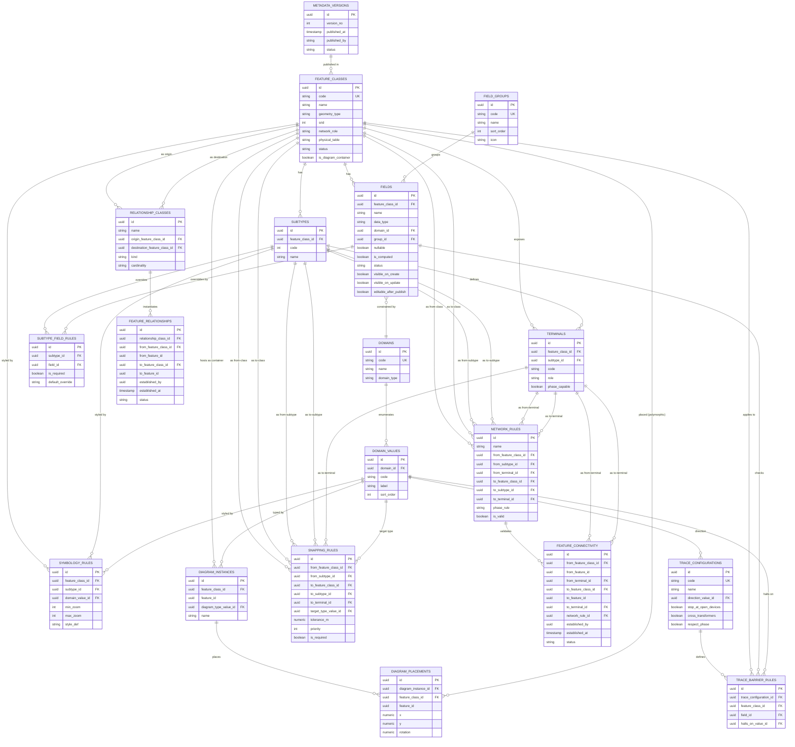

# Metadata core

This is the canonical, textual copy of VoltEdge's metadata architecture —
the tables that describe every feature class, then compile into physical
schema. Everything in this system stems from this doc; check it before
writing a feature-specific code path anywhere else.

An interactive version with hand-drawn mechanism diagrams (the transformer
terminal walkthrough, the map-vs-diagram figure, the MCP boundary, the
snap → resolve pipeline, the candidate → establish pipeline, the trace
barrier walkthrough) exists as a published Claude artifact. This file is
the version that lives with the code and stays in sync as phases land —
update both when the architecture changes, this one is authoritative for
the repo.

## Metadata core — entity relationship

Eighteen tables. Every feature class, subtype, field, domain, terminal,
connectivity rule, style rule, and trace rule in the system is a row in
one of these. Nothing about a specific feature type — conductor, pole,
transformer — exists in code.

Two tables here are metadata *about* metadata: `metadata_versions` tracks
publish history for the compiler itself (schema-level publish, admin-only,
infrequent) — separate from the draft/published `status` a single feature
*row* carries, which is a data-level, end-user, frequent concept and lives
outside this ERD entirely.

Three families of tables here are **generic runtime infrastructure, not
compiled per feature class**: `diagram_instances`/`diagram_placements`,
`feature_connectivity`/`feature_relationships`, and (implicitly)
attachments. They reference any feature row polymorphically through a
`feature_class_id` + `feature_id` pair rather than a normal foreign key,
because the target table varies by feature class.

## Metadata as schema compiler

Two different kinds of "publish" exist, and they must not be conflated:

1. **Metadata publish** (schema-level, admin-only, infrequent) — an
   architect changes what a feature class *is*.
2. **Data publish** (row-level, end-user, frequent) — an editor's
   draft/published state on one real feature.

The metadata publish lifecycle:

1. **Draft** — edits to `feature_classes`/`fields`/`domains`/etc. Nothing
   downstream has reacted yet.
2. **Validate** — domain references resolve, network rules only reference
   feature-class/subtype pairs that exist, geometry types are compatible
   with any relationship classes involving them.
3. **Compile** — the generator diffs current physical schema against what
   the draft metadata now describes, and produces a real DDL migration:
   `CREATE TABLE`, `ALTER TABLE ADD COLUMN`, `CHECK`/FK constraints for
   domains, indexes. Applied transactionally.
4. **Publish** — only after DDL succeeds does a `published_metadata_version`
   pointer flip, firing a `NOTIFY metadata_published`.
5. **Runtime services react** — the API, Martin's layer config, and the
   frontend's symbology/domain endpoint hold an **in-memory cache** of the
   compiled, published metadata, loaded at boot and reloaded on the
   publish event. They never query metadata tables per request.

A feature class doesn't exist to any consumer — API, Martin, the map layer
list — until its metadata has gone through compile + publish. Before that
it's a design-time row with no physical footprint.

## Symbology resolution — shape vs. modifier, map vs. diagram

Martin never sees `symbology_rules` or an SVG — it only serves geometry
plus whatever attribute columns a feature class's rules depend on. Every
icon decision happens client-side, resolved from the same published
metadata cache as everything else.

**Resolution order (most specific wins):**

| Order | Match |
|---|---|
| 1 | feature_class + subtype + domain_value |
| 2 | feature_class + subtype |
| 3 | feature_class + domain_value |
| 4 | feature_class only — the default symbol, mandatory at publish |

**Shape vs. modifier** — the split that keeps an icon library from growing
hundreds of near-duplicate SVGs:

| Attribute change | Shape or modifier? | Handled by |
|---|---|---|
| switch: open ↔ closed | shape — blade position differs | two `icon_ref` values, one per SWITCH_STATE domain value |
| transformer: 2-winding vs 3-winding | shape — extra winding loop | `icon_ref` keyed on winding_topology domain |
| transformer: 11kV vs 33kV primary | modifier — same pictogram | color/label computed from primary_voltage, no new file |
| transformer: kva_rating | modifier — continuous value | scale tier computed client-side |
| conductor: phase A / B / C | modifier — no icon at all | stroke color computed from phase_designation |

`symbology_rules` also carries a `render_context` value — map or diagram —
because the same closed switch is a small cartographic icon on the map and
a standard IEC schematic symbol in the one-line diagram. Diagrams don't go
through Martin at all: a `diagram_instance` holds a handful of features,
so the API serves them directly rather than tiling them.

## Diagram containers — representing what isn't on the map

Some features earn a place in the system without a defensible latitude
and longitude — a protective relay inside a cabinet, a logical control
scheme. `geometry_type` gains a legal value, `none`: no `geom` column is
generated for that feature class at all. Its only visual representation is
a `diagram_placements` row inside a `diagram_instance`.

| feature_classes | geometry_type | network_role | is_diagram_container |
|---|---|---|---|
| SUBSTATION_AREA | polygon | container | true |
| DIST_XFMR | point | junction | false |
| PROTECTIVE_RELAY | none | none | false |

A transformer that *does* have real geometry is referenced twice: its
`geom` column drives its position on the map, an unrelated
`diagram_placements.x/y` drives its position on a one-line diagram — two
independent coordinate systems, same `feature_id`. `diagram_type` is just
another row in `domains`, not a new lookup table.

## Field lifecycle & extensibility

| Change | Mechanism | Note |
|---|---|---|
| add a field | new `fields` row → publish → `ALTER TABLE ADD COLUMN` | safe, additive |
| disable a field | `fields.status = deprecated` | hidden from forms/API, data retained — dropping the column is a separate, deliberate action |
| assign / unassign a domain | `fields.domain_id` changed | publish gate runs an existing-data validation pass first — a domain swap can invalidate rows already stored |
| control the form | `visible_on_create`, `visible_on_update`, `editable_after_publish` | separate from `subtype_field_rules.is_required` — visibility, editability, and requiredness are three different questions |

## Attribute groups

Every field belongs to one `field_groups` row — a small, reusable set
(general, electrical, maintenance, asset), not redefined per feature
class. The edit form renders one section per group that has a populated
field on that feature class; an empty group just doesn't appear.

Documents/attachments deliberately isn't a field group — attachments live
in their own RustFS-backed table, not as fields. The edit form still shows
a Documents tab, driven by a relationship instead.

## Snapping rules

Digitizing runs on OpenLayers' Snap interaction, driven by
`snapping_rules`:

| snapping_rules sample | target_type | tolerance | priority | required |
|---|---|---|---|---|
| MV_CONDUCTOR → DIST_XFMR | point_feature | 0.15 m | 1 | true |
| MV_CONDUCTOR → MV_CONDUCTOR | endpoint | 0.15 m | 2 | false |
| SERVICE_LINE → MV_CONDUCTOR | edge | 0.30 m | 3 | false |
| POLE → MV_CONDUCTOR | edge | 1.00 m | 4 | false |

`priority` resolves ties when more than one target falls inside tolerance
— a point feature always outranks a bare vertex. `is_required` marks the
hard cases: a conductor endpoint that lands near a transformer but outside
tolerance should fail validation, not save as a near-miss.

Snapping and terminal resolution are two different problems, deliberately
kept apart: `snapping_rules` answers "is this vertex close enough to
count as touching that feature" (pure geometry); `network_rules` then
answers "which terminal does it electrically belong to" (pure attribute
matching). A transformer is one point in the geodatabase either way.

## Suggested vs. established — the integrity boundary

Snapping proves two vertices are geometrically coincident. It proves
nothing about intent. Connectivity and structural support are both
assertions about the real world, and only a person gets to make that
assertion.

| | Computed live | Requires explicit establish |
|---|---|---|
| containment (substation ⊃ transformer) | ✓ — `ST_Contains`, unambiguous geometry | — |
| structural support (pole ↔ conductor span) | — | ✓ — `feature_relationships` row |
| electrical connectivity (conductor → transformer terminal) | — | ✓ — `feature_connectivity` row |

The difference is judgment. Containment has none — a point is either
inside a polygon or it isn't. Support and connectivity both assert
something a coordinate can't carry, so both get a real, explicit row,
written only when a user — or an agent acting on a user's explicit
confirmation — takes the establish action. Never as a side effect of
digitizing, and never as a side effect of matching a rule.

A matching rule produces a **candidate**, not a fact. This is also why the
trace engine's in-memory graph syncs off `feature_connectivity` writes,
not off geometry or attribute changes — topology only moves when a human
commits to it. A switch flipping open or closed changes trace *results*,
not the underlying topology; the connectivity row stays exactly as it was.

## Network tracing — direction, configuration, composition

| Trace | Built from | What makes it distinct |
|---|---|---|
| connected | connected (undirected) | no direction — everything reachable from here |
| downstream | downstream | source → loads, stops at barriers |
| upstream | upstream | point → source(s), stops at barriers |
| shortest path | shortest_path | between exactly two points |
| isolation | upstream + downstream, composed | barrier devices found on both sides of a fault point = the minimal switching set |
| loop / mesh detection | connected, run from two sources | anything reachable from both sources is a parallel path |
| feeder / subnetwork | downstream | barrier set extended to stop at any subnetwork controller, not just open devices |

Isolation and loop detection aren't a fifth and sixth direction — the Go
service composes two primitive traces and post-processes the result. Only
four raw direction values ever need to exist.

"Transformer-aware, voltage-aware, phase-aware, respects barriers" is one
mechanism, not four — `trace_configurations` (direction +
`stop_at_open_devices` + `cross_transformers` + `respect_phase`) plus
`trace_barrier_rules` (which feature class + field + domain value halts
traversal). A downstream trace walks `feature_connectivity` edge by edge
and stops hard at the first open device — device state is checked live at
each hop, never baked into the graph.

| trace_configurations sample | direction | stop_at_open | cross_xfmr | respect_phase |
|---|---|---|---|---|
| Fault isolation — MV | upstream + downstream | true | false | true |
| Downstream load analysis | downstream | true | true | true |
| Feeder connectivity audit | connected | false | true | false |

Trace results are ephemeral by nature — the role already set aside for
Postgres UNLOGGED tables in place of Redis. No durable trace_results table
needed.

## MCP — data plane only

An MCP server sits beside the REST API, giving an agent tools to operate
on data — never on the metadata that governs the system. MCP and the REST
API write through the exact same generic, metadata-validated engine; the
metadata compiler is reachable only from the admin UI, with no path from
MCP into schema authoring.

| MCP tool | Read-only or mutating | What it does |
|---|---|---|
| search_features | read-only | query by feature_class + filters |
| suggest_connections | read-only | evaluate network_rules for a feature, propose ranked terminal candidates — never writes |
| suggest_relationships | read-only | same idea for structural support, from relationship_classes — never writes |
| validate_feature | read-only | dry-run against subtype_field_rules / network_rules, no write |
| establish_connection | mutating | writes a feature_connectivity row — the only path that turns a candidate into real topology |
| establish_relationship | mutating | writes a feature_relationships row — same explicit-confirm requirement |
| create_feature / update_feature | mutating | same validated write path as the REST API |
| run_trace | read-only | upstream/downstream trace via the Go graph service, walks feature_connectivity only |

The `suggest_*` tools are always safe to call. The `establish_*` tools map
directly to a user's explicit confirmation — an agent should never call
them on its own judgment, only in response to one.

## Sample configurations

Four feature classes, chosen to hit different corners of the model.

### MV_CONDUCTOR — edge

Subtypes: `overhead_mv_conductor`, `underground_mv_conductor`.

| Field | Group | Type | Domain | Rule |
|---|---|---|---|---|
| phase_designation | electrical | text | PHASE_CODE | required |
| conductor_material | electrical | text | CONDUCTOR_MATERIAL | required |
| voltage_class | electrical | text | VOLTAGE_CLASS | required |
| size_mm2 | electrical | numeric | — | required |
| length_m | general | numeric | — | computed, ST_Length(geom) |
| duct_bank_id | general | uuid | — | required if subtype = underground |
| pole_span_count | general | int | — | required if subtype = overhead |
| condition_rating | maintenance | text | CONDITION_RATING | required |
| last_inspected_at | maintenance | date | — | optional |

Symbology composes two rules per feature: phase (A/B/C/ABC → color) and
subtype (underground → dashed).

### POLE — none (structural, not a network participant)

Subtypes: `wood`, `concrete`, `steel`. No terminals row, never appears in
`network_rules` — it doesn't carry current. Relates to a conductor only
via `feature_relationships` (kind = spatial_support), explicitly
established, `ST_DWithin` only validating plausibility.

| Field | Group | Type | Domain | Rule |
|---|---|---|---|---|
| pole_material | general | text | POLE_MATERIAL | required, mirrors subtype |
| pole_use | general | text | POLE_USE | required |
| height_class | general | text | POLE_HEIGHT_CLASS | required |
| install_date | asset | date | — | optional |
| condition_rating | maintenance | text | CONDITION_RATING | required |
| last_inspected_at | maintenance | date | — | optional |

### DIST_XFMR — junction

Subtypes: `pole_mounted`, `pad_mounted`, `underground_vault`. Terminals:
T1 (primary, phase-capable), T2 (secondary, phase-capable), T3 (ground,
not phase-capable).

| Field | Group | Type | Domain | Rule |
|---|---|---|---|---|
| kva_rating | electrical | numeric | KVA_RATING | required, coded 5–2500 |
| primary_voltage | electrical | text | VOLTAGE_CLASS | required |
| secondary_voltage | electrical | text | LV_VOLTAGE_CLASS | required |
| phase_config | electrical | text | PHASE_CONFIG | required |
| winding_config | electrical | text | WINDING_CONFIG | required only if phase_config = 3P |
| manufacturer | asset | text | — | required |
| serial_number | asset | text | — | required |
| condition_rating | maintenance | text | CONDITION_RATING | required |
| last_oil_test_at | maintenance | date | — | optional |

`network_rules` sample: MV_CONDUCTOR → T1 valid when
`from.voltage_class = to.primary_voltage`; T2 → SERVICE_LINE valid when
`from.secondary_voltage = to.voltage_class`; T1 → T2 direct has no row —
invalid.

`winding_config`'s requirement depends on *another field's value*, not
subtype — `subtype_field_rules` alone can't express that. Flagged as the
first case needing a conditional-validation extension, not a blocker.

### SUBSTATION_AREA — container

Subtypes: `transmission_substation`, `distribution_substation`,
`switching_station`. Containment (`ST_Contains`) is computed live, not
stored — a transformer inside the boundary says nothing about whether
it's electrically traced through the substation. Those stay two separate
questions.

| Field | Group | Type | Domain | Rule |
|---|---|---|---|---|
| substation_name | general | text | — | required |
| substation_type | general | text | SUBSTATION_TYPE | required |
| capacity_mva | electrical | numeric | — | required |
| owner_utility | asset | text | — | required |
| commissioning_date | asset | date | — | optional |
| last_audit_at | maintenance | date | — | optional |

## Metadata configuration — running checklist

| Area | Covered by |
|---|---|
| feature class shape | feature_classes, fields, subtypes, domains |
| form behavior | subtype_field_rules, visible_on_create/update, editable_after_publish |
| attribute layout | field_groups |
| connectivity | network_rules, terminals, feature_connectivity (explicit establish only) |
| structural relationships | relationship_classes, feature_relationships (explicit establish only) |
| tracing | trace_configurations, trace_barrier_rules |
| map & diagram styling | symbology_rules, render_context |
| non-spatial / schematic-only features | geometry_type = none, diagram_instances, diagram_placements |
| digitizing behavior | snapping_rules — proximity only, never a connectivity write |
| agent-assisted actions | MCP suggest_* (read-only) vs establish_* (mutating, user-confirmed only) |
| validation beyond domain/required | regex, ranges, uniqueness, cross-field conditionals — **not yet modeled** |
| access control | role_permissions on feature_class / field_group — **not yet modeled** |
| list & search UI | filterable/sortable field flags — **not yet modeled** |
| map labeling | separate from symbology_rules — **not yet modeled** |
| asset numbering | per-feature-class ID/sequence rules — **not yet modeled** |
| attachment policy | allowed/required attachment types per feature class — **not yet modeled** |
| units & locale | stored vs display unit per field — **not yet modeled** |
| lifecycle states | draft/published today; states + transitions tables if a feature class ever needs more |

Check this list before adding a bespoke, feature-specific code path
anywhere else in the system.
