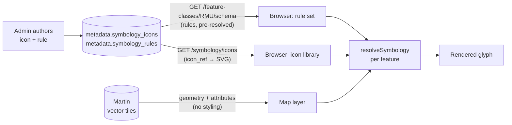

# The VoltEdge Symbology & Map Styling Guide

*How to make your network look the way you mean it to — authoring the symbols
your features wear on the map, and understanding the little engine that chooses
them.*

---

## How to read this guide

Symbology is the layer of VoltEdge that turns rows in a table into a picture: the
copper dot that says "transformer here," the hollow triangle that says "this
switch is open," the dashed teal line that says "this span is underground." This
guide is about authoring that picture and understanding how it is drawn.

Like the [Substation Guide](substation-guide.md) and the
[Asset Tags Guide](asset-tags-guide.md), it braids two lanes into one text so the
person *doing* the work and the person *reasoning about* the work can read the
same chapters:

- **The ▶ operator lane** — the step-by-step, "open this page, press this button,
  paste this markup" path for actually getting a symbol onto the map: drawing an
  SVG icon, registering it in the library, attaching it to a feature class, and
  making it change with a feature's own attributes. If you only need to *style*
  the network, read just these parts.
- **The ∑ model lane** — the "why it behaves this way" reference: the two tables
  behind every symbol, the client-side matcher that picks a style per feature,
  the most-specific-wins rule, and the render math that decides how big a glyph
  lands. If you administer VoltEdge or need to debug a symbol that won't appear,
  these are for you.

Skip the **∑** parts freely; the **▶** parts stand alone.

This guide assumes you have met the core VoltEdge concepts — feature classes,
subtypes, fields and domains, the map, and permissions — in the
[User Handbook](user-handbook.md). Where symbology touches those, it says so and
points back.

> **Symbology is metadata configuration**, so — like the
> [CIM Export Guide](cim-export-guide.md) — the whole of it lives behind the
> `metadata:*` permissions and the **Admin** area. Reading the symbology screens
> needs `metadata:read`; changing anything needs `metadata:write`. Every 🔒 in
> this guide names the exact permission the action wants.

### The cast

The recurring VoltEdge characters carry through, each holding a real set of
permissions the examples respect exactly:

| Who | Role | Shows up when… |
| --- | --- | --- |
| **Ada** | System administrator (`metadata:write`) | Drawing icons, authoring rules — the main character of almost every chapter |
| **Priya** | Read-only viewer / dispatcher (`features:read`) | Looking at the map and asking "why can't I *see* the RMUs?" — the reason a symbol exists |
| **Tom** | Network analyst (`metadata:read`) | Wanting a switch to *look* open when it is open — the driver of field-based styling in Chapter 4 |
| **Dana** | Network editor (`features:write`) | Placing the features that then wear Ada's symbols |

### The running example

One symbol threads through the whole guide: the **Ring Main Unit** glyph. By the
end you will have drawn an SVG icon called `voltedge-rmu` — a small square switch
box with three leads — registered it in the icon library, attached it to the
`RMU` feature class so every ring main unit on the map wears it, and learned how
to make it change color, size, and shape in response to a feature's own fields.
It is the same class the [RMU note](phase-rmu.md) models and the
[Substation Guide](substation-guide.md) places.

> **Legend used throughout:** 🔒 marks an action that needs a specific permission
> (named inline). 💡 is a tip. ⚠️ is a caution. ▶ opens an operator (how-to)
> passage; ∑ opens a model (how-it-works) passage.

### Chapter roadmap

1. **[How symbology works — the mental model](#chapter-1--how-symbology-works)** — the two tables, the client-side matcher, why a symbol is chosen per feature, and why neither a recompile nor a tile-server restart is what makes one appear.
2. **Authoring SVG icons** — the icon library page, what makes a valid symbol (the width/height rule, the `{{COLOR}}` placeholder), the sizing math, and drawing the RMU glyph from scratch.
3. **Attaching a symbol to a feature class** — the per-class Symbology section, the mandatory default rule, render context, and the point style knobs (icon, color, scale).
4. **Targeting — styling by subtype and by field value** — the two targeting axes, coded fields and their domains, most-specific-wins in practice, and the open/closed switch worked example.
5. **Lines and polygons** — width, dash patterns, fill and stroke, and styling conductors by voltage.
6. **Zoom, labels, and visibility** — a rule's zoom band vs. the class display-zoom vs. the map label, and how to declutter a busy map.
7. **Diagram symbology** — the `diagram` render context, how a single-line stencil differs from a map glyph, and authoring both from one class.
8. **Troubleshooting & recipes** — the "nothing appears" checklist, the SQL you can run to see what the map sees, and a one-page cheat sheet.

---

## Chapter 1 — How symbology works

This chapter builds the vocabulary the rest of the guide assumes, and it answers
the single most common confusion up front — the one that sends people restarting
services that have nothing to do with the problem. Read it once. If you only ever
remember one thing, make it this: **a symbol is chosen in your browser, per
feature, from rules the server hands down — nothing is "baked" and no picture is
stored.**

### 1.1 ▶ The problem symbology solves

Priya opens the map. She can see conductors and transformers, but the ring main
units her team just surveyed are invisible — or worse, they are all identical
grey dots she can't tell apart from anything else. She pings Ada: *"Can you make
the RMUs actually look like RMUs?"*

That request — "make this kind of feature look like *that*" — is the whole of
symbology. Every feature in VoltEdge is stored as plain geometry plus attributes
(a point at a location, with a subtype, a voltage, a status). None of that says
anything about *appearance*. Symbology is the configuration that sits on top and
says: *when you draw an* `RMU`*, draw it as this little square icon in copper; when
you draw an* `MV_CONDUCTOR` *that is underground, draw it as a dashed line.*

Ada owns that configuration. She never edits Priya's features to change how they
look — she edits the **rules** that decide how a whole *class* of feature is
drawn. Do it once, and every ring main unit — the thousand already on the map and
the next one Dana places tomorrow — wears the symbol automatically.

### 1.2 ∑ Two tables, two different jobs

Here is the fact that trips up almost everyone the first time (it tripped up this
very network before this guide existed): **symbology is two separate things, in
two separate tables, and doing only the first one renders nothing.**

| Table | What it holds | The analogy |
| --- | --- | --- |
| `metadata.symbology_icons` | Named pieces of SVG artwork: `icon_ref` → markup | A **library of stamps**. A stamp on the shelf marks nothing. |
| `metadata.symbology_rules` | Which style (which icon, colour, size…) applies to which feature | The **instruction** "stamp *this* stamp on every RMU" |

An icon is just a drawing with a name (its `icon_ref`, e.g. `voltedge-rmu`). It
sits in the library doing nothing. It only reaches the map when a **rule** on
some feature class points at it by name and says "use this."

> ⚠️ **The number-one mistake.** Uploading an SVG to the icon library and
> expecting it to appear on the map. It won't — you have created a stamp but
> never told anything to stamp it. You need *both* an icon **and** a rule that
> references it. Chapters 2 and 3 are exactly those two steps, in order.

Why split them at all? Because the two jobs change independently. You can redraw
what a symbol *looks like* (edit the icon markup) without touching a single rule
about *where* it is used — and vice versa. A stroke-width tweak to the RMU glyph
instantly re-flows to every rule that uses it, with no rule editing. That
separation is deliberate; it is why the icon's identity (its `icon_ref`) is fixed
and only its artwork is editable in place.

### 1.3 ∑ The picture is never stored — it is resolved, in your browser

The second surprise: **the map's tile server never sees a symbol at all.**

VoltEdge serves feature *geometry* as vector tiles through Martin (the tile
server). Those tiles carry the shapes and every attribute column — a point, its
subtype, its voltage, its status — but **not one byte of styling**. Martin does
not know what an RMU should look like and never will.

Instead, when the map layer for a class loads, the browser fetches that class's
**schema** — `GET /feature-classes/{code}/schema` — and inside it a `symbology`
array: the class's rules, pre-resolved into a shape the browser can match
directly. Then, for *each feature the tiles deliver*, the browser runs a tiny
matcher (`resolveSymbology`) that reads that feature's own attributes, picks the
best-fitting rule, and paints the glyph the rule describes.

So the flow is:



In plain ASCII, the same pipeline:

```
  metadata.symbology_icons ─┐                     Martin tiles
  (icon_ref → SVG markup)   │                (geometry + attributes,
                            │                    NO styling)
                            ▼                          │
                   GET /symbology/icons                │
                            │                          ▼
   metadata.symbology_rules │                   ┌─────────────┐
   (which style, which      ├──► browser ──────►│ resolve per │──► glyph
    feature)                │                   │   feature   │    on map
                            │                   └─────────────┘
                   GET /feature-classes/RMU/schema
                     (rules, pre-resolved)
```

This is why the two "obvious" fixes are the wrong ones:

- **Restarting Martin does nothing for symbology.** Martin serves geometry; it
  has no idea symbols exist. A symbol that won't appear is never Martin's fault.
- **Recompiling a class does not drive its map symbols either.** Recompiling
  rebuilds the class's *table and tile function* (its geometry plumbing). The
  schema endpoint reads `symbology_rules` **live** from the metadata tables at
  request time — it is not a compiled snapshot. Add or edit a rule and it is
  effective on the very next schema fetch.

> 💡 **What *does* make a change appear:** a fresh fetch of the class schema. The
> map caches each class's schema for a few minutes and only rebuilds a layer when
> that fetch changes, so after authoring a rule or icon the reliable trigger is a
> **hard browser refresh** (Ctrl/Cmd-Shift-R). No service restart, no recompile.

### 1.4 ∑ How one feature's style gets picked: most-specific-wins

A class can carry many rules at once — a plain default, a different look for one
subtype, a special colour when a status field has a certain value. When the
browser draws a single feature, several of those rules might match it. Which one
wins?

VoltEdge scores each matching rule by **how narrowly it targets**, and the
narrowest match wins. A rule can be pinned on two independent axes:

- **Subtype** — "only features of subtype 3." Worth **2** points.
- **A field value** — "only features whose `status` field equals `open`." Worth
  **1** point.

A rule that pins *both* scores 3; subtype-only scores 2; field-only scores 1; a
rule that pins *neither* scores 0. For each feature, every matching rule is
scored and **the highest score paints it.** Ties are not expected — authoring is
meant never to produce two equally-specific rules for the same combination.

```
  Specificity of a rule = (subtype pinned ? 2 : 0) + (field value pinned ? 1 : 0)

   subtype 3  AND  status = open   →  3   (most specific — wins over all below)
   subtype 3                       →  2
   status = open                   →  1
   (neither — the default)         →  0   (the safety net — always matches)
```

That score-0 "neither" rule is special: it matches *every* feature of the class,
so it is the guaranteed fallback when nothing more specific applies. **Every class
must have exactly one of these** — the mandatory **default rule**. It is what
guarantees a feature is never left unstyled. (Chapter 3 covers authoring it; the
nothing in the code enforces the "exactly one default" invariant after creation; see Chapter 3.)

> 💡 Think of it as a cascade of increasingly specific overrides on a base coat.
> The default is the base coat everything gets; each narrower rule repaints just
> the features it names.

### 1.5 ∑ Two worlds: the `map` and the `diagram`

Every rule also declares a **render context** — where it applies:

- **`map`** — the geographic map (the vector-tile layers Priya is looking at).
- **`diagram`** — the schematic single-line diagram (the stencils on a
  substation one-line).

The same feature class can, and usually does, carry rules for both: a real-world
copper icon on the map, and a standardised schematic symbol on the diagram. They
are authored side by side in the same editor and never interfere — each consumer
reads only its own context's rules. When Tom is styling switches in Chapter 4 he
is working in `map`; Chapter 7 crosses over to `diagram`.

> ⚠️ A rule authored with render context `diagram` will **never** show on the
> geographic map, however perfect its icon. If a symbol is missing from the map,
> the first thing to check — after "does a rule exist at all" — is that the rule's
> context is `map`, not `diagram`. This is a real and easy mix-up.

### 1.6 ▶ The shape of the work ahead

With the model in hand, the operator path for Priya's request is just three
moves, and the rest of this guide is those three moves in depth:

1. **Draw and register the icon** (Chapter 2) — create the `voltedge-rmu`
   artwork in the icon library. 🔒 `metadata:write`
2. **Attach it to the class** (Chapter 3) — add a `map` symbology rule to the
   `RMU` class whose icon is `voltedge-rmu`. This is the step that actually puts
   it on the map. 🔒 `metadata:write`
3. **Refine it** (Chapters 4–6) — make it change with the feature's fields,
   tune its size and colour, and control when it labels and at what zoom it
   shows.

Then hard-refresh, and Priya's RMUs appear — wearing a symbol that finally looks
like an RMU.

### 1.7 Chapter summary

- Symbology turns stored geometry + attributes into a styled picture; it is
  **configuration on a feature class**, not an edit to any feature.
- It lives in **two tables**: `symbology_icons` (the artwork library, keyed by
  `icon_ref`) and `symbology_rules` (which style applies to which feature). **An
  icon alone renders nothing** — a rule must reference it.
- Symbols are **resolved in the browser, per feature**, from rules the schema
  endpoint hands down live. **Martin never sees a symbol; recompiling does not
  drive map symbology.** The reliable "make it appear" action is a **hard
  refresh**.
- When several rules match a feature, the **most specific wins**
  (`subtype = 2, field value = 1`); a mandatory **default rule** (neither axis
  pinned) is the always-matching safety net.
- Every rule has a **render context** — `map` or `diagram`. A `diagram` rule
  never shows on the map.

*Next: Chapter 2 — Authoring SVG icons: what makes a valid symbol, the `{{COLOR}}`
placeholder and the width/height rule that catches everyone, the sizing math, and
drawing the `voltedge-rmu` glyph from a blank editor.*

---

## Chapter 2 — Authoring SVG icons

This is the first of Priya's three moves: drawing the artwork. By the end of the
chapter Ada has a valid, named icon — `voltedge-rmu` — sitting in the library,
previewed and ready. It still won't be on the map (that is Chapter 3's job — the
rule), but it will exist as a reusable stamp.

Everything here is the **icon library**: `metadata.symbology_icons`, the artwork
half of the two-table model from Chapter 1. Nothing in this chapter mentions a
feature class, because an icon knows nothing about where it will be used.

### 2.1 ∑ The library, and the five shapes you already have

Before Ada draws anything, it helps to know the library is never empty. Five
shapes are **built into the frontend as a fallback** and always resolve, even on
a database with zero authored icons:

| `icon_ref` | Shape |
| --- | --- |
| `circle` | Filled disc (the default when a rule names no icon) |
| `square` | Rounded filled square |
| `triangle` | Filled triangle |
| `triangle-outline` | *Hollow* triangle — stroke only, transparent centre |
| `diamond` | Filled diamond |

These live in `symbology-icons.ts` as `FALLBACK_ICONS`. They matter for two
reasons. First, a brand-new install can style its whole network from these alone.
Second — and this is the safety net Chapter 1 promised — if a rule ever names an
`icon_ref` that isn't in the database (a typo, or a fetch still in flight), the
resolver falls back through this set to `circle` rather than drawing nothing. **A
missing icon degrades to a shape; it never makes a feature invisible.**

> ∑ The `triangle-outline` shape is a deliberate lesson in itself. It is the same
> triangle as `triangle` but with `fill="none"` and a stroke — a genuinely hollow
> silhouette. It exists so an *open* switch can differ from a *closed* one by
> **shape**, not merely by colour. Keep that "shape vs. modifier" idea in your
> pocket; Chapter 4 uses exactly this pair to style switches by their state.

### 2.2 ▶ Where you author icons

Ada opens **Admin → Symbology icons**.

- 🔒 Seeing the page needs **`metadata:read`**. Every authenticated admin-area
  user who has that can browse the library and its live previews.
- 🔒 The **New icon**, edit (✏️), and delete (🗑️) controls only appear with
  **`metadata:write`**. The page gates its own write buttons to match what the
  server will allow, so Tom (read-only) sees the gallery but no way to change it.

The page lists every authored icon as a card: a live thumbnail, the `icon_ref` in
monospace, and a badge reading **Tintable** or **Full-color** (more on that in
§2.5). Empty database? The page says so and reminds you the built-in shapes still
render.

### 2.3 ▶ Creating the icon — the two fields

**New icon** opens a small form with exactly two inputs:

1. **Name** — this becomes the `icon_ref`, the permanent identity a rule will
   spell to reach this artwork. It must be **lower-kebab-case**: start with a
   letter, then lowercase letters, digits, or hyphens — the pattern
   `^[a-z][a-z0-9-]*$`, enforced both in the form and again on the server
   (`iconRefPattern` in `api/internal/admin/validate.go`). The field lowercases
   as you type. `voltedge-rmu` is valid; `Voltedge_RMU` and `2-rmu` are not.
   > ⚠️ The name is the identity and it does **not** change later — editing an
   > icon changes only its markup, never its `icon_ref` (§2.6). Choose a name a
   > rule can live with. A house prefix like `voltedge-…` or a standards prefix
   > like `iec-…` keeps the library legible.
2. **SVG markup** — the drawing itself, pasted as raw `<svg>…</svg>` text. Beside
   the textarea is a **live preview** thumbnail and a **tint colour** swatch. The
   preview re-renders as you type (as soon as the text contains `<svg`), so you
   see the glyph before you save.

**Create** writes the row (`POST /admin/symbology-icons`) and the new icon is
immediately live everywhere — the page refreshes both its own list and the map's
public icon registry, so no deploy and no refresh are needed for the *library*.
(The map still needs a rule before it draws the icon — Chapter 3.)

### 2.4 ∑ What makes a valid, renderable SVG

Three rules separate an icon that renders from one that silently fails. The first
is the one that cost this very network an afternoon.

**Rule 1 — carry explicit `width` and `height`, not just a `viewBox`.** This is
the single most common defect, and its failure mode is nasty because *nothing
errors* — the icon just never appears. When the browser rasterises an SVG for a
map glyph it does so through a detached `Image()`, and Chromium sizes an image
with no intrinsic width/height to **150×150** — far too big for the icon slot, so
it drops out. Every built-in shape carries `width="24" height="24"`, and the
editor hint says so in as many words: *"Must carry explicit width/height, not just
a viewBox."* So:

```xml
<!-- ✅ renders -->
<svg xmlns="http://www.w3.org/2000/svg" width="24" height="24" viewBox="0 0 24 24">…</svg>

<!-- ❌ has a viewBox but no width/height — resolves to 150×150 and silently vanishes -->
<svg xmlns="http://www.w3.org/2000/svg" viewBox="0 0 100 100">…</svg>
```

> ⚠️ This is exactly the trap behind "I attached the symbol, recompiled, restarted
> the tile server, and nothing showed up." The recompile and restart were red
> herrings (Chapter 1); the icon simply had no width/height. Adding them is the
> whole fix.

**Rule 2 — author on a 24×24 canvas.** Every built-in is drawn at `viewBox="0 0
24 24"`, and the map's render math assumes it (§2.7). You *can* use another
viewBox, but if you draw on a 100-unit canvas and the artwork only fills the
middle of it, the glyph lands small — because the map scales the whole 24-unit
box down and your art occupies a fraction of it. Drawing at 24×24 (or tightening
your viewBox to hug the artwork) is the reliable way to get a symbol that reads at
the same size as the built-in dot.

**Rule 3 — use `{{COLOR}}` where the rule's colour should go (optional).** See
the next section.

### 2.5 ∑ Tintable vs. full-colour: the `{{COLOR}}` placeholder

A symbol can either take its colour from the *rule* that uses it, or carry its own
fixed colours. VoltEdge supports both through one mechanism: the literal token
`{{COLOR}}`.

- Write `fill="{{COLOR}}"` or `stroke="{{COLOR}}"` and, at render time, that token
  is replaced by the colour the rule specifies. One icon, any colour — this is
  how the same `circle` shape paints a copper transformer and a blue service
  point. The library card badges these **Tintable**.
- Leave `{{COLOR}}` out entirely and the artwork renders **exactly as authored** —
  the substitution simply finds nothing to replace (a harmless no-op). This is
  how a multi-colour logo or a standards symbol with fixed colours opts out of
  tinting. The card badges these **Full-color**.

That is the entire rule: *placeholder present → the rule colours it; placeholder
absent → it keeps its own colours.* You never choose a "mode"; the markup decides.

> 💡 The preview's **tint swatch** only affects `{{COLOR}}` symbols — it substitutes
> that colour into the placeholder so you can check a tintable icon against a real
> colour before saving. On full-colour artwork the swatch does nothing, which is
> itself a useful signal that your icon has no placeholder.

### 2.6 ▶ Drawing `voltedge-rmu`

Ada wants a ring main unit to read as a small **switch box with three leads** — a
box for the enclosure, three stubs for the ways. Here is that glyph, authored the
recommended way: a 24×24 canvas, explicit width/height, and `{{COLOR}}` on the
stroke so a rule can colour it:

```xml
<svg xmlns="http://www.w3.org/2000/svg" width="24" height="24" viewBox="0 0 24 24"
     fill="none" stroke="{{COLOR}}" stroke-width="2"
     stroke-linecap="round" stroke-linejoin="round">
  <rect x="5" y="8" width="14" height="9" rx="1.5"/>
  <line x1="9"  y1="8" x2="9"  y2="3"/>
  <line x1="12" y1="8" x2="12" y2="3"/>
  <line x1="15" y1="8" x2="15" y2="3"/>
</svg>
```

Ada pastes this into the markup field, types `voltedge-rmu` as the name, nudges
the tint swatch to a copper tone to sanity-check it, and presses **Create**. The
`voltedge-rmu` stamp now exists in the library.

> 💡 **Line weight and hollow vs. filled are yours to tune.** `stroke-width` sets
> how heavy the leads and box read (raise it for a bolder glyph); `fill="none"`
> keeps the box hollow, while `fill="{{COLOR}}"` on the `<rect>` would make it a
> solid block. `stroke-linecap="round"` softens the lead ends. These are ordinary
> SVG attributes — the editor imposes nothing beyond the three rules in §2.4.

> ∑ **A note on canvas size and apparent size.** If you prefer to draw on a larger
> canvas (say `viewBox="0 0 100 100"` with heavier stroke-widths to match), the
> icon will still render once it carries width/height — but it will look *smaller*
> on the map than a 24-unit version, because the map scales the whole box down and
> your art fills only part of it. That is the "it's authored but it looks tiny"
> situation. The clean fixes are, in order of preference: redraw at 24×24; tighten
> the viewBox to the artwork's real bounds; or, without touching the icon, drive
> its on-screen size up with the **rule's `scale`** knob (Chapter 3, §3.x). The
> `scale` knob is the right tool when the artwork is fine and you just want it
> bigger for one class.

### 2.7 ∑ How big the icon actually lands

The on-screen size of a point glyph is a single multiplication the map does per
feature:

```
  on-screen scale = ICON_BASE_SCALE (0.65)  ×  (rule.scale ?? 1)
```

`ICON_BASE_SCALE` is a fixed `0.65` (in `map-layers.ts`) — it scales a 24-unit
icon down so it reads at roughly the size of the plain map dot it replaces, rather
than as a raw 24-pixel blob. The rule's own `scale` (default `1`) then multiplies
that. So a rule with `scale = 2` on a 24×24 icon renders it at twice the base
size; a rule with no scale renders it at the base. This is the knob to reach for
when a symbol is authored correctly but you want it bigger or smaller **for one
class** without editing the shared artwork — and it is exactly the setting Chapter
3 covers when it attaches `voltedge-rmu` to the `RMU` class.

### 2.8 ▶ Editing and deleting icons

**Editing** (✏️ on a card) reopens the same editor on the existing markup, with
the live preview. You can rewrite the drawing freely — thicken the leads, swap
`fill="none"` for a solid box, add a `{{COLOR}}` placeholder — and **Save**
(`PATCH /admin/symbology-icons/{icon_ref}`). The change is instant and global:
every rule that references this `icon_ref` now draws the new artwork, with no rule
editing, because the icon's identity never moved. The one thing you cannot change
here is the `icon_ref` itself — that is the stable name rules depend on.

**Deleting** (🗑️) is guarded: an icon can only be deleted **while no symbology
rule references it.** If any rule still points at it, the server refuses with a
clear error rather than leaving rules pointing at a hole. So the safe order is
always: repoint or remove the rules first, then delete the icon.

> 💡 **Prefer SQL?** The library is a plain table — `metadata.symbology_icons`
> (migration 0023), `icon_ref` → `svg`. Nothing stops you inserting or updating a
> row directly (`INSERT INTO metadata.symbology_icons (icon_ref, svg) VALUES (…)`),
> and it takes effect on the next schema/registry fetch just like the UI path.
> The same three validity rules from §2.4 apply — width/height especially, since
> SQL won't warn you. The visual editor exists so you don't *have* to, but the
> door is open.

### 2.9 Chapter summary

- Icons live in **`metadata.symbology_icons`**, authored at **Admin → Symbology
  icons** (🔒 `metadata:read` to view, `metadata:write` to change). Five built-in
  fallback shapes always resolve, so the library is never empty and a bad
  `icon_ref` degrades to a shape rather than to nothing.
- A new icon needs a **lower-kebab name** (its permanent `icon_ref`) and **SVG
  markup**, checked against a **live tinted preview**.
- A renderable SVG must **carry explicit `width`/`height`** (missing them →
  silent 150×150 failure), is best **authored at 24×24**, and uses **`{{COLOR}}`**
  wherever the rule's colour should apply (omit it for fixed full-colour art).
- On-screen size = **`0.65 × (rule.scale ?? 1)`**; the rule's `scale` is how you
  resize a correct icon per class without editing the artwork.
- Editing changes only the artwork (never the `icon_ref`) and is global and
  instant; deletion is blocked while any rule still references the icon. SQL is a
  supported alternative to the editor.

*Next: Chapter 3 — Attaching a symbol to a feature class: the per-class Symbology
section, the mandatory default rule, choosing the `map` render context, and wiring
`voltedge-rmu` onto the `RMU` class so it finally appears.*

---

## Chapter 3 — Attaching a symbol to a feature class

The icon exists; now make it appear. This is the step that actually puts a symbol
on the map — the **rule** that says "draw every `RMU` as `voltedge-rmu`." By the
end, Priya's ring main units finally look like ring main units.

### 3.1 ▶ Where rules live

Rules are edited **per feature class**, not in one global list:

**Admin → Feature classes → open the class (e.g. `RMU`) → the *Symbology* section.**

That section lists every rule the class already has, each with a **live swatch** of
exactly how it renders, and gives you four actions: **Add rule**, **Edit**,
**Duplicate**, **Delete** (🔒 all `metadata:write`; `metadata:read` sees the list
read-only). A separate **Labelling** section and **Display zoom** section sit
nearby — those are Chapter 6.

### 3.2 ▶ The Add-rule form, field by field

**Add rule** opens one dialog. The top row is **targeting** (who the rule applies
to); the bottom is **style** (what it draws). For a first default rule you touch
only two things — render context and the icon — and leave the rest at "any".

| Field | What it does | For the RMU default |
| --- | --- | --- |
| **Render context** | `map` or `diagram` — which surface this rule paints | **`map`** |
| **Subtype** | Restrict to one subtype, or **any** | **any** |
| **Field** | Restrict to a coded field's value, or **any** | **any** |
| **Value** | (appears only after a Field is chosen) the required value | — |
| **Apply rule from / to zoom** | Zoom band this *style* applies over (Chapter 6) | leave blank |
| **Color** | The colour — fills `{{COLOR}}` in the icon | your copper tone |
| **Scale** | Multiplies the icon's size (`0.65 × scale`) | `1` (or `2` to enlarge) |
| **Icon** | The icon picker — pick `voltedge-rmu` | **voltedge-rmu** |

The style controls change with the class's geometry: a **point** class shows
**Scale + Icon**; a **line** shows **Width + Dash**; a **polygon** shows **Fill
color + Stroke color** (Chapter 5). `RMU` is a point, so you get the icon picker.

### 3.3 ∑ The default rule — the one every class must have

A rule with **Subtype = any** and **Field = any** targets *nothing in particular*,
so it matches **every** feature of the class. That is the **default rule** — the
base coat from Chapter 1, and every class must have **exactly one**.

- It is what guarantees a feature is never unstyled.
- **Nothing enforces the "exactly one default" invariant after a class is created.**
  The rule editor does not, and neither does the compiler (`cmd/compile` and
  `internal/compiler` contain no symbology check; the migration and code comments
  that say otherwise are out of date). So you can freely add, edit, and delete rules;
  if you leave a class with **no** default, nothing fails — features with no more-specific
  match simply fall back to the map's plain geometry-type styling. Two defaults are
  likewise accepted (the matcher picks one).
- Deleting rules has **no guard** — deletion can only ever remove specificity, and
  nothing re-checks the set afterwards, so keep your own default rule in place.

> 💡 So the practical rule of thumb: **always keep one any/any rule per class.**
> Build specificity *on top* of it (Chapter 4), never by removing it.

### 3.4 ▶ Worked example — put `voltedge-rmu` on the map

Ada finishes Priya's request:

1. **Admin → Feature classes → `RMU` → Symbology → Add rule.**
2. **Render context:** `map`. **Subtype:** any. **Field:** any. *(This is the
   default rule.)*
3. **Color:** click the swatch, pick the copper tone. **Icon:** open the picker,
   choose **`voltedge-rmu`** (its thumbnail is tinted with the colour you just
   picked, so you see the real glyph). **Scale:** `1` — or `2` if it reads small.
4. **Add rule** → the row appears in the list with a live swatch.
   (`POST /admin/feature-classes/RMU/symbology-rules`.)
5. **Hard-refresh the map** (Ctrl/Cmd-Shift-R). Every RMU now wears the glyph.

If the `RMU` class already had a plain default rule (many seeded classes do),
Ada doesn't add a second one — she **Edits** the existing default and swaps its
icon to `voltedge-rmu`. One default, edited, not duplicated.

> ⚠️ If nothing changes after the refresh, the usual causes are: the rule's render
> context is `diagram` not `map`; the icon has no width/height (Chapter 2); or the
> browser is still on the cached schema — a *hard* refresh, not a soft one. Chapter
> 8 is the full checklist.

### 3.5 Chapter summary

- Rules are authored per class at **Admin → Feature classes → {class} → Symbology**
  (🔒 `metadata:write`), each shown with a live swatch.
- The **Add rule** dialog is **targeting** (render context / subtype / field / value
  / zoom) over **style** (colour + geometry-specific knobs + icon).
- A **default rule** (any/any) matches every feature; **keep exactly one per
  class** — nothing enforces it (not the editor, not the compiler), and a missing default means plain
  geometry styling.
- Attaching `voltedge-rmu` to `RMU` is one `map` default rule with that icon; a
  **hard refresh** makes it appear.

---

## Chapter 4 — Targeting: styling by subtype and by field value

A single glyph for a whole class is rarely enough. You want *open* switches to
look different from *closed* ones, transmission poles heavier than distribution
poles, faulted assets to jump out. That is **targeting**: narrowing a rule so it
paints only some features, and letting the most specific rule win.

### 4.1 ∑ The two axes, and who wins

From Chapter 1, a rule can pin two independent axes, and specificity is their sum:

| Rule pins… | Specificity | Beats |
| --- | --- | --- |
| Subtype **and** field value | **3** | everything below |
| Subtype only | **2** | field-only and default |
| Field value only | **1** | default |
| Neither (the default) | **0** | nothing — the fallback |

For each feature the browser scores every matching rule and paints with the
highest. You never order rules by hand; you just author the narrow ones and the
engine picks. **Authoring should never create two equally-specific rules for the
same subtype+value combination** — that is the one ambiguity to avoid.

### 4.2 ▶ Targeting by subtype

Use this when a subtype should simply look different — an underground vs overhead
conductor, a transmission vs distribution pole.

1. **Add rule** on the class.
2. **Subtype:** pick the subtype (the dropdown shows `code: name`). **Field:** any.
3. Set the style. **Add rule.**

That rule scores 2 and overrides the default for just that subtype. Everything
else still falls through to the default.

### 4.3 ▶ Targeting by field value — the coded-field requirement

Use this to style by an attribute's *value* — a switch's state, a pole's material,
an asset's condition.

The value axis only works on a **coded field**: a field backed by a **domain**
(a fixed list of allowed values). In the Add-rule form, the **Field** dropdown
lists **only** the class's coded fields; a free-text or numeric field never appears
there. Once you pick a field, a **Value** dropdown appears, populated from that
field's own domain values, and it is **required** — a field without a value is
rejected (both in the form and on the server).

> ∑ At render time the match is exact string equality: the feature's stored value
> for that field must equal the rule's **value code**. So the codes you target are
> the domain's value *codes*, whatever they are (`open`, `oh`, `CU`…), not their
> display labels.

### 4.4 ▶ Worked example — open vs closed switches

Tom wants open switches to read as a **hollow** triangle and closed ones as a
**solid** triangle, so the network's switching state is legible at a glance. His
switch class has a coded **state** field whose domain includes `open` and `closed`.

Three rules, layered on the class:

1. **Default (any/any)** — `triangle`, in the normal device colour. *(Score 0 —
   the base coat; a switch with no state, or an unexpected state, still draws.)*
2. **Field = state, Value = `closed`** — `triangle` (solid). *(Score 1.)*
3. **Field = state, Value = `open`** — `triangle-outline` (hollow). *(Score 1.)*

Now a closed switch matches rules 1 and 2 → rule 2 wins (solid). An open switch
matches rules 1 and 3 → rule 3 wins (hollow). This is exactly why
`triangle-outline` exists in the fallback set: an open switch differs by **shape**,
not merely colour.

> 💡 **Want open switches red *and* hollow?** Give rule 3 a red **Color** too — a
> rule sets targeting and style together, so one open-state rule can change both
> the icon and its colour. (This is the pattern the OMS console uses to make open
> switches shout.)

### 4.5 ▶ Combining both axes

Pin **Subtype and Field** together for a score-3 rule — e.g. "load-break switches
(subtype) that are open (state=open)" drawn differently from other open switches.
Reach for this only when a broad field rule genuinely needs a per-subtype
exception; most maps never need score-3 rules.

### 4.6 Chapter summary

- **Targeting narrows a rule**; specificity = subtype (2) + field value (1); the
  highest-scoring matching rule paints each feature, automatically.
- The **value axis needs a coded (domain-backed) field** — only those appear in the
  Field dropdown, and a chosen field **requires** a value.
- Layer narrow rules **on top of** the default; the open/closed switch pattern
  (default `triangle`, `closed`→solid, `open`→hollow `triangle-outline`) is the
  canonical field-value example.
- A rule sets **style and targeting together**, so one rule can change both shape
  and colour for its slice.

---

## Chapter 5 — Styling lines and polygons

Points wear icons; lines and polygons don't. When the class's geometry is a line
or a polygon, the Add-rule form swaps the icon picker for the knobs that geometry
actually uses — and shows a **live swatch** so you see the stroke or fill as you
set it. Targeting (Chapter 4), the default rule (Chapter 3), and zoom (Chapter 6)
work identically; only the style controls differ.

### 5.1 ▶ Line styles — colour, width, dash

A **line** class (a conductor, a cable, a boundary run) shows three controls:

- **Color** — the stroke colour.
- **Width** — the stroke thickness in pixels.
- **Dash** — a named pattern, one of exactly four: **`solid`**, **`dashed`**,
  **`dotted`**, **`dashdot`**.

> 💡 The list-row subtitle summarises a line rule as e.g. *"dashed · 3px"*, so you
> can read a class's line rules at a glance without opening each.

**Worked example — underground conductors dashed.** Dana wants overhead spans
solid and underground spans dashed on `MV_CONDUCTOR` (overhead vs underground is a
subtype swap on that class):

1. **Default (any/any):** Color = the MV colour, Width = `2`, Dash = `solid`.
2. **Subtype = Underground:** same colour, Width = `2`, Dash = `dashed`. *(Score 2
   — overrides the default for underground only.)*

Overhead falls through to solid; underground draws dashed. Add a **voltage-class**
rule on top (if you carry a coded voltage field) to thicken 33 kV runs — Width `4`
— and it layers cleanly.

### 5.2 ▶ Polygon styles — fill and stroke

A **polygon** class (a site boundary, a zone) shows:

- **Fill color** — the interior.
- **Stroke color** — the outline.

Colour these to sit *under* the network without drowning it — a pale fill and a
darker stroke usually read best. The live swatch previews both together.

### 5.3 ∑ What's written, and why blobs stay clean

Behind the form, a rule stores only the style keys its geometry uses:
`icon_ref`/`color`/`scale` for a point, `color`/`width`/`dash` for a line,
`fill_color`/`stroke_color` for a polygon (`color` is shared). Only keys you set
are written — a point rule never carries empty line keys — so a rule's style is
exactly what it needs and nothing more. You don't manage this; it's why the form
shows only the relevant knobs.

### 5.4 Chapter summary

- The style controls follow geometry: **point → Scale + Icon**, **line → Width +
  Dash**, **polygon → Fill + Stroke** (Color is shared).
- Dash is one of **`solid` / `dashed` / `dotted` / `dashdot`**.
- Targeting, default rule, and zoom behave exactly as for points — style
  underground conductors dashed via a subtype rule over a solid default; thicken by
  voltage with a field rule on top.

---

## Chapter 6 — Zoom, labels, and visibility

A correct symbol on a crowded map is still unreadable if everything draws at every
zoom. This chapter is the decluttering toolkit — and it hinges on telling apart
**three** different zoom controls that beginners conflate. Get these straight and
map tuning becomes easy.

### 6.1 ∑ Three controls, three jobs — do not confuse them

| Control | Where | What it does |
| --- | --- | --- |
| **Rule zoom band** (*Apply rule from/to zoom*) | inside a **rule** | Picks *which style* applies at a zoom — **never hides** anything |
| **Display zoom** (min/max) | the **Display zoom** section | **Hides the whole feature** (glyph *and* label) outside a zoom range |
| **Label min zoom** | the **Labelling** section | Suppresses just the **text label** below a zoom |

The trap: a **rule's** zoom band does **not** hide features. Outside it, the
feature still draws — some *other* rule (or the default) paints it. If you want a
class to actually **disappear** when zoomed out, that is **Display zoom**, not a
rule band. The rule form even says so inline.

### 6.2 ▶ Restyle by zoom (rule band)

Use a rule band to simplify a symbol when zoomed out — a small dot far out, the
full icon up close:

1. A **default** rule (no band): the full icon. *(Applies where no banded rule
   does.)*
2. A rule with **Apply rule to zoom = 12**, styled as a small plain `circle`.
   *(Wins at low zoom; above 12 it drops out and the default's full icon takes
   over.)*

Because a banded rule that falls out simply yields to a lower-specificity rule,
**keep an unbanded rule** to cover the zooms the band doesn't — otherwise a feature
can be left with no matching rule at that zoom and fall back to plain styling.

### 6.3 ▶ Hide a class at some zooms (Display zoom)

**Admin → Feature classes → {class} → Display zoom → Set range.** Enter a **Min**
and/or **Max** zoom (whole numbers 0–24; leave either blank for no bound). Outside
the range the **entire feature** vanishes — glyph and label. This is how service
points or LV detail stay hidden until you zoom in, and how transmission backbone
can drop out when you zoom way out.

> 💡 Display zoom is the big hammer for clutter: hide dense, low-importance classes
> until the user is close enough for them to matter. It's map-only — the diagram
> one-line always shows everything.

### 6.4 ▶ Labels — the map label editor

**Admin → Feature classes → {class} → Labelling → Add label.** There is **one
label config per class** (not per rule). The controls:

- **Template** — the label text, with **`{field}`** placeholders substituted from
  each feature's own attributes: e.g. `{name} ({voltage} kV)`. An **Insert field…**
  dropdown appends tokens (built-in `name`, plus the class's fields). **An empty
  template turns labels off.** Missing values collapse out cleanly.
- **Size**, **Color**, **Bold**, **Italic** — the text appearance, with a live
  preview.
- **Halo** (on by default) with its **color** and **width** — the legibility
  outline that keeps text readable over busy backgrounds. Leave it on.
- **Min zoom** — suppress the label below this zoom (declutter without hiding the
  glyph).
- **Offset X/Y** and **Rotation** — nudge and spin point/polygon labels (a line
  label rides its line and ignores these).

**Worked example — name your transformers.** Dana labels `DIST_XFMR` with
`{name}` at **Size 11**, halo on, **Min zoom 14** — so ratings appear only when
zoomed into a neighbourhood, not as a wall of text across the region.

> ∑ The label config rides `label_def` jsonb on the feature class and is published
> on the same class schema the map already reads — so, like rules, a label change
> is live on the next schema fetch (hard refresh), no recompile.

### 6.5 Chapter summary

- **Three zoom controls:** a **rule band** picks a style (never hides); **Display
  zoom** hides the whole feature; **Label min zoom** hides only the text.
- To make a class **disappear** when zoomed out, use **Display zoom**, not a rule
  band — and keep an unbanded rule so banded features never fall through to plain
  styling.
- **One label per class**: a `{field}` **template** (empty = off), text styling,
  a legibility **halo** (keep on), and a **min zoom** to declutter.

---

## Chapter 7 — Diagram symbology

Everything so far has styled the **geographic map**. VoltEdge also draws the
**schematic single-line diagram**, and it has its **own** symbology — a standard
stencil for each class, independent of how the class looks on the map. This
chapter is short because you already know the machinery: it's the same rule editor,
with the render context flipped.

### 7.1 ∑ Why diagram symbology is separate

On the map a transformer is a real-world glyph at a real location; on a one-line it
is a standardised schematic symbol wired into a bus. Those are different pictures
of the same asset, so each class carries **two independent sets of rules**, told
apart by **render context**: `map` rules paint the map, `diagram` rules paint the
one-line. Each consumer reads **only its own context** — the map matcher ignores
`diagram` rules entirely, and vice versa.

The resolution is otherwise identical: most-specific-wins, the same subtype/field
targeting, the same default-rule requirement **per context**. (Diagram resolution
runs without a "current zoom", so rule zoom bands don't apply there — a diagram
isn't zoomed the way a map is.)

### 7.2 ▶ Authoring a diagram symbol

1. **Admin → Feature classes → {class} → Symbology → Add rule.**
2. **Render context: `diagram`.**
3. Target and style exactly as for a map rule — pick a schematic icon, set colour,
   layer subtype/field rules the same way.
4. Save; the one-line canvas uses it (it has no zoom to gate on, so it reads
   `diagram` rules directly).

> ⚠️ **The most common mix-up, restated:** a rule authored `diagram` will **never**
> show on the geographic map, and a `map` rule never shows on the one-line. If a
> class looks right on the map but wrong on the diagram (or vice versa), you're
> almost always looking at the wrong context's rules. Check the **Render context**
> column first.

### 7.3 ▶ Practical guidance

- Give a class a **`diagram` default rule** too, if it appears on one-lines — the
  same "exactly one default per context" discipline keeps its schematic never
  unstyled.
- Diagram icons are typically **standards symbols** (IEC-style), often authored as
  **full-colour** artwork (no `{{COLOR}}`) so they render as-drawn regardless of a
  rule's colour. The icon library is shared — one `iec-…` icon can serve many
  classes' diagram rules.
- Use **field-value diagram rules** to reflect state schematically too — e.g. an
  open disconnector drawn as a break in the line — exactly as §4.4 does for the
  map.

### 7.4 Chapter summary

- Each class carries **separate `map` and `diagram` rule sets**, chosen by **render
  context**; each surface reads only its own.
- Authoring a diagram symbol is the same editor with **Render context = diagram**;
  give it its **own default rule**, and note **rule zoom bands don't apply** on the
  diagram.
- A symbol on the wrong surface almost always means the **wrong render context** —
  check that column first.

---

## Chapter 8 — Troubleshooting & recipes

The reference you jump to when a symbol misbehaves. It distils every gotcha in the
guide into a checklist, a set of SQL peeks, and a one-page cheat sheet.

### 8.1 ▶ "I attached a symbol and nothing appears" — the checklist

Walk these in order; the top three catch almost everything:

1. **Is there a *rule*, not just an icon?** An icon in the library renders
   nothing on its own. You need a **rule** on the class that references it
   (Chapter 3). *(This is the #1 cause.)*
2. **Does the icon carry `width` and `height`?** Not just a `viewBox` — a missing
   intrinsic size resolves to 150×150 and **silently vanishes** (Chapter 2). *(This
   is the #2 cause, and the one this network actually hit.)*
3. **Is the rule's render context `map`?** A `diagram` rule never shows on the map
   (Chapter 7).
4. **Did you *hard*-refresh?** The map caches each class's schema for a few minutes;
   a soft refresh may keep the old one. Ctrl/Cmd-Shift-R. **Restarting Martin and
   recompiling do *not* help** — symbology is resolved client-side from the live
   schema (Chapter 1).
5. **Is the class hidden by Display zoom** at your current zoom (Chapter 6)?
6. **Does the targeting actually match?** If the rule pins a field value, the
   feature's stored value must equal the rule's **value code** exactly (Chapter 4).
   A default (any/any) rule is immune to this — add or check one.
7. **Does the class have its mandatory default?** No default → nothing fails (the compiler does not check), but features with no
   more-specific match fall back to plain geometry styling.

### 8.2 ▶ "It shows, but it's the wrong size"

- **Too small / too big:** drive the **rule's `scale`** (on-screen = `0.65 ×
  scale`), Chapter 2.7 — don't fight it by resizing the SVG unless the artwork is
  genuinely off.
- **Authored on a big viewBox and reads tiny:** the art fills only part of a large
  canvas that gets scaled down. Redraw at **24×24**, tighten the viewBox, or bump
  `scale` (Chapter 2.6).

### 8.3 ▶ "Wrong colour"

- **Tint ignored:** the icon has **no `{{COLOR}}` placeholder**, so it renders as
  authored (it's **Full-color**). Add `{{COLOR}}` to the fill/stroke you want the
  rule to control (Chapter 2.5).
- **Everything one colour:** you're seeing the **default** rule; add a
  subtype/field rule to differentiate (Chapter 4).

### 8.4 ∑ SQL peeks — see what the map sees

The tables are directly readable (and editable). Handy checks:

```sql
-- Every rule on a class, most-specific first, with its style:
SELECT r.render_context, r.subtype_id, r.domain_value_id, r.min_zoom, r.max_zoom, r.style_def
FROM metadata.symbology_rules r
JOIN metadata.feature_classes fc ON fc.id = r.feature_class_id
WHERE fc.code = 'RMU';

-- The icon markup a rule points at (does it carry width/height?):
SELECT icon_ref, svg FROM metadata.symbology_icons WHERE icon_ref = 'voltedge-rmu';

-- Which rules reference an icon (why a delete is blocked):
SELECT feature_class_id, style_def->>'icon_ref' AS icon_ref
FROM metadata.symbology_rules
WHERE style_def->>'icon_ref' = 'voltedge-rmu';
```

> 💡 Editing these rows directly is supported — it takes effect on the next schema
> fetch, same as the UI. Just honour the width/height rule when inserting an icon
> by hand; SQL won't warn you.

### 8.5 Recipe cheat sheet

| Goal | Recipe |
| --- | --- |
| Give a class a symbol | Icon in library → **one `map` default rule** referencing it → hard refresh |
| Different look per subtype | Rule with **Subtype** set (score 2) over the default |
| Style by an attribute | Rule with **Field + Value** (needs a coded field; score 1) |
| Open vs closed switch | default `triangle` + `closed`→solid + `open`→hollow `triangle-outline` |
| Underground dashed | Subtype rule, **Dash = dashed**, over a solid default |
| Thicker by voltage | Field rule on a coded voltage class, **Width** raised |
| Enlarge a symbol | Rule **Scale** (e.g. `2`) — not by resizing the SVG |
| Hide a class when zoomed out | **Display zoom** min/max — *not* a rule zoom band |
| Simplify a symbol when zoomed out | Rule **zoom band** + keep an unbanded rule |
| Name features on the map | **Labelling** → template `{name} …`, set **Min zoom** to declutter |
| Schematic symbol | Same editor, **Render context = diagram**, own default rule |
| Recolourable icon | Author with **`{{COLOR}}`**; omit it for fixed full-colour art |
| Delete an icon | Repoint/remove referencing rules first (delete is blocked otherwise) |

### 8.6 The one-paragraph mental model (keep this)

Two tables — **icons** (artwork) and **rules** (which style for which feature) —
resolved **in the browser, per feature**, most-specific-wins, from rules the class
schema hands down **live**. An icon alone draws nothing; a rule attaches it. Every
class needs **one default rule per render context**. Symbols must carry
**width/height**. Nothing is baked: **a hard refresh** — never a recompile or a
Martin restart — is what makes a change appear.

*End of the Symbology & Map Styling Guide.*
